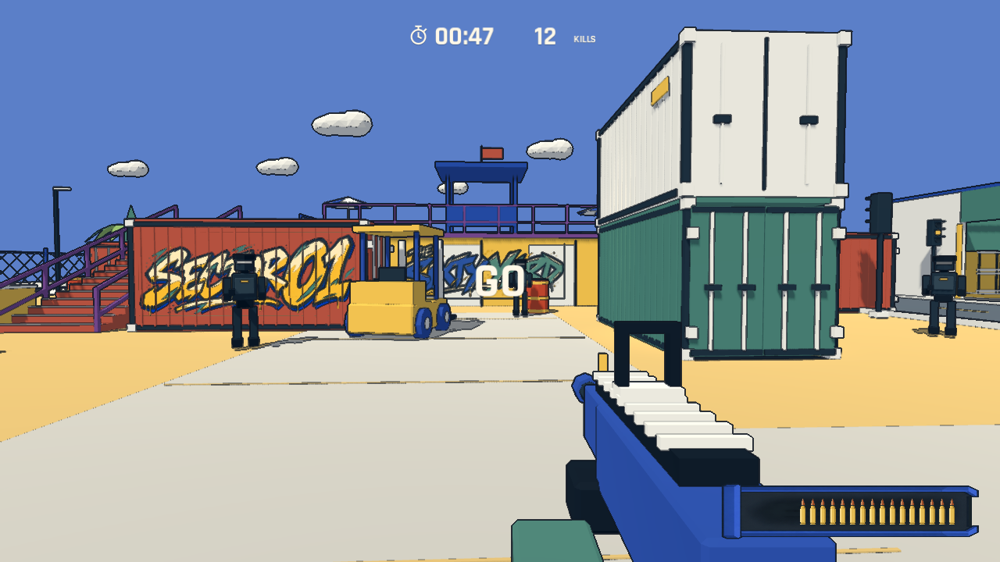

# No-Art-FPS

A bright, low-poly, sixty-second FPS score attack. Godot 4.7.2 + Blender 5.2.2 LTS.

Playable local prototype. A 64×48 m yard with automatic container doors, an enterable warehouse and an upper pool terrace; one automatic rifle, ranged black guards and fast knife enemies, a full 60-second round, and instant retries.



This is an actual engine render. Enemy placement and the HUD values in this showcase are staged for visual comparison; the full-round automated test captures are separate.

## Play

On this Mac, double-click **Play No-Art-FPS.command**, or run:

```sh
./tools/run.sh
```

Alternatively, import `project.godot` in Godot 4.7.2 and press F6/F5 as appropriate. The main scene is `scenes/main.tscn`. The launcher uses the locally installed Godot executable; this is not yet a separately exported, signed application.

### Browser build

Play online: **[fps.yicong.me](https://fps.yicong.me/)** — desktop keyboard/mouse or landscape touch controls. Current release: `20261106-v4`.

Install the matching Godot 4.7.2 Web export templates, then run:

```sh
./tools/export_web.sh
python3 -m http.server 8785 --bind 127.0.0.1 --directory builds/web
```

Open `http://127.0.0.1:8785/`. Desktop uses keyboard/mouse; touch devices use landscape controls. Portrait shows a rotate-device prompt. The left thumb moves, the right half aims, and the fire button supports dragging to aim while firing. Jump, reload and pause have separate controls. The single-thread Compatibility export needs WebAssembly and WebGL 2.0, but does not need COOP/COEP headers or a service worker. The HTML download indicator follows engine-reported byte counts; after downloading, it waits for the first complete game frame before revealing the title.

`builds/web/` is the complete public bundle and `manifest.json` records its file sizes and SHA-256 hashes. Source art, reference footage, design documents, screenshots and QA scripts are excluded from the pack. Upload the whole bundle without renaming its `index.*` files. For a CDN, the server may redirect `index.wasm` and `index.pck` to a versioned CORS-enabled origin while keeping JavaScript/audio worklets on the page origin. Serve WASM as `application/wasm`; precompressed files must have the matching `Content-Encoding` and `Vary: Accept-Encoding`. The font license accompanies the release.

On touch devices, FIRE requests fullscreen and landscape orientation when supported. Browser security requires a user gesture, and some mobile browsers do not support document fullscreen; an explicit fullscreen button is provided. Automatic fullscreen failures stay silent; a manual failure shows a brief menu-only message that disappears before loading or play. Safe-area insets and dynamic viewport sizing accommodate notches and browser chrome. Rotation to portrait, backgrounding, or leaving fullscreen pauses play and clears held inputs. Desktop-only pointer capture starts inside FIRE/retry/resume input gestures. Losing pointer lock during a round pauses it. Resource preparation and navigation rebakes use a single-thread path on the Web; native behavior is preserved. Browser validation is recorded separately from native QA in [the Web delivery notes](docs/updates/2026-11-06-web.md).

- Enter / FIRE: load the round, then immediately start 60 seconds of combat as GO fades out.
- WASD: move. Mouse: look. Left mouse: automatic fire. Space: jump.
- R: reload. Empty magazines reload automatically; reserve ammunition is unlimited.
- Escape: pause / resume. Losing focus also pauses.
- Enter on results or pause: retry. Escape on results: title.
- Pause menu: use Resume/Restart, the sensitivity and music-volume sliders, and the camera-motion toggle. `-` / `+` and M remain available as shortcuts.
- Results: the circular-arrow button retries, and the home button returns to the title; Enter and Escape still work. A skull precedes the round score, and a trophy precedes the best. A gold ring around the trophy marks a new record.

The title uses three left-aligned white lines without outlines and a purple FIRE button with white Rajdhani Bold text. Its background is a captured opening gameplay frame, including the initial enemies and weapon but no HUD. The title and loading page share this still image with the same 55%-opaque black shade.

FIRE replaces the title with a large magazine that fills as the round is prepared, keeping the background unchanged. Unknown remaining work advances only to seventeen rounds. After real completion, it fills the final three, dips and snaps back; the darkened still reveals the live world from the center outward, then the magazine shrinks into the lower-right HUD. Gameplay and the round timer start immediately on docking, with a central GO fading out over 0.8 seconds. Escape cancels loading; returning focus resumes a suspended transition.

Enemy targets rise from 8 to 10 to 12 across the three 20-second phases. Two patrols occupy the warehouse and two occupy the upper deck, with reserved reinforcement slots; other enemies roam the yard. Reinforcements appear outside direct view and at least eight metres away.

Black guards walk and patrol continuously. Enemies steer around one another, their bodies collide, and occupied reinforcement positions are deferred until clear.

Ground-level container doors open automatically when you approach the entrance. The green and purple containers hold black guards who join combat after the doors open; you can walk inside. No interaction key is required.

Both stairs lead to a larger pool terrace with loungers, parasols and a loop around the shallow pool. Walk down the pool entrance and back out without jumping. Six coconut palms add ground-level landmarks.

Large spray-painted lettering marks the red container, yard wall and warehouse. The artwork is blended into the actual opaque wall material, with mipmaps for stable viewing at a distance; generation prompts are in [assets/graffiti/README.md](assets/graffiti/README.md).

Red-and-yellow barrels ignite when shot, warn for 0.65 seconds and explode within five metres; solid cover blocks blast damage, and nearby barrels chain. Orange enemies carry knives and rapidly approach, then raise their weapon before a close-range chop. Sidestep, back away, shoot them during windup, or use solid cover to block the slash.

Head hits kill a normal target in one shot; body hits take three. Every kill is worth one. The rifle holds 20 rounds and reloads automatically with unlimited reserves. Health is hidden; a gradual dark-red screen-edge vignette warns of danger. After five seconds without a hit, health recovers gradually. Defeat causes a five-second respawn while the round clock keeps running. A central skull and shrinking ring show the wait; each completed respawn adds a skull at the top right. Deaths reset on a new round and are not saved. A strictly higher kill count highlights the results trophy. Only the highest kill count is retained as a score record. The local best and settings are stored in Godot's `user://record.cfg`; QA runs do not overwrite them.

The lower-right magazine shows twenty cartridges in one horizontal row. Each accepted shot splits and ejects the front cartridge at the right, then feeds the remaining rounds forward. Reloading pushes the missing cartridges in one by one; once full, the magazine dips and snaps back into place. Each cartridge clicks as it seats, both during the loading screen and gameplay reloads. The entire sequence still takes 0.9 seconds, with firing available only after completion. Ammo numbers, the progress bar and the RELOADING label have been removed. Low camera-motion mode also reduces shell travel/spin and the final seating dip.

On mobile, open **体感瞄准** from the title or pause menu to enable optional gyro-assisted aiming. Hold the phone still briefly to calibrate. Sensitivity ranges from **0.25x to 3.00x** and is remembered on this browser; motion input starts disabled each visit. Touch aiming remains available. Permissions, missing sensors, backgrounding, portrait rotation and respawn are handled without blocking touch play. Physical phone feel still needs device testing. See [gyro implementation and validation](docs/updates/2026-11-06-gyro-aim.md).

Mobile adaptation and verification limits: [landscape touch controls](docs/updates/2026-11-06-mobile-controls.md). For desktop inspection of the touch layout, append `?touch=1`. This does not emulate real mobile hardware.

## Build the original assets

```sh
blender --background --python tools/build_assets.py
blender --background --python tools/build_playbox_assets.py
blender --background --python tools/build_leisure_assets.py
python3 tools/build_audio.py
blender --background --python tools/build_music.py
godot --headless --path . --editor --import
```

`art_source/no_art_kit.blend` is an editable asset library with the models laid out separately. Its source script makes fourteen GLBs, including four container colors, a rifle with hands, the enemy, forklift, barrel, tree, cloud, pallet, crate, steel bundle and traffic light. Audio includes twelve original effects and an original 60-second MIDI composition rendered for runtime playback. The HUD uses bundled SIL-OFL Rajdhani Bold; its license is in assets/fonts/. The magazine uses a bundled imagegen sprite atlas; its generation prompt and source details are in [assets/ui/README.md](assets/ui/README.md).

The yard is assembled in `scripts/arena.gd`; static collisions also supply the runtime navigation bake. Repeated box scenery and fence lattice are batched by material. The reference recording and extracted reference frames stay local and are Git-ignored.

## Verify

```sh
node tests/mobile_input_test.mjs
node tests/gyro_test.mjs
godot --headless --path . --script tests/rules_test.gd
godot --path . -- --qa --check
godot --path . -- --qa
godot --path . -- --qa --benchmark
godot --path . -- --qa --feedback
godot --path . -- --qa --expansion
godot --headless --path . -- --qa --population
godot --path . -- --qa --combat
godot --path . -- --qa --movement
godot --path . -- --qa --magazine
godot --headless --path . -- --qa --reload-audio
godot --path . -- --qa --containers
godot --path . -- --qa --terrace
godot --path . -- --qa --routes
godot --path . -- --qa --graffiti
godot --path . -- --qa --respawn
godot --path . -- --qa --loading
godot --path . -- --qa --finale
godot --path . -- --qa --results-ui
```

The Node command checks simultaneous touch input and cancellation. The Godot rules command tests score and timer boundaries. `--check` exercises normal collision movement on both ramps, live head/body raycasts, wall blocking, pause, reload, respawn, and ten restarts. `--qa` runs a real-time full-minute automatic aiming session, with scripted viewpoint changes. `--population` checks patrol retention, regional reinforcements, population caps and safe spawn distances/visibility. The short benchmark runs twelve enemies with VSync disabled. These flags are development-only test helpers, not normal gameplay modes.

`--movement` checks that every opening outdoor black guard moves, twelve enemies can cross opposing lanes without overlapping or getting stuck, pause freezes avoidance movement, and occupied spawn slots are rechecked after their warning. `--containers` covers automatic doors, captive guards, entry and reset. `--terrace` checks poolside navigation, walking into/out of the pool, and palm collisions. `--routes` walks both complete stair-to-terrace routes in both directions without jumping, then crosses the purple/cream seams slowly.

`--magazine` counts rendered cartridges during firing and sequential loading, checks seating/return timing and exactly 54 ticks per reload, automatic/manual reload, pause, death cancellation and restart, then verifies the HUD in a 960×540 window.

`--reload-audio` checks actual audio voices against seated cartridges for full and partial reloads, pause/death/deadline/reset, and loading's 17+3 rounds, suspension and cancellation. Rendered `--loading` and `--magazine` checks also verify the sound count; `--magazine` saves a local audio-mixer recording to `artifacts/local/cartridge-reload.wav`.

The final fifteen seconds enable DESTROY rounds. At one second remaining, every remaining enemy, structure, barrel and prop erupts, with explosions around the screen edges. Remaining enemies count once before the deadline. Results freeze the world and show a captured still; retry/title restore the arena. `--finale` checks the exact trigger, all targets, pause, scoring, frozen pixels and restoration.

`--results-ui` exercises both icon buttons with actual viewport mouse events, checks new/best and three-digit score layouts at 1280×720 and 960×540, and verifies retry completes loading. The four original imagegen assets and exact prompts are in [assets/ui/results/README.md](assets/ui/results/README.md).

Latest update: [cartridge insertion audio](docs/updates/2026-11-06-cartridge-audio.md). Earlier: [title styling and stair landing fix](docs/updates/2026-11-06-title-and-stair-landings.md), [FIRE title and magazine loading transition](docs/updates/2026-11-06-fire-loading-transition.md). Next directions: [shooting feedback and combat pressure](docs/design/shooting-feel-next.md). Earlier: [sequential reload](docs/updates/2026-11-06-cartridge-reload.md), [five-second respawn](docs/updates/2026-11-06-seams-and-respawn.md), [wall graffiti](docs/updates/2026-11-06-wall-graffiti.md), [pool terrace](docs/updates/2026-11-06-poolside-playbox.md). MIDI: [sixty.mid](assets/music/sixty.mid).

Player-facing copy for review: [game text inventory](docs/review/game-text-review.md), with current strings, display conditions, source locations and menu screenshots.

Results and screenshots: [implementation and validation notes](docs/implementation.md). Design background: [initial playbox plan](docs/design/No-Art-FPS-playbox-plan.md).

Planned second map: [scene migration and Dust2 defuse mission](docs/design/2026-11-06-map-scenes-localization-plan.md). The proposed mission requires defusing three planted C4 objectives within two to three minutes while surviving patrols. This is a design plan; the current playable mode remains the sixty-second score attack.

## Local workflow

Each completed implementation stage is committed locally. Every new commit is immediately pushed to `git@github.com:YicongCao/No-Art-FPS.git`; push failures are reported while preserving local commits.

Keep the original Blender sources and reproducible asset scripts alongside the Godot project. Validate rendered output after material, lighting or geometry changes.
