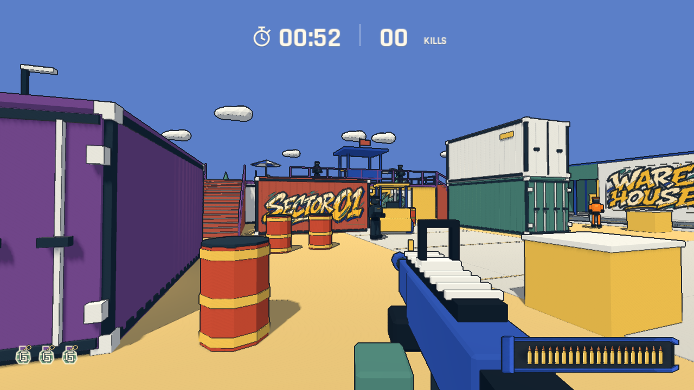
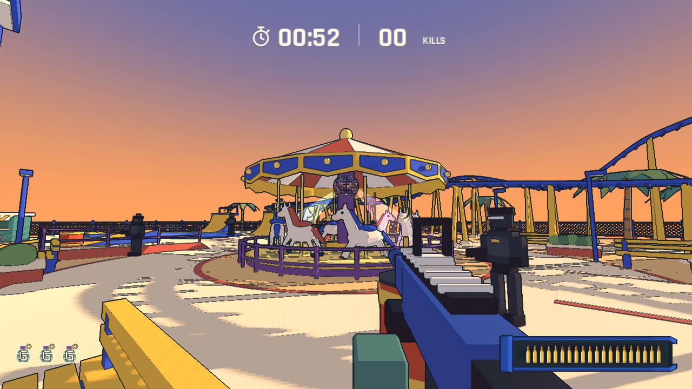
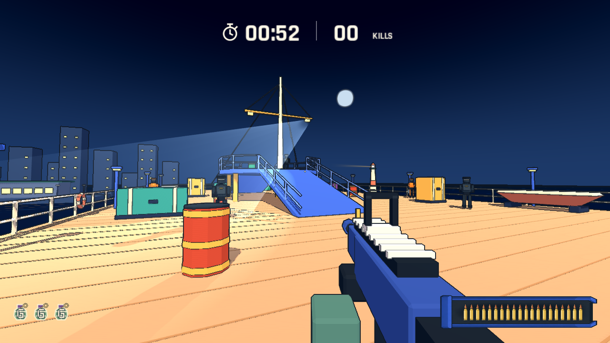
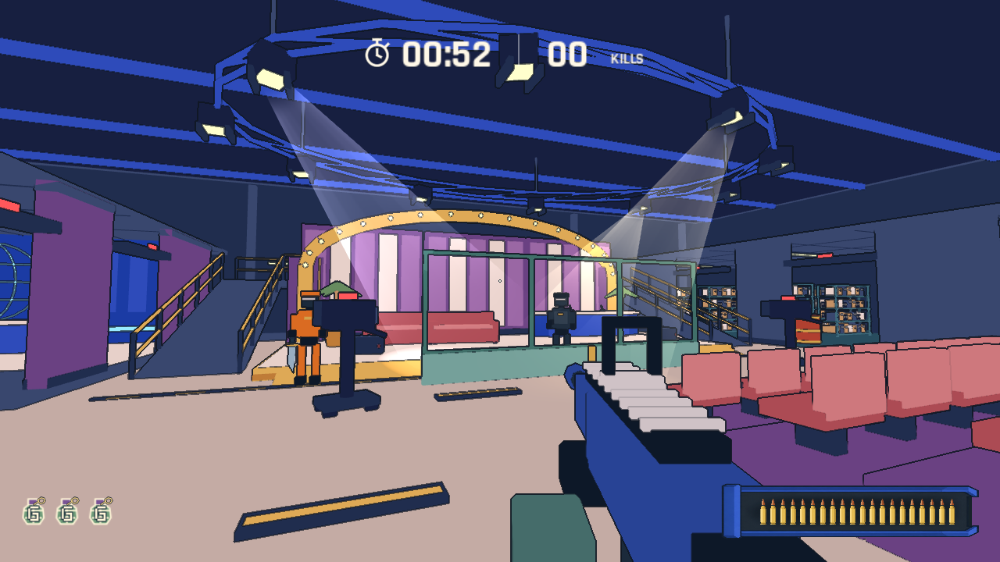
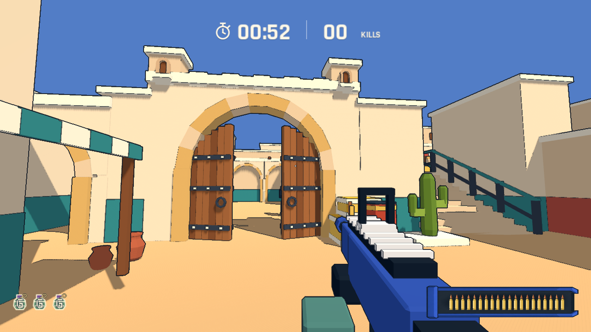
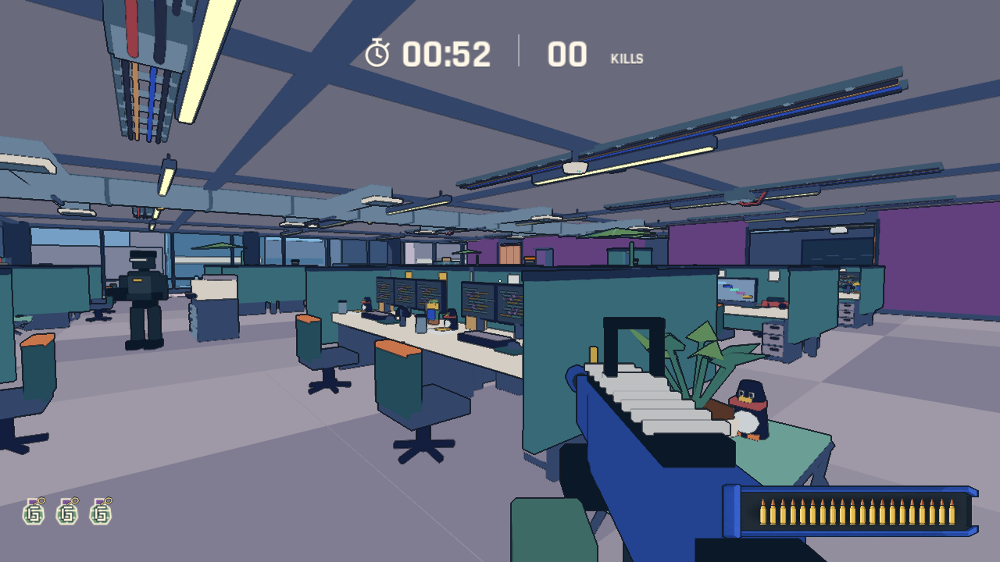
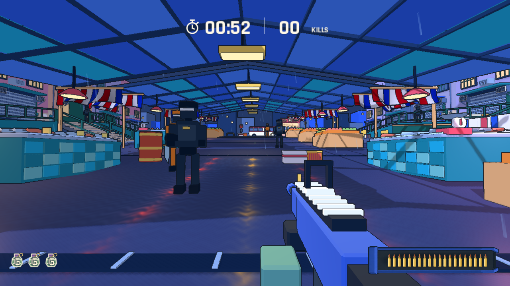
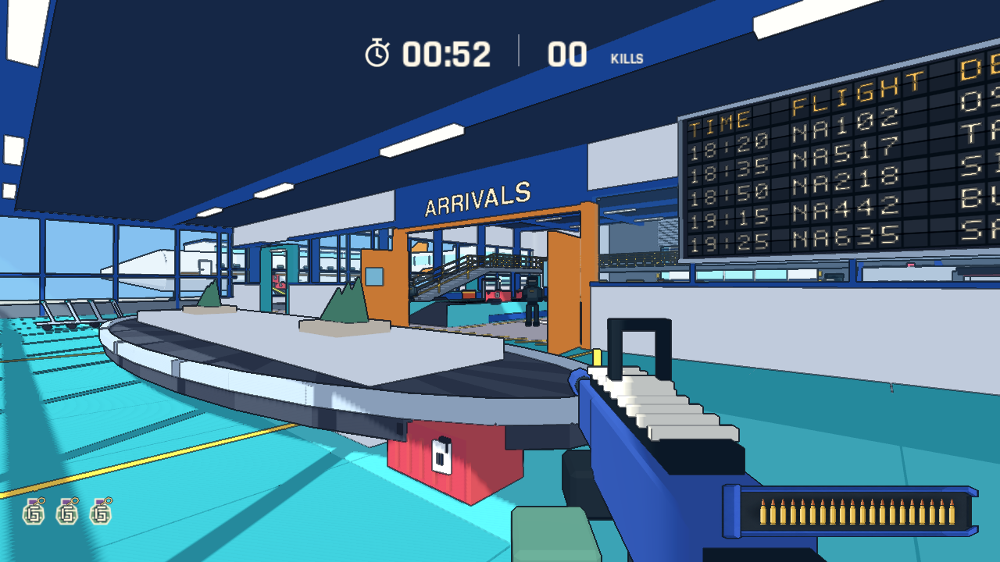
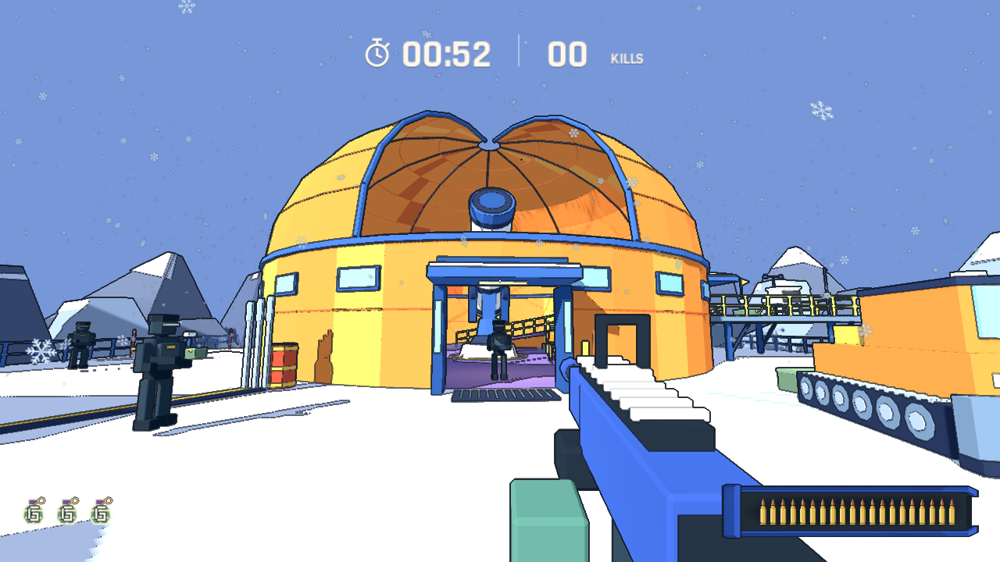

# No-Art-FPS

A colorful low-poly FPS built with Godot and Blender. Score as many kills as you can in 60 seconds, then try to beat your best.

**[Play in your browser](https://yicongcao.github.io/No-Art-FPS/)** · [Desktop downloads](https://github.com/YicongCao/No-Art-FPS/releases/latest) · [Development guide](docs/development.md)

<table width="100%">
  <tr>
    <td colspan="3"></td>
  </tr>
  <tr>
    <td width="33%"></td>
    <td width="33%"></td>
    <td width="33%"></td>
  </tr>
  <tr>
    <td width="33%"></td>
    <td width="33%"></td>
    <td width="33%"></td>
  </tr>
  <tr>
    <td width="33%"></td>
    <td width="33%"></td>
    <td width="33%"></td>
  </tr>
</table>

[Watch the 45-second gameplay trailer](artifacts/gameplay-trailer.mp4) · [Watch the full automated QA run (uncut MP4)](artifacts/qa-run.mp4)

## Play locally

Open `project.godot` in Godot 4.7.2 and press **F5**, or run `./tools/run.sh` with Godot on your PATH.

**Controls** · WASD to move, hold Shift to sprint, mouse to aim, left click to fire, Space to jump, R to reload, G to throw a grenade, Esc to pause. The browser version also supports landscape touch controls.
