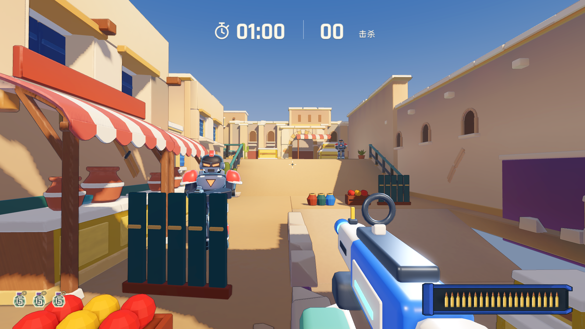

# No-Art-FPS v0.4.0 · 喷漆塑料首版

本次是喷漆塑料画面风格的首个桌面正式 Release，整合此前在 Web 版迭代的场景、敌人与战斗反馈。

- **喷漆塑料画面**：明亮的低多边形场景、塑料与金属高光、更轻的描边，以及按地图定制的光照、材质和氛围。
- **九张竞技地图**：默认地图改为沙城；各地图增加主题可破坏物，延续 60 秒计分与最后 15 秒狂暴玩法。
- **机甲敌人与命中反馈**：更新步枪兵和近战兵外观，加入装甲破损与爆头击杀效果。近战兵会在约 1.7 米处停步，过近时退让，减少遮挡视野。
- **Web 版优化同步**：限制移动端 3D 像素负载、减少敌人重复绘制；按浏览器实际刷新率选择 60 / 120 FPS 目标，实际帧率仍取决于设备与浏览器。

## 下载

- **Windows x64**：下载并完整解压 `No-Art-FPS-v0.4.0-Windows-x64.zip`，将 `No-Art-FPS.exe` 与 `No-Art-FPS.pck` 保持在同一目录后启动。
- **macOS Universal**：下载并解压 `No-Art-FPS-v0.4.0-macOS-universal.zip`，打开 `No-Art-FPS.app`。包含 Apple silicon 和 Intel 架构，采用 ad-hoc 签名，未进行 Apple 公证。
- `Sandgate-gameplay.png` 为本版本 1920×1080 实际游戏渲染截图。
- `SHA256SUMS.txt` 提供两个客户端压缩包和截图的 SHA-256 校验值。

操作：WASD 移动，鼠标瞄准，左键射击，Shift 冲刺，空格跳跃，R 换弹，G 投掷手雷，Esc 暂停。

macOS 客户端已实际验证启动、选图、开局、射击和暂停；Windows 包已完成导出、架构与压缩包完整性检查，未在本机运行 Windows 实测。

[浏览器试玩](https://fps.yicong.me/) · [GitHub Pages](https://yicongcao.github.io/No-Art-FPS/)
