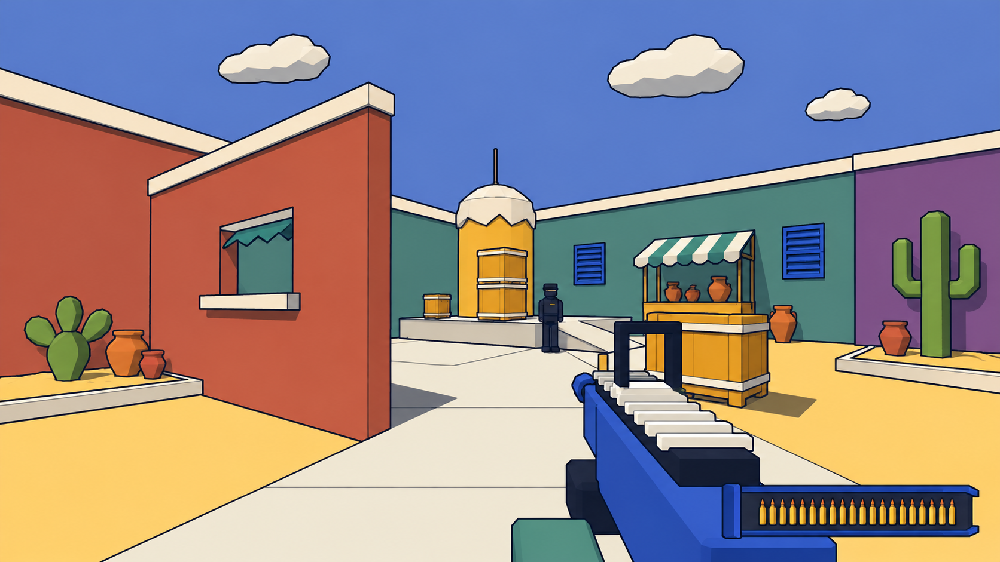
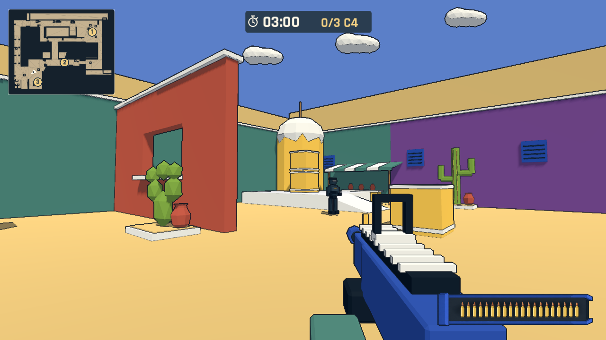

# Dust 明亮色块概念

2026-11-06，按用户要求使用内置 imagegen 生成。第一张输入为本项目首图 `artifacts/showcase-ground.png`，仅作画风基准；第二张为 `artifacts/dust-revised-b.png`，作现有关卡构图与建筑参考。原始生成 PNG 保存在同目录 `dust-color-concept.png`，用于美术方向，不作为游戏中的贴图或模型。仙人掌用 Blender 原创建模，游戏继续使用共享色板和漫画描边。

## 最终提示词

Use case: stylized-concept. Asset type: game environment art direction concept for the existing No-Art-FPS Dust-flavor map, landscape 16:9 gameplay-like view. Image 1 is the authoritative art-style reference: bright saturated flat color planes, thin dark comic outlines, very simple angular low-poly silhouettes, warm yellow ground, cream paths, deep cobalt blue rifle and readable charcoal block enemies, crisp slightly pixel-stepped rendered edges. Image 2 is composition/architecture reference ONLY: preserve the recognizable courtyard, left wall with a rectangular window, back tower and crate stacks, first-person blue rifle lower right. Restyle this courtyard to closely match Image 1. Flat clean solid-painted surfaces instead of mottled sandstone textures: left window wall brick-red #B65745 with cream cap and sill; back wall muted teal #4D7D70 with blue shutters; right facade purple #754C87 in restrained area; warm golden sand floor with cream paved strip; blue sky #5B7FC8 with 3 chunky cream polygonal clouds. Back tower mustard yellow body with cream faceted dome. Put one simple green low-poly saguaro cactus with upright arms and another squat paddle cactus on the far left/right edge of the courtyard, rooted in sandy raised beds; absolutely no palms, coconut trees or tropical leaves. Crates are chunky ochre wood with cream straps, a small cream-and-teal striped awning on a back-wall market stall, a few terracotta pots. Flat shaded readable forms, low texture detail, consistent fine navy outlines, soft bright shadows with visible detail, neither photorealistic nor heavily painterly. Keep central walking and aiming lane clear. Exactly one stationary dark guard near back crate as a scale cue. No added buildings blocking the window/lanes. No floating words, no HUD, no text, no watermark. This is a feasible model/material concept, not a finished game screenshot.

## 还原目标

- 移除 Dust 的椰子树；新增粗分面的柱状与扁掌仙人掌、沙土花床和陶罐。
- 用首图共享的砖红、青绿、紫色、暖黄和奶油白材质替代统一的褐色砂岩表面。
- 墙帽、窗台、箱体绑带与遮阳棚形成清楚轮廓；低面数奶油云补充天空。
- 保留既有玩家、蓝色武器、描边、巡逻和拆弹 HUD。实际几何按可编辑关卡重建，不宣称逐像素复刻概念图。

## 引擎还原

已按此方向完成 Blender 几何、GLB、Godot 场景和材质。B 点补齐了红色窗口墙的奶油色墙帽、青绿与紫色背景墙、蓝色百叶窗、斜面条纹棚、陶罐和两种仙人掌；保留首张地图的天空颜色、蓝色武器与细描边。Dust 使用适合此庭院朝向的日照方向，切换到首图会恢复首图日照。

以下为实际 Godot 渲染，镜头与敌人由自动检查摆放；不是 imagegen 输出，也不是人工试玩。通路与建筑尺度依照现有关卡保留，因此不宣称逐像素复刻概念图。实现与验证见 [明亮画风更新](../updates/2026-11-06-dust-bright-style.md)。

