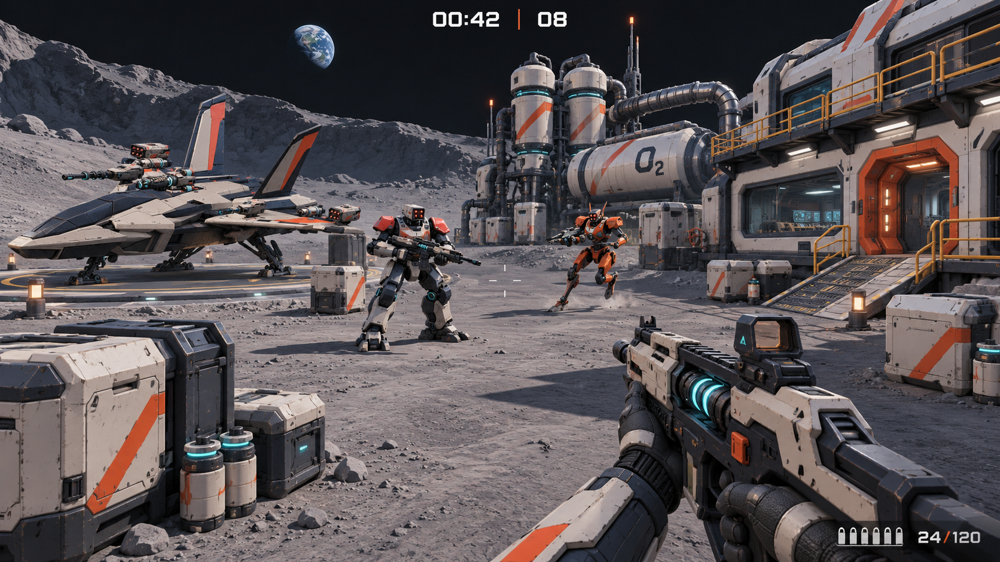
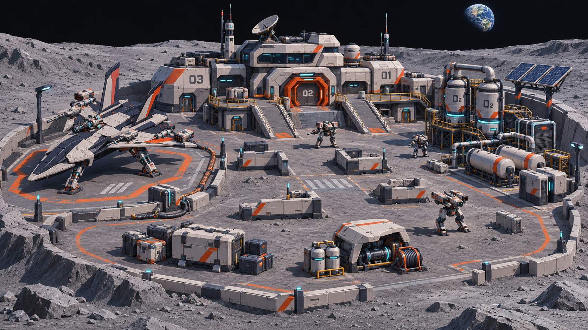
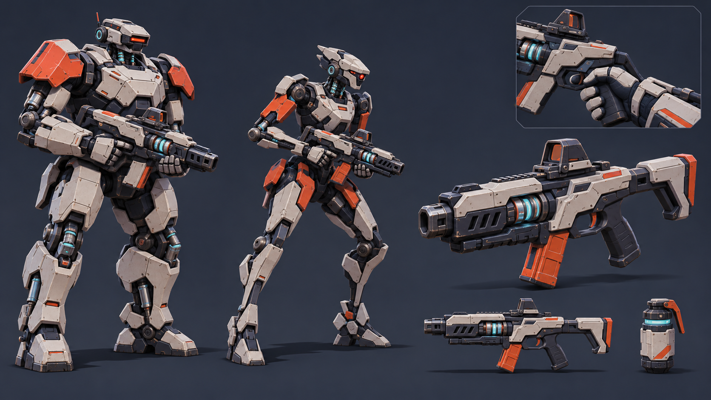

# 月球基地一分钟射击：视觉概念

2026-11-13。基于用户提供的飞船风格参考，由 imagegen 生成三张概念图。参考原图保持本地，不纳入仓库。本组图片用于讨论视觉方向，不是游戏截图、可运行小样或可直接导入的三维资产；游戏尚未修改。

沿用现有一分钟射击玩法，设想把场景、玩家装备和两类敌人统一为月球工业机甲风。主色为米白装甲、深蓝灰机械骨架、橙红标识，少量青色用于能源与设备状态；保留明亮、清晰的敌人轮廓与简洁 HUD。图片中的具体数字、文字与细节不作为玩法改动规范。

## 第一人称战斗画面

玩家持线圈卡宾枪，面对重型步枪机甲与轻型突击机甲。飞船停机坪在左侧，基地气闸在右侧，氧气设备与工业管线构成中后景。

## 地图全景

紧凑的停机坪、基地和氧气工业区，以环形通路、中央交战区、低掩体和短坡道连接。设备维护盖、货箱、罐体等可延续可破坏物设计。此图不是已验证的关卡布局。

## 敌人与枪械

宽肩厚装甲的步枪兵与细长、前倾的突击兵用轮廓区分，头部传感器保持可辨识。玩家卡宾枪、手套和投掷物共享同一套装甲、机械连接与配色语言。

