# No-Art-FPS · 三张地图概念验收

每张地图四幅独立横图。鸟瞰图用于统一主要空间关系，三个地面机位用于看材质、道具与狂暴阶段。每组在初稿基础上扩充为约十六类场景辨识元素。点击图片可打开原图。

## 香港雨市

主坡道由鱼档接到菜摊和茶餐厅窗口，左侧唐楼石阶与右侧送货缓坡在两端相接。场景辨识元素包括红灯罩、竹架、蓝绿帆布、红白蓝编织袋、窗式冷气机、马赛克墙裙、绿色护栏、红磅秤、铁鱼盘、碎冰、发泡胶箱、胶凳、排水沟、卷闸、折叠手推车和坡顶红白小巴。狂暴时打穿轻质挡板，打开侧巷转场。

### 鸟瞰 · 坡道与两侧回路

[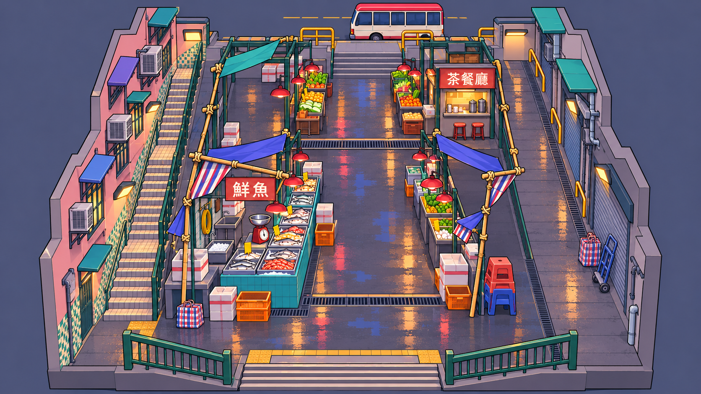](hong-kong-rain-market/overview.png)

### 坡底入口 · 仰看雨棚市集

[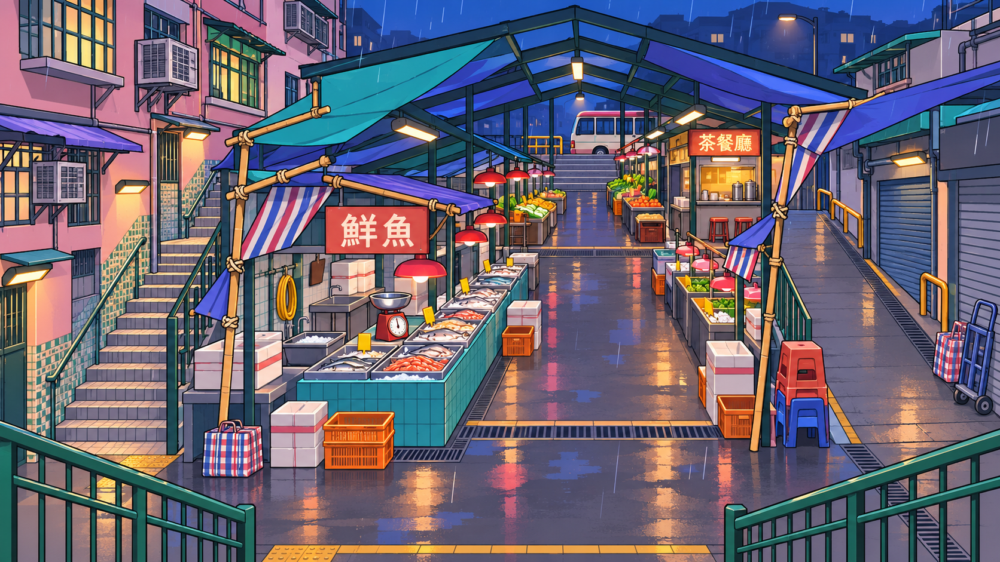](hong-kong-rain-market/slope-entry.png)

### 鱼档横巷 · 贴近摊位

[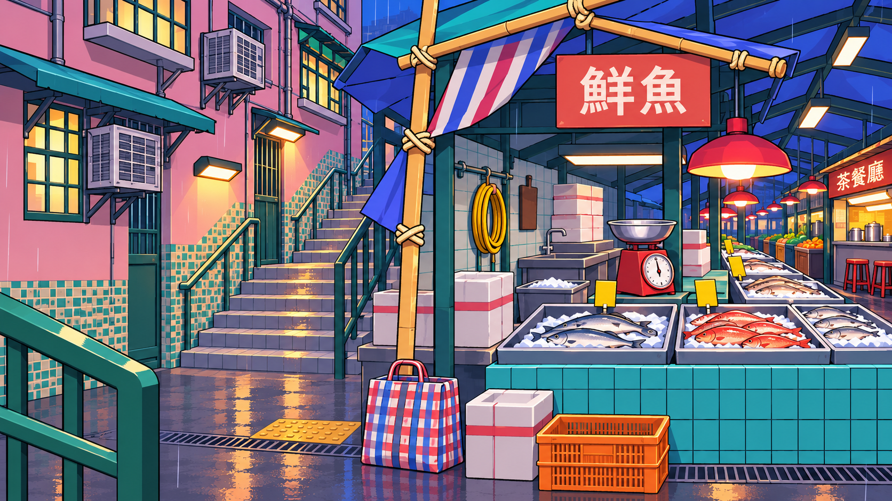](hong-kong-rain-market/fish-crossing.png)

### 送货坡道 · 狂暴破口

[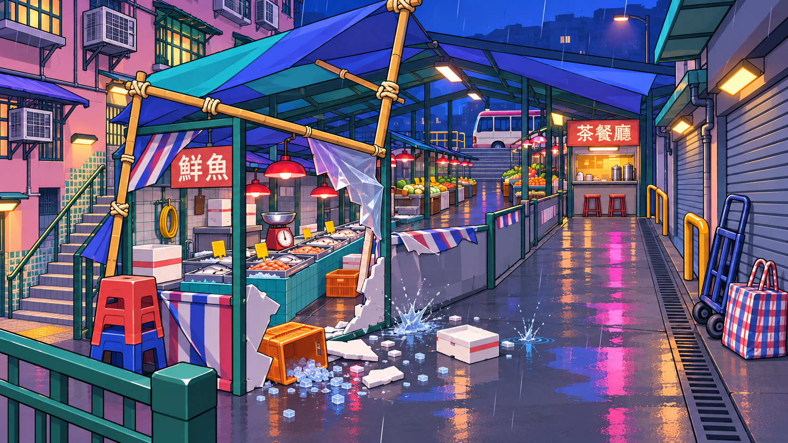](hong-kong-rain-market/service-frenzy.png)

## 行李转盘之后

到达厅经橙色员工门通向分拣层。两条反向传送带夹着地面通道，另有检修天桥和装卸口。场景辨识元素包括不锈钢转盘、翻页到达牌、行李手推车、行李牌、扫描机软帘、红外门、分流滑槽、黄色检修围栏、滚筒板车、电动牵引车、挡轮楔、分拣筐、反光锥、卷门、窗外跑道灯和跑道灯塔。狂暴时灯带追光，打散的箱内物品会落到皮带上。

### 鸟瞰 · 从到达厅到后场卸货口

[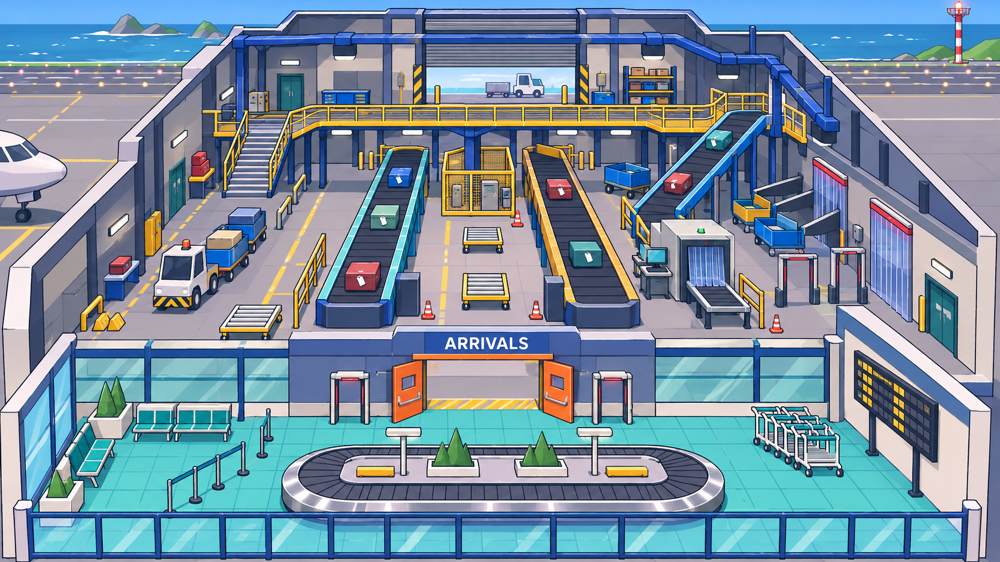](baggage-below/overview.png)

### 到达厅 · 从转盘看员工门

[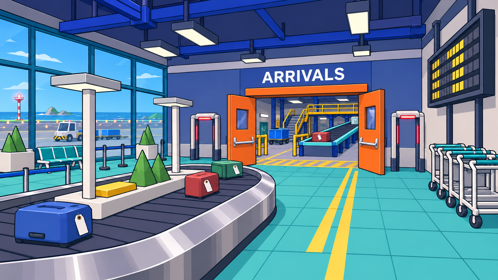](baggage-below/arrivals.png)

### 检修天桥 · 俯看两条传送带

[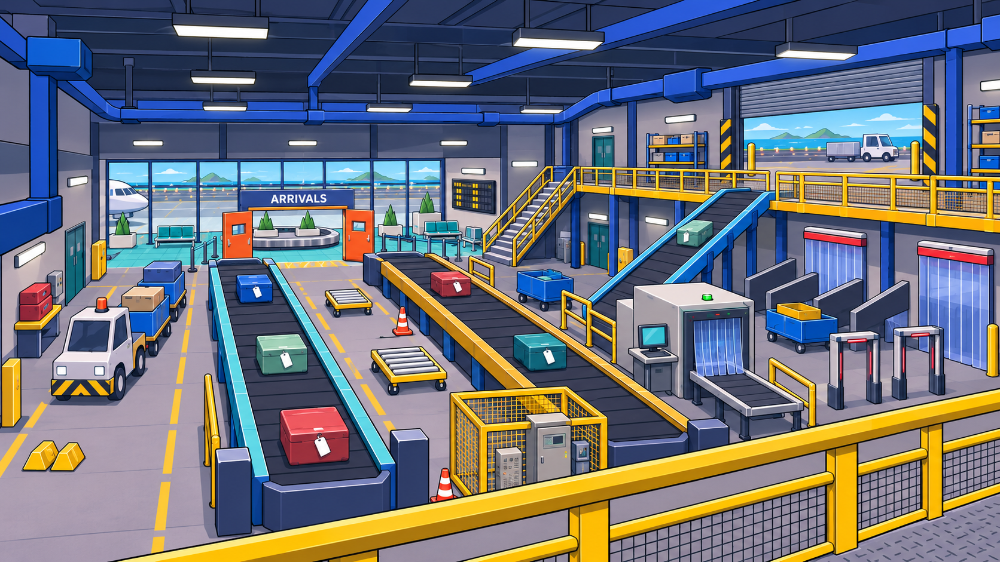](baggage-below/catwalk.png)

### 分拣层 · 狂暴灯带与炸开的行李

[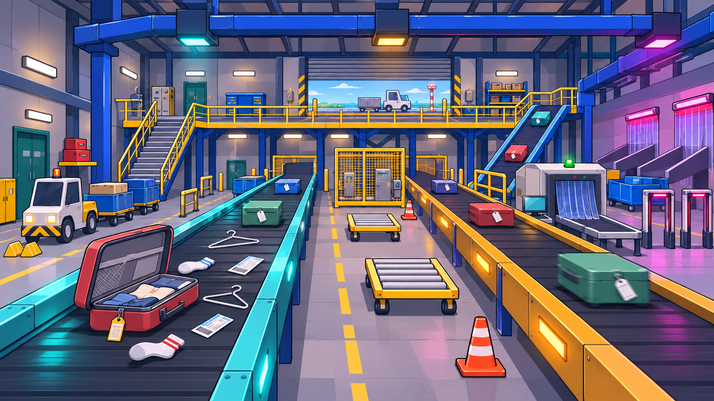](baggage-below/sorting-frenzy.png)

## 雪线天文台

围着橙色穹顶的外圈雪路连接观景台与东侧气象平台，穹顶内绕望远镜走半层检修坡道。场景辨识元素包括风积雪、雪杆、防吹雪木栅、测绘标杆、雪崩信标箱、雪铲、履带雪车、挂冰管线、百叶气象箱、杯式风速计、风向标、校准三脚架、发电机电缆、镜头器材箱、星图和防寒门斗。狂暴时穹顶缝隙扫出一条窄红光，照过室外积雪。

### 鸟瞰 · 雪路、穹顶与环廊

[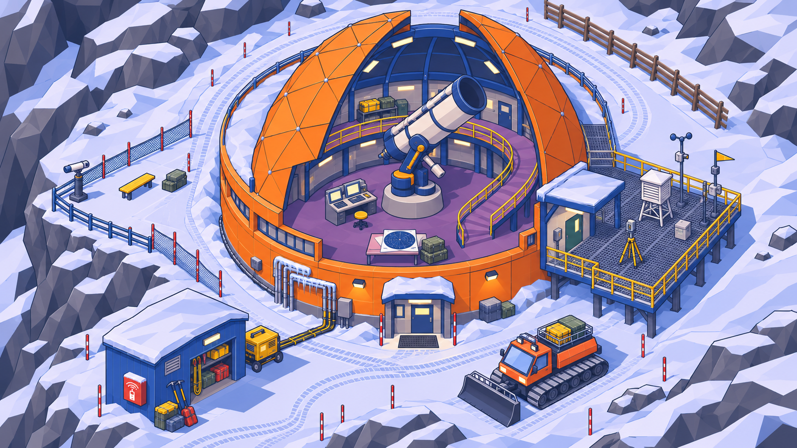](snowline-observatory/overview.png)

### 雪车前场 · 仰看观测穹顶

[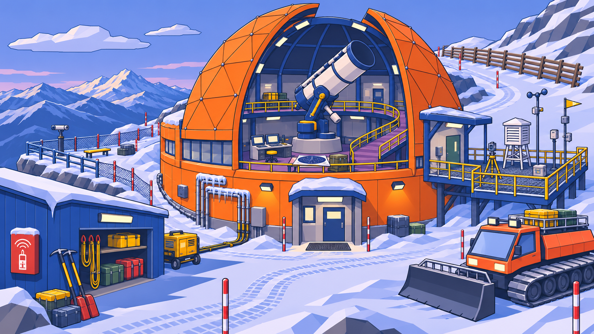](snowline-observatory/snowcat-court.png)

### 望远镜环廊 · 从坡道看室内

[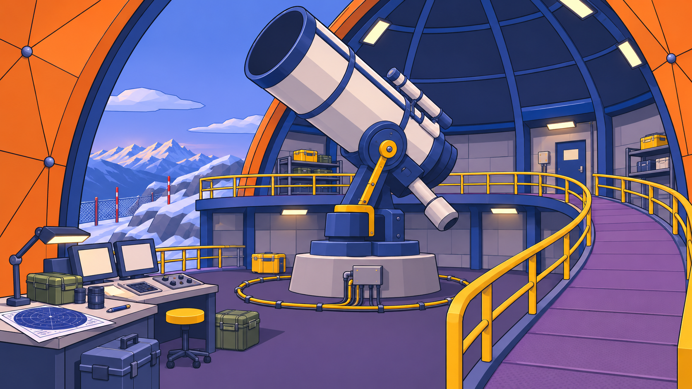](snowline-observatory/telescope-ring.png)

### 气象平台 · 狂暴红光扫过雪地

[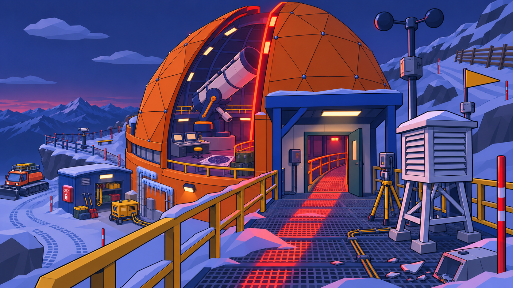](snowline-observatory/weather-deck-frenzy.png)

## 布局对齐

机场天桥图里的装卸口出现在侧面，建模时以鸟瞰的后墙装卸口为准。天文台的雪车在不同机位中的停放位置略有变化，以鸟瞰的入口右侧为准。雨市狂暴稿里的破口会并入右侧送货坡道，常态横向通道的宽度和位置留到白盒阶段验证。

生成提示词

## 生成提示词

使用内置 imagegen。共用画风参考为[货场露台](../../../artifacts/readme/yard-terrace.png)与[演播室狂暴](../../../artifacts/readme/studio-frenzy.png)的实机截图。机场地面图、雪线天文台与香港雨市的后续机位还参考同地图的首稿。

### 共用要求

> Use case: stylized-concept. Produce ONE standalone landscape 16:9 game environment concept for No-Art-FPS. Images 1 and 2 are actual game style references only. Match their Godot low-poly geometry, crisp thin dark outlines, broad flat color planes, simple textures and bold playable cover. Use a deliberately buildable scale and graphic clarity, even with more region-specific props. No characters, weapons, HUD, legend, diagram arrows, captions, watermark, or additional panels. No photorealism or painting.

### 香港雨市

> Fictional Hong Kong hillside wet market at blue-hour rain. Coordinate layout from the bottom of the slope: uphill central covered market spine with two parallel rows of stalls and two cross passages. Left return is a narrow tiled stepped lane along older pastel tong lau; right return is a shallow service ramp beside corrugated shutters and drainage gutters. Upper landing with red-white minibus partly visible outside playable area, lower landing framed by a green cast-metal stair railing. Mid-spine wet seafood row uses cyan tiled counters and orange crates; uphill end uses produce and cha chaan teng takeout hatches. Palette of turquoise and indigo tarps, coral signage, warm tungsten pools and desaturated concrete; broad asphalt reflections with only sparse stylized rain strokes. Local props distributed around routes: striped nylon canvas, tied bamboo awning frames, hanging red wet-market lamps, yellow-price-card shapes, stainless fish trays, broken ice, foam fish boxes, red weighing scales, drain grates, folded handcarts, red-white-blue woven bags, stacked plastic stools, mahjong-tile-like tilework, caged window AC, projecting shop signs, and warm tea counter. If any sign text, at most a few crisp Traditional Chinese characters such as 鮮魚 or 茶餐廳. Keep walking lanes clear.

**鸟瞰 · 坡道与两侧回路**

> Camera and focal content: Use image 3 as the architecture and palette reference; look at it from overhead instead. CRITICAL CAMERA: nearly top down, 75–80 degrees downward from horizontal, like an overhead drone on a small scale model. No sky, no skyline, no horizon, no street-level perspective, no low oblique elevation. All four edges of the playable block are visible with margin, south at the bottom. Open/cut away most of the central tarps to expose the ground between two rows of stalls; keep a few short blue and green strips on bamboo frames. Cut tenement walls down so no walkway is hidden. Clearly show the lower and upper landings, left tiled stair return, right smooth ramp return and two transversal walkable connections across the stall rows. Use strong readable level-design composition. Same red-white minibus at the high landing outside the arena and fish stalls at the lower half.

**坡底入口 · 仰看雨棚市集**

> Camera and focal content: Elevated god's-eye 3/4 architectural view from the lower landing looking uphill. Show the complete playable block with both return routes, two cross passages, fish and produce zones, and both end landings clearly connected. Use partial canopy cutaway on the market, leaving enough recognizable tarp strips while revealing the stall counters. Compact whole block, playable miniature rather than a limitless city. Surrounding tenements at reduced cutaway heights preserve the neighborhood identity without obscuring routes.

**鱼档横巷 · 贴近摊位**

> Image 3 is the same map's layout, palette and architecture reference, not the required camera. Render a NEW first-person eye-height view, never repeat the reference view. Retain the primary route adjacencies and material colors in the reference. Camera and focal content: Eye-level transverse view from the central fish row's crossing toward the left stepped return lane. Cyan mosaic fish counter in foreground with metal trays, angular ice and recognizable whole fish silhouettes, hanging red lamp, foam boxes, orange crates and red scale. Frame enough of the green railing, wet stair and opposite storefront to establish it is a real junction.

**送货坡道 · 狂暴破口**

> Image 3 is the same map's layout, palette and architecture reference, not the required camera. Render a NEW first-person eye-height view, never repeat the reference view. Retain the primary route adjacencies and material colors in the reference. Camera and focal content: Eye-level from the right service ramp looking diagonally back toward market through a newly opened shortcut during frenzy. One lightweight stall screen shattered locally into angular foam, plastic, ice and two splashes. Keep side drain, shuttered shop, bamboo canopy frame, street cart and downhill market behind identifiable. Neon signs throw restrained magenta and cyan pools on rain-wet pavement; a few warm bulbs preserve color contrast. Keep passage readable and effect local.

### 行李转盘之后

> Fictional coastal airport arrivals and two-level baggage handling hall. From south to north: public arrivals claim area at the front with a single rounded carousel, turquoise tile and broad glazed apron windows; an already-open orange service doorway leads into the central sorting floor. Inside are two waist-high parallel opposing belts with dark rubber slats and cyan/amber side rails, one uphill feeder ramp at right, a single U-shaped yellow-railed maintenance catwalk, stairs and service ramps at opposing ends. Left floor aisle offers grounded cover around tow tractor and baggage dollies; right floor aisle has strip curtains and sorting chutes. Northern rear has a large roller dock with apron vehicle silhouette outside. Airport identity props distributed in their practical zones: stainless baggage carousel lip, arrivals split-flap board, empty luggage trolleys, suitcase ID tags, bag scanners with translucent curtains, overhead conveyor girders, infrared gates, yellow mesh maintenance cage, blue baggage carts, little electric tug, folding wheel chocks, rollers, sorting totes, loose orange traffic cones, service doors and runway lights beyond glass. Avoid logos and long text; if needed exactly ARRIVALS as small built-in architectural signage.

**鸟瞰 · 从到达厅到后场卸货口**

> Camera and focal content: God's-eye three-quarter architectural cutaway from south. Reveal the entire block with rounded public carousel in front, the orange doorway, two parallel central belts and right-hand inclined feeder, left tug route, guarded U-shaped catwalk, two clearly walkable end connections and rear roller dock. Remove roof and a few front walls like a scale model so all routes and height differences read. Keep public and sorting area visibly contiguous.

**到达厅 · 从转盘看员工门**

> Image 3 is the same map's layout, palette and architecture reference, not the required camera. Render a NEW first-person eye-height view, never repeat the reference view. Retain the primary route adjacencies and material colors in the reference. Camera and focal content: Ground-level from public arrivals beside the stainless rounded carousel toward the open orange service doorway. A few blocky luggage silhouettes, trolley stack, floor direction bands, hanging arrivals board and cyan window frames. Glazed apron windows show a subtle distant ground vehicle and runway lights, while through the orange door one can glimpse the first black belt and yellow maintenance guardrail.

**检修天桥 · 俯看两条传送带**

> Image 3 is the same map's layout, palette and architecture reference, not the required camera. Render a NEW first-person eye-height view, never repeat the reference view. Retain the primary route adjacencies and material colors in the reference. Camera and focal content: Eye-height from upper maintenance catwalk looking lengthwise over the paired conveyors. Yellow rail near camera anchors height. Show split chutes, scanner curtains, slatted moving belts on the lower level, right feeder incline, ground tug and tow dollies on left, and walkable stair returning to ground on far side. Top industrial strip lights, modest airport safety colors, no busy atmospheric haze.

**分拣层 · 狂暴灯带与炸开的行李**

> Image 3 is the same map's layout, palette and architecture reference, not the required camera. Render a NEW first-person eye-height view, never repeat the reference view. Retain the primary route adjacencies and material colors in the reference. Camera and focal content: Ground-level between the two belts looking north to the dock during frenzy. View one local open suitcase sending a few socks, wire hangers, boarding passes and tags onto a belt. Sequential cyan, amber and magenta sorting lights illuminate equipment without making the hall uniformly dark. Retain moving rubber slats, chute mouths, distinct two opposing belts, airside roller dock and safe side paths. Small debris near the single suitcase only.

### 雪线天文台

> Fictional alpine mountain observatory at cold late-afternoon blue light. Central ORANGE geodesic observatory drum with a partly open segmented orange dome and clear slot, giant white and navy equatorial optical telescope inside, walkable inner ring and half-story service ramp. South arrival forecourt has small blue maintenance shed and parked tracked snowcat. West exterior has cliff-side overlook with snow fencing, a thin ridgeline view and safe guardrail. East exterior route follows a grated weather-instrument deck with sheltered service door linking to dome. North wraps the dome in a second snowy route. Specific regional and astronomical props distributed by zone: wind-formed snowdrifts, snow poles, anti-drift timber fence, red survey stakes, avalanche beacon cabinet, stacked alpine gear, snowcat treads, ice-covered conduit, louvered weather shelter, cup anemometer, wind vane, small calibration tripod, generator cables, circular cable guide, eyepiece service console, star-chart paper, lens cases and tiny insulated observatory entry. Frosty white, cool cobalt shadows, gray rock and saturated orange shell; alpine shapes without photoreal snow, or a resort vibe.

**鸟瞰 · 雪路、穹顶与环廊**

> Camera and focal content: Image 3 shows exact location, colored dome and prop design; create a new view of that miniature. Near vertical GOD'S EYE, camera tilted downward 72–78 degrees from horizontal, NO sky and no horizon, visible ground behind the dome. Pull back so the entire mountain station has margin on all sides. Roof cutaway removes the southern quarter of dome to reveal telescope mount, ring and upper service ramp. At bottom left blue shed, bottom right orange tracked snowcat. Guarded overlook at left, rectangular grated instrument deck right with an actual walkable connection to north return. Show the entire snowy path behind the orange dome wrapping west to east, with safe fences. Graphical faceted mountain rocks frame the edges only.

**雪车前场 · 仰看观测穹顶**

> Image 3 is the same map's layout, palette and architecture reference, not the required camera. Render a NEW first-person eye-height view, never repeat the reference view. Retain the primary route adjacencies and material colors in the reference. Camera and focal content: Ground-level from snowcat forecourt looking up to the orange dome and its open slot, snowcat at the right and blue maintenance shed at the left, blue shed and survey poles near foreground. Wind-sculpted angular drifts, snow fencing and shovel racks suggest high-altitude operation. Show both a clear approach to dome and a visibly distinct exterior route. Distant mountain ridges separated into bold graphic planes.

**望远镜环廊 · 从坡道看室内**

> Image 3 is the same map's layout, palette and architecture reference, not the required camera. Render a NEW first-person eye-height view, never repeat the reference view. Retain the primary route adjacencies and material colors in the reference. Camera and focal content: Eye-level from inside at the start of the curved service ramp, viewing under a giant navy and white optical telescope pointed up through the dome slot. Show dark floor ring, handrails, half-level upper walkway, eyepiece service console, cases, star-chart sheets and shelter door. Cool daylight through the slot and simple warm task light. Clear traversal shape with generous headroom.

**气象平台 · 狂暴红光扫过雪地**

> Image 3 is the same map's layout, palette and architecture reference, not the required camera. Render a NEW first-person eye-height view, never repeat the reference view. Retain the primary route adjacencies and material colors in the reference. Camera and focal content: Eye-level from east grated instrument deck in frenzy at very late dusk. Look back at the same rotating orange dome, a tight vivid red observing-light slit crossing the cold blue-white snow, visibly readable red spill on low snowdrifts. Foreground cup anemometer, louvered weather shelter, cable runs and red survey stake, a few fractured instrument casing shards lit by the red strip. Show a useful sheltered shortcut to the ring and guardrails. Strong silhouette and restrained lighting.

