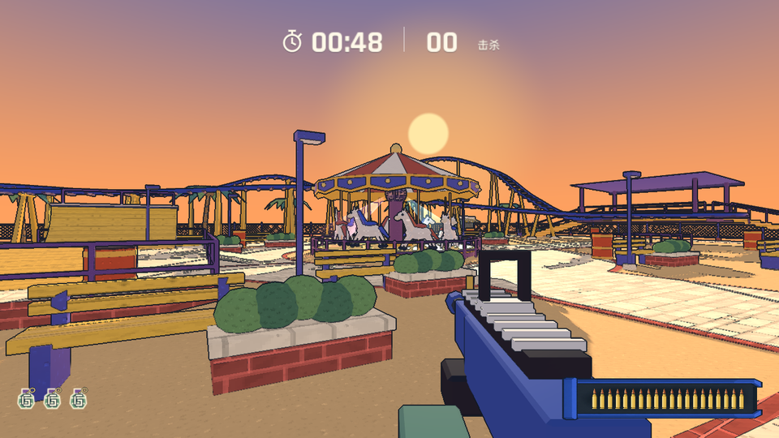
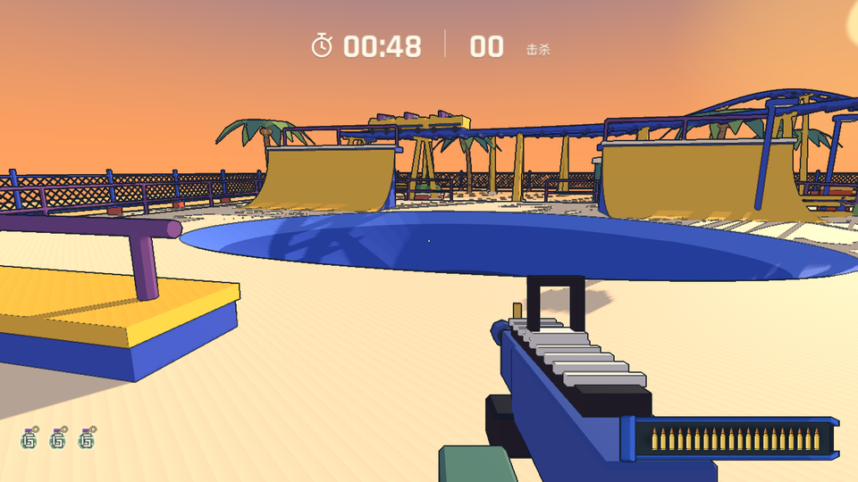
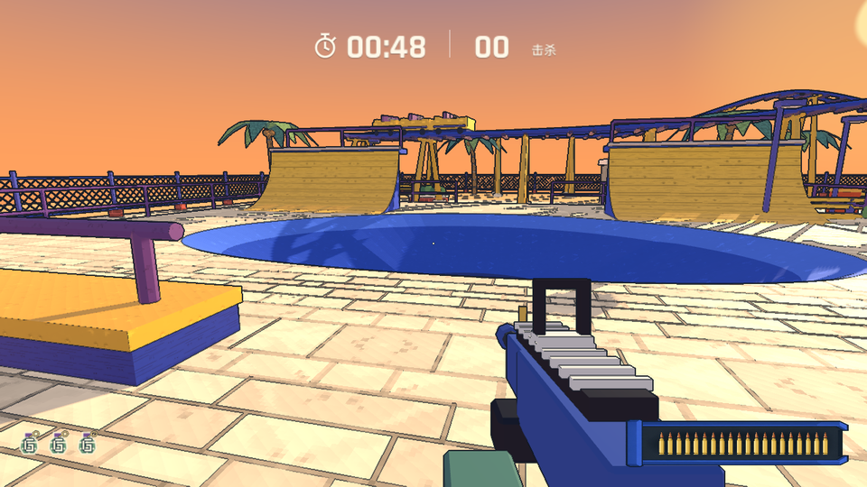
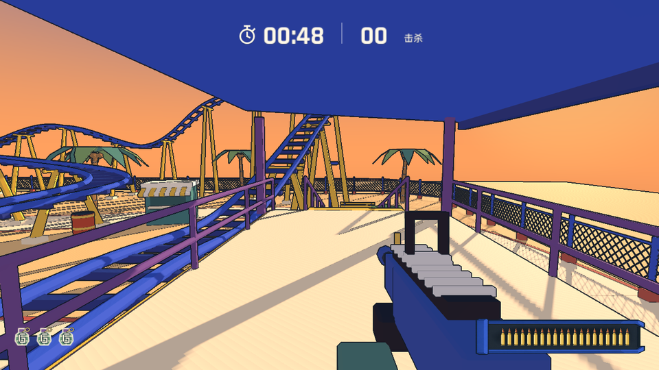
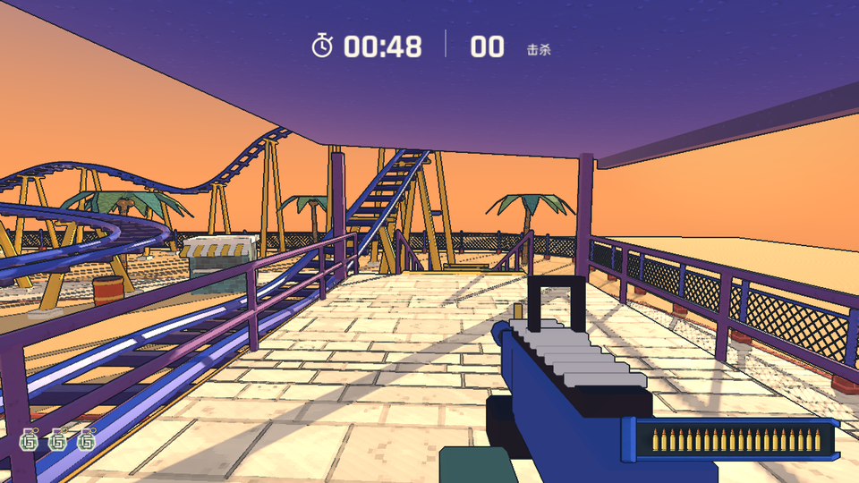
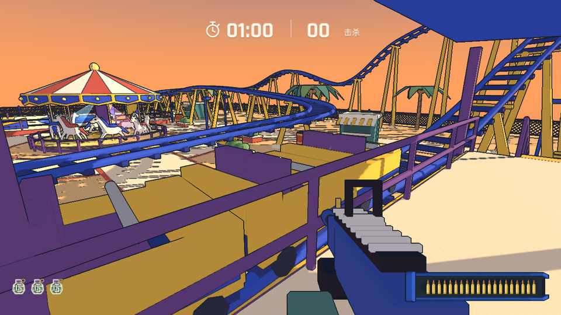
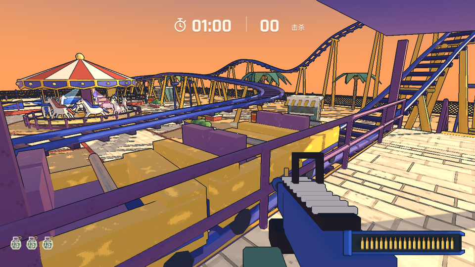
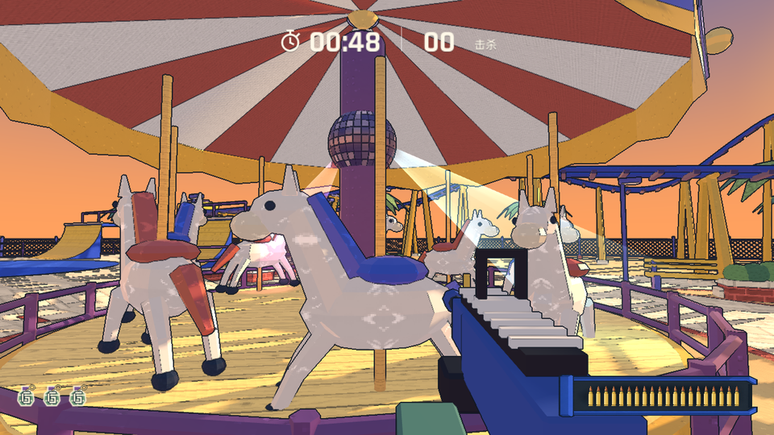
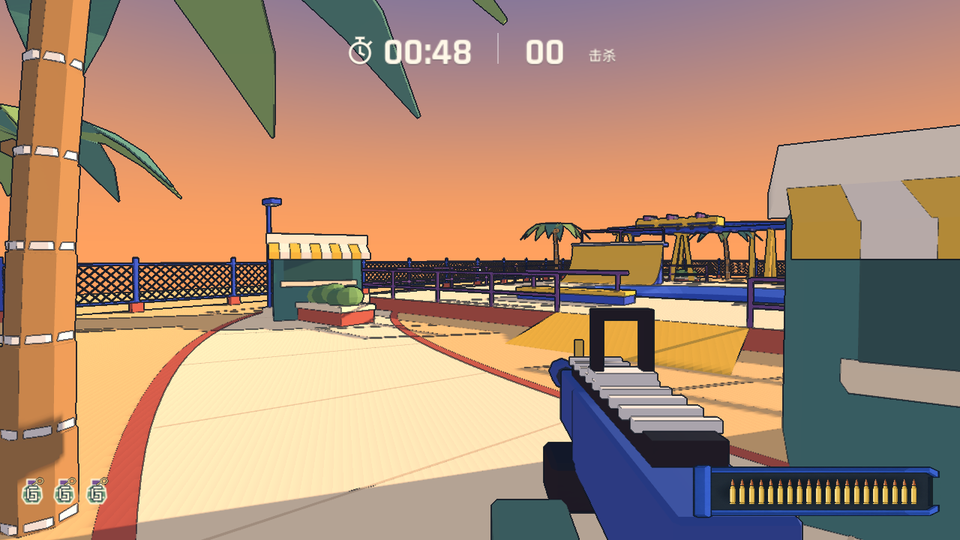
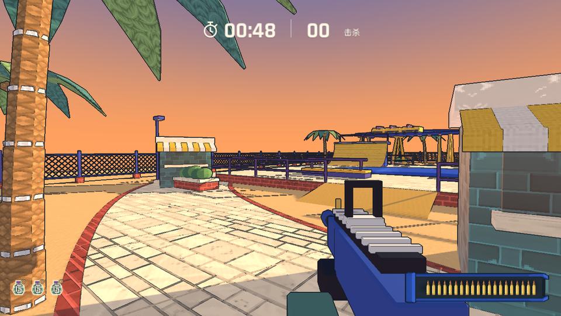

# 夕阳游乐园 · 实验性像素贴图

在标题页右键游乐园缩略图，或在触摸屏长按缩略图，再勾选「实验性贴图」。该选项默认关闭，应用在当前游戏会话中，重新加载游戏会恢复关闭。

| 同机位实机 | 原版 | 实验贴图 |
| --- | --- | --- |
| 步道与旋转木马 |  |  |
| 滑板碗池 |  |  |
| 过山车站台 |  |  |
| 过山车车厢 |  |  |
| 木马漆面 |  |  |
| 棕榈与摊位 |  |  |

实验覆盖地图里 369 个景物网格和独立着色的镜球，包括所有重复构件。大便或蟑螂模式下生成的便携厕所和柱状炸药也会使用对应贴图。原色板仍用作底色。金属、木马漆面和瓷砖有更低的粗糙度，布、土、砖和植物保持较弱的高光。

[原始图集](imagegen-atlas.png)和[补充图集](imagegen-atlas-scenery.png)由内置 imagegen 生成。两张图集通过[纹理处理脚本](../../../tools/maps/build_park_texture_tiles.py)切成 18 张平铺纹理。像素材质按模型局部坐标投影 UV，与车厢和木马一起运动。原 GLB 供两种画风共用。

实机对照用 Godot 固定机位拍摄。运行 `godot --resolution 1280x720 --script tests/park_texture_experiment_check.gd` 可重新拍摄，并验证关闭开关后恢复到同机位原图。

## 生成提示词

> Generate a single square production texture atlas for a colorful low-poly amusement park videogame at sunset. EXACTLY 3 columns by 3 rows of nine equal square tiles. Perfectly straight tile boundaries at one third and two thirds, no margins or gutters, each panel fills its cell edge to edge. Strictly flat orthographic albedo artwork, no object perspective, no lighting, no drop shadows, no lettering, no gradients, no labels or numbers. Hand drawn 16-bit pixel art texture treatment, crisp integer-square pixel clusters, sparse details with large quiet color areas, warm playful Nintendo-like low-poly game palette. Every cell should repeat naturally like tileable surfaces; edge motifs are secondary. The nine cells in row-major order are: top left cream and peach promenade limestone pavers with staggered joints and subtle peach chips; top center warm tan compact gravel with sparse rounded pixel specks; top right muted terracotta red brick and beige mortar, orderly offset brick courses. Middle left medium cobalt blue smooth painted concrete with very sparse wear and aggregate, no brick lines; middle center golden honey brown wooden planks with light sparse grain, wide boards and a few small knots; middle right violet lavender painted sheet metal with subtle rounded fastener dots and sparse flecks. Bottom left matte vanilla woven carnival canvas, lightly textured with faint threads and tiny blocky warm glints, no obvious stripes; bottom center pale ochre powder coated enamel with sparse pixel scuffs and tiny rounded details; bottom right muted green and teal glazed ceramic tile with very subtle staggered joints and a few chipped corners. Keep contrast within each tile restrained; avoid black outlines, loud noise and chromatic outliers. Think nine 64x64 material swatches enlarged with nearest neighbor. Atlas only, no presentation.
