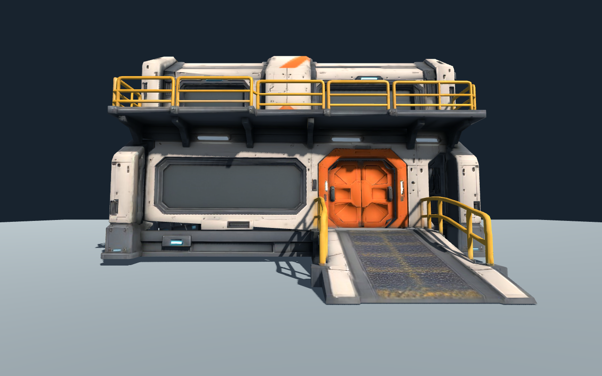
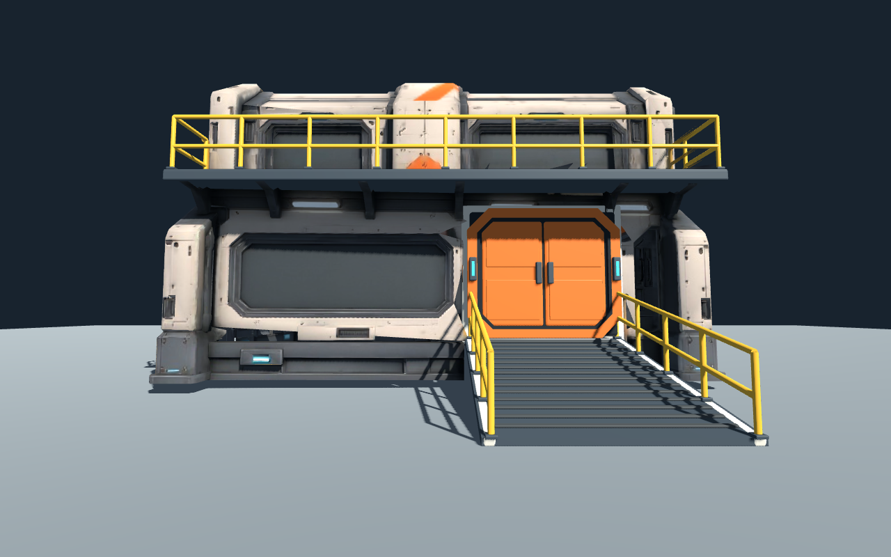
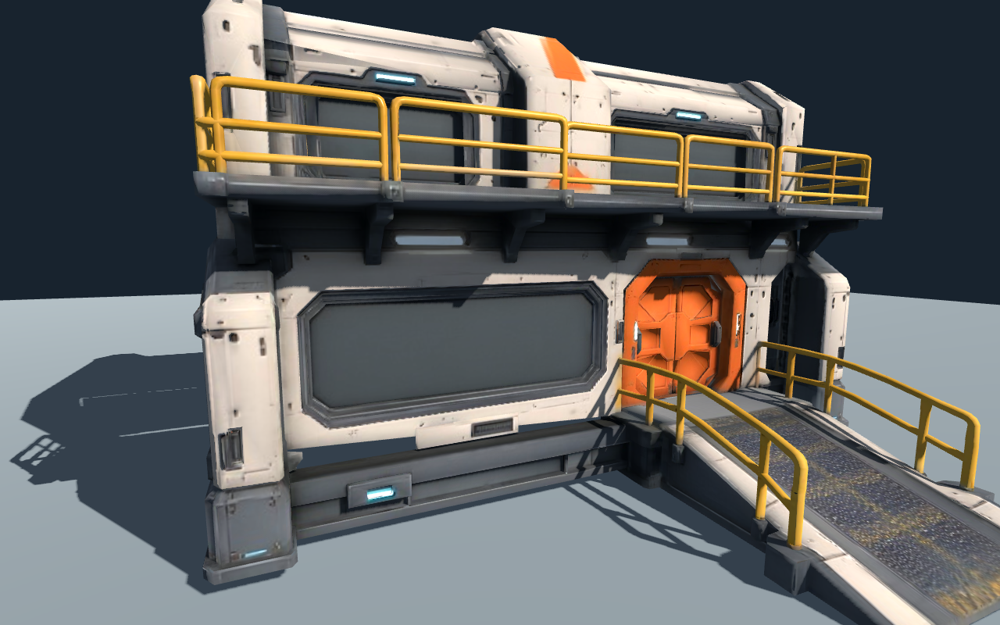
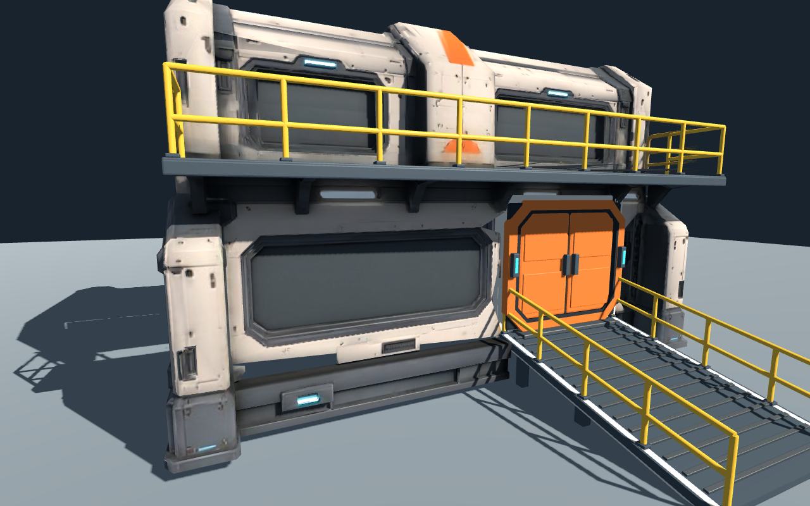
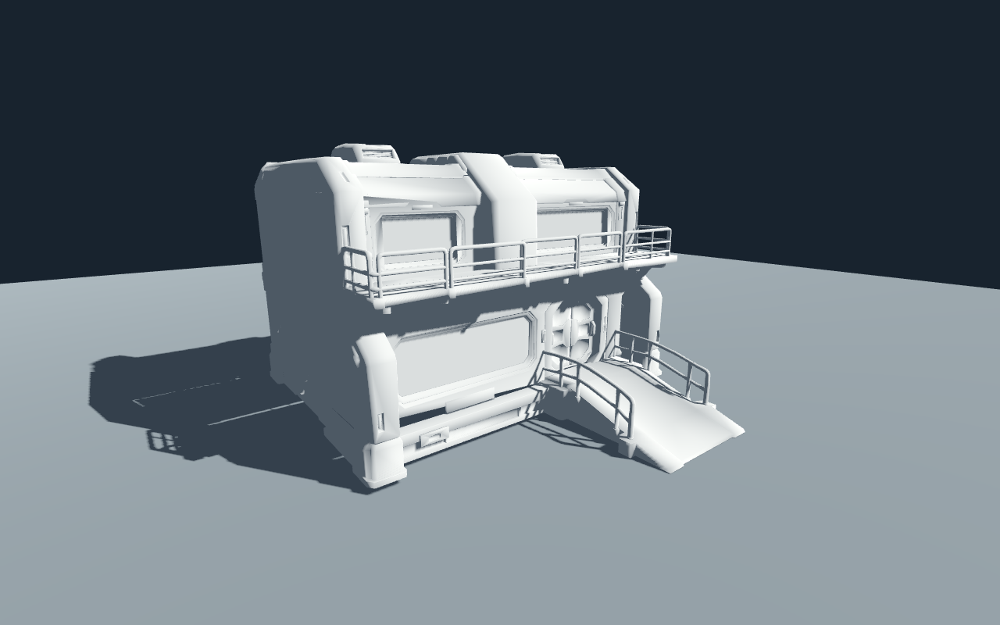
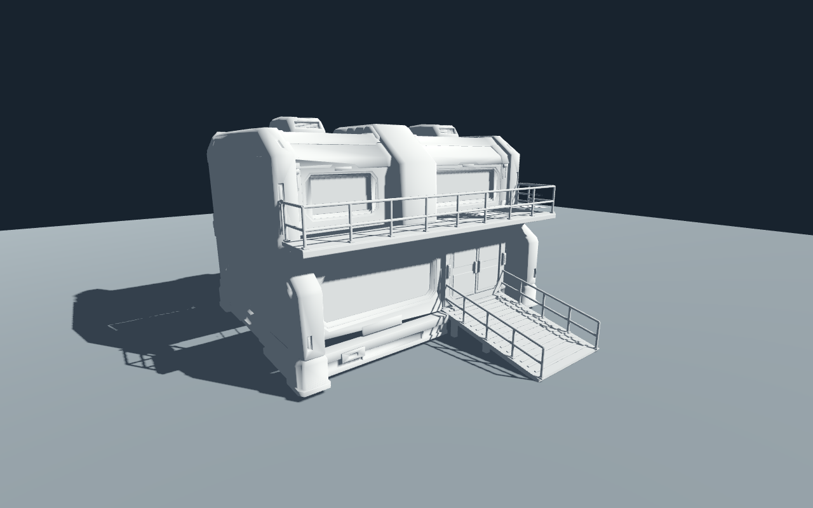

# 基地混合路线第二轮：结构更可控，生产成本仍有门槛

2026-11-14 · `space` · 从原版 Tripo 模型复制后替换，原版 `.blend` 和 GLB 保留。

**判断：这条路线对近景、需要修改或交互的构件有价值；不适合把每栋建筑都先整体生成、再逐件切开重做。** 本次栏杆、坡道、气闸已经替换，规整度和可编辑性改善；新旧材质尚未完全融合，绘制批次明显上升，不能直接称为更省性能或已达到最终美术标准。

## 同机位对照

下面两组均为 Godot 4.7.2 原生 Compatibility 渲染，同一脚本、太阳、环境光、63° FOV、1280×800 和 4×MSAA。没有通过换灯光或后期改善新版观感。

| 修改前 | 修改后 |
| --- | --- |
|  |  |
|  |  |
|  |  |

其他视角：[正面](godot-front.png)、[背面](godot-rear.png)、[侧面](godot-side.png)、[灰模背面](godot-clay-rear.png)。

## 实际替换内容

- **栏杆**：直线圆管、竖直立柱、统一底座；高度 1.12 m，立柱最大间距 1.4 m。转角立柱已去重，共 11 根。为了安装新栏杆并收掉旧切口，补了阳台承接板与前缘收口，不把裸切口留给玩家。
- **坡道**：闭合楔形面板，宽 3.55 m、水平长 4.60 m、高差 0.94 m、坡度约 11.55°；独立踏条、侧梁、接地支撑和扶手。坡顶与气闸门槛共用高度参数。尚未生成角色碰撞或做行走验证。
- **气闸**：八角外框、内密封圈、两片独立门扇、锁件、门槛和状态灯。门扇有命名与铰接原点，当前仍关闭；没有把“有原点”当成开门动画或室内玩法已完成。
- **保留**：主体壳、原墙面与原贴图。原始素材哈希核对通过。

旧模型通过四组局部空间掩码移除 5,296 个三角形，保留 10,913 个主体三角形。掩码是针对这一份网格拟定的，不是可自动处理任意建筑的算法。新增程序几何 7,844 个三角形。

## 效果判断

| 项目 | 改善 | 仍有的代价或限制 |
| --- | --- | --- |
| 栏杆 | 横杆笔直、截面统一、立柱竖直且间距可调 | 仍需要与旧外壳统一漆面磨损；不能用纯色材质直接代表最终品质 |
| 坡道 | 斜面、门槛、踏条和支撑可控，不再依赖变形网格 | 扶手高度和坡度是设计参数，非已完成的角色通行验收 |
| 气闸 | 对称、轮廓明确、门扇可独立编辑，发光区独立 | 比旧模型更干净、装饰密度更低；旧版某些机械细节有质感，不能把删除细节都算提升 |
| 接缝 | 用承接板和安装框收口，移除了明显旧栏杆残片 | 主体仍保留原有墙面平整度和局部阴影问题，本轮未整体修楼 |
| 修改体验 | 改栏杆高度/间距能直接重建，不需重新付费生成 | 换一栋不同 Tripo 楼时，原网格切除与接口拟合仍要重新做 |

## 整理成本：执行速度与首次制作分开

从开始定位模型到最后一轮原生截图完成，本轮记录的代理施工/验证墙钟为 **8.5 分钟**。它包含思考、编写代码、工具等待和返修；不含本报告与 Git 推送。**不是人工建模师工时，也不是完整生产资产的总工期。** 拆除与生成器编写交叉进行，未独立计时，以下按实际工作量分开列出，避免编造精确分项分钟数。

| 工作 | 本轮实际投入 | 可复用程度 |
| --- | --- | --- |
| 拆除旧结构 | 检查颜色/面中心/坐标范围；拟定四组掩码；两轮收紧跨区域三角形与残片的处理范围 | 低：高度依赖本次生成网格 |
| 制作新构件 | 一个参数文件、一个 Blender 生成器；圆管/盒体/楔形/八角环组合，三类构件及挂接件 | 高：同接口资产可重复使用 |
| 装配修正 | 修正门扇父级坐标更新；去重栏杆转角立柱；补阳台和气闸收口 | 中：装配方法可复用，旧壳的接缝仍需判断 |
| 引擎验证 | 五轮新版原生截图检查；最终七个视角/材质状态；原版重新渲染并采集相同统计 | 高：检查场景与机位可复用 |
| 默认构件重建 | 脚本内部计时约 0.42 秒 | 不包含 Blender 启动、Godot 导入、人工判断或图像验收 |
| 参数变体 | 栏杆改为高 1.25 m、最大间距 1.8 m，立柱变为 10 根；约 0.42 秒生成导出，结构断言通过 | 已验证参数化；变体未单独做视觉验收 |
| 追加云费用 | 0 credits、0 次 Tripo 任务 | 沿用上一轮生成物 |

## 运行成本不是免费获得的

| 指标 | 原版 | 混合版 |
| --- | ---: | ---: |
| 模型三角形 | 16,209 | 18,757（+15.7%） |
| 网格对象 | 1 | 17 |
| 材质 | 1 | 8 |
| 新增贴图 | 无 | 无，沿用原三张 2K；新构件使用材质参数 |
| 前视绘制调用 | 9 | 57 |
| 玩家眼高绘制调用 | 10 | 64 |
| 近景绘制调用 | 10 | 72 |

绘制调用来自引擎统计，包含地面、阴影等通道，不等同于模型对象数，也不能换算成“慢几倍”。数据见 [原版统计](../base-pilot/render-stats.json) 与 [混合版统计](render-stats.json)。没有采集稳定帧时间、Web 或手机性能。

本次只在“同一组件、同一材质”内部合并网格，以保留编辑结构；尚未做跨组件静态批处理或共享图集。正式导出应保留可编辑 `.blend`，另输出按空间/材质合并的静态外壳，门扇与真正需要交互的件独立。否则大量建筑会放大绘制调用问题。

## 是否划算，以及施工计划怎样改

1. **一栋不可接近的背景楼：通常不值得整套替换。** 原生成物的整体造型已经成立；只修显眼错误，避免为了不可见的结构付出手术成本。
2. **近景基地或反复修改的标准设施：混合路线值得继续。** 尺寸、间距、坡度和门节点能可靠控制，新增尺寸变体不再需要云生成。复用越多，生成器的首次投入越容易摊薄。
3. **大量不同 AI 建筑逐栋切割：性价比不明朗，不扩张。** 本次暴露的主要成本是从整体网格里取出正确部件，而不是生成新的栏杆。尚无足够样本证明逐栋返修比模块化从零搭建快。
4. **下一轮从输入阶段分工。** 完整概念图保留为视觉目标；实际送入 Tripo 的主壳参考尽量移除薄栏杆、坡道和门扇，预留简单安装面。精确构件直接从模块库装配，减少先生成再拆除的浪费。不要把“提示词要求分件”当成已经获得语义模块。
5. **加入最终材质整合与导出预算关卡。** 本版结构更规整，但新件偏干净，尚未融合磨损/粗糙度；先统一共享材质，再做静态合批，不依靠叠加后期掩盖差异。

## 文件与复现

- [可编辑混合版 Blender](../../../../art_source/space/base-hybrid/base-hybrid.blend)
- [参数](../../../../art_source/space/base-hybrid/recipe.json) / [生成器](../../../../art_source/space/base-hybrid/build_hybrid.py)
- [混合版 GLB](../base-pilot/lab/hybrid.glb) / [原版 GLB](../base-pilot/lab/model.glb)
- [结构统计](build-stats.json) / [参数变体统计](build-stats-variant.json) / [成本口径与文件哈希](cost-and-provenance.json)

在仓库根目录执行：

```sh
/Applications/Blender.app/Contents/MacOS/Blender --background --factory-startup --python art_source/space/base-hybrid/build_hybrid.py
/Applications/Godot.app/Contents/MacOS/Godot --headless --editor --path docs/art/space/base-pilot/lab --import
/Applications/Godot.app/Contents/MacOS/Godot --path docs/art/space/base-pilot/lab -- --hybrid
```

生成器附加 `-- --variant` 可复现参数变体，变体模型保存到忽略的本地实验目录，不复制进正式资源。Godot 不传 `--hybrid` 时渲染原版；两者使用相同相机和灯光。

已验证：原版哈希未变；新几何坐标有限；门扇包络未漂移；坡道坡度与门槛高度匹配；默认/变体生成、GLB 导出、Godot 原生渲染通过。结构断言不是碰撞、导航或玩家实测。当前仍是隔离资产实验，没有改正式游戏、没有 Web 发布。
