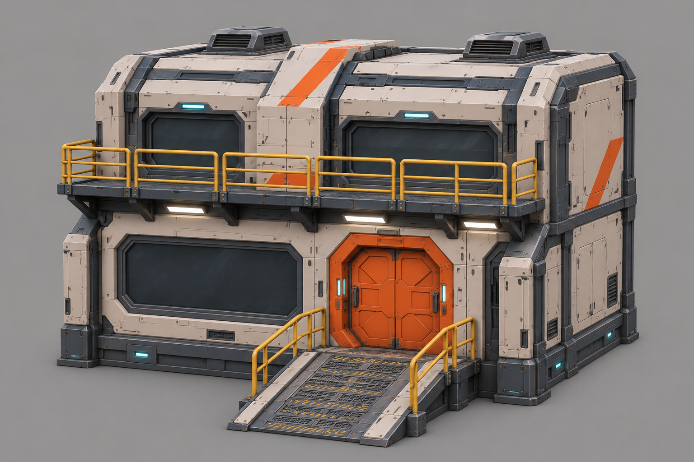
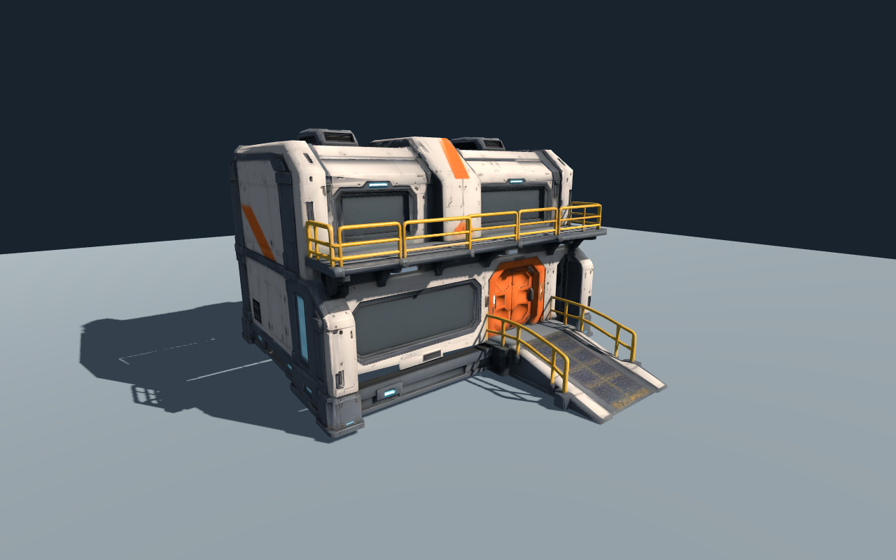
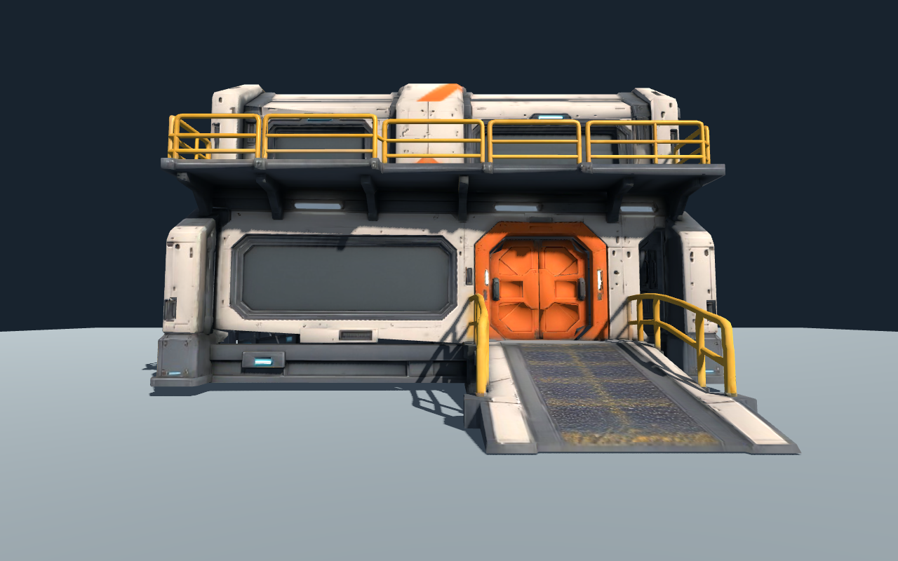
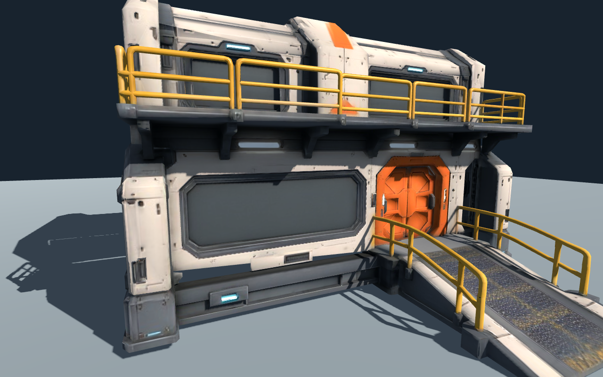
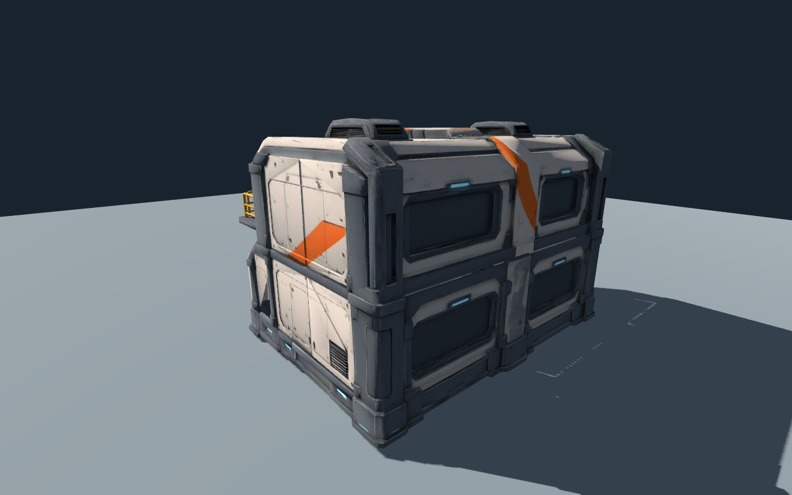
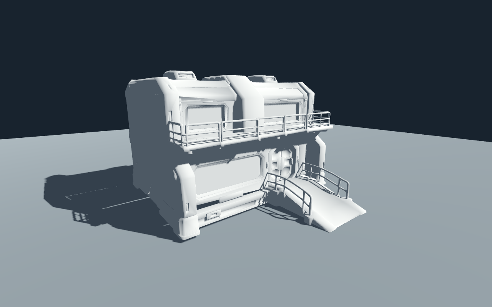

# 基地 Tripo 实测：整体造型可用，近景结构需接管

2026-11-14 · `space` 分支 · 一次 P2 图生 3D 实验。

**结论：保留混合路线，但不要把建筑完全排除在 Tripo 之外。** 本次生成很快建立了完整、风格一致的基地外观，可以作为造型验证和中远景候选。它还不是能直接接入玩法的生产资产：细栏杆、门板、墙面精度、尺寸、语义拆件、碰撞和灯光都需要进一步处理。

本次只测试一个单图输入、一个模型版本和一个面数档位。没有证明 Tripo 所有模型都存在同样问题，也没有证明手工修复一定比程序化重建慢。

## 看实际结果

输入是从原始游戏概念图派生的独立建筑参考，不是原概念图右侧建筑的精确还原。为便于单件试验，采用约 12 m 宽的紧凑双层基地；不能直接替代总装 A02 的整段建筑。窗后封闭、气闸关闭，不制作室内。



下面是 **Godot 4.7.2 原生 Compatibility 实际渲染**，不是 Tripo 预览，也不是 imagegen 美化。使用独立检查场景、统一太阳与环境补光、63° FOV、1280×800、4×MSAA；没有放入正式游戏，没有加入探针或最终月面环境。



玩家眼高设为 1.65 m。这里没有玩家控制器、武器或命中系统，不能称为完整游戏实机验收。





单图未展示的背面也有完整外形和窗格图案，但布局是生成推测，未经过设计确认。灰模背面对照显示，背面窗格主要依赖贴图，不能等同于与正面同等精度的几何结构。



相同机位替换为统一灰色材质，关闭原贴图和法线影响。栏杆的弯曲和截面不一致仍存在，说明不只是材质问题。



另有 [侧面](godot-side.png)、[灰模背面](godot-clay-rear.png)。

## 量化结果

| 项目 | 本次结果 | 含义 |
| --- | --- | --- |
| 模型 | P2-20260801 | 单次图生 3D，seed 14011 |
| 请求预算 | face_limit=20,000，texture=true，pbr=true | 无后处理计费链、无批量候选 |
| Tripo 实际扣费 | 110 credits | API 返回的 credits_consumed；不包含概念图生成的成本 |
| 云端任务时间 | 72.31 秒 | 服务端 created_at 到 completed_at；不含参考图、上传、下载和本地整理 |
| 三角形 | 16,209 | 实际导入统计，低于请求上限 |
| 网格 / 材质 | 1 / 1 | 不是按门、坡道、栏杆拆好的生产结构 |
| UV | 1 套 | 自动图集，不是可复用墙体 trim 的结构 |
| 贴图 | Base Color、Normal、ORM，各 2048×2048 | 三张 2K；实际通道连接仍须审核 |
| 原始 GLB | 4,491,012 bytes，约 4.28 MiB | 文件小不代表 GPU 驻留小 |
| 归一化 GLB | 4,491,988 bytes | 只做朝向、宽度和接地归一化，没有重拓扑或重建 |
| 纹理内存参考 | 三张 RGBA8 含完整 mip 约 64 MiB | 未压缩估算，不是当前设备显存实测 |
| 归一化包络 | 宽 12.00 m、深 12.96 m、高 8.30 m | 深度包含坡道；单张参考不能约束实际工程尺寸 |
| 原始方向/尺寸 | 正面 +X，整体为归一化小尺度 | 旋转并按宽度缩放后才符合项目的 -Z 正面和米制约定 |

这些数值来自 [结构审计](mesh-audit.json) 与 [生成清单](manifest.json)。没有采集完整游戏帧时间；不能凭 16k 三角形宣称满足 Web 60 FPS。

## 哪些可以保留，哪些需要处理

| 观察 | 判断 | 施工动作 |
| --- | --- | --- |
| 白壳、橙色气闸、黄色栏杆、深色窗框保持统一 | 大形与材料身份有效 | 保留为整体视觉基准，允许静态中远景候选 |
| 正面完整，背面不是空白，但灰模背面大部分为平面 | 单图补全有价值，背面细节主要靠贴图 | 背面仍需人工确认；关键布局采用明确后视参考 |
| 近景栏杆弯曲、粗细不均，灰模仍可见 | 几何精度不足 | 用 Curve/Tube 与立柱阵列重建，优先保留准确剪影 |
| 气闸由输入的平整双门变为突出中央结构 | 精确造型未严格保留 | 门与门框单独建模；以后需开合时必须语义拆件 |
| 墙面分片、倒角及接缝近看不够规整 | 不能只靠法线贴图改善 | 近景墙体改模块化平面/倒角；核对平面度与接缝 |
| 只有一个材质与一个网格 | 不等于无法编辑，但缺少语义边界 | 区分“静态外壳”与“交互/精确构件”，不把按松散块分离视为模块化完成 |
| PBR 文件没有 emissiveTexture/emissiveFactor | 青色和白灯目前只是纹理里的亮色 | 增加独立发光遮罩/灯罩和真正落光；不得给整张材质添加发光 |
| ORM 图存在，但原始 GLB 没有 occlusionTexture 连接 | 不能把文件名视为 AO 已生效 | 审核 R 通道内容后再决定接入；不盲目把未知灰度当 AO |
| 材质 doubleSided=true | 可能增加绘制成本，掩盖薄片问题 | 先查背面/开口，再有选择地关闭双面；不能直接强制剔除 |
| 侧面投影有细亮缝，灰模可见不规整接缝 | 需要检查薄片、裂口与阴影偏移 | 在不同光向和单面显示下复查；本轮不宣称已经修复 |
| 生成物无碰撞、socket、语义门/栏杆节点 | 云生成不是玩法资产交付 | 补简化碰撞、接口、独立状态与重置逻辑 |

拓扑诊断发现原始导入有 4,053 个连通片，受到 UV/法线分裂顶点影响；在临时副本上以 0.01 mm 容差焊接后仍有 237 个连通片、3,841 条边界边。这是检查线索，**不代表 237 个可复用模块，也不能直接等同于 3,841 条可见裂缝**。未在正式网格上执行自动焊接，以免破坏硬边和 UV。

## 调整施工流程

1. **新增“整体视觉基准”步骤。** 基地/飞船可以先用 Tripo 出一版整体，快速确认造型、配色和远景体量。通过后作为参考或候选外壳，不立即当最终建筑铺图。
2. **按交互与观看距离决定拆分，不按生成服务决定拆分。** 门、栏杆、坡道、可破坏盖板、承重接口仍程序化；墙后大壳和不可接近的屋顶可以评估保留 AI 网格。不能无差别要求每个资产都重新手工制作。
3. **先做尺寸和结构审核，再做精细纹理。** 必须先用标尺确认层高、门高、坡道坡度和栏杆高度。只按总宽缩放不足以获得合理的人体尺度；有问题时局部重建，不用整体非均匀缩放糊过去。
4. **每个复杂资产先拍原材质 + 灰模 + 背面。** 不让漂亮贴图掩盖结构问题；多视图一致性在生成前检查，背面推测在生成后确认。
5. **PBR 检查加入导入关卡。** 对照 GLB 实际槽位检查 Base Color/Normal/Metallic/Roughness/AO/Emissive、色彩空间和双面设置；“pbr=true”不是验收结论。
6. **增加“局部替换试验”，再决定全场生成量。** 下一步只修这栋的栏杆、坡道和气闸，同时保留一个未修原版作对照。记录真实清理工时和效果，再决定 AI 外壳能保留多少。本轮未做这项，不能提前宣称能省多少工时。
7. **保留原来的离线程序化材质与轻量运行时路线。** 无需为本次结果新增全场 Triplanar、平面反射或复杂后期；先解决几何、真实灯和共享材质。

因此，原计划“基地完全不生成整体”过于保守；但“整栋生成后直接使用”同样不可取。现在改为“整体生成验方向 → 精确/互动部件程序化接管 → 引擎内验证 → 通过后扩展”。

## 交付物与复现

- [输入图](input.png) 与 [完整图像提示词](imagegen-prompt.txt)：内置 imagegen 生成，源风格参考为原始 01-gameplay.png。
- [Blender 源文件](../../../../art_source/space/base-pilot/base-pilot.blend)：纹理已打包，只有归一化后的生成网格，尚未整理为模块或绑定。
- [测试 GLB](lab/model.glb)：实验资产，不在正式游戏资源导出中。
- [Godot 检查工程](lab/project.godot)：直接运行会拍五个材质视角和两个灰模视角，然后退出。
- [归一化与审计脚本](audit_model.py)、[临时焊接诊断](audit_weld.py)、[捕获脚本](lab/lab.gd)。

```sh
/Applications/Godot.app/Contents/MacOS/Godot --headless --editor --path docs/art/space/base-pilot/lab --import
/Applications/Godot.app/Contents/MacOS/Godot --path docs/art/space/base-pilot/lab
```

原始下载和带签名 URL 的服务端响应留在被忽略的 `artifacts/local/space-base-pilot/`。清单仅保留必要参数、任务 ID、费用和哈希；不含 API key 或账户余额。

已通过：Blender 导入/保存/GLB 导出、Godot 独立工程导入、原生 Compatibility 七张截图，已实际查看正面/背面/侧面/玩家视角/近景和灰模图。初次检查脚本使用了不存在的反射枚举，已删除并重新运行通过。

未完成：Web 浏览器渲染、物理手机、正式地图整合、玩家碰撞、导航、破坏、完整回合、帧时间和人工操作游玩。当前证据支持资产路线评估，不支持生产上线。

## 后续局部替换试验

栏杆、坡道与气闸的程序化替换已完成，见 [第二轮对照与成本评估](../base-hybrid/README.md)。本页原始模型与基线截图保留。
