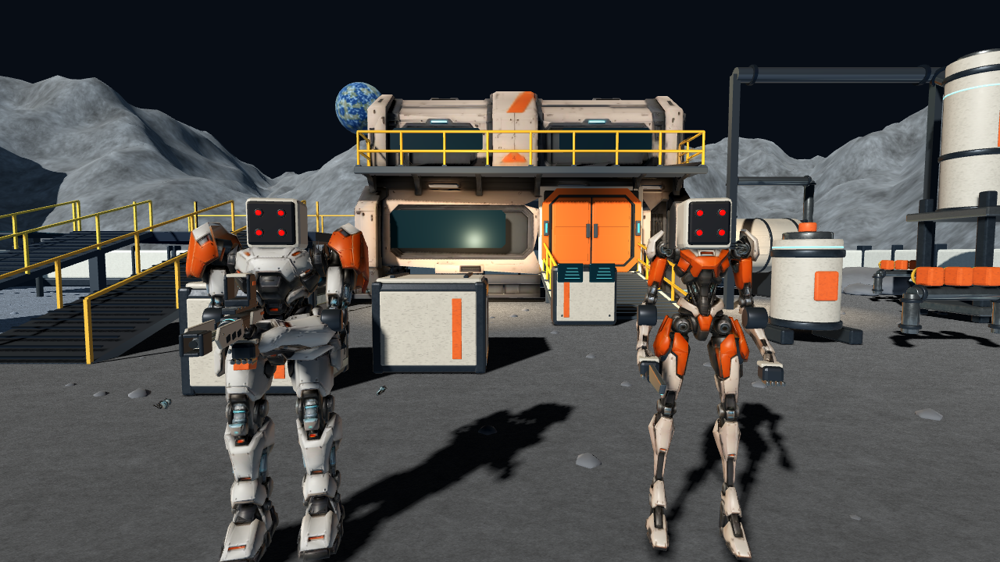

# 机械士兵：四红点光学面板

按用户指定的概念方向，两类机械士兵都移除拟人面部，改成倒角装甲头壳、内凹黑色面板和 2×2 红色传感器。保留两类身体轮廓、Head 枢轴、Helmet 拆壳节点和原有头部命中判定。



红点、镜座和面板全部挂在 Helmet 下；真实爆头后一起隐藏，避免留下悬空光点。光点是自发光材质，没有新增实时灯光。头壳范围仍覆盖原判定位置。

源文件为 `art_source/space/heroes/rifle-mech.blend` 与 `assault-mech.blend`，生成器 `build_sensor_heads.py`。完整机甲构建脚本也调用相同函数，避免下次重建恢复旧面部。不修改输入云模型、不重新付费生成。

验证：Godot 导入、两类各四个传感器、近景实际渲染、动作状态、真实射击爆头、拆壳后所有红点不可见、ADS 与换弹回归；独立 Web 导出与 Chrome 触控模拟的移动/射击/换弹/ADS/投掷/暂停恢复。不是物理手机或人工游玩验收，本次不重复性能采样。

```sh
/Applications/Blender.app/Contents/MacOS/Blender --background --python art_source/space/heroes/build_sensor_heads.py
/Applications/Godot.app/Contents/MacOS/Godot --headless --path . --editor --import
/Applications/Godot.app/Contents/MacOS/Godot --path . --script tests/moonbase_heroes_check.gd -- --sensor-heads
python3 tools/export_moonbase.py --review d --review-dir docs/art/space/sensor-heads
```

预览更新到本机 `http://localhost:8766`，仍在 `space`，不发布到生产站。前一版 D 截图与验证材料保持原样。
