# 上漆玩具场景建模进阶：可行性调研、五项原则与全地图落地

日期：2026-11-12。作为 [`docs/art/toy/README.md`](../toy/README.md) 的场景几何深化方案，解决地图建筑与道具“只是给直角长方体包了一圈圆角”的造型单薄问题。现已完成全部 `12` 张可玩冲分地图的微缩实景沙盘向建模升级、顶点光重烘焙、自动化规则验收与同机位对比归档。

---

## 一、工程可行性调研与底层打通

对全部地图构建器（[`tools/maps/arena_kit.py`](../../../tools/maps/arena_kit.py)、[`tools/build_sandgate.py`](../../../tools/build_sandgate.py)、[`tools/build_bb_office.py`](../../../tools/build_bb_office.py)、[`tools/build_amusement_park.py`](../../../tools/build_amusement_park.py)、[`tools/build_last_ferry.py`](../../../tools/build_last_ferry.py)、[`tools/build_night_studio.py`](../../../tools/build_night_studio.py)、[`tools/maps/build_yard.gd`](../../../tools/maps/build_yard.gd) 等）、顶点光烘焙器（[`tools/maps/bake_vertex_light.py`](../../../tools/maps/bake_vertex_light.py)）和运行时材质装配器（[`scripts/maps/map_lookdev.gd`](../../../scripts/maps/map_lookdev.gd)）排查后，解决了四个关键卡点：

| 症结 | 代码根因 | 解决方案 |
| --- | --- | --- |
| 导出阶段丢弃倒角与法线 | 各构建器 `export()` 使用 `mesh.from_pydata()` 重新拼合裸网格，未做倒角且丢弃光滑组与自定义法线 | 新增共用模块 [`tools/maps/toy_kit.py`](../../../tools/maps/toy_kit.py)，按构件真实厚度 `体积 / 最大面面积` 自动筛选，逐件执行 `1` 段 `bmesh.ops.bevel` 后合并材质，统一施加 `WEIGHTED_NORMAL` 并开启 `export_normals=True` |
| 漆面高光被粗糙度锁死 | 多个构建器将材质设为 `Roughness = 0.86`–`1.0`，`map_lookdev.gd` 将石材锁在 `0.92`，且 `yard` 的 `MultiMeshInstance3D` 与 `wall_paint.gdshader` 关闭了高光反射 | 玩具彩漆粗糙度统一至 `0.42`–`0.62`、石材灰泥调至 `0.68`、木质调至 `0.58`；`map_lookdev.gd` 纳管 `MultiMeshInstance3D` 涂层，`wall_paint.gdshader` 补齐 `specular_schlick_ggx` 与墙面明暗渐变 |
| 顶点烘焙细分破坏自定义法线 | `bake_vertex_light.py` 的 `refine()` 直接切分导入后的三角面，多产生约 `40%` 碎面且冲掉加权法线 | 在 `refine()` 前先执行 `bmesh.ops.join_triangles` 还原四边面再做网格切分，切分后清理旧法线并重算 `WEIGHTED_NORMAL` |
| 室内地图缺少高光主方向 | `bb_office` 与 `ginza_station` 太阳光能量仅 `0.18`，全靠无方向环境光照明，立体框线与倒角缺乏明暗转折 | 在 [`scripts/maps/toy_palette.gd`](../../../scripts/maps/toy_palette.gd) 为两张室内地图补入窗口/出入口方向的暖色主光（能量 `0.44`–`0.46`） |

### 物理碰撞与导航零回退保障

各场景 `.tscn` 的物理碰撞与 `NavigationRegion3D`（`PARSED_GEOMETRY_STATIC_COLLIDERS`）完全读取 `tools/maps/*_layout.json` 的简化几何，不依赖视觉 `.glb`。全部地图升级过程中均保持碰撞盒、斜坡、护栏、出生点与狂暴捷径坐标不变。

---

## 二、五项场景建模原则与概念参考

在不引入手工雕刻与写实脏迹贴图、保持脚本程序化生成的前提下，全地图统一遵循以下五项微缩沙盘结构规则：

### 1. 三段式建筑截面：消灭光秃直墙交界

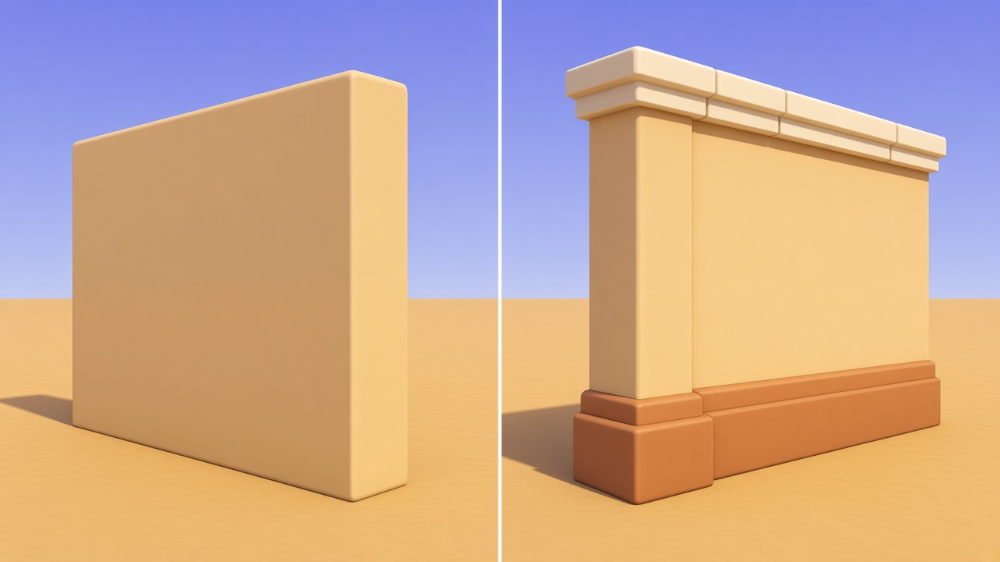

- **底部勒脚 / 踢脚线（`stepped_plinth`）：** 外扩阶梯底座锚定地面，承接顶点环境光遮蔽。
- **墙裙腰线与转角柱：** 建筑外转角包覆转角柱（Pilaster），墙裙顶部加外凸腰线。
- **分段挑檐压顶（`segmented_coping`）：** 按 `1.4`–`2.2` 米模数切出拼缝，下衬石质或金属挑檐唇边。

### 2. 微锥度与斜切咬合：打破 90 度正交死板感

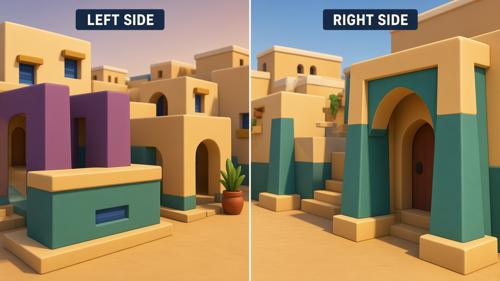

- **1 至 4 度微锥度（`tapered_box`）：** 门洞墩柱、扶壁、护栏立柱、女墙垛口顶面微收，重心自然下沉。
- **拱门拱顶石与柱头：** 拱圈正中拱顶石（Keystone）外凸提亮，立柱补齐独立柱础与柱头（Capital）。

### 3. 内凹深框与注塑分件缝：禁止表面平贴色块

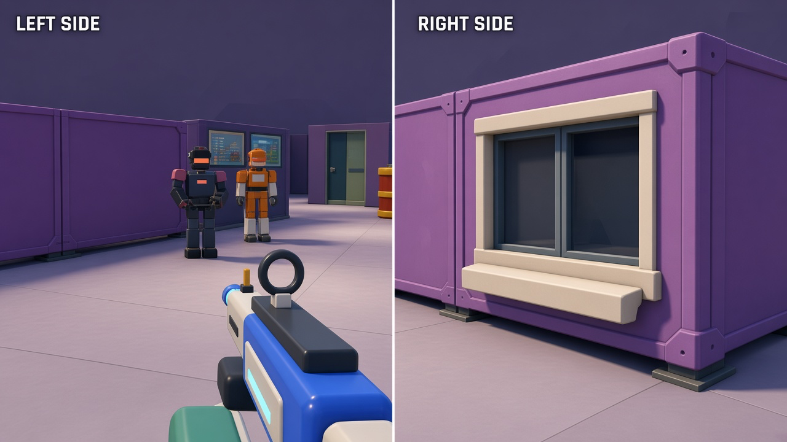

- **三层深度窗洞（`recessed_window`）：** 阴影底板后退、窗芯居中、`15` 厘米模压外框与带牛腿厚窗台前探。
- **注塑拼装分件缝：** 室内隔断、站台轨道墙与演播室声学墙内衬深色龙骨芯，外挂留有 `2.4`–`2.8` 厘米深缝的模压面板。

### 4. 薄片改厚体块：补齐骨架与工业箍圈

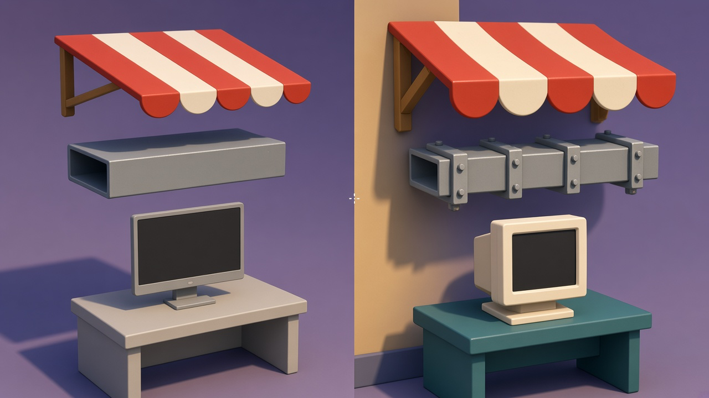

- **三段微弧遮阳棚（`cambered_canopy`）：** `8.5` 厘米厚折弧条纹棚面、分片垂边与斜撑托架，替换单面薄片。
- **带箍管线与双面厚框终端机：** 风管补齐法兰箍、浅色垫圈与四角金色螺栓耳；显示器与控制台补齐阶梯 CRT 后壳与厚前框。

### 5. 核心玩具套件工作流：共用原语拼装母版模块

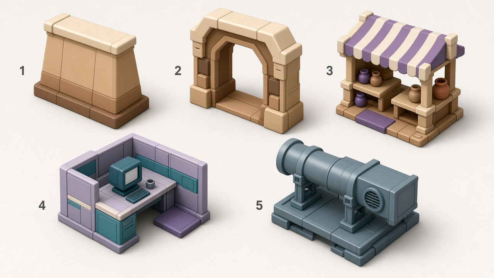

全部原语集中于 [`tools/maps/toy_kit.py`](../../../tools/maps/toy_kit.py) 与 [`tools/maps/arena_kit.py`](../../../tools/maps/arena_kit.py)，各图聚焦出镜率最高的核心建筑与掩体套件升级。

---

## 三、全地图（12 张）实机渲染前后对比

以下全部为 `1600 x 900` 本地实机同机位渲染，每张拼图**左侧为本次几何深化前的玩具分支状态，右侧为深化建模并重烘焙顶点光后的状态**。单张原图均保存在 [`renders/`](renders/) 目录。

### 1. 货场（`yard` / `score_attack`）

程序化生成单段加权法线倒角盒体网格（`beveled_box_mesh`），升级二层平台建筑勒脚、转角柱与分段挑檐，仓库立柱柱础、门洞黄框与屋檐压顶，重做近景双色包角矮掩体，加厚泳池露台阳伞与池岸压顶石，并为 `MultiMesh` 批次与涂鸦墙面补齐半光泽彩漆高光。

| 起点实战视角 | 全景机位 |
| --- | --- |
| 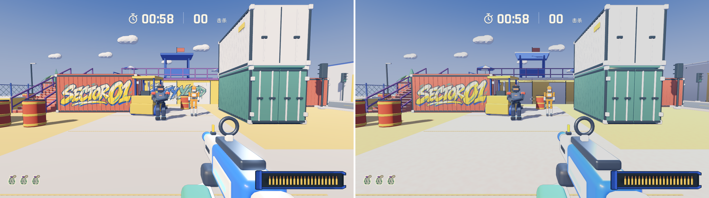 | 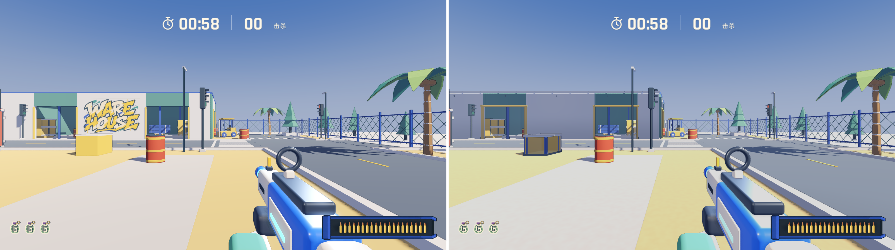 |

### 2. 沙门（`sandgate`）

全部可玩分区立面三段式改造（外扩石质勒脚、彩漆墙裙腰线、转角柱、分段挑檐压顶）、拱门微锥墩柱与凸出拱顶石、`15` 厘米深框百叶窗与牛腿窗台、三段弧面斜撑遮阳棚、彩带陶罐与四面内凹加固货箱。

| 起点实战视角 | 全景机位 |
| --- | --- |
| 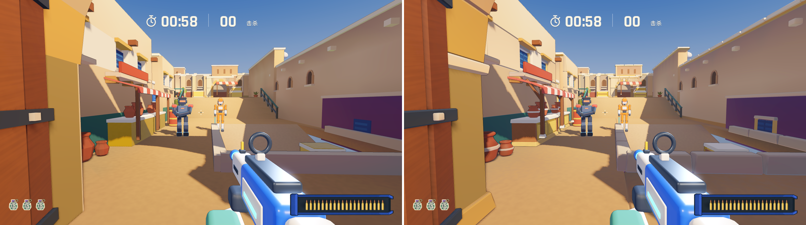 | 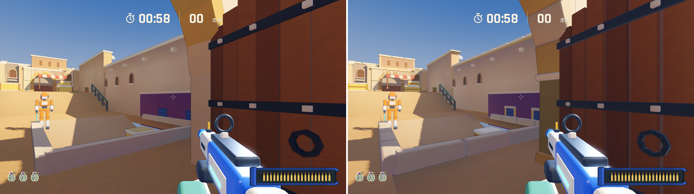 |

### 3. 办公室（`bb_office`）

走廊与会议室紫色隔墙分缝面板化（深色内凹缝、双面踢脚底座、分段顶冠）、三类工位屏风模块化重构（外凸立柱、稳固底座脚、奶油色分段顶盖、软包内嵌板）、正反双面厚框 CRT 显示器、微锥桌腿与带螺栓耳的法兰风管。

| 起点实战视角 | 全景机位 |
| --- | --- |
| 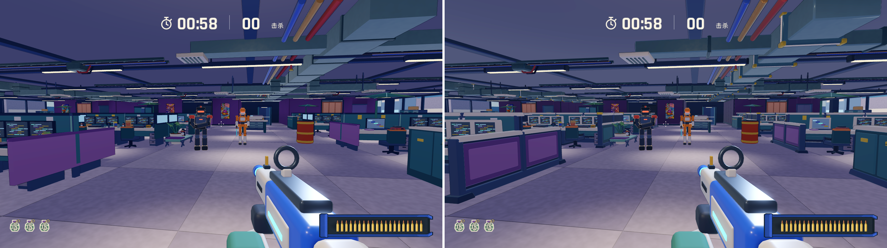 | 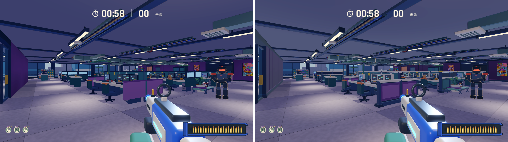 |

### 4. 游乐园（`amusement_park`）

入口售票亭与园区小吃亭升级三段式底座、转角柱、深窗台与三段弧面挑棚；旋转木马补齐双面实体顶棚、金色放射肋条、立体波浪檐板与中轴黄铜箍圈；过山车站台基座增加壁柱与分段金檐，长椅、花坛、路灯与围栏柱全面玩具化加厚。

| 起点实战视角 | 全景机位 |
| --- | --- |
| 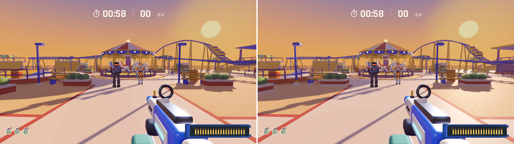 | 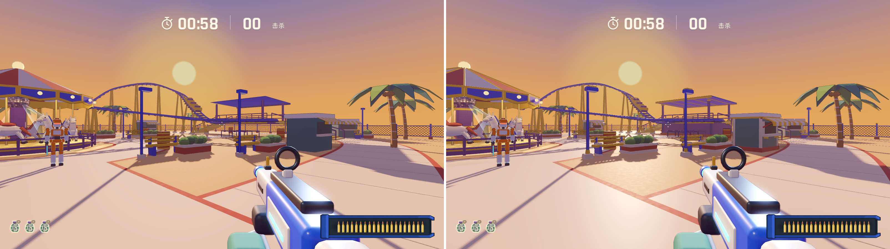 |

### 5. 末班渡轮（`last_ferry`）

驾驶室舱壁升级阶梯围槛底座、金色腰线、转角柱、遮阳眉檐、深框舷窗与双色箍圈烟囱；引桥斜坡增加奶油色厚侧梁、金色护栏与防滑踏条；主桅杆补齐甲板基座、黄铜套环、瞭望台毂座与探照灯罩；货箱与储物柜补齐包角与分段顶盖。

| 起点实战视角 | 全景机位 |
| --- | --- |
| 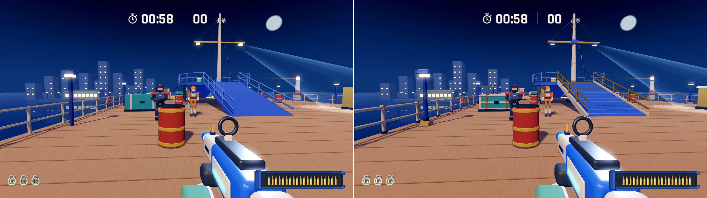 | 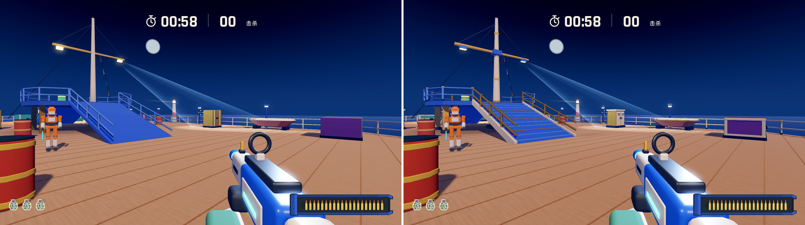 |

### 6. 午夜演播室（`night_studio`）

外围与内部分隔声学墙改为深色芯板配等距分缝模压板、阶梯底座与分段顶梁；综艺背景板补齐外框立柱、背撑杆与金色分段顶冠；导播间观察窗、主播台、圆润三垫嘉宾沙发、厚壳监视器与新闻岛台全面升级。

| 起点实战视角 | 全景机位 |
| --- | --- |
| 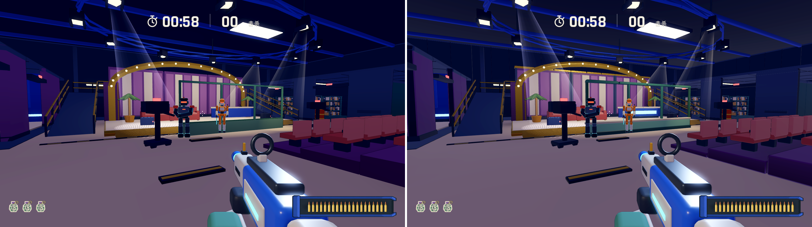 | 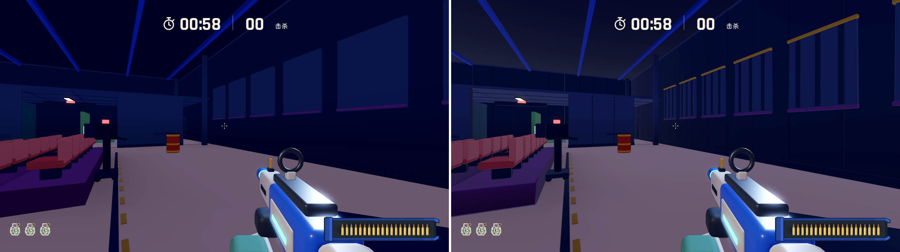 |

### 7. 霍格沃茨（`hogwarts`）

大礼堂与城堡石拱升级柱础、凸出拱顶石、阶梯收分扶壁、柳叶尖拱窗外框与牛腿窗台；全图屋顶由零厚度单面片升级为 `14`–`18` 厘米实心石板屋面；魁地奇礼宾台、石护栏墩柱、霍格莫德半木结构商铺弧形挑棚与集市摊位全面深化。

| 起点实战视角 | 全景机位 |
| --- | --- |
| 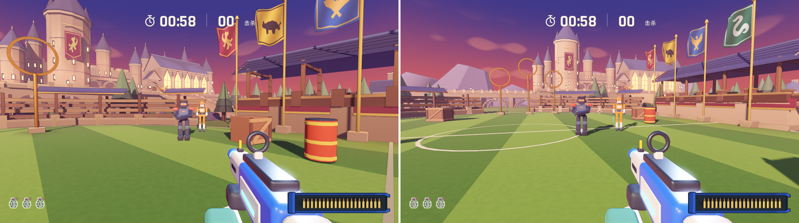 | 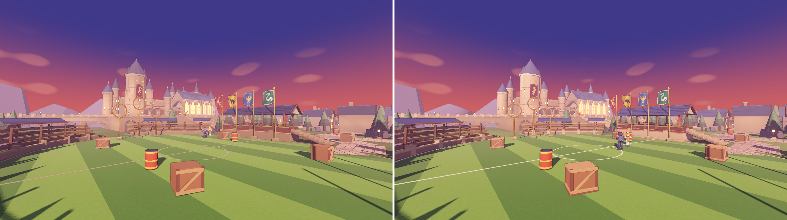 |

### 8. 棕榈温室（`palm_house`）

八角温室砖砌矮墙增加石质底座、内凹砖池与分段石窗台，铸铁转角柱补齐柱础与柱头；霸王龙化石展台、睡莲水渠护岸、棕榈树石花池、锅炉房、育苗棚及前院售票亭与大门石柱均升级三段式截面与实心屋顶。

| 起点实战视角 | 全景机位 |
| --- | --- |
| 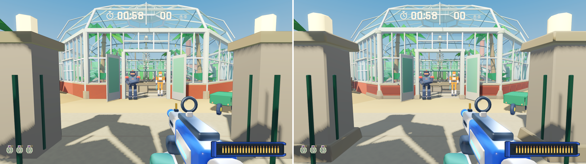 | 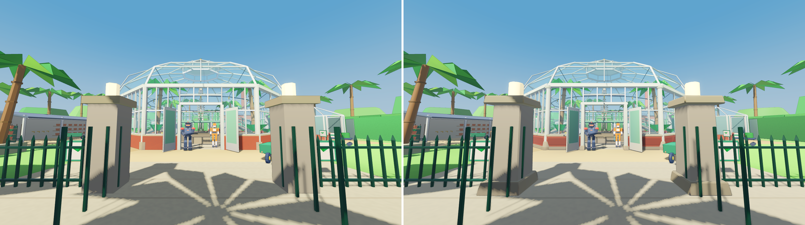 |

### 9. 雪线天文台（`snowline`）

圆形观测鼓楼外墙补齐深蓝底座、竖向分仓肋条、加厚带窗台条形窗与加宽顶环；南门防风门廊增加拉杆挑檐与厚积雪；气象甲板钢柱、维修小屋、压雪车（发动机散热百叶与微锥驾驶室）及室内遥测控制台全面重构。

| 起点实战视角 | 全景机位 |
| --- | --- |
| 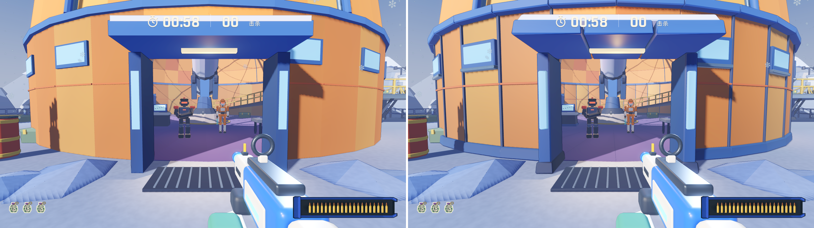 | 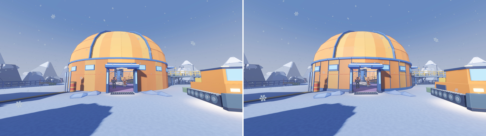 |

### 10. 行李层（`baggage_below`）

安检隔断墙改为分缝白板、深蓝底座与分段蓝框；橙色员工大门与西侧通道补齐模压门套与分段门楣；分拣传送带增加外凸加强肋条，行李提取转盘中岛、安检机、牵引车、行李拖车与顶棚钢梁全面加厚倒角。

| 起点实战视角 | 全景机位 |
| --- | --- |
| 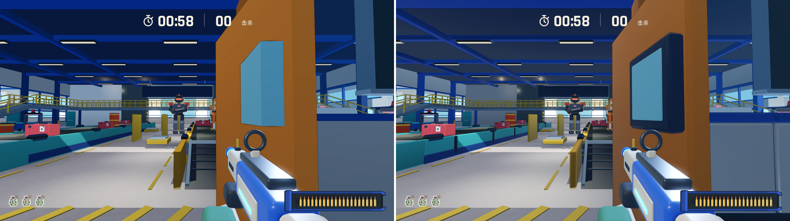 | 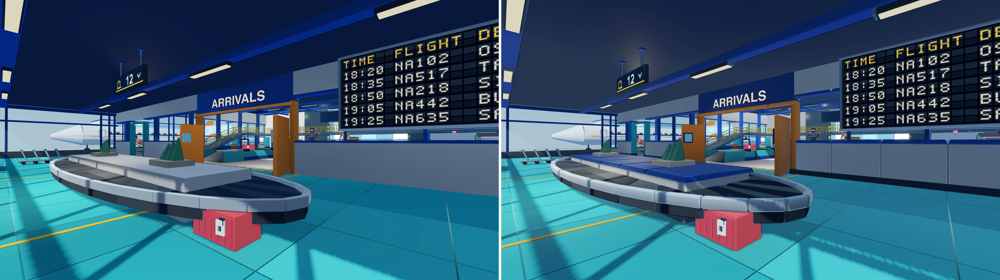 |

### 11. 银座站（`ginza_station`）

轨道隔墙拆分为 `20` 跨模压瓷砖面板配深灰踢脚与分段压顶；站台与通道方柱补齐踢脚底座与柱头；跨线天桥与楼梯扶梯补齐醒目橙色起点立柱、加厚斜梁与桥面唇边；半高屏蔽门、列车车顶空调舱、闸机、售货机与站台小卖部同步升级。

| 起点实战视角 | 全景机位 |
| --- | --- |
| 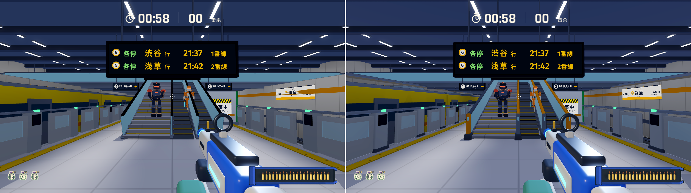 | 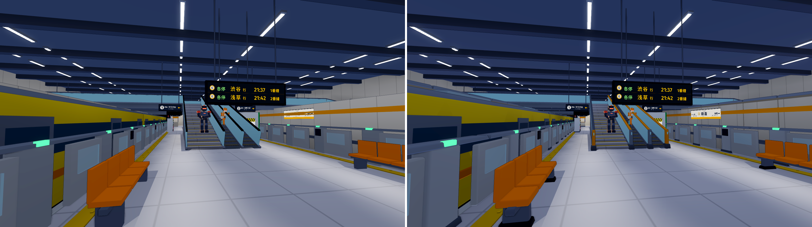 |

### 12. 香港雨市（`rain_market`）

两侧唐楼立面补齐花岗岩勒脚、每层白色挑檐线脚、屋顶分段女儿墙压顶与带斜拉杆的分段挡雨棚；海鲜档、活鱼池与菜档补齐石质底座与不锈钢/白瓷压顶边；海旁码头护墙压顶与系船柱同步玩具化加厚。

| 起点实战视角 | 全景机位 |
| --- | --- |
| 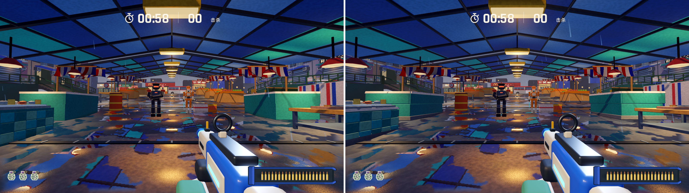 | 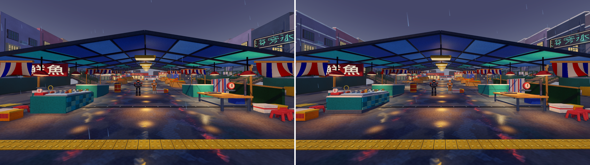 |

---

## 四、集中验收结果与性能实测

### 自动化规则与实走测试（全部通过，尚未人工完整对局试玩）

- 基础与全局检查：`rules_test.gd`、`map_scene_test.gd`、`color_material_check.gd`、`aim_sights_check.gd`、`--combat`、`--finale`、`--enemy-accuracy` 全部通过。
- 货场专项检查：`--destroy`、`--routes`（东西双楼梯往返与慢速接缝）、`--terrace`（露台接缝、浅水池进出与棕榈树干阻挡）全部通过。
- 独立地图专项检查：`sandgate_check.gd`、`bb_office_check.gd`、`hogwarts_check.gd`、`amusement_park_check.gd`（`--park`）、`last_ferry_check.gd`（`--ferry` 实机窗口模式，含远景灯塔与码头视锥校验）、`night_studio_check.gd`（`--studio`）全部通过。
- 五张概念地图集中检查：`concept_arenas_check.gd`（覆盖 `rain_market`、`baggage_below`、`snowline`、`palm_house`、`ginza_station` 的巡游动线、双层高差、狂暴破拆捷径、特种机关与回合重置）全部通过。

### 全地图模型体积与实机渲染性能汇总

测试环境：Apple M4 Pro，Godot 4.7.2 `gl_compatibility`（OpenGL on Metal），视口 `1440 x 810`（窗口 `1280 x 720`），VSync 开启，敌人 AI 实时运行、镜头缓慢扫动采样：

| 地图 | 烘焙后静态建筑三角面 | 模型目录体积 | Draw Calls P50 | 图元数 P50 | 帧间隔 P50 |
| --- | ---: | ---: | ---: | ---: | ---: |
| `score_attack` (`yard`) | 批次 + 套件内嵌 | 通用套件共用 | `2,129` | `265,398` | `11.58 ms` |
| `sandgate` | `118,006` | `4.7 MB` | `930` | `391,998` | `9.88 ms` |
| `bb_office` | `89,588` | `4.4 MB` | `2,629` | `717,803` | `15.60 ms` |
| `amusement_park` | `20,186` | `3.8 MB` | `1,178` | `335,270` | `9.90 ms` |
| `last_ferry` | `54,093` | `1.8 MB` | `882` | `291,913` | `10.26 ms` |
| `night_studio` | `28,494` | `1.8 MB` | `1,044` | `274,778` | `9.64 ms` |
| `hogwarts` | `237,154` | `9.6 MB` | `627` | `501,471` | `9.02 ms` |
| `palm_house` | `87,127` | `3.2 MB` | `828` | `312,790` | `9.74 ms` |
| `snowline` | `78,929` | `3.4 MB` | `756` | `356,430` | `9.97 ms` |
| `baggage_below` | `92,026` | `3.5 MB` | `990` | `345,905` | `9.42 ms` |
| `ginza_station` | `85,286` | `3.9 MB` | `888` | `335,237` | `9.89 ms` |
| `rain_market` | `230,498` | `7.8 MB` | 独立 `MarketLookdev` | 独立管线 | 实机截图通过 |

---

## 五、全量重构建与烘焙命令

```sh
# 1. 通用道具与货场场景
blender --background --python-exit-code 1 --python tools/build_assets.py
blender --background --python-exit-code 1 --python tools/build_leisure_assets.py

# 2. 独立构建器地图
for script in build_sandgate build_bb_office build_amusement_park build_last_ferry build_night_studio; do
  blender --background --python-exit-code 1 --python "tools/${script}.py" || exit 1
done

# 3. ArenaKit 地图
for map in hogwarts palm_house snowline baggage_below ginza_station rain_market; do
  blender --background --python-exit-code 1 --python "tools/maps/build_${map}.py" || exit 1
done

# 4. 静态建筑顶点光烘焙
for map in sandgate bb_office amusement_park last_ferry night_studio hogwarts palm_house snowline baggage_below ginza_station rain_market; do
  blender --background --python-exit-code 1 --python tools/maps/bake_vertex_light.py -- "$map" || exit 1
done

# 5. Godot 导入与货场打包
godot --headless --path . --editor --import
godot --headless --path . --script tools/maps/save_yard.gd
```

## 六、下一轮模型进化方案

2026-11-12：在本轮全图基础结构升级之上，后续建议转向专属母版、主轮廓、真实深度和第一人称可见收益。详见 [下一轮方案](next-iteration.md)。该文档为设计建议，尚未实施；不改变以上已完成工作的范围。
