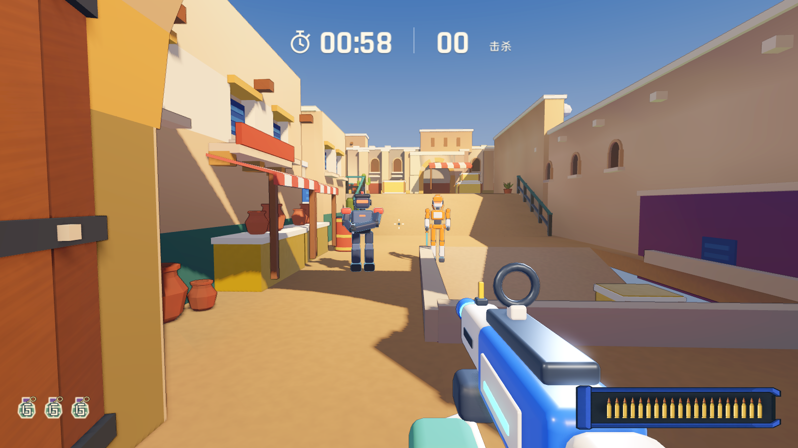
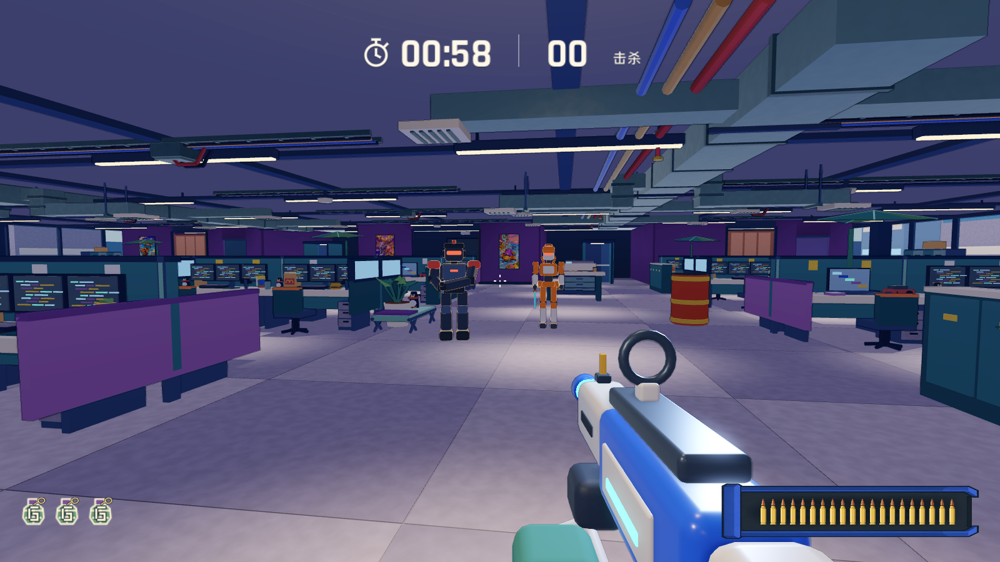

# 上漆玩具场景建模进阶：从圆角盒体到微缩沙盘

日期：2026-11-12。作为 [`docs/art/toy/README.md`](../toy/README.md) 的场景几何补充方案，解决当前地图建筑与道具“只是给直角长方体包了一圈圆角”的造型单薄问题。

## 问题诊断

当前角色与武器（[`tools/build_toy_actors.py`](../../../tools/build_toy_actors.py)）已完成多级体块拆分，但多数地图场景（如 [`tools/maps/arena_kit.py`](../../../tools/maps/arena_kit.py)、[`tools/build_sandgate.py`](../../../tools/build_sandgate.py)、[`tools/build_bb_office.py`](../../../tools/build_bb_office.py)）底层仍以正交直棱柱 `box()` 和 `slab()` 直接拼合：

1. 大部分地图静态建筑尚未接入统一倒角与加权法线，或仅做了均匀圆角，变成缺少骨点的“肥皂块”；
2. 墙地直插、门窗平贴、管线光滑无节，缺少二三级结构拆分与非正交剪影，在纯色无贴图的材质规则下暴露出明显的灰盒感。

| 当前沙门实战视角 | 当前办公室实战视角 |
| --- | --- |
|  |  |

在不引入手工雕刻与写实贴图、保持 Blender Python 脚本程序化建模且不改动现有碰撞盒的前提下，按以下五个建模要点升级场景套件。

---

## 1. 三段式建筑截面：消灭光秃直墙交界

墙体不能用单个 `box()` 从地面一通到底，需要拆分为接地、墙身、收顶三层结构，配合顶点烘焙遮蔽稳住体积。

- **底部勒脚 / 踢脚线（Plinth / Baseboard）：** 高 `0.18` 至 `0.30` 米，向外凸出 `3` 至 `5` 厘米，颜色比主墙压深一档或改用石材、深色塑料色板，把墙体钉在地面上。
- **顶部压顶 / 挑檐（Coping / Cornice）：** 高 `0.12` 至 `0.20` 米，向外挑出 `5` 至 `8` 厘米并带斜切面，使用亮一档的浅色并切出分段拼缝，让墙顶边缘接住连续高光。
- **转角护角柱（Corner Pilaster）：** 两面墙交汇的外转角包覆凸出墙面 `4` 厘米的立柱，打破平直转折。
- **脚本落点：** 在 `tools/maps/arena_kit.py` 中封装 `coping_wall(start, end, height, thickness)`，替代直接调用 `box()` 砌墙。

---

## 2. 微锥度与斜切咬合：打破 90 度正交死板感

纯正交（90 度）方块堆叠会产生强烈的工程白盒感。参考《守望先锋》场景体块处理，立柱、墩体与矮掩体应引入轻微的上窄下宽锥度，并用硬斜切配合窄倒角替代均匀大圆角。

- **1 至 4 度微锥度（Taper）：** 墩柱、门洞扶壁、室外胸墙顶面比底面内缩 `3%` 至 `6%`，搭配独立柱础垫块（Footing），剪影重心自然下沉。
- **45 度结构斜切 + 窄高光倒角：** 工业结构件、掩体转角优先做显式的斜切面（Chamfer），再用小半径倒角接高光，避免所有边缘都糊成软泡沫。
- **剪影破形件：** 在墙头、门楣局部挑出短木梁头、拱顶石（Keystone）或承托牛腿，用极少面数打破直线边界。
- **脚本落点：** 为 `prism()` 与 `box()` 增加 `taper` 参数，支持顶面按比例缩放。

---

## 3. 内凹深框与注塑分件缝：禁止表面平贴色块

纯色画面里没有贴图阴影造假，门窗、屏幕、隔断如果只是大盒体表面贴薄片，侧面与高光下会立刻露馅。

- **三层深度开洞法则：** 外框凸出墙面 `+4` 厘米 -> 门板或窗玻璃向墙内退 `-12` 至 `-20` 厘米 -> 底部挑出 `+8` 厘米的厚窗台板（Sill）。`20` 厘米的真实进深能在斜射主光与顶点遮蔽下投出清晰口袋阴影。
- **注塑拼装分件缝（Panel Seams）：** 大尺寸塑料玩具必然存在分件卡扣缝。超过 `3` 米的连续平面（办公室紫色隔断、地铁站墙板、演播室背景板）每隔 `1.2` 至 `2.0` 米切出宽 `2` 厘米、深 `1.5` 厘米的凹槽，或拆分为留有 `1.5` 厘米间隙的并排面板，并在边角加入规则定位凹点或包角盖。
- **脚本落点：** 新增 `recessed_opening()` 与 `paneled_wall()` 组件，自动生成外框、内退芯板、窗台与等距分缝。

---

## 4. 薄片改厚体块：补齐骨架与工业箍圈

微缩玩具比例下，薄于 `3` 厘米的零件在 `10` 米外接不住倒角高光，还会显得廉价脆弱。所有单薄片状物与光滑长管都需要加厚并补齐支撑逻辑。

- **遮阳棚与雨棚：** 去掉零厚度平板，改为带厚度的三段微弧折面，前缘增加下垂挡边（Valance），下方补齐加厚三角斜撑木架与咬合槽口。
- **风管与管道桥架：** 去掉一通到底的光滑方管，每隔 `1.5` 至 `2.0` 米套一圈凸出 `2.5` 厘米的法兰夹箍（Flange Clamp）与吊杆卡扣，形成明暗节奏。
- **家具与终端设备：** 桌面边缘、椅背、栏杆与显示器外壳放大至写实厚度的 `1.5` 至 `2` 倍；办公桌显示器改用厚边框、深背壳的复古块体造型，契合塑料玩具语境。
- **脚本落点：** 在 `tools/toy_blocks.py` 与地图套件中提取 `flanged_duct()`、`awning()` 等带骨架的复用生成器。

---

## 5. 核心玩具套件工作流：每图聚焦 5 个母版模块

无需手工重做整张地图，沿用角色与武器已跑通的“正交设定图 -> 程序化零件拼装”流程，每张地图优先升级出镜率最高的 5 个核心套件（Hero Kits），严格控制大、中、小三级体块比例（约 `7 : 2 : 1`）。

| 编号 | 模块类型 | 结构要点 | 适用地图举例 |
| --- | --- | --- | --- |
| 1 | 微锥度矮掩体 | 底宽顶窄、深色底座、分段浅色压顶 | `sandgate`、`yard`、`hogwarts` |
| 2 | 厚框拱门 / 门洞 | 多色块咬合拱圈、外凸门柱、侧面拼装卡槽 | `sandgate`、`hogwarts`、`palm_house` |
| 3 | 主题摊位 / 掩体组 | 厚折边条纹棚、承重斜撑、成组圆润陶罐或货箱 | `sandgate`、`rain_market`、`amusement_park` |
| 4 | 模块化室内工位 | 分缝隔断屏风、厚圆角桌面、大肚厚框终端机 | `bb_office`、`night_studio`、`baggage_below` |
| 5 | 重型管线机械组 | 粗主管道、等距法兰箍、支撑底座与百叶格栅 | `bb_office`、`ginza_station`、`baggage_below` |

---

## 最小试水步骤

合回 `main` 及发布 Web 前，先在单张地图上控制面数预算完成样板验证：

1. **按需倒角：** 将 `tools/toy_bevel.py` 接入地图套件，仅对出生点与主战区近景掩体、门框、压顶、柱子启用 1 至 2 段倒角加权法线；大面积地面与图外远景建筑保持硬边不倒角。
2. **单点替换：** 先选 `sandgate` 或 `bb_office` 起点正前方视野内的 3 至 4 类核心构件（矮墙、门窗框、遮阳棚或工位风管）按上述五点改写生成函数，保留原有 `layout["boxes"]` 碰撞体与导航网格不变。
3. **同机位验收：** 重新运行烘焙与 `tools/maps/capture_map_compare.gd`，在相同 `1600 x 900` 机位下对比前后剪影、阴影层次、三角面增量与帧时间。
