# 十二张地图干净向几何做旧升级（Clean Toy Palette + Sculpted Geometric Wear）

日期：2026-11-13，分支：`toy`（仅本地客户端，不发布 Web）。针对第一轮纯着色器噪点做旧导致的“画面发脏、水渍泥斑糊住玩具色块”问题，重构做旧策略：**大幅收敛表面着色器污渍，恢复明亮干净的上漆塑料色块，改用真实 3D 几何切角、斜角墙缝、局部剥落露砖、斜缝错位压顶石与铆钉修补板来表达鲜活的不规则使用痕迹**。

---

## 一、两层重构机制

### 1. 表面着色器净色化（清除泥斑水渍，只留光泽破光与干净亮边）

更新 [`assets/shaders/toy_paint.gdshader`](../../../assets/shaders/toy_paint.gdshader)、[`assets/shaders/map_surface.gdshader`](../../../assets/shaders/map_surface.gdshader)、[`assets/shaders/wall_paint.gdshader`](../../../assets/shaders/wall_paint.gdshader)、[`assets/shaders/market_surface.gdshader`](../../../assets/shaders/market_surface.gdshader) 与 [`scripts/maps/toy_palette.gd`](../../../scripts/maps/toy_palette.gd)：

- **移除发脏覆盖层**：去掉地面泥印斑块、立面深色雨水流挂、顶点 AO 叠脏以及地毯/草坪脏污贴片；大面积色彩扰动收敛至 `±2%–3%`，墙面与地面恢复清透纯正的玩具色块。
- **保留克制亮边与光泽质感**：仅在真实 3D 倒角、崩角切面与斜角缝唇边保留手涂亮色底漆干扫（上限 `0.28–0.32`），墙根接地灰尘压缩至 `< 12 cm` 的暖色微过渡，主要由粗糙度微差（`ROUGHNESS`）提供触感而不污染固有色。

### 2. 程序化 3D 几何做旧原语（[`tools/maps/toy_kit.py`](../../../tools/maps/toy_kit.py) 与 [`tools/maps/arena_kit.py`](../../../tools/maps/arena_kit.py)）

所有几何做旧完全限制在视觉网格（`.glb` / 视觉子网格）中，碰撞盒、斜坡与导航数据（`tools/maps/*_layout.json`）保持零改动，并在离线阶段重新执行 Cycles 顶点光遮蔽烘焙：

1. **斜角墙缝（`slanted_wall_seam`）**：由内凹深色斜缝槽与两侧对向斜切凸缘组成（可选配跨缝铁扒钉），用真实结构明暗转折打破整块平滑直墙。
2. **立体崩角切口（`chipped_box`）**：通过 BMesh 平面切削门洞墩柱、转角柱、护柱与货箱包角，生成带单段加权法线倒角的干净多边形缺口，并露出内层浅色石芯或钢芯。
3. **斜缝错位与残缺压顶石（升级 `segmented_coping`）**：压顶石改用交替斜角灰缝（Slanted mortar joints）、微小沉降高低差，并在风化墙段留出成对残桩的不对称 V 形缺口。
4. **低浮雕灰泥剥落露砖（`exposed_masonry_patch`）**：阶梯状低浮雕砂浆底衬搭配错缝单段倒角砂岩/红砖块与斜向破损灰泥边唇。
5. **铆钉修补板与风积沙堆/碎石（`repair_patch_plate`、`sand_drift`、`weathered_rubble`）**：用于工业集装箱、渡轮舱壁、地铁与机场设备的切角铆钉补丁板，以及沙漠墙根的多面体风积沙棱与崩落陶罐/石块残片。

---

## 二、十二张地图几何使用痕迹配置

| 地图 | 表面风化强度 | 专属 3D 几何破碎与不规则使用痕迹 |
| --- | ---: | --- |
| `sandgate` | `0.40` | 沙漠立面斜角墙缝配铁扒钉、阶梯剥落露砂岩砖、拱门墩柱立体崩角与错落拱券石、斜缝残缺压顶石与垛口、墙角风积沙堆与碎陶片 |
| `score_attack` (`yard`) | `0.36` | 集装箱四角铸件切角缺口、局部凹短波纹筋与奶油色铆钉修补板；二层平台与仓库立面斜角墙缝、残缺挑檐压顶；木托盘断板与木箱斜撑 |
| `hogwarts` | `0.38` | 城堡大礼堂扶壁与石护栏墩柱立体崩角、石砌斜角墙缝、高低残缺女墙垛口、霍格莫德商铺露石块墙皮与庭院碎石 |
| `palm_house` | `0.34` | 温室红砖墙裙与花坛斜角伸缩缝、花坛与入口石柱崩角露芯、斜缝石压顶、锅炉房铁箍斜缝与育苗棚剥落露红砖 |
| `amusement_park` | `0.32` | 入口大门金柱崩角、售票亭与小吃亭斜角墙缝及底部露红砖块、过山车站台斜角缝与金属修补板 |
| `last_ferry` | `0.38` | 码头岸壁斜缝残缺压顶石、候船楼斜角墙缝与黄铜修补板、驾驶室围槛斜缝与补丁、船甲板货箱崩角立柱 |
| `snowline` | `0.32` | 橙色观测鼓楼抗冻斜角伸缩缝与钢制修补护板、防风门柱崩角露钢芯、防雪木栅栏断柱与斜缺横板 |
| `rain_market` | `0.36` | 唐楼外墙斜角沉降缝配钢拉结件、隔跨交替的露混凝土块与金属修补板、斜缝错位檐口线脚 |
| `baggage_below` | `0.30` | 防撞黄护柱叉车磕碰缺口露钢芯、安检隔墙斜角伸缩缝、行李分拣传送带机壳铆钉检修补丁板 |
| `ginza_station` | `0.26` | 轨道隔墙斜角伸缩缝与局部掉砖露底块、隧道混凝土门柱崩角、站台瓷砖立柱边角磕碰缺口与斜缝 |
| `night_studio` | `0.26` | 声学隔墙异色替换吸音板、斜角拼缝与金色检修补丁板、舞台金色台唇边角磨损切口、地面斜向过线槽 |
| `bb_office` | `0.25` | 走廊隔断局部异色更换面板、干墙斜角接缝与镀锌检修盖板，整体保持整洁明亮办公空间 |

---

## 三、同机位实机渲染对比（左：第一轮过脏着色器做旧 / 右：本轮干净色块 + 3D 几何做旧）

全部 `12` 张地图 `1600 x 900` 的 `play` 与 `view` 高清原图及对比图均保存在 [`renders/`](renders/)。

### 1. 沙门（`sandgate`）与 货场（`score_attack`）

| 沙门实战视角 | 货场实战视角 |
| --- | --- |
| 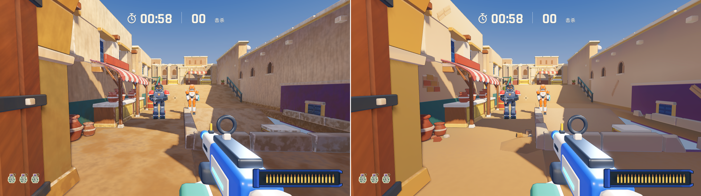 | 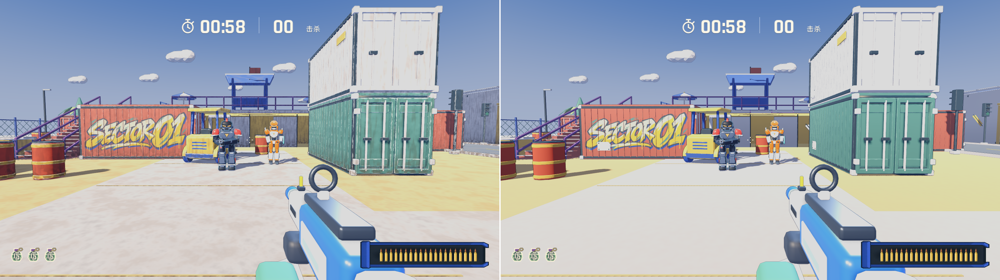 |

| 沙门全景视角 | 货场全景视角 |
| --- | --- |
| 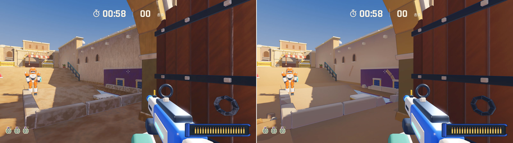 | 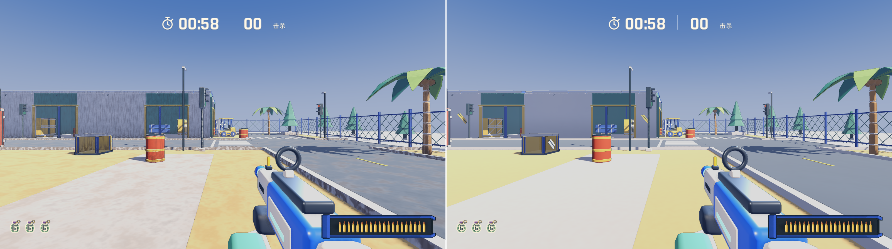 |

### 2. 棕榈温室（`palm_house`）与 银座站（`ginza_station`）

| 棕榈温室实战视角 | 银座站实战视角 |
| --- | --- |
| 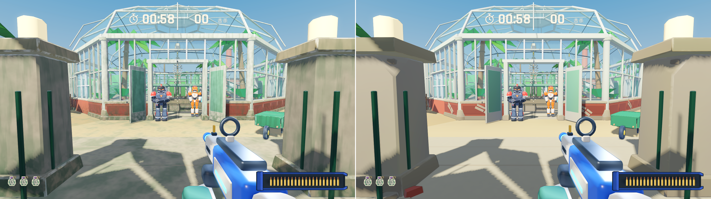 | 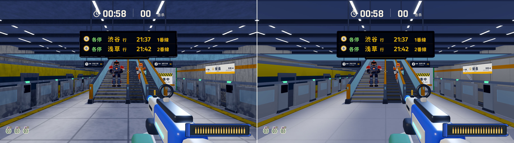 |

### 3. 霍格沃茨（`hogwarts`）与 末班渡轮（`last_ferry`）

| 霍格沃茨实战视角 | 末班渡轮实战视角 |
| --- | --- |
| 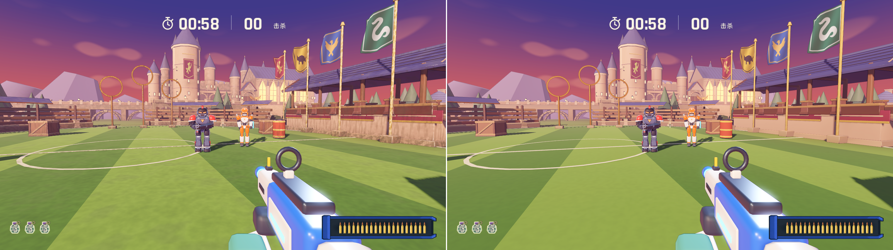 | 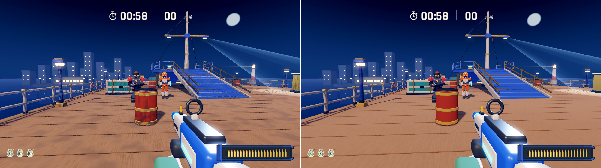 |

### 4. 雪线天文台（`snowline`）与 行李层（`baggage_below`）

| 雪线天文台实战视角 | 行李层实战视角 |
| --- | --- |
| 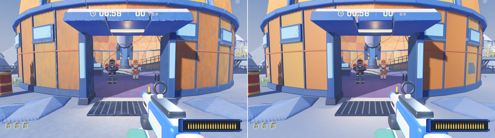 | 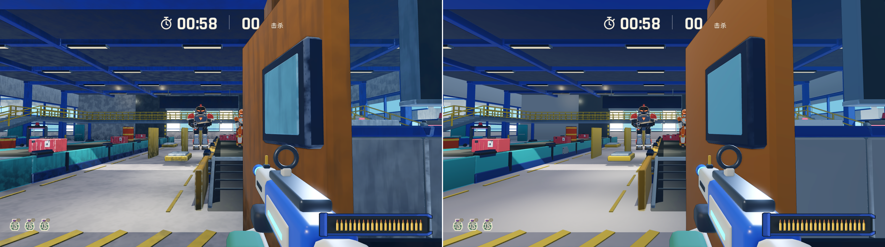 |

### 5. 游乐园（`amusement_park`）与 香港雨市（`rain_market`）

| 游乐园实战视角 | 香港雨市实战视角 |
| --- | --- |
| 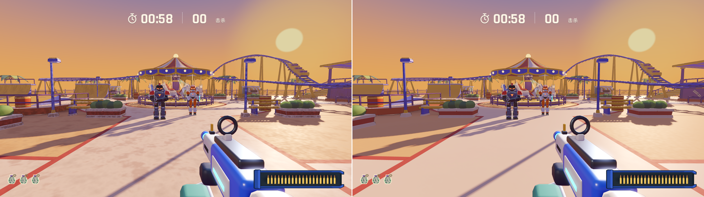 | 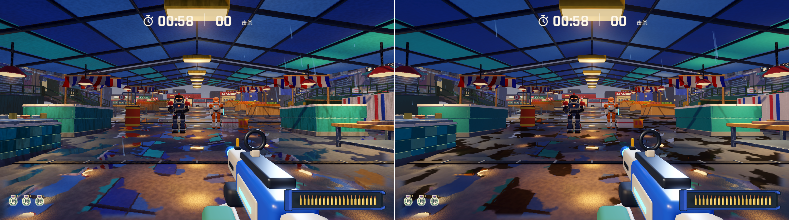 |

### 6. 午夜演播室（`night_studio`）与 办公室（`bb_office`）

| 午夜演播室实战视角 | 办公室实战视角 |
| --- | --- |
| 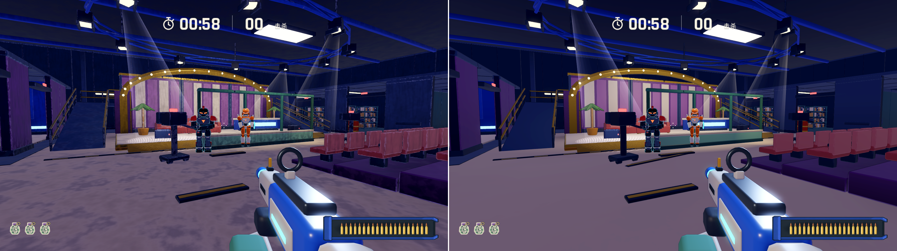 | 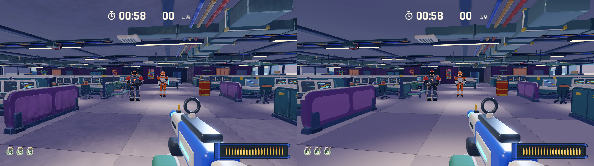 |

---

## 四、验证与性能实测

- **碰撞与导航零回退**：`tools/maps/*_layout.json` 零变更；`rules_test.gd`、`color_material_check.gd`、`rain_market_lookdev_check.gd`、`map_scene_test.gd`、`sandgate_check.gd`、`hogwarts_check.gd`、`concept_arenas_check.gd`、`--combat`、`--qa --destroy` 全部通过（注：以上为引擎自动化检查与脚本渲染采样，尚未代替人工完整对局试玩）。
- **实机渲染性能**（Apple M4 Pro，`1440 x 810`，敌人 AI 激活扫镜采样）：`score_attack` P50 `10.31 ms`、`sandgate` `9.28 ms`、`hogwarts` `9.25 ms`、`palm_house` `8.89 ms`、`ginza_station` `8.58 ms`、`bb_office` `12.17 ms`，几何合并进原有单材质批次，Draw Calls 零额外增长。
