# 上漆塑料玩具画风

分支：`toy`。只做本地客户端版本，不发布 GitHub Pages，也不发布 `fps.yicong.me`。分支合回 `main` 前，需要另外完成 Web 性能与发布验证。

## 目标

精致的上漆塑料玩具：明亮、干净、体积清楚。比当前平涂低多边形更有质感，但不追求《守望先锋》级别的模型和贴图细节。风格取舍不清时，参考《守望先锋》的处理原则：大形体优先、色彩分区清楚、暖光冷影、角色从环境中跳出来。只学原则，不复制它的角色、地图、标志或 UI。

## 规则

| 对象 | 材质 | 形体 | 轮廓 |
| --- | --- | --- | --- |
| 第一人称枪 | 半光泽塑料，少量金属件，独立补光 | 所有主要块体倒角，边缘接高光 | 不依赖黑线 |
| 敌人 | 半光泽塑料，亮色面罩与阵营色 | 圆角大块，头肩轮廓清楚 | 背景反差色边缘光 |
| 建筑与大道具 | 哑光彩漆，大尺度上亮下暗 | 主要外角倒角，平面保持平直 | 很淡的深度轮廓，随距离消失 |
| 布、雪、植物 | 哑光，细节很弱 | 团块，不做细碎噪声 | 不描颜色边界 |

- 光：太阳偏暖，阴影偏冷蓝紫；天空渐变提供环境光；用 Filmic 类曲线保护高光。
- 颜色：每个视角保留一个主色、一个辅色和少量强调色。敌人的明度或冷暖必须和背景拉开。
- 细节：远处看大色块，近处才看到倒角高光和少量结构线。不用噪点代替形体。
- HUD：维持时间、击杀、准星和按情况出现的弹药；不显示生命。

## 改造顺序

1. 第一人称枪：倒角、塑料材质、独立补光。
2. 敌人：圆角形体、亮色面罩、边缘光。
3. 全局：色调映射、渐变天空、冷色阴影。
4. 环境：去掉按颜色差描边，加入大面积明暗渐变。
5. 道具和建筑：按统一倒角规范逐步替换。

每一步用同一组固定机位截图对比，并检查 15–25 米外敌人是否好认。

## 基线

改造前（`main` 的 `8e29780`），1440 x 810 本地渲染：

| 院子 | 沙门 |
| --- | --- |
| 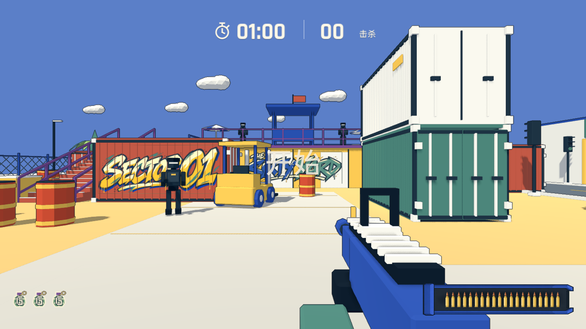 | 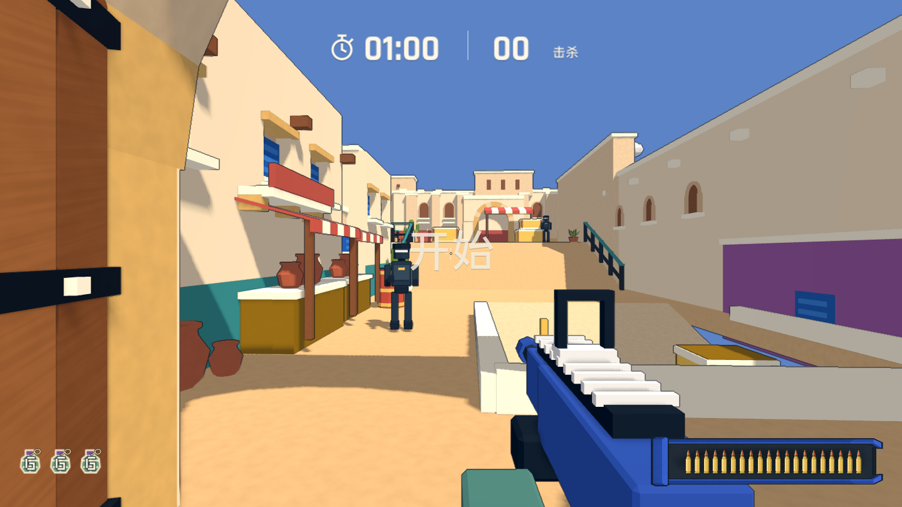 |
| 雪线 | 办公室 |
| 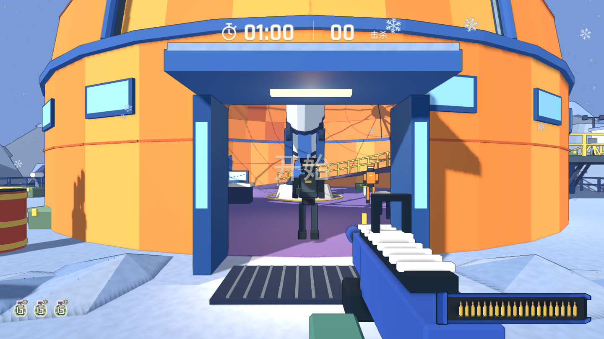 | 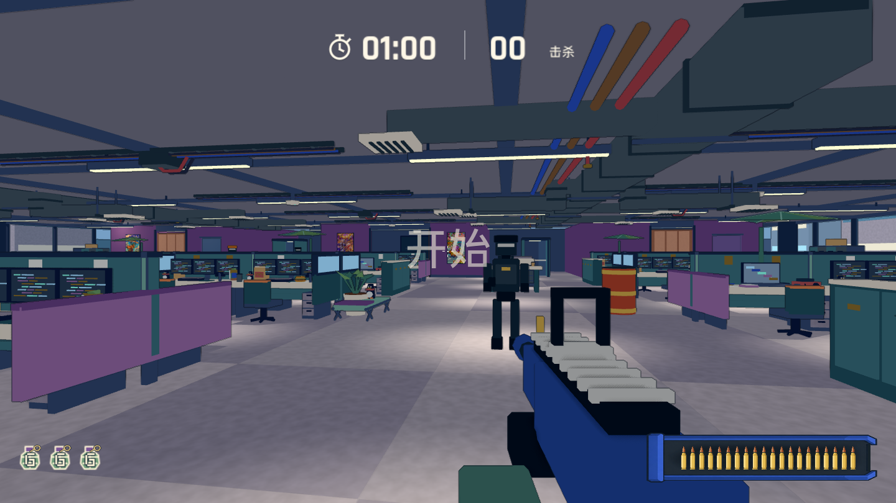 |

## 第一轮结果

五个阶段已完成，同一机位、1440 x 810 本地渲染：

| 院子 | 沙门 |
| --- | --- |
| 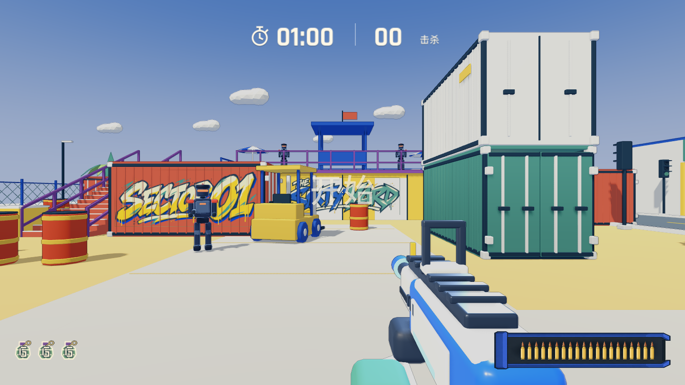 | 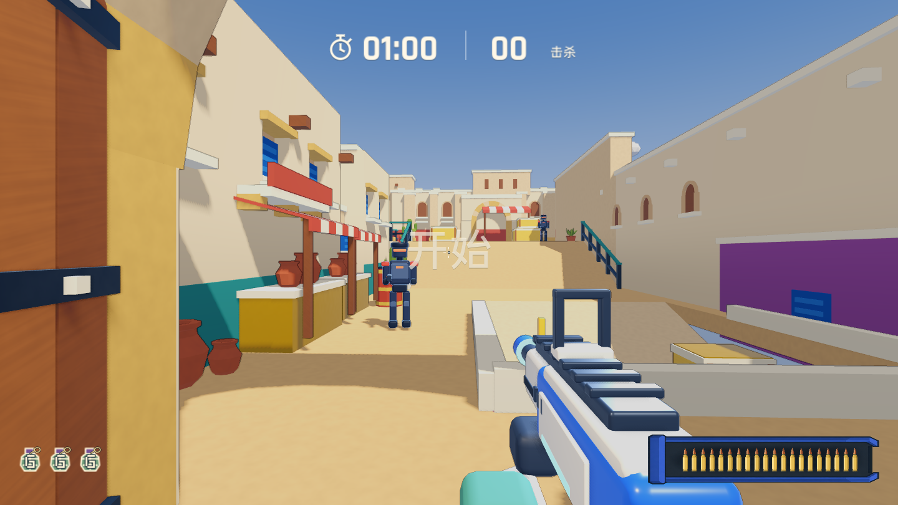 |
| 雪线 | 办公室 |
| 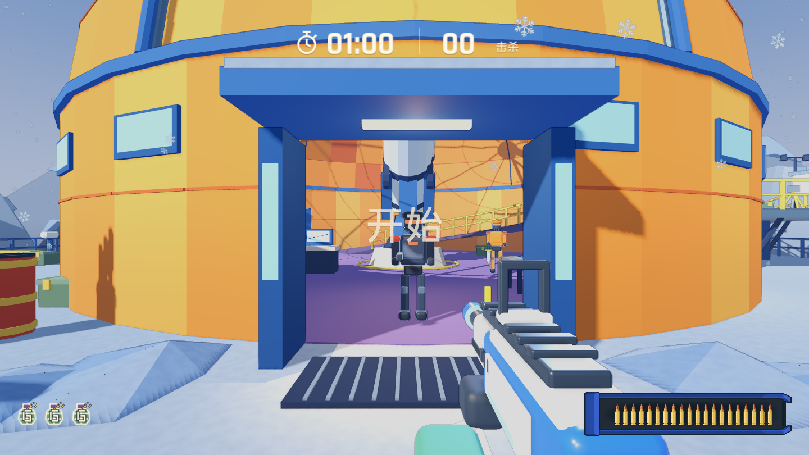 | 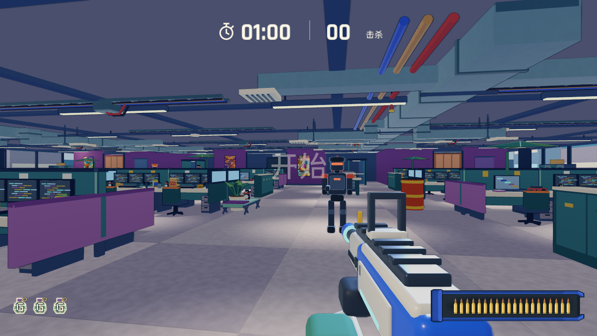 |

| 阶段 | 实现 |
| --- | --- |
| 枪 | `tools/build_toy_actors.py` 生成 `assets/models/toy/rifle.glb`：分段倒角、加权法线、奶油外壳、蓝色主体、金属件与青色发光点缀。照门、准星和枪口坐标不变。相机上挂暖色主光与冷色轮廓光，只照第一人称图层。 |
| 敌人 | 同一脚本生成 `assets/models/toy/enemy.glb`：圆角大块、红色护肩与头盔脊、暖红发光面罩。节点名、四肢枢轴和头部判定不变。`assets/shaders/toy_rim.gdshader` 作为附加通道，提供不依赖场景灯光的冷色边缘。 |
| 全局 | `scripts/maps/toy_look.gd`：Filmic 色调映射、饱和度 1.15、对比度 1.06；纯色背景地图改为 `toy_sky` 渐变天空，颜色取自当前背景色，狂暴模式的天色同样生效。天空同时作为反射来源。 |
| 环境 | 纯色漆面改用 `toy_paint`，原色、粗糙度、金属度不变，只加墙面下暗上亮和底面偏冷；`map_surface` 同步。描边去掉颜色差检测，线色取压暗的底色，1.4 米内淡出，远处减弱。 |
| 道具 | `tools/toy_bevel.py` 按最短边 18%、最大 4 厘米倒角并修正法线，`build_assets.py` 与 `build_playbox_assets.py` 共用；漆面粗糙度 0.88 改为 0.7。院子场景不重建，用 `tools/maps/apply_toy_kit.gd` 按网格名替换几何，节点、碰撞与导航不变。 |

重建顺序：

```sh
blender --background --python tools/build_toy_actors.py
blender --background --python tools/build_comedy_weapons.py
blender --background --python tools/build_assets.py
blender --background --python tools/build_playbox_assets.py
godot --headless --path . --editor --import
godot --headless --path . --script tools/maps/apply_toy_kit.gd
```

## 验证与已知问题

自动检查：导入、规则测试、瞄准照门、颜色材质、地图场景、战斗、伤害反馈、集装箱、破坏、终局、楼梯路线，以及 8 张地图普通与狂暴状态的渲染截图。尚未人工完整试玩。

原生性能，Apple M4 Pro、1440 x 810、每图 8 秒，敌人 AI 运行、镜头缓慢扫动：

| 地图 | 帧时间 P50（`main` -> `toy`） | draw calls | 图元 |
| --- | ---: | ---: | ---: |
| 院子 | 9.07 -> 10.0 ms | 1837 -> 1995 | 4.9 万 -> 20.6 万 |
| 办公室（第 4 阶段时） | 9.21 -> 10.92 ms | 2374 -> 2575 | 未复测 |

合回 `main` 并发布 Web 前需要处理：

- 敌人边缘光按部件逐个多绘制一次，8 个敌人约多 200 次 draw call；可合并非动画部件，或改为单一材质内的菲涅尔项。
- 倒角使院子道具三角面约增加 4 倍；需要给远处道具做低模 LOD，或减少波纹的倒角段数。
- `tests/interaction_check.gd` 的重生断言与 `--graffiti` 重复视角断言在 `main` 上同样失败；`--containers` 的放出守卫断言在两个分支上都偶发失败。均非本分支引入。
- 其余地图的专属道具（温室、城堡、雪线等）还未套用倒角规范。

## 第二轮：按四视图重建敌人与步枪

混元 3D 原件不能直接用，原因见 [`art_source/toy/hunyuan/README.md`](../../../art_source/toy/hunyuan/README.md)。改为在 `tools/build_toy_actors.py` 中照 [`concepts/tripo/`](concepts/tripo/README.md) 程序化重建：

- **步枪手（`enemy.glb`）：**
  - 加粗躯干、四肢和靴子，加大护肩，头盔改为整块加珊瑚色头盔脊，加耳罩；胸甲、腰带、护膝用石板灰；
  - 四肢的枢轴从部件中心移到肩和髋，走路时绕关节摆动；上臂和前臂分段，双手握枪；
  - 节点名、头部判定 1.70 米、开火点 `(.22, 1.12, -.58)` 不变；
  - 每个部件里，与主体同色的块并进主体，其余颜色各并成一个子网格；共 8288 面、29 个网格。
- **敌人的枪：** 按四视图改成石板灰机身、炭灰枪口块、浅灰枪托和弹匣，两侧各一道发光条，枪口正对开火点。
- **玩家步枪（`rifle.glb`）：** 蓝色机匣、奶油色护木和枪托、一整条顶部导轨、环形照门。照门中心、准星顶点和枪口坐标不变，共 5964 面。

| 两种敌人 | 关节摆动 |
| --- | --- |
| 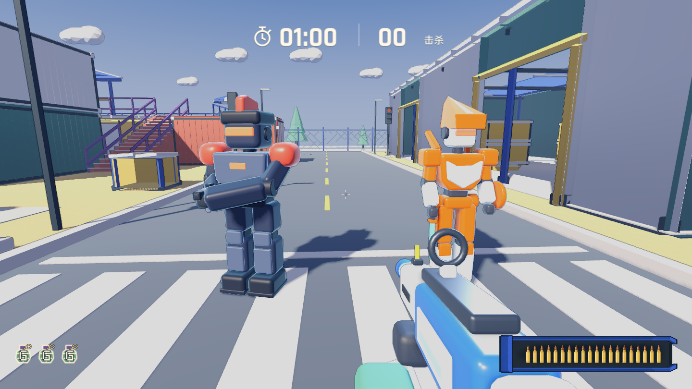 | 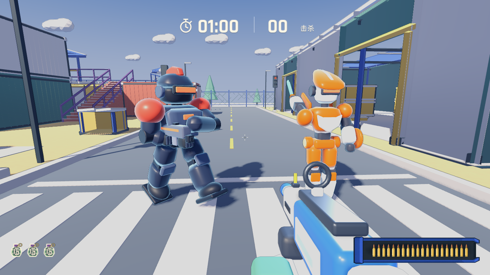 |
| 腰射 | 开镜 |
| 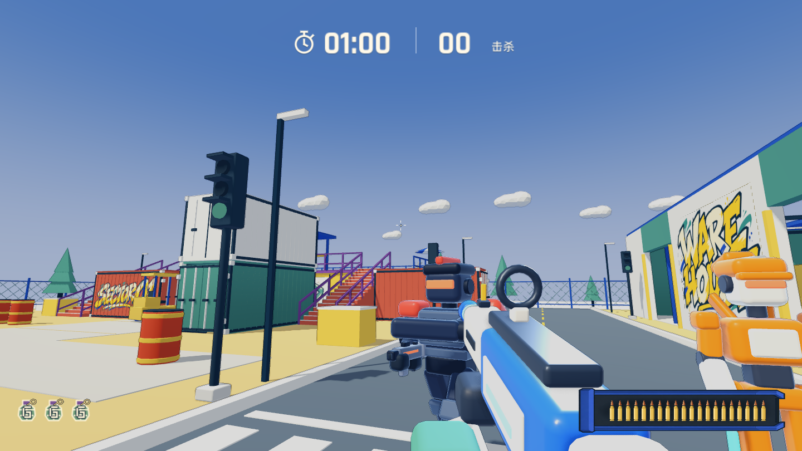 | 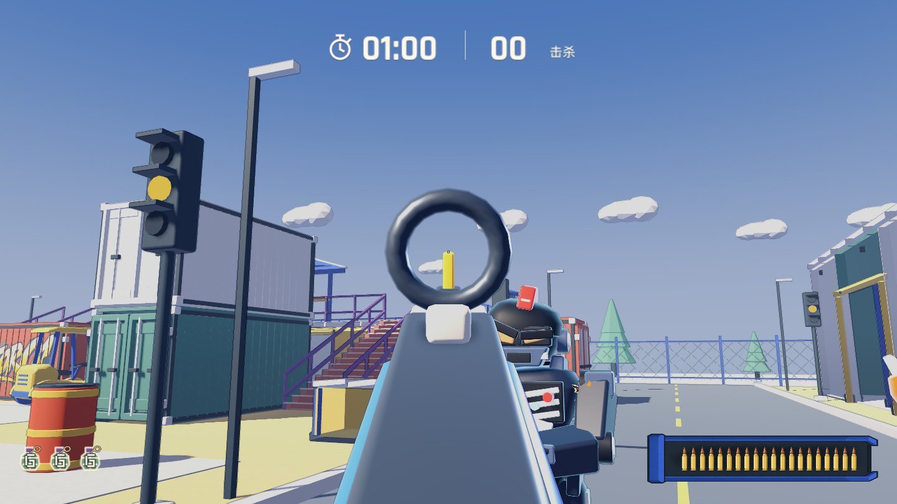 |

截图：`godot --path . --script tests/toy_actor_capture.gd`。

自动检查：瞄准照门、颜色材质、`--combat`、`--dodge`、`--awareness`、`--enemy-accuracy`、`--damage-feedback`、`--finale`，以及一局 60 秒自动对局，全部通过。`comedy_check` 在第 87 行失败（狂暴模式下快攻敌人的生命值断言），改动前同样失败。尚未人工试玩。

院子性能基准（12 个敌人、不限帧）：draw call 2128 -> 2256，帧时间 P50 7.58 -> 7.41 毫秒，P99 11.9 -> 12.8 毫秒，在测量波动范围内。多出的 draw call 来自每个敌人多 5 个网格，各带一次边缘光绘制。

## 第三轮：突击手、刀与搞笑模式武器

同样照四视图程序化重建，共用的倒角、塑料材质和合并逻辑抽到 `tools/toy_blocks.py`。

- **突击手（`toy/rusher.glb`）：**
  - 橙色外壳、奶油色胸板和小腿、深色关节，楔形头盔、背鳍和髋部推进器；
  - 快攻敌人不再借用步枪手模型，也去掉了横向 0.92 的缩放；
  - 蓄力闪烁仍作用在 `Torso`、`Helmet` 和四肢上，所以这些主体是橙色，奶油色和深色部分是子网格；
  - 右手落在刀臂的握刀点，头部判定仍在 1.70 米；共 7968 面。
- **刀（`toy/rusher_blade.glb`）：** 青色刀身、橙色护手、深色握柄、奶油色尾帽，替换旧的 `knife.glb`。
- **滋水枪（`comedy/water_blaster.glb`）：** 蓝色机身、黄色水箱、橙色喷嘴和金色套环、绿色泵把；枪口坐标不变。
- **拖把枪（`comedy/mop_launcher.glb`）：** 紫色机匣、淡紫色杆、整块薄荷绿拖把头，杆上夹一只拖鞋；替换 `slipper_launcher.glb`，枪口坐标不变，仍然发射拖鞋。
- **拖鞋弹体（`comedy/slipper.glb`）：** 改为橙色鞋底、奶油色鞋垫和橙色鞋带，与拖把枪上的一致。

| 滋水枪 | 拖把枪 |
| --- | --- |
| 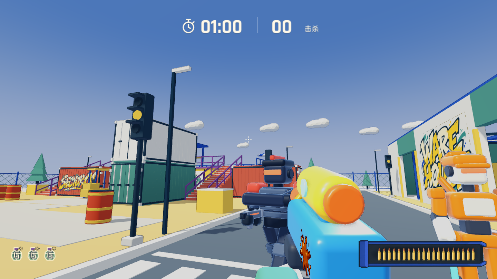 | 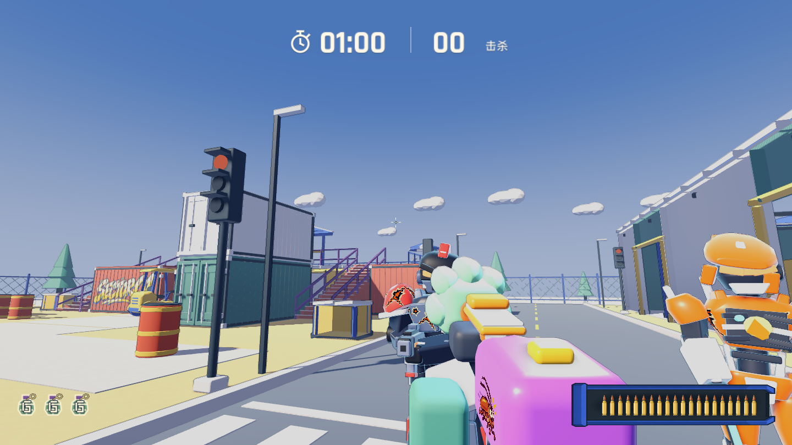 |

自动检查：`--combat`（含刀可见、没有枪）、`--dodge`、`--awareness`、`--enemy-accuracy`、`--damage-feedback`、`--finale`、瞄准照门、颜色材质和一局 60 秒自动对局，全部通过。两种搞笑模式的检查都通过了武器文件断言，之后停在原有的第 87 行。尚未人工试玩。

性能：这次测量时机器负载很高（load average 13 到 18），和上一提交交替测了三轮，帧时间与 draw call 持平。完整的性能排查放到后面再做。

## 第四轮：霍格沃茨光照与色彩方案样板

烘焙顶点光照（`tools/maps/bake_vertex_light.py`）加每张地图的色彩方案（`scripts/maps/toy_palette.gd`），目前只做了霍格沃茨。对比图与参数见 [`hogwarts/README.md`](hogwarts/README.md)。

## 敌人概念轮廓细化

在已有替换基础上进一步制作重装步枪兵与后掠头盔突击兵，实机图、资源规模与验证见 [造型细化记录](actors-refined/README.md)。

## 敌人主体重建

针对上一轮轮廓变化不足的反馈，进一步重建头盔、躯干和四肢曲面。见 [同机位前后对比](actors-rebuild/comparison.html) 与 [实现和验证记录](actors-rebuild/README.md)。

## 方案 A 反派玩具机甲与非爆头战损

按方案 A（「黑曜重装卫兵」与「狂飙剃刀猎犬」）补齐曲面装甲内的机械关节、怒眉裂隙眼、胸口反应炉、左腕能量圆盾与宽刃电浆刀，并修复及强化单发非爆头命中的 3D 崩甲与电弧裂痕战损。详见 [设定稿与实机战损对比](actors-mecha/README.md)。

## 十二张地图风格化微缩沙盘做旧

统一升级 `toy_paint`、`map_surface`、`wall_paint` 与 `market_surface` 四个着色器及 `toy_palette.gd` 风化色板，加入近中景 3D 倒角干扫掉漆、墙根飞溅积尘、立面水渍流挂、地面踩踏磨损与粗糙度破光。详见 [做旧机制与 12 图前后对比](../toy-weathering/README.md)。
