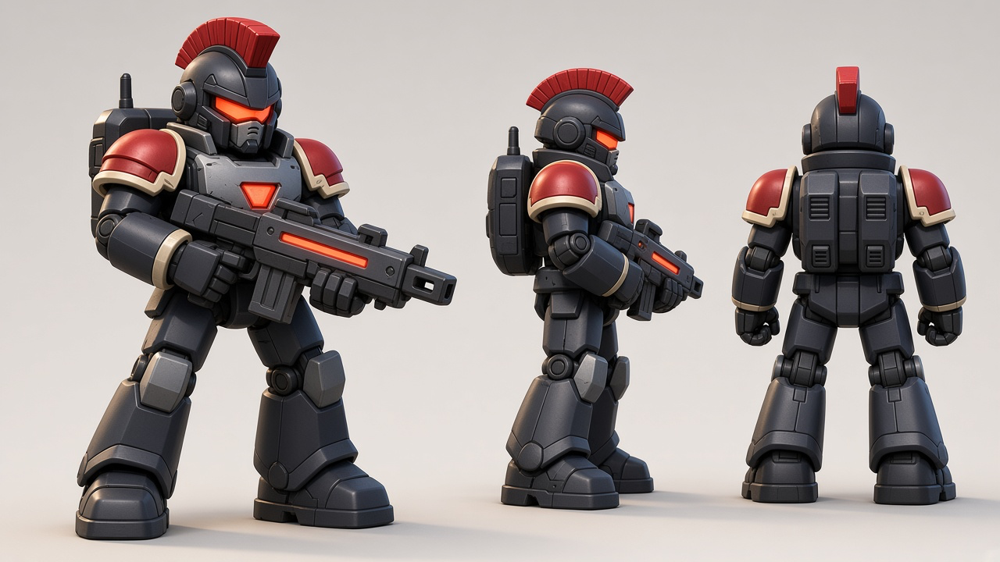
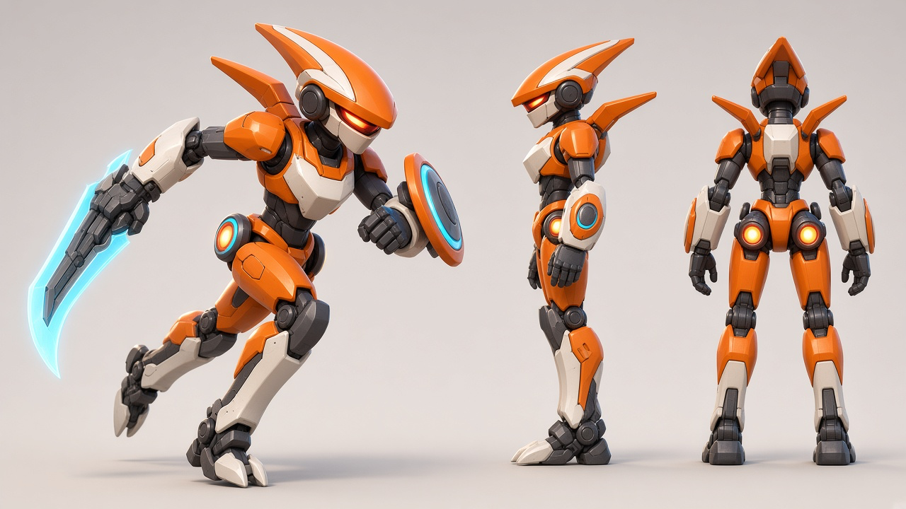
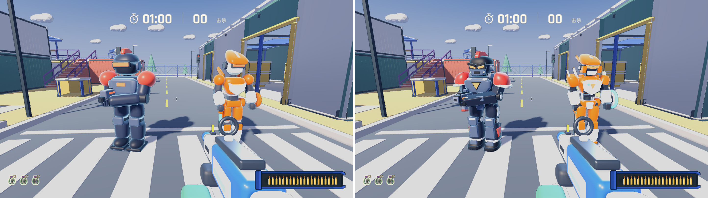
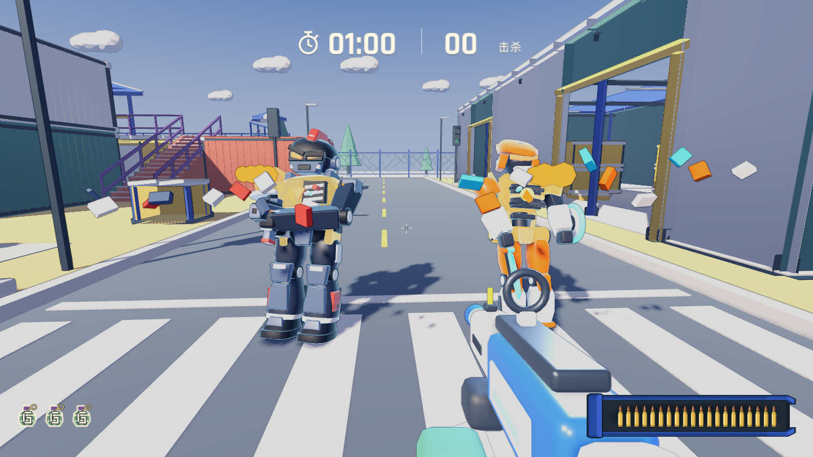
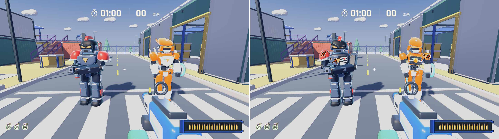

# 反派玩具机甲重构与非爆头战损反馈

日期：2026-11-13，分支：`toy`（仅本地客户端，不发布 Web）。针对上一轮曲面重建过度简化为圆滑胶囊块、以及单发非爆头命中后缺少可见战损状态的问题，按方案 A（黑曜重装卫兵 + 狂飙剃刀猎犬）完成模型重构与四层战损反馈落地。

---

## 一、方案 A 设定稿

| 远程步枪兵：「黑曜重装卫兵」 | 近战突击兵：「狂飙剃刀猎犬」 |
| --- | --- |
|  |  |

---

## 二、建模与绑定升级（`tools/toy_blocks.py`、`tools/build_toy_actors.py`）

新增中心原点超椭圆曲面壳体构造器 `sculpt_loft()`、微锥斜切块 `wedge()`、轮廓挤出板 `plate_profile()`、锥度肢体 `taper_limb()` 与带双端浅色卡扣盖的外露圆柱关节鼓 `joint_drum()`，在不改变头部判定球（`y = 1.70`）、身体胶囊碰撞与开火点（`(.22, 1.12, -.58)`）的前提下补齐机甲层次：

- **远程步枪兵（`assets/models/toy/enemy.glb`）：**
  - **头盔与面部：** 弧面战术重盔配下压 V 字怒眉檐、鼻梁隔断双裂隙炽红眼罩、机械下颚呼吸栅、双侧圆柱耳部传感鼓与高耸绯红冠脊。
  - **躯干与背包：** 高领防爆护颈圈、钛灰胸甲配倒三角炽红反应炉与奶油白领口锁扣、腰肋外露双液压阻尼杆、战术弹药包腰带，背部升级双联装动力电池仓、斜向百叶散热口与短天线。
  - **四肢与持枪同步：** 绯红弧面大肩盾配奶油白下缘卡扣圈；喇叭口重装护胫增加钛灰前甲与绯红踝部推进饰块；修复行进时双手与脉冲步枪脱节的问题，双臂与枪身在跑动中保持同步微幅颠簸。
- **近战突击兵（`assets/models/toy/rusher.glb`、`rusher_blade.glb`）：**
  - **头盔与身形：** 全包覆安全橙前掠鲨鱼头盔、深灰内凹面罩、上挑凶狠红光眼罩与后掠双尾鳍；V 字宽肩收束至外露液压活塞细腰。
  - **非对称近战武装与推进器：** 左前臂挂载带发光青色光环的小型能量圆盾；右手换装带深灰阶梯机械刀脊的宽幅弧形青色电浆战刀；背部与髋部两侧配发光橙金喷口，足部改为三趾机械利爪靴。

---

## 三、单发非爆头战损反馈修复与强化

### 根因定位

1. **局部坐标偏移导致裂痕着色器全透明：** 上一轮 `armor_loft` 将网格原点留在脚底 `(0, 0, 0)`，顶点 `VERTEX.y` 落在 `1.13`–`1.53`，偏离 `armor_hit.gdshader` 预期的局部中心 `y ≈ 0`，导致闪白结束后裂痕 `ALPHA = 0`。
2. **突击兵胸甲节点漏挂：** `enemy.gd` 仅向 `Torso` 和 `Vest` 挂接 `armor_hit`，未覆盖突击兵的 `ChestPlate` 及肩甲等子部件。

### 四层战损表现（单发身体命中后剩余 `1 HP`）

1. **受击闪光与后仰：** `0.16` 秒高亮暖金受击闪白与上身受击后仰。
2. **彩漆装甲碎片迸射（`spawn_armor_chips`）：** 命中瞬间沿弹着方向弹出 `9` 块对应阵营配色的塑料护甲残片落地弹跳，伴随火花闪光。
3. **真实 3D 外甲崩落与破损件替换：**
   - **步枪兵：** 左侧绯红大肩盾（`LeftPad` + `LeftPadTrim`）整块崩飞露出内部深色机械肩座，右侧肩盾歪斜，完整胸甲切换为 3D 破损胸甲 `BrokenVest`（左胸缺口露出内部金属肋条与断裂发光导管），头盔震歪。
   - **突击兵：** 奶油白前胸板 `ChestPlate`、左侧背翼 `LeftFin` 与左侧头盔尾鳍 `LeftHorn` 崩落，直接露出胸腔内部深色机械肋架、过载橙色反应炉与断裂青色导能管。
4. **非对称焦黑弹坑裂痕与持续电火花：** 重写 [`assets/shaders/armor_hit.gdshader`](../../../../assets/shaders/armor_hit.gdshader)，绘制偏心焦黑弹坑、奶油色掉漆边缘与脉动熔岩电弧裂纹；存活于 `1 HP` 期间胸口破损处每隔约 `0.45` 秒迸出短路火花。

| 受击瞬间护甲碎片迸射 | 完整状态 vs 单发身体命中后 1 HP 持续战损 |
| --- | --- |
|  |  |

---

## 四、资源预算与自动化验证

| 模型 | 网格数 | 三角面数 |
| --- | ---: | ---: |
| `enemy.glb`（含隐藏战损胸甲 `BrokenVest`） | `49` | `16,582` |
| `rusher.glb` | `29` | `13,290` |
| `rusher_blade.glb` | `4` | `700` |
| `rifle.glb` | `9` | `3,692` |

已通过的自动化与实机渲染检查（尚未进行人工完整对局手感试玩）：

- `godot --headless --path . --editor --import`
- `godot --headless --path . --script tests/rules_test.gd`
- `godot --headless --path . --script tests/aim_sights_check.gd`
- `python3 tools/qa_run.py --fixed-fps 60 -- --qa --combat`（含新增 `COMBAT_BODY_DAMAGE_PASS`：校验步枪兵与突击兵单发身体命中后剩余 `1 HP`、碎片特效生成、外甲崩落隐藏、破损内构显现与着色器裂痕状态）
- `python3 tools/qa_run.py --fixed-fps 60 -- --qa --dodge`
- `python3 tools/qa_run.py --fixed-fps 60 -- --qa --enemy-accuracy`
- `python3 tools/qa_run.py --fixed-fps 60 -- --qa --damage-feedback`
- `godot --path . --script tests/toy_actor_capture.gd`（更新 `pair.png`、`walk-pose.png`、`body-hit-flash.png`、`body-damage.png`、`readability-15m.png`、`readability-25m.png`）
