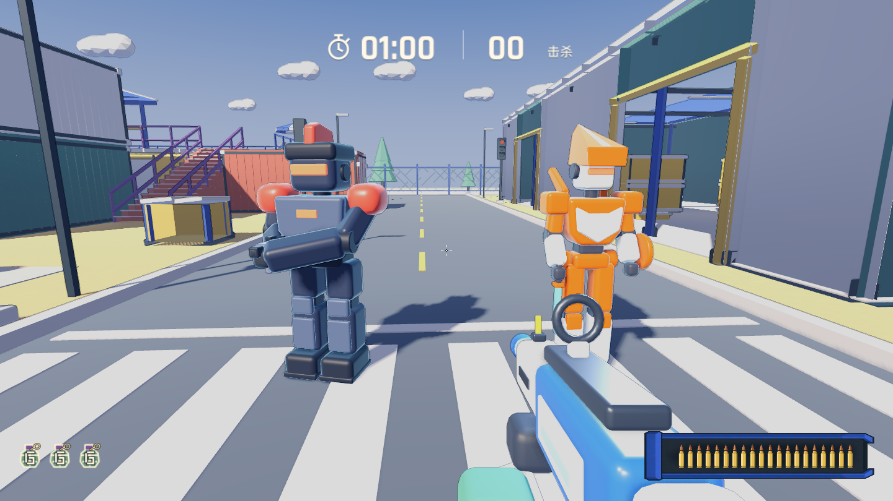
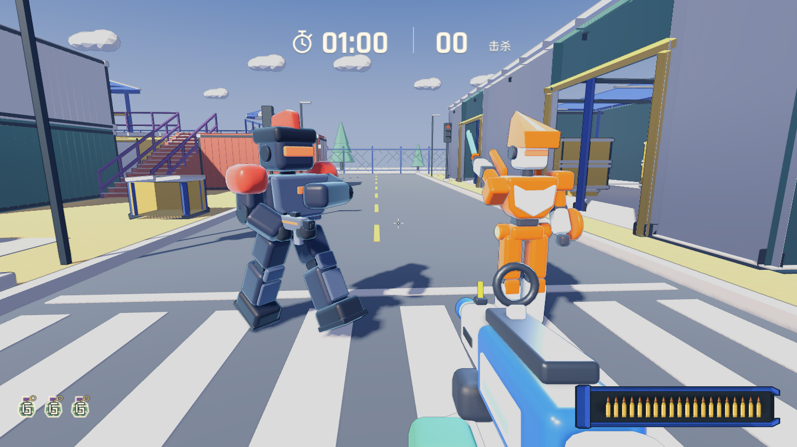

# 概念图敌人造型细化

2026-11-12，toy 分支本地客户端。基于原来的基础替换，继续按 concepts/rifleman-mecha.png 与 rusher-mecha.png 制作可编辑 Blender 几何，已用于所有普通步枪兵与快速持刀突击兵。没有合入 main 或发布 Web。

## 本轮造型

- 步枪兵：加厚躯干与四肢；改为收腰胸甲、圆润大护肩、完整头盔脊、护胫与分层靴底。保留深蓝灰机身、珊瑚红识别色和双手持枪。
- 突击兵：后掠收尖头盔、窄中缝、盾形奶油白胸甲、三角背鳍、左腕圆盾、更完整的小腿护甲；橙色基色与冲刺闪烁恢复色同步。
- 使用轮廓挤出和可变宽度收尖建模，继续按刚性关节/材质合并；没有增加角色网格数量。
- 原有头部判定、肩髋枢轴、枪口和刀的挂接接口继续使用。装饰性头盔脊和背鳍不扩大伤害判定。

这是一版可玩的程序化模型细化，仍比概念图简化，尚非逐像素还原。实际地图光照下的颜色以实机图为准。

## 实机

[约15米](../actors/readability-15m.png) / [约25米](../actors/readability-25m.png)。固定相机沿院子道路观察，验证深色重装与橙白轻装的区分；不代表所有地图背景的识别性验收。

## 资源与验证

|模型|三角面 前→后|网格数|
|---|---:|---:|
|步枪兵|8288 → 9088|29 → 29|
|突击兵|7968 → 8352|23 → 23|

Blender 源文件：art_source/toy_actors.blend；生成脚本：tools/build_toy_actors.py；游戏文件：assets/models/toy/enemy.glb、rusher.glb 和 rusher_blade.glb。

导入、规则、战斗（含持刀冲刺与打断）、闪避、敌人命中率、伤害反馈，以及一局60秒自动对局与重开均通过。4000发采样瞄准比例29.6%，保持30%设计值。测试输出在本目录。

本轮没有人工手感验收。自动对局含脚本精准瞄准、瞬移与大量击杀，其帧间隔受同时进行的截图进程影响，不作为本轮性能优化或退化的结论。
