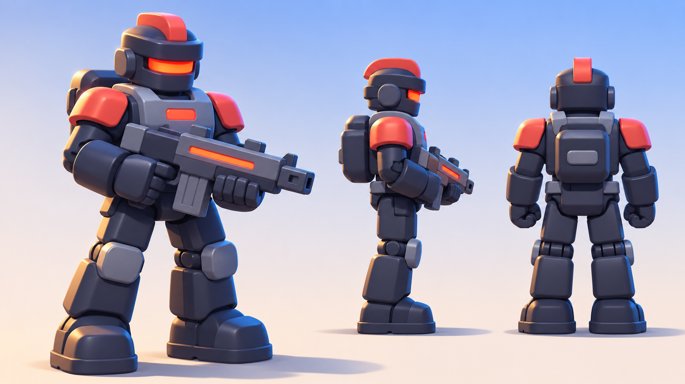
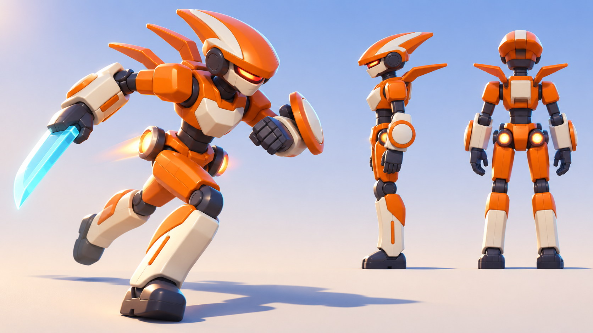

# 反派玩具机甲概念

2026-11-11，内置图像生成工具产出，用 [改造后的院子截图](../after/score_attack.png) 作画风参考。这是方向图，不是建模尺寸图；落地时仍以 `tools/build_toy_actors.py` 的节点名、枢轴和头部判定为准。

## 步枪手

重装、站姿稳。深蓝炭灰塑料机身，石板灰胸甲，珊瑚红护肩与头盔脊，暖红发光面罩和胸标，枪身一道红色发光条。对应当前黑色远程敌人。

## 突击手

轻、快、前倾冲刺。安全橙外壳配奶油白面板，楔形赛车头盔，半透明青色刀刃，背鳍与髋部推进器。对应当前橙色持刀敌人。

两者共用倒角、关节缝和暖红面罩，读作同一阵营；明度与轮廓一深一亮，远距离也能区分。下一步可按此把现有敌人改为头盔脊、背包、护膝更完整的版本，突击手增加楔形头盔与背鳍，头部判定位置不变。
