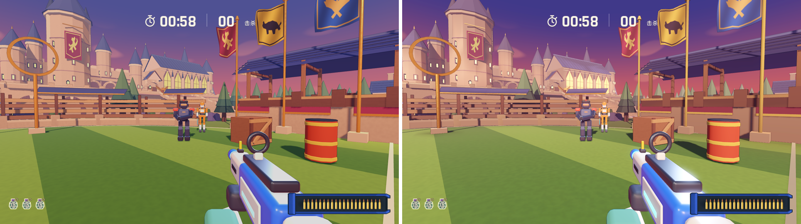
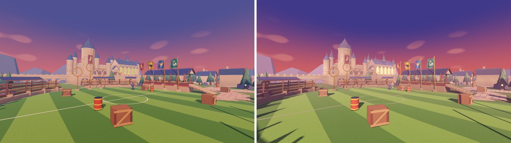
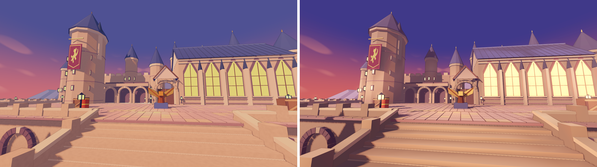
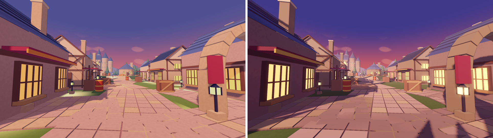

# 霍格沃茨：光照与色彩方案样板

2026-11-12。按 [画面评审](../README.md) 的前两步，只改霍格沃茨，作为其他地图的样板。每组左边是改造前，右边是改造后，1600 x 900 本地渲染，机位固定（`tools/maps/capture_toy_compare.gd`）。

| 实战视角 | 球场 |
| --- | --- |
|  |  |
| 城堡台阶 | 霍格莫德街道 |
|  |  |

单张原图在 `before/` 和 `after/`。

## 第一步：烘焙天光遮蔽和反射光

`tools/maps/bake_vertex_light.py` 在地图构建之后运行，把结果写进静态建筑的顶点颜色：

1. 同时载入全部静态建筑，让墙、屋顶和地面互相遮挡。木箱、摊位等可破坏道具不参与。
2. 把活动区域内的大面细分：地面边长不超过 1.5 米，墙面不超过 2.6 米，墙角和台阶边才有顶点承接暗部。
3. 用 Cycles 在纯白天空下烘焙漫反射光照（含两次反弹），再除以同朝向开阔表面应得的光照，只留下遮蔽和邻近色彩的反光。
4. 平滑掉逐顶点采样噪点，设最暗下限 0.5，强度 0.7。白色场地线在烘焙时不挡光，避免在草皮上留下暗斑。

游戏里，`map_lookdev.gd` 发现网格带顶点颜色时，就把它乘进漆面颜色。太阳、阴影和环境光仍然实时计算。

重建顺序：

```sh
blender --background --python tools/maps/build_hogwarts.py
blender --background --python tools/maps/bake_vertex_light.py -- hogwarts
godot --headless --path . --editor --import
```

代价：静态建筑三角面 8.3 万 -> 16.7 万，模型文件 4.1 MB -> 7.8 MB；Blender 烘焙约 45 秒。

## 第二步：色彩方案

`scripts/maps/toy_palette.gd` 按地图定义主光、阴影色、雾、光晕、发光倍率和敌人边缘光。没有条目的地图维持原样，敌人边缘光恢复默认。霍格沃茨：

| 项 | 改造前 | 改造后 | 目的 |
| --- | --- | --- | --- |
| 太阳 | `ffbf91`，0.43，仰角 35 度 | `ffcfa3`，1.0，仰角 24 度 | 低角度暖光，拉出长影，墙面朝阳一侧发亮 |
| 环境光（阴影色） | `d7c7f4`，0.48 | `b6b2f2`，0.52 | 背光面偏蓝紫，与暖色亮面拉开冷暖 |
| 雾 | 0.0028 | `d9a7c4`，0.0032 | 远处城堡和山峦退进粉色薄雾，近处战斗区不受影响 |
| 光晕 | 关闭 | 强度 0.42，阈值 1.05 | 只让发光的窗户、灯笼泛光 |
| 窗户、灯笼发光 | 1.35 倍 | 1.35 x 1.8 倍 | 黄昏里的视觉焦点 |
| 敌人边缘光 | 淡蓝 0.48 | 青色 `9fe4ff` 0.62 | 冷色边缘，从暖色场景中分离 |

试过更橙的太阳和更饱和的紫色环境光，草地会被压成橄榄色；雾到 0.006 时城堡轮廓被冲淡。最终取了偏中性的光色和一半的雾。狂暴模式仍按原逻辑切换天色与环境光颜色，太阳和雾沿用方案。

## 验证

自动检查：`hogwarts_check`（路线、楼梯、回合与狂暴、掩体、终局、两种搞笑模式）、`concept_arenas_check`、`color_material_check`、`aim_sights_check` 通过。截图包括普通与狂暴状态。尚未人工试玩，未做性能测量。

已知问题：

- 石板路在近处仍能看出轻微的斑块，来自逐顶点烘焙的分辨率。
- 面数翻倍，合回 `main` 发布 Web 前需要和其他性能问题一起评估，可按距离降低细分或只细分地面。
- 在 GL Compatibility 渲染器下，Godot 文档写明屏幕空间环境光遮蔽（SSAO）不可用，`map_lookdev.gd` 里的 SSAO 设置不会生效；这次的遮蔽全部来自烘焙。
