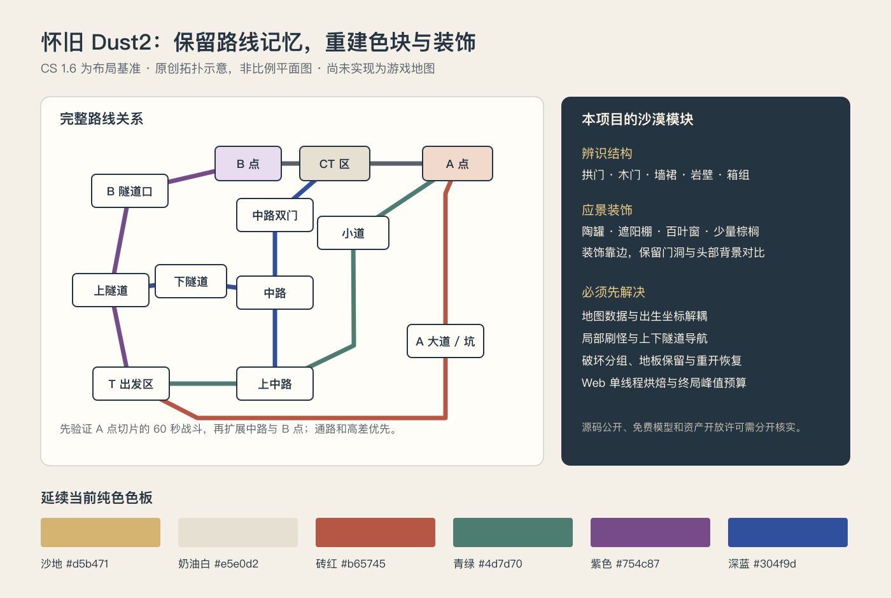

# 怀旧 Dust2 白模来源与 No-Art-FPS 复刻可行性

调研日期：2026-11-06。项目基线：`56d0411`，Godot 4.7.2 / Blender 5.2.2 LTS，含单线程 Web、触屏和陀螺仪输入。

## 结论

**用本项目的明亮低模设计语言重建 Dust2 可行。建议采用 CS 1.6 版本的路线和地标作为怀旧基准，重新搭建几何、碰撞和装饰。** 完整地图可以作为新地图保留原场地；第一阶段先完成 A 点、A 大道和小道的可玩切片，确认 60 秒模式的目标密度后再扩展中路、隧道和 B 点。

找到了一项明确以 B 点白模命名、标注 CC Attribution 的模型，以及一项 MIT 许可的 A 点程序建模项目。但本次**没有核实到同时满足“完整 CS 1.6 Dust2、白模、来源清楚、允许改造并在本项目发布”四项条件的现成资产**。不能把免费可下载、公开源文件或开源导出器，等同于地图资产本身开放许可。

本次完成来源搜索、许可文本核对、项目代码审查，以及一个候选 `.blend` 的本地读取与几何统计。没有制作 Dust2 游戏地图、导入候选到运行时、测量原版全图尺寸或进行 Dust2 试玩。以下工时、尺寸和性能预算均是后续验证的起始方案。

## 找到的资源

### 1. Dust2 B Site Environment Blockout：最接近所求的局部白模

- 作者：Xipeng Wang。来源：[Sketchfab 模型页](https://sketchfab.com/3d-models/dust2-b-site-environment-blockout-8c61f92605a14e6582b1a1d6cdf7740b)。
- 搜索索引明确显示作品名、可下载及 **CC Attribution** 标记；覆盖 B 点，不是完整地图。
- 当前直接读取模型页返回 403，因此没有下载或打开文件，未核实下载格式、CC 许可版本、网格数量、尺寸、原始 `.blend` 是否存在、以及具体参照哪个 CS 版本。
- 用途：优先候选，适合后续手动打开原页面复核许可、作者原创声明及下载包，再检查拓扑。署名、链接及改动说明应随衍生资产保存。网页许可标记不能单独证明上传者有权授权所有来源内容。
- 判定：**白模线索成立，完整可用性尚未验证**，不能现在就称作已取得的完整开源 Dust2。

### 2. StarKnightt/counter-strike-in-browser：可编辑、许可最清楚的 A 点重建

- 来源：[仓库](https://github.com/StarKnightt/counter-strike-in-browser)、[LICENSE](https://github.com/StarKnightt/counter-strike-in-browser/blob/main/LICENSE)、[生成脚本](https://github.com/StarKnightt/counter-strike-in-browser/blob/main/tools/build_map.py)、[Blender 源文件](https://github.com/StarKnightt/counter-strike-in-browser/blob/main/tools/dust2_a.blend)。
- 实际审查版本：`190a277555ff6a1b7112090fc0a2db3189006db8`；脚本 Git blob 为 `7067162b577ff7265235056db999705c047ae7ea`，`.blend` blob 为 `5c1e9526f6fb1d1a3676e6ca679b19b7983101c6`。
- 代码 MIT；许可另列贴图 CC0、字体 OFL 等第三方内容，并声明没有包含 Valve 游戏资产。它是 **CS2 风格的 A 点及连接区域**，不是 CS 1.6 全图，也不是纯白模。README 所述运行 GLB 约 34 MB。
- 读取该 `.blend` 的实测：Blender **5.2.2 LTS** 成功读取；34 个网格对象、34 个材质、150,192 个实例三角面；49 张图像全部指向缺失的外部文件。此统计没有应用额外修改器，也没有测量 Godot 导入后的性能。
- 34 个网格对象名字显示按材质合并，不能据它直接划分建筑或门的破坏单元。全场包围范围为 X 970、Y 900、Z 180 个 Blender 单位，包含背景几何，**不能当成 A 点可玩区域尺寸**。脚本声明以米建模，但仍需用已知门框/人物尺寸交叉校准，不能将上述范围当作原版 Dust2 尺寸。
- 脚本含 Windows 绝对路径和外部贴图依赖；原样在此 Mac 执行不会直接得到本项目资源。后续可保留 MIT 声明，将几何生成思路改为模块化白模和共享纯色材质；避免复用高密度装饰和整体合并网格。
- 判定：**适合参考和改造建模代码，A 点试作候选优先；需要重建分组、碰撞和材质。** `.blend` 已验证可读，GLB 导入与布局精度未验证。

### 3. rolivencia/de_dust2_largo：怀旧 A 大道 RMF 源文件

- 来源：[仓库与来源说明](https://github.com/rolivencia/de_dust2_largo)、[CS 源目录](https://github.com/rolivencia/de_dust2_largo/tree/master/cs/src)。目录确认有 `de_dust2_largo.rmf`，1,260,384 bytes，blob `35d58a30415b1a2b50d7a17e66b5e970632280c6`；还有 WAD。
- 作者说明它源自 CS 1.6 Dust2 反编译并重建，仅保留 A 大道相关通路。根目录未发现明确开放许可证，不能按开源资产纳入游戏；作者还说明当前 RMF 未必能生成当年完全相同的 BSP。
- RMF 是 Hammer/J.A.C.K. 的刷子源格式，**不是 Godot/Blender 可直接导入的网格**。若取得适当许可，需要 RMF 转 MAP，再重建凸多面体或使用经验证的转换链；不能把它直接改后缀为 GLB。
- 判定：怀旧版本的局部结构线索，**不是完整白模，也未确认可再发布许可**。

### 4. de dust2 rmf：完整怀旧结构的参考线索，专有许可

- 来源：[ModDB](https://www.moddb.com/addons/de-dust2-rmf)。页面标明 `de_dust2.zip`、约 216 KB，分类 Prefab，上传者 WhatUziname7，署名 username7 / Valve，许可 **Proprietary**。
- 判定：接近编辑源文件需求，但许可明确不是开源。未下载检查，不把“source file”标签当作几何完整性或开放授权证明。

### 5. GameBanana RMF 重建与完整游戏模型导出：参考用途优先

- [de_dust2 remake 2021](https://gamebanana.com/mods/83649) 的搜索摘要提到随包附 RMF；[de_dust2 RMF Restored](https://gamebanana.com/mods/653390) 是另一条修复源文件线索。直接抓取页面只得到 JavaScript 外壳，**本次未确认这两项的具体许可及下载包**。
- [The Models Resource 的 CS 1.6 Dust 2](https://models.spriters-resource.com/pc_computer/counterstrike16/asset/310949/) 提供游戏地图模型下载入口；它属于原游戏资源导出，不是作者独立创作的白模开放授权。
- [CSGO Dust 2 Mid Layout – Scrapped Stylised Thing](https://sketchfab.com/3d-models/csgo-dust-2-mid-layout-scrapped-stylised-thing-fa976f85ac4d4f3db724f3794bfc6c3a) 的索引标 CC Attribution，可作为中路局部风格线索；直接访问同样 403，版本、格式、几何及作者来源未验证。
- 判定：记录链接，**不据此纳入可发布素材**；不混用 CS1.6、CS:S、旧 CS:GO 和 CS2 的比例与细节来声称完整怀旧复刻。

### 6. 相关开源工具与主题替代地图

- [Source 2 Viewer / ValveResourceFormat](https://github.com/ValveResourceFormat/ValveResourceFormat) 是 MIT 工具；[导出指南](https://s2v.app/ValveResourceFormat/guides/exporting-maps.html) 明确展示 CS2 Dust2 到 glTF / VMAP 的链路，并说明反编译会丢失结构信息。**工具许可不覆盖导出的 Valve 地图**；而且它针对 Source 2，不是 GoldSrc 的 CS1.6。技术上能导出，不能因此认定得到开源白模。
- [JackKruger/cssMapExtraction](https://github.com/JackKruger/cssMapExtraction) 提供 Source BSP 转 JSON 几何/路线的方案，可参考转换分层与通路校验思路。GitHub 仓库元数据 `license: null`，不是已确认开放许可的工具；它也不是 GoldSrc 全图即用方案。
- [redesaile/cs2-dust](https://github.com/redesaile/cs2-dust) 标注 MIT，是沙漠小镇的瞄准训练地图，**不是 Dust2 复刻**。可参考装饰主题；具体模型/材质是否依赖原游戏另行逐项核对。

## 怀旧版与本项目风格如何结合

作者 Dave Johnston 的 [The Making Of: Dust 2](https://www.johnsto.co.uk/design/making-dust2/) 提供 CS1.6 俯视图及版本对比，并解释拱门、道路、简洁结构和近远交战的作用。它支持使用 CS1.6 作为版本基准；页面截图依然属于各自权利人，参考图保持本地，不放入运行素材或提交。

应优先保留玩家的空间记忆：A 大道转角与低坑、双扇门、中路门洞、小道转折及上台阶、B 点入口与箱组、上下隧道连接、CT 区到 A/B 的转场。**识别度来自路线、遮挡和高差，不能只摆黄墙和木箱。** 首轮保留这些结构关系；经白模步行测量后再决定对长路线压缩多少。

可编辑示意：[dust2-adaptation.svg](dust2-adaptation.svg)。图仅表示关键通路连接，B 门/窗口、A 长门等局部节点在图中简化，不能当作施工尺寸或逐点导航图。

建筑以奶油色土墙和块状屋顶为主，延续当前 `#d5b471` 沙地、`#e5e0d2` 奶油白、`#b65745` 砖红、`#4d7d70` 青绿、`#754c87` 紫色及 `#304f9d` 深蓝。区域强调色只用于门框、遮阳棚或墙裙：A 区偏砖红，中路偏青绿，B 区少量紫色。不能把全部墙面涂成高饱和色。敌人仍以深色轮廓对比明亮背景。

建议补一个原创沙漠模块包，源文件在 `art_source/dust_village_kit.blend`，逐项 GLB 在 `assets/models/dust_village/`：

- **辨识结构**：6–8 段低模拱门、双扇木门、土墙/压顶/墙裙、阶梯外观配斜坡碰撞、岩壁和高台。门的位置、净宽和遮挡必须与白模核对。
- **A 大道**：简化停放车辆、关闭的百叶窗、小遮阳棚与墙边木箱；保留转角、低坑和主射线。
- **中路与小道**：双门、青绿墙裙、少量屋顶水罐/天线；细杆和电线合批，放在射线以上。不要用晾衣布遮住头部目标。
- **B 点**：可识别的原版箱组轮廓、少量陶罐和墙边货物；装饰箱与战术掩体明确分组，不临时改变包点入口宽度。
- **隧道**：浅砂岩块面、拱券、暖色补光；门外明亮、内部仍能看清深色敌人。不用大量黑色阴影掩盖结构。
- **气氛**：少量棕榈、陶罐、卷帘门、挂灯。复用现有棕榈/木箱/油桶，泳池与躺椅暂不带入怀旧场景。文字牌只在真正需要辨识时加入，图形提示按当前 AGENTS.md 用 SVG 并保留可访问文字。

装饰必须服务战斗：主通道净宽、头部背景对比、门洞视线和玩家碰撞优先。初始通道宽度约 3–4 m、掩体约 1–1.2 m 高是本项目适配目标，**不是测得的原版 Dust2 数值**。窄门、隧道不能机械缩小全图后再强行适配 1.8 m 玩家胶囊。

## 现有实现的复用与必须改造之处

### 可复用

`scripts/arena.gd` 的盒体、坡道、合批、纯色色板，以及 Blender 显式 GLB 导出流程适合重新搭白模；`player.gd` 的 7 m/s 移动和射击、`enemy.gd` 的避让、伤害计分与 HUD 可继续使用。已有木箱、油桶、棕榈是第一批氛围素材。规则层保持 60 秒、击杀 +1、最后 15 秒 DESTROY 和最后 1 秒全场引爆。

### 1. 地图数据需要与当前场地解耦

`game.gd` 的开局敌人位置、导航就绪检查、集装箱索引和三处复活候选，`player.gd` 的出生位置，以及 `arena.gd` 的 yard/warehouse/deck 区域均绑定当前场地。直接替换 GLB 后这些坐标可能落在墙内或地图外。

建议保留原 `arena.gd`，新增 `scripts/maps/dust_arena.gd` 与地图描述 Resource，统一提供出生/复活点、开局演员、区域边界、巡逻点、增援点、结构注册与导航就绪探针。开场截图、加载、复活和 QA 从地图描述读取，不继续增加 Dust2 坐标分支。

### 2. 60 秒得分模式需要局部刷怪导演

当前同时存在 8/10/12 个敌人，并为仓库/平台保留巡逻人口。完整 Dust2 有多个互相遮挡的区域，把 12 人均匀分配全图会出现转场长、看不到目标的空窗；A 大道长距离还会使触屏头部目标太小。

先保持现有总人口上限，按玩家所在区域及其相邻入口集中补兵，远区只保留少量巡逻。每个关键站位至少验证两个合格增援口，继续保留大于 8 m、遮挡/可见性复查、占位检查和导航可达性。用导航路径时间补充当前直线距离排序，避免跨墙的“近点”实际要绕很远。

定义目标可见但不可打、可打但太远、可交战三种状态，记录转角后的首个目标时间和最长空窗。建议起始验收为可交战空窗 P90 小于 2 秒；这是目标，不是既有测量结论。如果一局只待在 A 点就明显更有效，需要调整区域人口和路线，不能用全面增加人数掩盖问题。

### 3. 立体导航与射线

白模须验证上下隧道、台阶、小道与低坑的双向步行。台阶外观下使用连续坡道碰撞；屋顶不得被错误烘焙为可达层。碰撞按墙体/凸体构建，静态复杂拱门可用静态凹形碰撞，敌人和玩家不使用凹形动态碰撞。

当前敌人导航半径 0.6 m、身体碰撞半径约 0.29 m，需要实测双向避让会否堵塞门洞。原版单位换算应以人物/门框及一个已知距离联合校准；Blender Z-up 经 glTF 导出转为 Godot Y-up，避免重复交换轴或镜像。

### 4. DESTROY 与全场引爆

目前建筑按 AABB 区域掩埋计分，大面积地图若把整片建筑放进一个包围盒，可能误伤隔壁街道或上下隧道内的敌人。建议每个破坏单元使用明确的碰撞/体积列表，墙体表现、承重地板和主通路分别注册。保留稳定的地图底层，破坏后不会落进无底空洞。

现有终局装饰处理依赖 `arena.gd` 的模型注册、合批调色板及保存的 transforms；整张合并 GLB 不会自动变成这些破坏单元。新地图须显式注册结构、可引爆道具和不可破坏地面，重开逐项恢复。火团/碎片预算应全图共享；五米网格聚合仍需按画面距离和可见区域限额。

### 5. Web 与移动端

项目当前 Web 运行时重烘焙走单线程路径，完整地图的门/建筑频繁拆除可能出现停顿。建议按区域分导航块、限制一次重烘焙范围，最终采用预烘焙基础路径与少量动态连接；在 Godot 4.7.2 导出中验证实际方案。

不要把候选的 34 MB 写实 A 点 GLB直接追加到 Web 包。采用共享纯色材质、低面数模块和少量标识图集。第一轮地图新增 GLB 总量可设 5–10 MB、正常可见 draw call 约 100–150、终局可见碎片约 300–500 个作为预算起点；**这些不是硬件保证**，需要桌面及实际手机测量首帧时间、帧间隔和峰值。长廊缩短、隧道提亮和目标可读性应在触屏/陀螺仪上人工检查。

## 建议实施阶段与验收

下面按一名熟悉当前项目的开发者估算有效工作时间，包含一次修订，不含素材许可往返和等待外部确认。没有运行原版精度测量，因此约有 50% 的不确定性。

1. **基准与地图接口，约 0.5–1 天**：固定 CS1.6 基准图与关键视角，仅本地保存；创建路线图和地图描述；原场地通过全部既有检查。若完整忠实复制要公开发布，先确认地图几何的使用条件；重做材质并不会自动解决精确布局的权利问题。
2. **A 点可玩白模，约 1–2 天**：大道、小道、A 平台/低坑、CT 连接；完成出生、增援、巡逻和复活。用真实输入双向走完所有路径，验证墙后不能穿射、台阶没有卡点，跑一局 60 秒。许可待核实的下载模型只作本地参考，白模可由现有模块独立搭建。
3. **完整路线扩展，约 2–4 天**：中路双门、上下隧道、B 点、T/CT 连接；验证所有关键入口互通及区域目标密度。保留全图怀旧拓扑，必要的路线长度/门宽修改逐项记录。
4. **原创风格与装饰，约 2–3 天**：模块库、区域色彩、灯光、8–12 种道具；保存 `.blend` 和 GLB。检查大道、双门、小道、B 入口和隧道五类实际引擎视角，限制装饰噪声。
5. **破坏与多端验收，约 1–2 天**：区域坍塌、动态导航、最后一秒、逐像素定格、重试/标题恢复，以及 Web 包与真实手机测试。以最大终局效果而非空白场景验证峰值。

因此，**首个可玩的 A 点切片约 1.5–3 天；完整全图加原创装饰约 6.5–12 天**。不是一键导入工作。若要求原版逐米忠实、所有建筑可破坏且手机稳定 60 fps，应在阶段 2 之后重新估算，不把本项目原地图的成绩移作新地图性能证据。

每个完成阶段按项目要求提交并立即推送。运行检查覆盖 Godot 导入/headless、规则、通路/射线/出生、坍塌后的导航与计分、定格/重开；实际渲染截图和自动回合与人工试玩分别记录。现有地图继续作为回归基准，不在素材调研阶段替换正在运行的游戏。

## 本次检查记录

- 搜索并核对上述公开来源；读取 A 点仓库 LICENSE 和源文件目录，实际读取 `.blend`。Sketchfab 及部分 GameBanana 详情不可访问的限制逐项标明，没有把搜索摘要扩写成下载验证。
- A 点参考文件与检查 JSON 保存在 Git 忽略的 `docs/design/reference/`；关闭 Blender 自动执行，仅运行本地编写的统计脚本，未执行第三方建图脚本。候选资源和参考截图未提交。
- 本次只新增分析文档、原创 SVG 路线示意及其 PNG 预览；检查本地文档链接、SVG XML 和完整渲染布局，不改变游戏代码，因此没有宣称完成 Dust2 Godot 导入、性能或人工手感验收。
