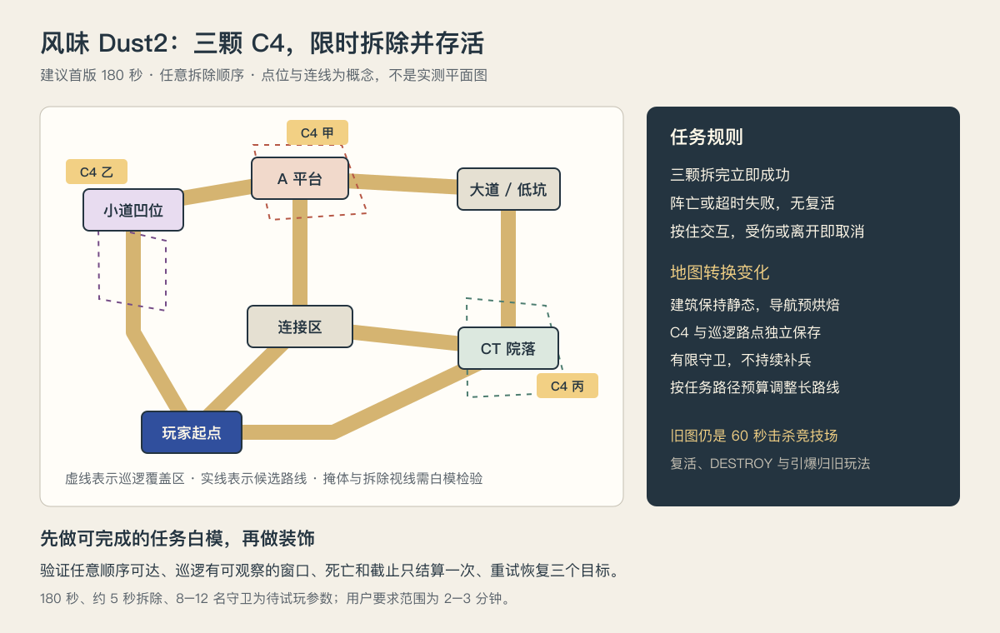

# 地图场景统一与风味 Dust2 本地化方案

日期：2026-11-06。代码审查基线：`71640c0`。本次按新的 C4 拆除玩法修订，取代先前将两张地图都作为 60 秒击杀竞技场的设想。本文是迁移与制作方案，未执行地图转换或改动游戏运行代码。源资产与许可核查见 [Dust2 调研](2026-11-06-dust2-feasibility.md)。

## 建议

**先分离共用战斗系统、地图数据和玩法规则，再将现有场地转换为可编辑的 `yard.tscn`，最后创建拆弹玩法的 `dust_flavor.tscn`。** 两张地图共用场景组织、移动射击和素材语言，分别提供击杀竞技场与限时拆弹。迁移过程拆成可验证阶段，先用老玩法验证规则分离，再制作新地图与任务。

代码生成地图与手工编排场景可以共享一个运行接口。文件格式不同不会自动导致代码混乱；真正的耦合是 `game.gd`、`player.gd`、`enemy.gd` 直接依赖旧场地坐标、区域名称、集装箱数组编号和烘焙结构。仅将现有运行场景打包成 `.tscn`，而继续保留这些依赖，并不能解决问题。

第一阶段允许老地图仍由代码生成，但通过与新地图相同的入口使用。第二阶段完成持久化后，旧 `arena.gd` 的摆放代码转为工具或删除；运行时不再重新执行 `build()` 覆盖编辑器布局。

## 两种玩法的边界

### 旧地图：ScoreAttack

保留现有 60 秒、每杀一名敌人计一分、持续增援、五秒复活、最后十五秒 DESTROY 和最后一秒全场引爆。最高击杀数与当前计分存档保持兼容。场景化迁移不得顺带改变这些规则。

### 风味 Dust2：DefuseMission

用户确定的目标：**玩家在 2–3 分钟内拆除预埋的 3 颗 C4，并存活；被敌人杀死或时间耗尽即失败。** 完成第三颗拆除时立即成功，无需回出生点，也不要求杀光敌人。

首版采用以下可配置假设，待实际试玩修订：

- 时限先取 **180 秒**，用 150 / 120 秒做后续难度测试，避免在白模未验证前锁死时间。
- C4 固定为 3 个独立目标，任意顺序；先使用一套作者摆放的点位和巡逻配置，不随机刷新位置。
- 接近 C4、有直接视线且在约 1.8 m 内时，按住 E 拆除约 5 秒；移动端提供有文字标签的按住交互按钮。范围和用时属于建议参数。
- 拆除期间暂停射击和换弹，新交互需在换弹完成后开始；玩家可转头观察，巡逻敌人与任务时钟继续运行。移动离开范围、遮挡、松开按键、受伤或失去输入时取消本次拆除，未完成的进度归零。已经拆除的 C4 不恢复，除非重开任务。
- 暂停/失焦停止任务计时和 AI，并取消交互、防止恢复后自动拆除；继续时需要重新按住。桌面 Pointer Lock 与触屏/陀螺仪沿用现有输入保护。
- 死亡直接失败，无复活或安全点传送。首版建议保留现有隐藏生命、受伤边缘提示和恢复机制；恢复节奏是否适合任务另行人工测，不擅自增加生命 UI。
- 首版不启用 DESTROY、建筑坍塌和全场自动引爆。任务超时触发未拆 C4 的局部爆炸表现后定格失败，不能借爆炸自动将目标标记为已拆或补计击杀。成功在第三颗拆除时定格。重试/返回标题共用菜单外壳，但成功与失败要有清楚、精简的文字。
- C4 是任务组件，枪击或普通油桶爆炸不能替代拆除。任务地图首版建议不用可爆油桶，减少目标误伤、动态导航和多层爆炸的复杂度；旧地图油桶保持原玩法。
- 首版使用有限、预置的巡逻敌人，建议先以 8–12 名测试全任务，无竞技场式无限补兵。敌人不需全部击杀。击杀只是清理路线的手段，不是胜负条件，也不会加时。
- 成功记录用时与任务配置版本；只比较相同地图/时限配置下的最快成功时间。失败不刷新纪录，竞技场的最高击杀数不与任务成绩混存。

### 截止与同一物理帧的判定

统一固定物理时钟；加载、暂停和鼠标捕获等待不占任务时间。交互完成时间必须严格早于截止；恰好在截止时完成第三颗视为超时。每个物理 tick 收集交互完成与伤害事件，由任务规则一次性裁定：死亡优先，其次超时，最后判断三个目标是否都已拆。不能由敌人和 C4 回调顺序决定同帧生死或成功；终态只进入一次，之后拒绝交互完成、伤害和奖励。

## 任务地图如何布局

StarKnightt A 点重建仍可作为起点，**不必为 3 个目标补齐原版全图**。首版三个区域候选如下，最终位置由白模中的路径、遮挡和防守角度决定：

1. **A 平台箱组旁**：较开放，先观察平台周边再拆除，提供局部低掩体。
2. **小道拱门后的侧室/凹位**：通过转角隐藏，与附近巡逻视线交替；若候选模型没有可用侧室，只补一个原创小空间。
3. **CT 连接区的院落**：通过坡道转场，设置可观察巡逻的入口和另一条撤回路径。

避免三个 C4 只沿一条直线顺序排列，也避免互相重叠的三条视线同时扫到一个拆除点。已有长廊、小道、高台、低坑和 CT 连接构成主骨架；必要时补一条短连接或一个房间，形成两个有价值的绕行选择。长廊承担观察/接敌，低坑承担躲避或换弹，不把 C4 塞进只能跳入跳出的陷阱。各目标附近至少有一处可短暂停留的掩体，以及可辨识的接近路线。

可编辑概念图：[dust-defuse-plan.svg](dust-defuse-plan.svg)。三个 C4 的编号仅用于设计说明，不要求玩家按编号顺序拆除。

时间预算先按 180 秒拆分：无敌人干扰时完整走访三点约 **45–70 秒**，三次交互约 **15 秒**，其余留给观察、战斗、恢复、绕路和首次寻找。此预算是设计目标，不是测量结果。测试至少两种目标顺序，记录路径距离、实际用时及最长寻找空窗，再决定要缩短哪条路线。取消旧方案里“长廊必须 25–32 m、小道必须 20–26 m”的要求；2–3 分钟模式允许保留更长的有意义转场。

## 巡逻与可读性

现有敌人移动、避让、攻击预警、视线射线和受伤表现可复用，但当前旋转/追击会持续依赖玩家位置，不等于完整巡逻感知系统。新任务需要明确的巡逻、警戒、追击/交火、搜索和回巡逻状态：

- 巡逻按场景路点移动，到转角/观察点停留；未发现玩家时不持续朝玩家转身。发现要求距离、视锥和静态遮挡都成立，禁止隔墙锁定。
- 丢失视线后只搜索最后已知位置，超过配置时间再回到巡逻路线；不每帧读取隐藏玩家的精确位置。
- 首版只使用现有远程黑色守卫，暂不引入更快的近战兵。8–12 名在多个区域分配，避免全图一起冲向玩家导致任务变回竞技场。
- 点位附近的安全窗口由遮挡与巡逻时序产生，清理守卫也能创造拆除机会。警报音/拆除音若会吸引敌人，需要单独规定传播距离与遮挡；首版先不增加未验证的听觉 AI。
- HUD 在任务中优先显示剩余时间与 `已拆 0/3`，保留准星和情境弹药；移除常驻击杀数。靠近目标时显示“按住 E 拆除”及单一进度。C4 外观与近距离声音可辅助寻找；不默认加穿墙标记或地图，仍需人工确认新手能找到三个点。
- 图形提示用 SVG 并保留文字标签，遵守当前项目规则。任务内生命继续只用渐变暗红边缘表达。

## 现有耦合与迁移对象

- `game.gd`：`Arena.new()`、`OPENING_POSITIONS`、开场/加载时 `containers[0]` 和 `containers[2]`、导航就绪探针、复活候选位置、`zone_capacity()` 中的 warehouse/deck 配额，以及全场引爆对 arena 内部集合的访问。
- `player.gd`：出生位置写死在 `reset_position()`，跌落阈值固定为 Y < -8。新地图如有低坑、低层通路，需要地图提供出生 transform 与跌落边界。
- `enemy.gd`：`home_zone == "yard"` 决定追击与巡逻，区域名称还影响近战兵分配。改为区域配置中的追击/巡逻策略与敌人类型限制。
- `arena.gd`：地图摆放、材质构造、刷怪坐标、巡逻、破坏恢复和导航编排混在同一个脚本中。拆出地图基类及通用组件，场地差异保存于场景节点与导出参数。
- `destructible.gd`：目前掩埋范围是世界坐标 AABB。编辑器移动/旋转建筑后不能继续使用旧范围，应使用建筑局部体积并在判断时转换坐标。
- 当前导航烘焙把顶层 StaticBody3D 重挂到 NavigationRegion3D；终局装饰处理又依赖 arena 的直接子节点。新结构使用明确注册列表和导航源组，避免是否生效取决于父节点恰好是哪一个。
- `run_rules.gd`：时限固定 60 秒并以击杀计分，不能直接给 Dust2 改成 180 秒后继续使用全部竞技场行为。保留竞技场规则，新增任务规则和目标完成登记。
- 旧通路、集装箱和泳池测试继续绑定 `yard.tscn`；加载、冻结和重开属于共用检查。计分/复活/引爆只在竞技场检查，C4/死亡失败/超时只在任务检查，不把旧场地编号或规则强加给新地图。

## 统一运行契约

新增 `MapDefinition` Resource，包含稳定地图 ID、显示名和 `PackedScene` 引用。新增 `SessionDefinition` 引用地图与玩法配置；竞技场配置与拆弹配置分别保存时限、死亡处理、成绩类型和各自规则。地图 ID 不直接决定胜负逻辑，也不在 JSON、Resource 与 `.tscn` 三处重复保存坐标。

共用会话控制器管理加载、开始、暂停、终态和重试；`ScoreAttackRules` 管理竞技场计分/复活/终局，`DefuseMissionRules` 管理截止、死亡失败及三个唯一 C4 ID 的完成集合。拆除条件与进度放在独立 `C4Objective` 组件。共用玩家/武器通过事件报告射击、伤害和死亡，不在每条射击函数里散布玩法分支。成绩 HUD 与结算内容从规则提供的展示数据读取；设置及加载转场共用。

两张地图根节点都挂 `MapRoot` 脚本。共享契约只需覆盖：

- 玩家起始 transform、跌落边界；复活候选作为竞技场所需的可选配置，拆弹任务不用。
- 开局演员描述、区域及巡逻点。竞技场另提供增援入口，任务地图另提供 C4 目标。`Marker3D` 的 transform 是摆放数据来源；敌人类型、区域归属与巡逻策略使用导出属性。
- 导航资源和实际就绪状态。就绪探针来自地图里的标记；不再检查一个旧场地的固定世界坐标。
- 共用 `reset_round()`；建筑/道具破坏和终局引爆由可选组件提供，仅竞技场规则调用。任务提供三个独立目标组件及超时局部表现，不能把 `explode_finale()` 变成所有地图的固定结束行为。

游戏通过同一会话入口实例化地图、绑定规则、等待准备完成。允许在启动时选择规则实现，但不添加 `if map_id == "dust"` 的射击、复活或结算逻辑。每个任务开始验证恰好三个不同 C4 ID、巡逻路点存在且目标可达；有问题在准备阶段明确报错，不能让玩家进入无法完成的任务。

地图接口使用有类型的 GDScript 基类/Resource；不为两个场地引入插件框架或反射注册系统。初始化需明确区分编辑器和运行时：编辑器能预览几何，运行绑定后才访问游戏对象；不能让 `_ready()` 在未取得 game 引用时生成守卫或播放音效。

## 将老地图转为 `.tscn`

1. **先封装运行入口**：建立薄的 `yard.tscn` 根节点和地图描述，暂时由旧生成器创建内容。将出生、区域和开局配置集中，让游戏摆脱地图内部数组编号。此步使两个来源可以共存，但不声称地图已经能逐物体编辑。
2. **建立通用场景组件**：门、油桶、可破坏建筑分别采用子场景；模型、碰撞和交互挂在一个父节点下。门板的转轴保留，视觉和碰撞一起跟随父节点移动。
3. **一次性生成编辑场景**：工具复用旧建造数据，将静态地面、结构、景物和标记保存为 `yard.tscn`。只序列化作者数据，不打包当时的敌人、音频节点、计时器、Tweens、临时火焰或 game 引用。`PackedScene.pack()` 只保存归属正确的节点，因此工具必须正确设置 `owner` 并保留嵌套场景实例。
4. **切换数据来源**：运行 `MapRoot` 读取已保存内容，旧 `build()` 不再在 `_ready()` 执行。保存后重新打开场景、移动一个测试景物并重新运行，确认编辑器变更没有被生成器覆盖。
5. **保持合批收益**：建筑按破坏单元组织；重复且静态的围栏/道具可由作者节点在准备阶段构造 MultiMesh，位置仍以 `.tscn` 为准。不要为便于编辑永久保留大量细小独立 draw call，也不要跨可破坏建筑合成一个网格。

仅改组织方式，不顺带调整旧地图的尺度、色板和刷怪密度。基准对照包括坐标/碰撞包围、材质绑定、坡道行走、开门、人口、复活、DESTROY、最后一秒、冻结背景和完整回合。首帧截图与性能在同窗口/渲染设置下比较；场景节点数允许因组件组织合理变化。

## Dust2 模型本地化

审查的 StarKnightt 版本为 `190a277555ff6a1b7112090fc0a2db3189006db8`。其 `.blend` 可读，但有 34 个按材质合并的网格和 49 张缺失的外部图片。`build_map.py` 保留了 `B_north` 等建筑、`floor_long`、`floor_short`、`floor_pit` 和门的生成步骤，末尾才将所有对象按材质合并。

**以该脚本的结构生成部分作为起点，在最终合并之前保留语义分组；现成 `.blend` 作为比对来源。** 已合并 `.blend` 中的分离松散部分只会得到网格片段，无法可靠区分建筑、窗框、道路和它们的归属。如果最终需要大量手工修复，可直接重建简单墙、地面和坡道，复用候选的少量辨识几何。

### 1. 精简与共享材质

本地生成脚本放在 `tools/build_dust_flavor_assets.py`，不再含外部 Windows 路径。保留 MIT 版权及许可说明，记录改造版本和来源。生成后的可编辑文件为 `art_source/dust_flavor.blend`，模块导出到 `assets/models/dust_flavor/`。

在生成时删除远景建筑、背景山、细电线、螺钉、密集木板缝、墙面裂痕、贴花层和多余窗户内构。保留影响识别/视线的主墙、拱门、木门、高台、坡道、低坑、箱组和简化车辆。不能仅按距离删除：临近几何可能是杂项，远处外墙可能是主遮挡。

先阻断 `tex_mat()` 和 sign 图片加载依赖，改成具名纯色材质槽，不下载 49 张贴图再移除。将所有 diffuse/normal/roughness 图像引用清理掉；保留低面数轮廓和少量结构线，不指望更换纯色材质自动降低几何复杂度。

项目共享材质使用独立 `.tres`，例如砂地、奶油墙、木材、砖红/青绿强调色和深蓝金属。旧场地的相同纯色项也迁入材质库；已有特定墙面涂鸦材质先保留专用实例，避免把场地 A 的涂鸦参数带进场地 B。Blender 保留匹配预览材质；Godot 引入模块后按具名槽绑定共享 `.tres`，避免每次运行按字符串猜测、重复创建材质。

### 2. 尺度与任务路线

源脚本以 Blender X/Y 为平面、Z 为高度，明确声称米制。使用玩家 1.8 m 身体、1.65 m 视点和门洞作为交叉检查，glTF Y-up 转换只做一次。先校准人物、门洞和掩体，再测路线；不要用包含巨型背景的全场包围盒推算尺度。

源脚本 `floor_long` 的 X 范围为 -66 至 -14，长约 52 单位；`floor_short` 为 -46 至 -8，长约 38 单位。若按声明取 1 单位 = 1 m，本项目 7 m/s 下直线走完约需 7.4 秒与 5.4 秒，未包含转角、加速、射击和暂停。这些是**候选脚本的尺寸和理论时间**，不是原版 Dust2 测量，也不是 Godot 试玩结果。

这些转场在 180 秒任务中可以承担观察和路线选择，不再因 60 秒得分效率而强制截短。先摆三个目标，再测完整访问路线与巡逻干扰，用上述 45–70 秒纯步行预算评估是否需要调整。若缩短，移动建筑片段、重建连接地面；不要把整张地图非等比压扁，让门洞、箱子、通道也一起变形。高差与低坑出口保持可读、可行走，允许地图轮廓和距离不同于原版。

### 3. 地图场景、碰撞与导航

`dust_flavor.tscn` 中的建筑使用独立父节点，每个父节点下有 `Visuals` 和 `Collision`，首版不需要为每栋建筑做掩埋体积和坍塌脚本。GLB 子场景作为视觉来源，外层 `.tscn` 保存 Godot 碰撞和脚本；模型重新导入不会覆盖作者的碰撞和地图位置。父节点负责整体移动旋转，跨组件读取 `global_transform`。

增加 `Objectives`、`Patrols` 和 `PlayerStart` 作者节点：三个 `C4Objective` 各有稳定 ID、模型、交互区域、可辨识提示位置及任务绑定；每条巡逻路线有路点、停留时长、方向和守卫起始位置。C4 附着在稳定墙面或箱台旁，周围留出完整站立空间，不能靠近隔墙范围就拆除，也不能只有跳跃落在箱顶才可接近。场景编辑后自动检查 ID 唯一性与目标可达性，点位和巡逻数据不写入 Blender 几何脚本。

地面、主要墙体和箱组先用简化 Box/凸体；楼梯外观使用连续坡道碰撞；拱门碰撞保留实际开口，不能用一整块包围盒堵门。只有必要的静态复杂面使用凹形碰撞，角色仍使用凸形/胶囊。装饰按用途决定是否挡路或挡弹，不逐颗给螺钉生成碰撞。

导航区引用明确的碰撞源组，不通过重挂建筑碰撞节点破坏层级。任务首版采用稳定墙体、固定开放的通路门和预烘焙导航 `.tres`，门板作静态构图，不把门开合及导航连接切换加入首版依赖。运行时只等待导航同步并验证玩家到三个目标、守卫各巡逻路段的可达性。避免为了共用竞技场破坏机制在任务中引入运行时重烘焙；旧地图动态破坏和 Web 路径继续回归。

出生和巡逻点以 Marker 节点保存，C4 作为可编辑目标场景放在地图内。首版任务不采用竞技场 8/10/12 波段配额或邻区不断增援，配置有限的守卫起点和巡逻路线。检查开局不能出生在立即受到攻击的位置，巡逻不会穿墙、卡在门口或落进低坑；任务必须存在可完成的观察/清路/拆除路线，不用随机补兵迫使玩家重做已清理区域。

### 4. 按交互与巡逻区域拆分模型，保留独立重置

**新玩法降低了 Dust2 的破坏拆分成本。** 地面、建筑与主掩体保持静态，按 `(空间区域/可编辑建筑, 材质)` 合并，便于调位置、局部剔除和碰撞制作；无需逐墙拆成可坍塌单元。区域合批不要把整张地图合成一个巨型网格，三个任务点附近保留调整视线/掩体的余地。C4、提示和有状态道具独立于建筑网格；首版停用活动门与可爆油桶，固定巡逻不会要求地形改变。

老地图继续按 `(破坏单元, 材质)` 合并，并改为局部掩埋体积；其 DESTROY 和终局行为归竞技场规则。任务不注册建筑到全场引爆列表，超时 C4 只负责局部表现，不影响已裁定的失败或地形导航。将来若增加破坏玩法再定义保护目标/路线的规则，不为可能的未来功能先拆碎全部模型。

场景中作者数据与局内状态分开：`.tscn` 保存起始 transform、材质引用、碰撞、三个 C4 和巡逻路点；内存保存目标完成集合、拆除进度、守卫死亡/警戒/最后已知位置、计时和终态。老地图另有 hits、burn_time、门角、碎片等。绝不在结算/重开时写回作者 `.tscn`。

先采用共同的**原地重置**契约：回合准备时取消上轮异步任务和交互、清掉敌人/特效、清空规则终态，再执行当前地图的重置。任务恢复三个 C4、取消手部/声音反馈并清除 progress、敌人重新按预置路线生成，玩家生命弹药回初始值；竞技场恢复其 transform/可见性/碰撞/门状态和基础导航。全部准备好再开始计时。换地图则释放旧实例并创建新实例；不为每个回合重载 GLB。

快照需保存所有可修改状态，而不仅 `show()`。同一 `.tscn` 的不同实例应隔离可变资源，如 MultiMesh transforms、修改过的材质和运行导航网格；只读网格和共享纯色材质可以共享。旧地图和 Dust2 先后加载时不得相互污染。导航请求带地图/回合 token，取消或释放后到达的旧回调不得覆盖当前地图。

冻结只影响运行世界，HUD 和菜单继续工作。竞技场展示击杀与最高纪录，任务展示成功/失败、已拆数量和用时/剩余时间，失败原因仅保留“阵亡”或“超时”一个短标签。成功、阵亡及超时都只进入结算一次；超时爆炸可在终态锁定后播放短暂表现，再捕获定格，期间不恢复伤害和交互。重试、标题和地图切换恢复处理模式并清除本局背景。任务纪录和竞技场纪录分开命名存储，开局截图、导航和初始状态归属当前地图实例。

## 分阶段完成标准

1. **地图与规则分离**：老地图外观与玩法不变，启动由会话/地图描述提供；游戏中没有新增地图名称分支。先跑旧计分、开场加载、复活、人口、45 秒 DESTROY 和 59 秒全场引爆及完整回合；任务规则可独立检查三个 ID、终态和时钟，不等待美术地图完成。
2. **老地图持久化**：`yard.tscn` 可在编辑器完整预览，移动景物并保存后重新运行生效；没有执行 `build()` 重摆。导入、通路、射线、开门、破坏、终局、定格、重试和 Web 检查通过，再删除临时兼容入口。
3. **任务白模与规则**：在 A 点局部骨架先摆三个 C4、起始点和巡逻路线；验证所有目标任意顺序可达、至少两条可选转场，测无战斗走访用时。检查唯一计数、重复拆除、隔墙/超距、射击不能拆弹、持续交互、移动/受伤/暂停/失焦取消、第三颗成功、死亡/超时失败、同帧优先级和截止边界。先用白模检验，不依赖完整 B 点或旧版全图。
4. **Dust2 几何本地化与巡逻**：保留来源许可，按可编辑建筑/区域导出精简模块；无外部纹理路径，绑定共享材质；标尺、门洞、地面、静态导航和各目标视线通过。AI 覆盖遮挡/视锥、警戒、最后位置搜索、回巡逻、门洞避让以及拆除时仍有压力；检查未发现玩家时没有隔墙跟随。试玩后才确定人数和计时。
5. **双模式及多端验收**：旧图继续跑 60 秒及破坏/复活回归；任务跑 120/150/180 秒配置、成功/死亡/超时和重复重试。地图切换没有目标、输入、HUD、敌人策略、纪录和导航资源串用。移动端实际长按交互与多指移动、瞄准、失焦取消分别检查；自动测试覆盖路线和规则，人工试玩覆盖找目标难度、时间压力和巡逻是否公平。

每阶段完成后提交并立即推送。如果阶段 2 暴露旧地图结构需要较大重写，可暂时让旧生成器与 `.tscn` 新地图共用接口；不为追求扩展名一致阻塞新地图，但最终编辑入口仍以场景布局为准。

## 本轮范围与估算变化

此前“全图复刻 + 全建筑破坏”的估算不再适用。优先本地化 A 点和连接区，补满足第三目标与绕行的少量原创空间，不以完整 Dust2 为验收要求。节省完整 B 点/隧道及破坏分组的工作，新增 C4 交互、任务规则、巡逻感知、双模式 HUD/纪录和移动端长按。

按熟悉项目的一名开发者、含一次修订的有效工时估算：规则/地图接口分离 1–2 天、旧地图场景化 1–2 天、任务白模与 C4 1–2 天、几何本地化与巡逻 2–4 天、双模式及多端验收 1–2 天，合计约 **6–12 个工作日**。许可核对及外部等待另计，人工试玩后的布局/AI 返工可能扩展范围。阶段 3 完成后重新估算，不把设计预算当成已验证完成时间。

本次仅修订计划和可行性文档，未实现或测试拆弹玩法。180 秒、5 秒拆除、1.8 m 距离、8–12 名守卫和点位都是首版建议；用户确定的要求是 2–3 分钟、3 颗 C4、存活完成任务。

## 需要掌握的 Godot 知识

- `.tscn` 可以挂 `.gd`，脚本仍负责行为；场景保存作者设置，并不意味着停止使用代码。
- 子场景实例类似可重复使用的零件，父节点 transform 移动整组视觉、碰撞和 marker。`position` 通常相对父节点，跨地图逻辑读取 `global_transform`。
- `.glb` 提供模型层级；Godot wrapper `.tscn` 保存交互、碰撞和绑定。不要把游戏规则直接写进导入缓存，也不要每次 reimport 手动修补模型场景。
- `owner` 决定节点能否随 PackedScene 保存；父子关系与保存归属不是同一概念。
- 共享 Resource 会被多个实例引用；要修改局内状态的资源应实例隔离，作者共享纯色材质尽量保持只读。
- `reset_round()` 恢复实例的运行状态，保存 `.tscn` 修改作者数据，是两种不同操作。
