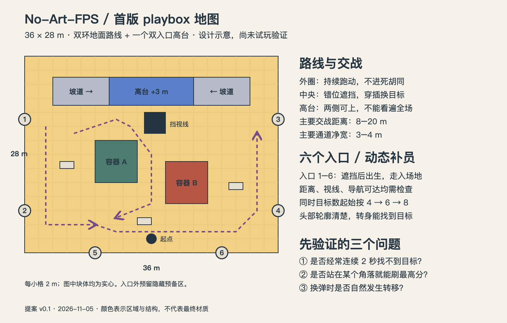

# No-Art-FPS：60 秒击杀冲刺设计案

日期：2026-11-05。状态：设计提案，尚未实现或试玩验证。项目检查时为空目录；本次新增方案、示意图与录像抽帧，没有创建可运行游戏。

## 1. 从参考录像保留什么

参考文件：`/Users/cong/Downloads/ScreenRecording_11-05-2026 22-04-15_1.mov`，约 31.77 秒、2144×1206、60 fps。检查了游戏部分的连续时间抽帧，以及约 2–4 秒的战斗动作序列。末尾系统控制界面不纳入风格参考。未以音轨判断音效品质，也不能据录像确认原作引擎、着色器算法、完整地图或性能。


可见特征：

- 蓝天、奶油黄地面、砖红/青绿/紫色建筑、深蓝武器，几乎没有写实表面噪声。
- 集装箱、叉车、油桶、栏杆、三角树与团块云；大块体构成轮廓，细节主要靠色块和少量结构线。
- 深色瘦长敌人、明显枪口闪光与抛壳、命中后倾倒；高低两层提供视角变化。
- 顶部计时板、右上小地图、左下生命/击杀板、右下弹药/按键表，以及重复爆头文字，让视线不断离开目标。
- 有波次清空提示。60 秒模式应该取消波次之间的等待。

建议风格定义：**明亮的彩色积木靶场，干净的块面，轻度漫画轮廓，清晰的深色目标。** “No-Art”可以理解为节制美术生产量；画面仍然需要严格的美术规则。参考中的细边缘可能来自模型接缝、材质或后处理，不能直接认定全部是某种描边 shader。

## 2. 核心规则：一局只回答一个问题

**60 秒内，你能击杀多少个目标？**

第一版建议：单人、桌面键鼠、一张固定地图、一把自动步枪、两种敌人；暂停可以停止练习计时，失焦自动暂停。联网排行榜、控制器和移动端另做后续范围。

| 项目 | 初始规则 | 目的 |
| --- | --- | --- |
| 时限 | 3 秒准备后，60 秒有效游戏时间 | 每局可比较 |
| 主成绩 | 每个敌人死亡 +1；爆头仍是一次击杀 | 不让倍率淹没目标 |
| 爆头价值 | 普通兵身体 3 发、头部 1 发 | 准度通过更快击杀体现 |
| 武器 | 10 发/秒，30 发弹匣，约 0.9 秒换弹，无限备弹 | 保留射击与转移节奏 |
| 生命 | 3 格护甲；受伤后短暂无敌，防同帧连击 | 易读、易调 |
| 恢复 | 3 秒未受伤后，每 1.5 秒回复一格 | 避免为回血绕图 |
| 倒地 | 1 秒后在安全点复位，倒计时继续，击杀不扣除 | 每局都能完成；惩罚是丢失输出时间 |
| 结算 | 击杀、本地最佳、爆头率；一键再来 | 主次分明 |

所有数值是起始调参假设，不是从录像测量得到的平衡结论。不加杀敌延时、积分倍率、武器商店、技能树和局内升级。第一轮先测准度、走位、换弹是否自然形成挑战。

初版不加入 sprint/滑铲/冲刺能力：普通移动约 7 m/s、可跳跃、空中控制克制，移动射击基本准确。先把加速、刹停、鼠标响应调好，再决定额外移动能力。

## 3. HUD：压缩信息来源，而非仅缩小面板

常驻顶部中间一行 `00:47   12 KILLS`，中心一个小准星。字体、间距和数字变化承担层级，不要卡片底板与多重边框。

- 弹药在枪旁用小号数字显示；满弹匣时可淡出，低弹和换弹时显现。若武器模型上的显示在测试中难读，保留固定屏幕位置，优先可读。
- 满护甲隐藏；受伤/未恢复时出现三格短线与短暂方向提示。不要依赖大面积红屏。
- 命中用短促准星反馈；击杀由计数变化和独立音色表达。爆头只保留一种短反馈，不叠两套文字。
- 删除小地图、常驻操作表、地点标签、波次提示、伤害数字和击杀播报列表。
- 首次操作提示只在准备阶段出现；操作与辅助设置放暂停菜单。
- 最后 10 秒只突出时间，不让整个画面闪烁。镜头晃动、闪光强度可调。

## 4. 地图：36×28 米的双环积木场



图中北侧平台及双坡道是实心结构；这版不设计平台下方可走通道。边缘入口为隐藏的刷怪口，图外应有视觉屏障与预备区，外墙不能在入口处封死敌人的路径。

布局目标是外圈能绕行，中央能穿插，二层提供短暂收益；地面路线始终是最短追击路线。不要做标准对称三线竞技地图，也不要照搬参考场景所有建筑。

- 面积约 36×28 m。主要通道净宽 3–4 m，局部开放区更宽；避免碰撞后净宽只剩 1 m。
- 主要交战距离约 8–20 m；可读头部大小比远景细节重要。
- 中央两组错位的 6×6 m 遮挡组，中间与两侧均可绕行；用少量 1.0–1.2 m 低掩体创造露头目标。
- 北侧高台高 3 m、约 12×4 m；两侧各一条长约 8 m 的坡道。最终表现可换成楼梯，但碰撞继续使用斜坡。
- 高台前放一个 3 m 高视线挡块；高台只能覆盖部分战区，两侧敌人可接近，避免成为永久安全刷分点。
- 第一版没有深室内、狭长死胡同、梯子、致死坑、跳跃必经点。场景边缘用围栏与块状建筑表达边界。
- 蓝色结构标记高台，青绿/砖红区块作方向参照；即使没有小地图，也能凭地标理解位置。

先在 Godot 里用盒体搭建，随时改宽度和遮挡关系。不要在 Blender 中先做完整地图再发现距离不好玩。

### 刷怪导演

用 6 个固定入口，分布于不同方向；出生点在入口后的遮挡区，敌人走入场地。出生预告约 0.5 秒，声音或小灯即可，不添加大型 UI 箭头。

初始同时存活目标数按 0–20 / 20–40 / 40–60 秒设为 4 / 6 / 8，硬上限 10；低于目标数时约每 0.35–0.6 秒补充一个，最多每帧一个，避免积压后一口气生成。普通移动靶占主流，快步侧移兵后半局加入。

出生选择检查：玩家距离约 8–18 m、视锥与遮挡测试、入口冷却、导航可达、不要挤在同一方向。玩家看不见不代表允许贴背生成；还要有距离与入场缓冲。

没有合格入口时延迟并重选，最多等约 1 秒后使用预告过的远端遮挡入口；仍不满足距离/可达条件则继续延迟并记录诊断，不能强行生成到玩家面前。地图设计必须保证大多数站位下至少两个入口可用。

建议熟练操作时的“没有目标可见且不可交战”空窗 P90 < 2 秒，准备/倒地阶段除外；这是验收目标，不是现有成绩。不要把刷怪速度设计成固定击杀上限，否则高手只是等敌人。

固定随机种子可以让练习更可复现，但受玩家站位影响的刷怪筛选仍会改变序列；它不是严格同赛程。排行榜若以后需要严格比较，另建明确的挑战规则与版本标识。

## 5. Blender 素材生产：一个模块库，两套复用角色

第一批只做会影响画面识别与战斗的东西。大多模型从 cube/cylinder 开始，避免雕刻和高低模烘焙流程。

| 批次 | 素材 | 制作方法 |
| --- | --- | --- |
| 核心 | 集装箱实体、开口容器/门框、墙、地块、低掩体、坡道、平台、栏杆 | 1 m 对齐网格；尺寸用 0.5 m 步进；共用材质 |
| 战斗 | 一把枪、简化手臂、一个敌人身体 | 枪夸大枪管/机匣/瞄具；手部可低细节；敌人头部易辨认 |
| 变体 | 快步兵 | 复用骨架，改肩/头轮廓与少量配色；不只靠颜色区分 |
| 氛围 | 箱、桶、路障、灯杆、低模树、云 | 6–8 边圆柱、锥体、团块；用少量母体生成变体 |
| 后补 | 叉车与标牌 | 只有主视角需要时制作；叉车不作为原型前置 |

建模规范：

1. Blender 与 Godot 均按 1 单位 = 1 m。导出前应用旋转/缩放，检查法线与原点；墙和容器原点置于底面拼装基准，武器置于握持基准。
2. 方块优先、少量倒角；同一尺度资产使用相近倒角宽度。大平面保持平直，不把所有物体都做成圆润玩具。
3. 初始每个静态道具约 100–1,500 三角面；枪含手臂约 2,000–5,000；敌人约 1,000–2,500。它们是制作预算，不能据此保证帧率。
4. 首批直接分配少量共享纯色材质，不做每个物体一套 2K PBR。实例数量上来后再合并材质，或改为调色板 UV/顶点色；避免每块小面都成为一个材质表面。
5. 只给标牌、编号等做一个小 decal/文字图集；铁丝网远处简化，减少细线闪烁和透明重叠。
6. 敌人先做刚性分件/简单骨架：待机、跑步、受击、倒地四个动作。枪后坐、摆动与换弹先在 Godot 程序动画完成；布娃娃不是第一版依赖。
7. 音频也属于核心素材：先准备可用的枪声、空仓/换弹、普通命中、击杀、倒计时和结算音。可录制或使用许可清楚的样本，统一响度，枪声轻微随机音高，击杀音不要被连射吞没。参考音轨未作评价。

推荐链路：`.blend` 源文件 → 显式导出 `.glb` → Godot 导入 → 包装为 `.tscn` 添加碰撞和脚本。Godot 官方推荐 glTF 2.0，也支持自动调用 Blender 导入 `.blend`；此项目选择显式 GLB 便于固定导出结果。[Godot 导入文档](https://docs.godotengine.org/en/stable/tutorials/assets_pipeline/importing_3d_scenes/available_formats.html)

Blender 负责几何、基础材质与动作，Godot 负责最终灯光、卡通材质和游戏表现。不要期待 Blender 自定义节点网络自动原样变成 Godot shader。先导出“一个箱子、一把枪、一个带骨架敌人”完成往返验证，再批量生产。共享材质提取为外部资源，重新导入后也要检查绑定是否保留。

建议未来目录（本次未创建这些游戏资源）：

```text
art_source/                # .blend 源文件；配置 .gdignore
assets/models/             # 导出的 .glb
assets/materials/          # 统一纯色/卡通材质
assets/audio/
scenes/actors/
scenes/props/              # 模型的碰撞/逻辑包装
scenes/maps/
scripts/
data/                      # 武器、敌人、回合配置 Resource
docs/design/
```

## 6. 相似画风靠统一规则与对照验收

建议起始色板（人工近似参考，不是精确测色）：奶油黄 `#F2D084`、米白 `#E5E0D2`、天空蓝 `#5B7FC8`、深墨色 `#243440`、砖红 `#B65745`、青绿 `#4D7D70`、紫色 `#754C87`、枪械蓝 `#304F9D`。

每个视角主要由天空/地面/建筑三种大色块组成；鲜艳的第二、第三强调色只放局部。敌人保持深色主体和浅色头部/胸前识别块，不能仅靠黑色轮廓在暗背景中找目标。

先用共享 StandardMaterial3D、低金属度、高粗糙度、一个方向光与环境补光完成基本外观；固定曝光，阴影保持可见细节。先关闭景深、运动模糊、自动曝光与厚重泛光。不要用 unshaded 替代全部材质，立体关系和落地阴影仍然重要。

若普通材质过于写实，再切统一的两至三段明暗材质。Godot 提供 `diffuse_toon` 等空间 shader 模式；需要稳定分段时再写统一 shader，而不是每件模型单独调。[Godot 空间 shader](https://docs.godotengine.org/en/stable/tutorials/shaders/shader_reference/spatial_shader.html)

描边最后做：优先用深色结构边、门框和细接缝；枪与敌人可单独尝试反向外壳描边。硬边模型可能出现外壳裂缝/粗细变化，要验证而不能当作即插即用。全屏深度/法线描边留作风格强化项，避免把地面边、栏杆和背景都画成黑网格。

默认先用 Godot 4 稳定版 + GDScript + Compatibility 做简单材质原型；启动项目时固定确切版本。此选择便于保留未来 Web 的可能性，不承诺已有 Web 兼容。如果以后确定只做桌面并需要高级后处理，再评估 Forward+。渲染器切换可能改变光照与材质表现，要重做截图比对。[Godot 渲染器说明](https://docs.godotengine.org/en/stable/tutorials/rendering/renderers.html)

设一个固定 lookdev 小场景：地面、集装箱、坡道、枪和敌人。锁住相机、灯光和曝光，保存地面/高台/背光三张基准图。每次美术更改都看这三个视角，并在实际游戏分辨率、运动状态下检查：

- 缩小到 320×180 后，是否仍能分辨敌人、入口和可走区域？
- 暗处敌人能否辨认头与躯干？黑白图是否仍有明暗对比？
- 枪和闪光是否遮挡准星附近目标？细栏杆是否闪烁？
- 替换了模型后，是否还像同一套玩具场，而不是多个资产包拼贴？

## 7. 原始 playbox 的技术骨架

这里的 playbox 指可走、可射击、可刷敌人、可结算重开的灰盒试验场。

```text
Main
├── RunController          # READY / RUNNING / RESULTS
├── Arena                  # 几何、静态碰撞、导航、入口
├── Player                 # CharacterBody3D
│   ├── Camera3D
│   └── WeaponController
├── SpawnDirector
├── Enemies
├── FX
└── HUD                    # CanvasLayer；这是 Godot 节点，与编辑器 Canvas 无关
```

- **移动**：CharacterBody3D + 胶囊碰撞；玩家高约 1.8 m，眼高约 1.65 m；楼梯视觉使用斜坡碰撞。不要让小台阶把高速移动卡住。
- **镜头**：16:9 下水平 FOV 约 95°为初值；在 Godot 的 KEEP_HEIGHT 设置下对应垂直 FOV 约 63°，不要直接把 95 填成垂直 FOV。鼠标灵敏度可调，默认弱摇晃；测试超宽屏和低分辨率。
- **命中**：hitscan 即时射线，独立头/身体受击区。先相机射线取得准星目标，再枪口到目标检测阻挡，处理“准星看得见但枪口被墙挡住”，不要穿墙射击。排除玩家自身和第一人称模型。
- **反馈**：开火立即响应；短闪光、后坐、命中音、死亡倾倒优先。第一版不依赖全局 hit-stop，以免污染 60 秒节奏。
- **敌人**：CharacterBody3D + NavigationAgent3D；普通兵进入射程后有清晰抬枪预告，快步兵改变移动方向。可用慢速可见弹体表达敌方攻击，避免无预警命中。
- **导航**：静态场景烘焙导航；目标更新可低频，但活动 agent 的路径推进按物理帧调用。NavigationAgent3D 提供路径点，不自动移动角色，角色仍需自己的速度/碰撞代码。[官方说明](https://docs.godotengine.org/en/stable/classes/class_navigationagent3d.html)
- **计时**：RunController 按有效物理游戏时间推进；截止先判断本 tick 是否超时，再接受击杀事件，规定 `elapsed < 60` 才有效。结果阶段立即停止射击/伤害/生成，仅允许表现结束；不因低 FPS、重复信号或倒地重置延长一局。冻结/暂停逻辑集中管理。
- **计数**：敌人只有第一次进入 DEAD 状态可发一次死亡事件，RunController 统一计分。同帧头部/身体信号不得重复加分；结算保存一次。
- **重开**：清除敌人、子弹、尸体、计时器和残留音效，重置生成器与输入状态，保留个人最佳。之后再考虑池化，先保证清理正确。

## 8. 分阶段交付，按门槛决定是否进入下一步

| 阶段 | 实际交付 | 验收门槛 |
| --- | --- | --- |
| P0：闭环 | 方块房间、枪、静态目标、60 秒、计分、重开 | 能连续完成 10 局；截止不再加分；不会双重击杀计数 |
| P1：战斗 | 双环地图、移动敌人、6 个入口、伤害复位 | 没有出生贴脸/不可达敌人；普通玩家能持续找到目标 |
| P2：视觉切片 | 一把枪、一个兵、一个集装箱区域及统一灯光 | 三个基准视角画风统一，敌人易辨认；先验证 GLB 往返 |
| P3：完整首版 | 替换其余灰盒、补音效、精简 HUD、结算 | 真实窗口下完整试玩；能理解为什么这一局比上一局更好 |

P0 和 P1 不必等 Blender 美术做完。P2 达标后再扩大资产量，避免整场返工。以后扩展优先级是第二把有不同决策的枪/第二张图，而不是先做数十把相似武器。

首版验证记录：固定版本、平台、分辨率、种子与设置，进行至少 10 局人工试玩；记录击杀、爆头率、受击、目标空窗、高台停留、各位置击杀分布。若一个角落就能稳定得到最高分，先改视线与入场路线。热力图需要这些真实数据之后再做，不以示意图冒充测试。

性能目标：在选定目标机器 1080p、实际最坏敌人数/特效下力争 P95 帧时间 ≤16.7 ms；记录 P99 与峰值。连续运行/重开约 10 分钟，观察敌人、节点、尸体、弹壳和内存是否持续增长。该目标目前未测量。最初限制同时敌人 ≤10、尸体短时回收、弹壳限量、一个主阴影光源；比只限制模型面数更可靠。

自动验证集中在有意义的规则：60 秒边界、同一敌人只计一次、重开恢复状态、倒地不重置倒计时。移动手感、HUD 阅读和敌人可见性必须人工试玩。

## 9. 本次结论与下一步

先验证“60 秒结束后愿不愿意立刻再来一局”。最有价值的第一步是 P0+P1 的可运行灰盒；美术并行只制作一个 lookdev 小场景与三类导入样本。不要把首版变成大型武器库或完整港口制作项目。

本文件中的图与数值为原创设计提案；录像截图用于本地参考。本次未启动 Godot/Blender、未生成 .blend/.glb/.tscn，也未进行游戏性能或手感验收。
