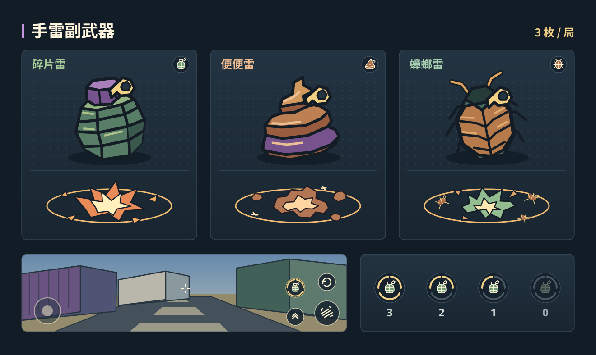

# 手雷副武器

## 一局 3 枚

四张 60 秒计分地图每局带 3 枚。手雷离手才扣库存，投完归零。复活、换弹、进入狂暴模式都不补充。开新一局才恢复 3 枚。拆弹模式暂不加入。

手雷适合扔进两三个敌人共用的路口，也能从墙边反弹打到掩体后。货场可以留给仓库口，游乐园用来封站台入口，渡轮能扔到楼梯转角，演播厅能从门口扔进开放办公区。最后 15 秒留一枚，可以和枪一起拆掩体，再利用爆炸打掉后面的敌人。

## 投掷与 HUD

- 桌面按 **G**，手机点开火键左上方的独立按钮。以点按为一次投掷，按住不连投。准星决定抛投方向，投掷后自动继续用主武器。
- 左手投掷，枪口下沉约 **0.25 秒**。主武器在这段时间暂停开火，正在进行的换弹继续。投掷间隔先定为 **0.75 秒**。玩家在手雷离手前死亡则取消，已经投出的手雷照常引爆。
- 离手后 **1.1 秒**引爆。平视落点先调在 **10–14 米**，低头可以近投。撞墙或落地时弹起，随后迅速停住。飞行时带一截短轨迹，落地后用引信闪烁和两声短促提示音标出位置。
- 桌面上的手雷图标位于左下角。触屏上的手雷图标在弹夹上方，与弹夹左对齐。每枚库存对应一个图标，投掷时最后一枚先拔出安全针，离手时甩出并快速消失。手机投掷按钮沿用触控内缩设置，用完后变暗。

## 爆炸与连锁

- 半径为 **7.5 米**。无遮挡时，内圈 **4.2 米**对敌人致死，外圈造成 **1 点伤害**，可以接一枪收掉。墙、楼板和掩体会挡爆炸，楼上楼下分别按实际距离和遮挡判定。
- 玩家自己的手雷只在内圈造成 **30 点伤害**，沿用屏幕边缘受击反馈。贴墙近投有代价，也给反弹失手留出余地。
- 手雷在普通阶段就能引爆可见范围内的油桶和厕所旁的柱状炸弹。油桶、厕所各自沿用原有爆炸规则。狂暴模式中，手雷另外给爆炸范围内、无遮挡的可破坏物各加 **1 次**破坏命中。手雷接一枪、两枚手雷都能凑够两次，倒计时归零时还没引爆的手雷随回合清理。
- 手雷和它引发的连锁击杀沿用回合计分和通用连杀判定。手雷伤害不算爆头，「一桶双响」仍按单只油桶的爆炸单独判定。

## 三种模式

- **碎片雷 / Frag Grenade**。军绿切面外壳、紫色雷帽、浅金拉环。爆炸是暖黄白芯和橙色碎片，声音是短促的金属扣响与干脆爆鸣。
- **便便雷 / Stink Bomb**。琥珀棕盘卷、紫色束环、浅金拉环。炸开时用奶油色冲击环和棕色软团表现，配一声有弹性的闷响。
- **蟑螂雷 / Roach Bomb**。墨绿甲壳、琥珀色甲片和一对短触角，保留浅金拉环。爆炸时壳片和少量卡通小蟑螂向外散开，配两声干脆的甲壳响。

三个版本共用碰撞体、弹道、伤害和库存。三种爆炸共用清晰的外圈提示，软团、壳片和小蟑螂随特效消散。模型做成带漫画描边的低面数构件，按钮图形使用 SVG，随模式切换。局内保留无文字图标，中英文名称用于按键说明和可访问标签。

## 原型验收

先在货场调近投、过门和撞墙反弹，再到渡轮验证楼层遮挡、到演播厅验证狂暴破坏。测试连续投出 3 枚、死亡复活后余量、暂停冻结引信、归零前后清理和重新开局。最后在手机横屏和大屏触控上检查开火、跳跃、换弹与投雷四键能否单手够到，三种模式的余量图标是否清楚。
