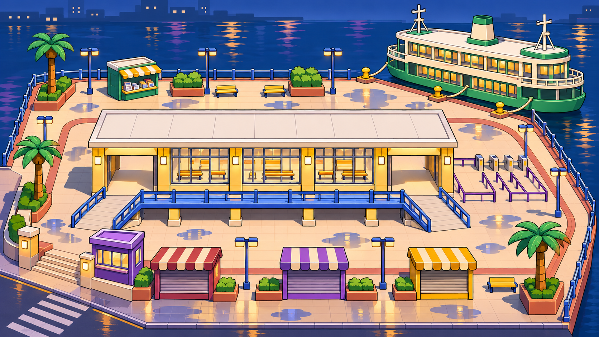

# 末班渡轮

一座雨后的虚构香港码头。候船厅的暖黄窗、钴蓝连廊和街边彩色摊档分别指向室内、高处和入口。绿白双层渡轮在东北角靠泊，作为海侧地标。海面、天空和远景用深蓝块面，主要交战面保留奶油色与暖光，方便辨认黑色枪兵。

## 首版白盒

- 以约 52 × 38 米为起点。外环从西南街口沿摊档、登船广场和滨水步道回到入口。候船厅东西两端各有一个宽门，构成横穿场地的地面捷径。
- 蓝色连廊抬高约 2 米，两端以缓坡接回外环。主路净宽约 4 米，捷径约 3 米。摊档、售票亭和行李车错位摆放，在约 8–18 米的主战距离切断长视线。
- 从街巷、候船厅两端和登船广场布置补员口。先用手机移动走完环线、穿厅和两端缓坡，再检查高处与滨水区能否持续遇敌。
- 最后 15 秒沿用两枪摧毁。撤去摊档、售票亭和棚架后，广场可以斜穿。码头地面、承重连廊和海侧护栏作为可行走基础。
- 标题开场从街口平视，候船厅在中间，渡轮露在右前方。平视缩略图以船体轮廓识别，FIRE 从同一个机位开局。

## 配乐

前 45 秒用三音登船铃、电贝斯和切分鼓做夜间街机赛车的律动。最后 15 秒将铃声提高一个八度，鼓换成更密的碎拍。两段共用主题，分别保存可编辑 MIDI 和游戏用 Ogg。常规段参考《R4》的《Naked Glow》，摧毁段参考《Movin’ in Circles》。 [Bandai Namco 官方原声](https://gamemusic.bn-ent.net/en/release/1266/)

俯视图用 imagegen 生成。生成提要是沿用游乐园的高机位、低多边形块面和深色描边，画出蓝调时刻的香港码头、暖亮候船厅、双坡连廊、彩色摊档和绿白渡轮。参考《Splatoon 3》Hagglefish Market 的码头摊位与色块辨识，以及天星小轮的船体配色。 [Nintendo 官方介绍](https://www.nintendo.com/us/whatsnew/splatoon-3-makes-a-big-splash-in-new-video-preview-filled-to-the-gills-with-fresh-gameplay-and-new-details/) · [香港旅发局照片](https://www.discoverhongkong.com/eng/place-to-go/travel.guide-star-ferry-pier.html)
