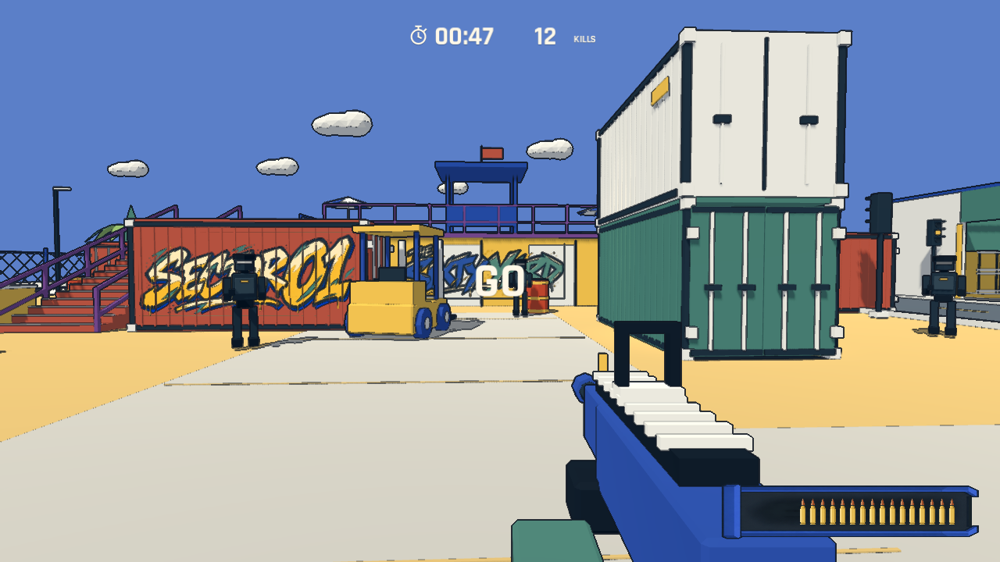
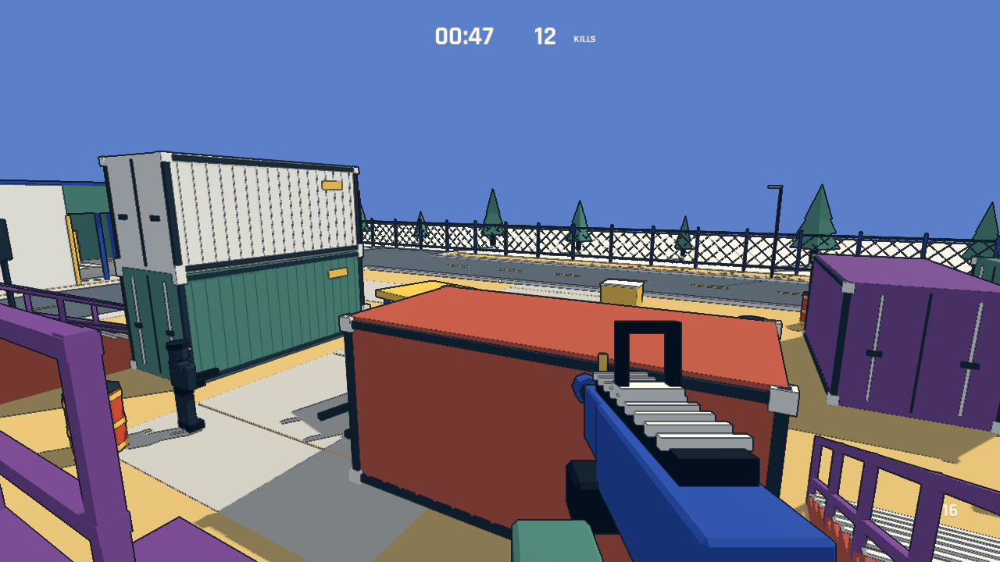

# No-Art-FPS local playbox — 2026-11-05

Implemented in Godot 4.7.2 with an original Blender 5.2.2 LTS asset kit. The source video is used as a visual reference, not as game code or imported art.

## Current playable scope

- A compact container yard with a forklift, barrels, fence lattice, low-poly trees/clouds, a rear platform and two traversable stair/ramp approaches.
- First-person walking/jumping, automatic hitscan rifle, independent head/body collisions, magazine/reload, recoil, hit/kill feedback and synthesized audio.
- Navigating enemies, a faster silhouette variant, telegraphed projectiles, contextual three-hit armor, regeneration and one-second respawn.
- Three-second preparation, a strict 60-second run, one point per kill, local best, results/retry, pause/focus handling and mouse/motion settings.
- Minimal persistent HUD: time, kill count and crosshair. Ammo and armor appear contextually.

## Visual comparison

These are actual Godot renders at the final 16:9 framing. The showcase uses deliberately positioned stationary enemies and preset HUD values to make comparisons reproducible. It is not a claimed player score. The full-round captures below are generated by actual automated shooting.

The reference's main visual language is present: blue sky, warm yellow ground, muted cream paving, brick-red/green/purple architecture, a deep-blue weapon and dark readable targets. Containers use physical ribs, corner castings and door rods; fences use batched lattice geometry. The initial overbright ground was reduced, and the viewmodel was moved and scaled down.

This is still a first visual approximation. The reference has more developed character posing, weapon handling, scene dressing and fine edge treatment. This prototype uses simple rigid-part enemy animation, direct lighting and geometric seams, without a full-screen outline pass. It does not claim a pixel-identical reconstruction or a finished art pass.

## Validation

Rule tests pass for idle rejection, duplicate deaths, deadline exclusion, late-score rejection, reset and exactly 3,600 physics ticks at 60 Hz.

The rendered interaction checks pass for:

- Traversing both approaches with ordinary player movement and collision; player Y exceeds 2.7 m on each ascent.
- Pausing the run clock, completing a reload, one-shot head kills and three-shot body kills through live physics raycasts.
- Preventing a shot through a solid container and preventing duplicate scoring.
- Restoring the player after damage without resetting the round clock.
- Ten immediate restarts without retained enemies/effects; measured node count returned to 260 against a baseline of 259 in that test.

The first full-minute test completed with 50 kills from 50 automatic headshots, rejected late scoring, and reset successfully. This uses perfect automatic aim and scripted repositioning; it is not balance evidence. Its capped frame intervals were P95 18.06 ms / P99 21.41 ms. The final rerun after geometry and spawn checks completed with 29 kills / 34 shots, P95 16.67 ms / P99 25.00 ms, and passed the same deadline/restart checks. Its result is in [playtest.json](../artifacts/playtest.json).

The short uncapped stress sample uses ten enemies, three seconds of warmup and ten seconds of measurement on this Apple M5. The final sample reported P95 3.33 ms / P99 4.19 ms, with a maximum 80.19 ms spike. The captured render target was 1138×640, while the logical UI canvas was 1440×810; this is not a 1080p performance result. Values are in [benchmark.json](../artifacts/benchmark.json). Window/render resolution and logical UI resolution are reported separately. Frame intervals include scheduling and are not GPU timer measurements. Average/P95 statistics do not hide the recorded maximum spike.

The normal launcher was started successfully. Native desktop screenshot capture failed twice, so OS-level clicking/keyboard interaction is not marked as verified; visual verification uses Godot viewport captures, and gameplay checks use engine input/physics.

This is not a ten-minute soak, a human balance test, or Windows/Web/controller validation. Audio is functional placeholder synthesis rather than a final sound-design pass. No standalone signed application or remote repository has been published.

## Source and repeatability

- `tools/build_assets.py` builds the original `.blend` library and GLB assets. It uses a new background Blender process, leaving any existing user scene alone.
- `tools/build_audio.py` synthesizes the WAV effects from a fixed seed.
- `scripts/arena.gd` assembles the map and bakes navigation from static colliders.
- `scripts/run_rules.gd` owns the scoring/deadline state; game code gates damage and spawn actions by run state.
- Test entry points and play controls are documented in the project README.

The original design document remains a proposal/history record. Current behavior and validation are described here and in the README.

## Menu cleanup — 2026-11-05

The project instructions now require: “Avoid unnecessary secondary labels and descriptions. Let the layout do the explaining.”

Title retains the name and Play button. Pause uses Resume/Restart buttons and two directly operable settings. Results retain kills, best and Retry/Menu. Promotional copy, duplicated key legends, prototype identifiers, headshot summary and the countdown slogan have been removed. Shortcut hints live in button tooltips; existing keyboard shortcuts remain functional.

Godot import passed. A temporary engine-side GUI check sent viewport mouse events through the real button hitboxes and verified Play, Resume, Retry, Menu, motion switching and sensitivity changes. Title, preparation, pause and results were rendered; title/pause were also inspected at a 960×540 window size. Screenshots are in `artifacts/menus/`. No combat rules changed.
