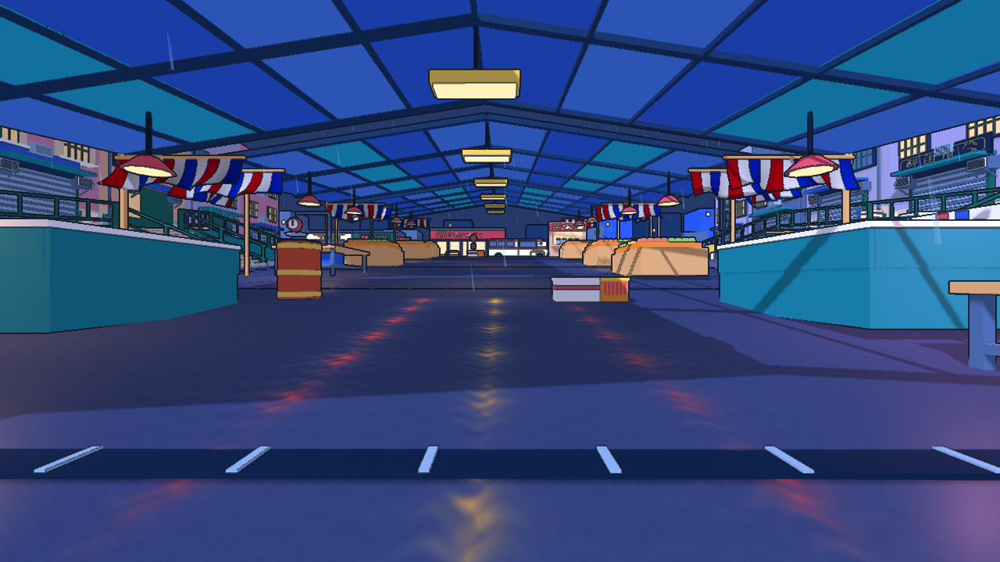
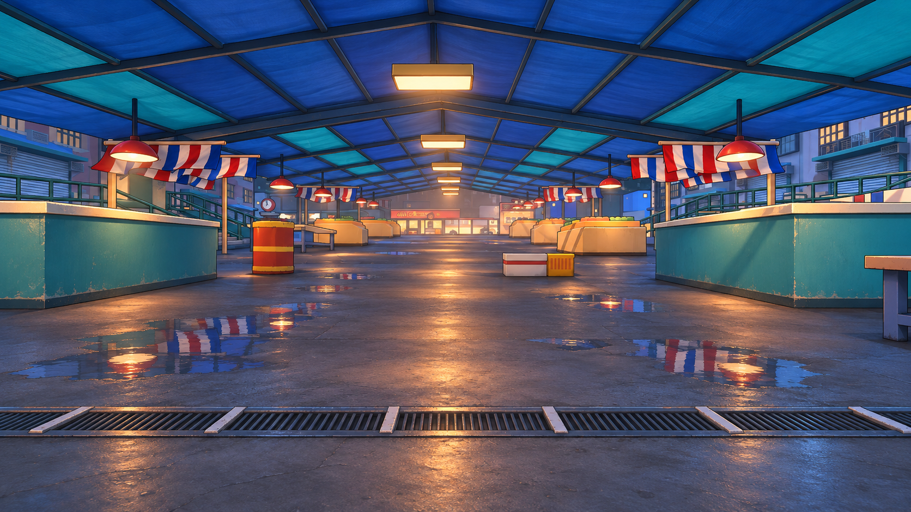

# 1.4 MB HTML FPS 的渲染拆解与 No-Art-FPS 改造潜力

2026-11-11。项目基线 `88f6940`；Godot `4.7.2.stable.official.ed1daf0bf`，GL Compatibility。

结论：文件体积属实，画面也确实由浏览器实时渲染。它把场景和材质的“生成规则”存进代码，运行时再展开成网格、贴图、阴影与反射缓冲。视觉完成度来自程序化 PBR 材质、明确的逆光构图、软阴影、真实平面反射、空气散射和完整的色彩处理共同配合。小下载包不等于低显存、低计算量，也不说明 Godot 无法得到类似品质。

对我们的建议是保留 Godot、既有地图与鲜明的低多边形风格，先升级一段雨市的材质和灯光。最有价值的迁移是统一表面与光照响应；没有必要先重做全部模型或移植整套 Three.js 后期。

## 1. 审阅范围与证据

- 输入：`/Users/cong/Downloads/fable5.5一次性制作.html`，SHA-256 为 `9e55b5200b088adaf8e1152da04efc0d3b25e236e6baf2dee96f81e23e084966`。
- 静态阅读实际代码，并把内联脚本格式化到 Git 忽略目录，区分 Three.js 内置功能与游戏真正调用的功能。
- Chrome 硬件 ANGLE Metal / Apple M5，1280 x 720、DPR 1、high，确认 `advanced=true`、`softShadows=true`、平面反射 active。
- 验证启动、实际游戏画面与向前移动；通过运行时质量开关，分别关闭平面反射，以及进一步关闭 AO、体积散射、Bloom、运动模糊，截图检查视觉贡献。不是只看宣传截图。
- 另做 10 秒固定相机帧间隔采样。未做整局通关、持续战斗、移动端或音频验收。鼠标射击与换弹自动冒烟没有产生射击计数，不能据此宣称这些交互已验证，也不足以断言游戏存在射击故障。
- 重新运行本项目 `tools/maps/capture_concept_arenas.gd -- rain_market`，得到 `CONCEPT_ARENAS_RENDERED`，概念图以这次真实渲染的画面为输入。

原 HTML、格式化源码、参考游戏截图和测试脚本留在本地；不提交参考文件或其截图。本次提交只有分析、自有项目截图、生成概念与汇总数据。[结构化证据](evidence.json)。

文件名中的“一次性制作”和页内模型宣传文字不是制作过程证据；这个文件无法证明用了哪个模型、几轮提示或是否人工修订。

## 2. 1.4 MB 具体装了什么

| 内容 | 字节数 | 占比 |
| --- | ---: | ---: |
| Three.js 核心、导出表与底层代码 | 701,819 | 49.2% |
| 游戏代码、GLSL、配置与剩余辅助代码 | 691,788 | 48.5% |
| HTML、CSS 与脚本之外的文字 | 32,100 | 2.3% |
| 合计 | 1,425,707 | 100% |

原文件为约 1.426 MB，或 1.360 MiB。按 `var oi=` 这个首个场景配置边界划分，字节数精确，但不是各模块完全独立的打包统计。运行时确认 Three.js revision 为 `180`。本地 gzip 压缩结果 445,935 字节，约 436 KiB；这不是源文件大小，也不是已验证的线上传输配置。

没有发现外链资源标签、Base64 图片包或外部模型 URL。此次启动的运行时资源记录只有本地 favicon 请求，没有 CDN 贴图或模型请求。GPU、浏览器、系统字体等执行环境本身当然不包含在 HTML 内。

它省体积的方式主要有四种：

1. **存配方，不存像素。** 锈迹、油漆、混凝土、划痕和地面水渍用噪声、周期图案、遮罩与参数生成。启动时在 GPU 上生成颜色、ORM 和法线纹理，后续帧采样已经生成的结果；不是每个像素每一帧都重新算整套复杂纹理。
2. **存建模过程，不存独立美术文件。** 箱体、集装箱波纹、起重机、栏杆、枪械与手套等由代码构造。港口的重复工业结构非常适合这一表达方式。
3. **重复利用并合并。** 材质缓存、静态几何按材质合并、文字标签图集，使大量零件共享渲染资源。不是每件道具都带自己的完整纹理组。
4. **音频也包含合成逻辑。** 存在 Web Audio 和 OfflineAudioContext 的声音生成与混音代码，不需要随包携带等量录音。本次未听测音质。

可把它理解成一份短小的制造说明书：说明书很薄，制造出的东西仍然可能很大。

## 3. 实现内容，不只是一张漂亮的图

| 模块 | 代码中实现的内容 | 本次证据等级 |
| --- | --- | --- |
| 世界 | 港区堆场、仓库、起重机、海面、外围背景、天气、场景标牌 | 代码与实际画面 |
| 玩家 | 移动、视角、跳跃、冲刺、蹲伏、碰撞与水域救援逻辑 | 移动实测，其余代码确认 |
| 武器 | 程序化步枪与手臂、瞄准、射击、换弹分阶段动作、枪口火焰、弹道与命中统计 | 画面与代码；射击输入未验收 |
| 敌人 | 不同敌方单位、警戒/攻击、生成队列、追击与受击处理 | 代码确认，未通关验证 |
| 任务 | 切断三处中继，再到撤离区域；死亡、重试、结算与评级 | 代码确认 |
| 输入与设置 | 键鼠、触屏按钮、画质档位、暂停、灵敏度等 | 桌面启动与输入部分验证 |
| 工程 | 启动进度、预编译、功能降级、自动降分辨率/画质、截图与 benchmark 接口 | 代码与运行状态 |

内部关卡统计报告 47 个集装箱、298 个道具、96 个图集标签，合并后的关卡部分约 794,188 三角形、125 个 mesh。这是相关模块的内部统计，不等于完整游戏所有独立面数。

因此它是一个有任务闭环代码的 FPS 体验版。不过，“具备实现”与“玩法成熟、无缺陷、各平台顺畅”是不同结论。

## 4. 画面为什么显得高级

### 4.1 材质细节会随光线变化

`Gg()` 生成 Albedo、ORM（遮蔽/粗糙度/金属度）和 Normal，再交给实际使用的 `MeshStandardMaterial`，辅以三平面映射、宏观色差、湿润参数与磨损。

这种细节不是单纯往颜色上撒噪点。粗糙度控制反光的清晰与扩散；法线让浅划痕和颗粒改变光照；金属与非金属对反光的响应不同。同一个简单箱体因此有了表面层次。Three.js 的这套材质采用 metallic-roughness PBR 工作流，环境图尤其影响效果。[官方材质说明](https://threejs.org/docs/pages/MeshStandardMaterial.html)

### 4.2 光照具有明确方向与冷暖关系

太阳方向约为 `(0.916, 0.225, 0.331)`，是低角度暖光。冷色天空、暖色地平线、暗集装箱与背光边缘构成一致的画面关系。天空本身用程序噪声、云层遮罩和朝向太阳的颜色函数生成，再捕获和预过滤成材质的环境光；仓库还有独立内部环境捕获。

这里的环境光与反射近似不能等同于实时多次反弹 GI。它用有限的光照模型与针对港口场景的美术设计建立可信关系。

### 4.3 软阴影不是普通的硬边投影

`qy()` 替换阴影 shader chunk：先搜索遮挡物，再按遮挡距离调整半影宽度，属于 PCSS 思路。常规档位有 8 次 blocker search、16 次过滤采样；high 阴影图为 4096 x 4096。接触处较实，离开遮挡物后逐渐柔软；斜面深度偏移也做了专门处理。

### 4.4 地面的反射来自镜像场景

`zb()` 建立镜像相机和独立 render target，使用斜裁剪平面，再把实际场景渲染到反射纹理；high 为主画面宽高各一半的反射分辨率。水洼遮罩、扰动和不同 mip 等级控制清晰度。

关闭这一路之后，集装箱与设施的水面倒影明显消失，地面仍保留环境与太阳的材质高光。这解释了为什么它的地面“属于这个场景”，而不仅是一层会闪的平面。它不是光追，也不是 SSR；基本适合近似共面的水洼，且要额外渲染一遍部分场景。

### 4.5 空气也参与成像

后期从深度重建位置，在半分辨率上沿视线采样，用太阳阴影图判断空气中的受光状况。high 为 24 步，ultra 为 40 步，并通过深度感知模糊和上采样抑制噪声、减少轮廓漏光。

这一路产生逆光空气、仓库光束和远近层次。单纯给背景设一个雾色不能得到完全相同的遮挡光束。关闭相应效果后，远处更硬、更平，空间氛围明显减弱。

### 4.6 有完整的相机与色彩处理

渲染器采用半浮点场景目标；后续包含半分辨率 AO、Bloom 下采样/上采样、曝光适应、ACES/AgX 混合曲线、冷阴影暖高光调色，以及少量暗角、锐化、抗锯齿、颗粒、镜头效果。`renderer.toneMapping` 本身关闭，不代表没有 tone mapping：它在自定义最终合成里完成。

高光不会简单截成一片白，暗部仍有层次，灯光才显得“亮”。但对我们来说，色差、颗粒、运动模糊、重镜头光晕和频繁自动曝光没有同等优先级，会影响追踪敌人与瞄准。

这些系统互相支撑。只抄 Bloom、雾或一个噪声 shader，很难复现整体效果。

## 5. 小包背后的代价

| 运行时指标 | 此次观测 | 正确解读 |
| --- | ---: | --- |
| 程序材质组 | 24 | 同组供多个物件复用 |
| 程序材质纹理估算 | 111.6 MiB | 源码按尺寸与 mip 估算，不是 GPU 工具实测 |
| 贴花/标签相关估算 | 50.1 MiB | 两项约 161.7 MiB；尚未计入完整显存 |
| renderer 纹理对象 | 144 | 包含运行时纹理；不是下载文件个数 |
| shader program | 116 | 有编译/预热成本 |
| 抽样帧绘制调用 | 389；另一移动视角约 491 | 含各渲染阶段，随视角变化 |
| 抽样帧三角形提交 | 约 202 万；另一视角约 291 万 | 阴影、反射等会重复提交，不能当独立模型面数 |
| 固定相机采样 | 10.01 秒、600 个有效间隔 | 硬件 M5、high、1280 x 720、关闭动态降分辨率 |
| 平均/P95 帧间隔 | 16.67 / 16.80 ms | 约 60 Hz 呈现节奏；不是 GPU 耗时，也不是全程战斗性能保证 |

启动初期的平滑 FPS 曾低于稳定阶段，说明预热和首次资源准备不能忽略。材质模块的 `genMs=101` 主要是其 JS 包围的生成提交计时，不宜当作完整 GPU 生成耗时或总加载时间。

代码在低帧率时会逐步降渲染尺度，最低到 0.6，再降低画质；移动设备默认 low，关闭 AO、平面反射和运动模糊，减少体积采样等。漂亮的 high 画面不是所有设备的相同体验。

本项目现有本地 Web 导出的 `index.wasm` 为 39,514,754 字节、`index.pck` 为 28,100,680 字节，仅作为本地文件的体积观察，未据此验证线上版本。Godot 通用引擎运行时、多个地图与完整资源包和单关卡 JS 实现的范围不同；不能用包大小比例判断渲染效率或视觉上限。

## 6. 我们当前真正缺少什么

上图为当前项目真实渲染的环境视角，HUD、枪和敌人在截图工具中隐藏，用于观察材质与光照；不是人工完成的一局游戏截图。

1. **大面积表面变化有限。** 抽查 `street.glb`、`fish_counter.glb`、`canopy.glb`，三者均无纹理，主要是纯色加固定粗糙度；许多柜台、棚面材料粗糙度约 0.84。低多边形本身不是问题，几米宽的同色表面缺少尺度变化才容易显得平。
2. **环境填光占比高。** 雨市环境颜色源固定，能量 0.76；画面易读，但需要让近灯区域、侧边冷光、遮蔽区域的亮度更有区别。项目已经有运行时局部灯，不能说“没有灯光”；应改善灯具、实际照明区域与表面反应的一致性。
3. **水洼是特定灯位的程序近似。** `assets/shaders/market_puddles.gdshader` 使用 `unshaded`，按灯具行列与观察角度计算颜色条带，没有采样真实场景反射纹理。因此不会自动映出柜台、雨棚、移动物或破坏结果。
4. **描边也在强调颜色边界。** `comic_outline.gdshader` 同时检测深度与颜色差，最后以最高 0.88 强度混墨色。若直接加细碎纹理，颜色边界检测可能把噪点也描成黑线。材质升级必须同时调整描边阈值/强度，或让颜色边缘与材质细节分离。
5. **主渲染链没有参考游戏那套层次处理。** 当前初始化采用线性 tone mapping，雨市 Environment 未启用 SSAO、Glow 或独立反射探针。需要按当前渲染器能力和游戏可读性建立统一调校，而不是每个地图孤立加特效。

## 7. Godot 与 Web 的迁移边界

当前项目必须继续支持 Web。官方当前功能表明确：Web 使用 Compatibility；该路径支持 ReflectionProbe、预烘焙 LightmapGI 的显示、深度/高度雾、tone mapping、SSAO、Glow 和全屏自定义后期，但不支持原生体积雾、SSR、方向光 PCSS、CompositorEffects。[渲染器功能表](https://docs.godotengine.org/en/stable/tutorials/rendering/renderers.html)

这里要避免沿用旧版本的结论：“Compatibility 完全不能做 Bloom/SSAO”已不符合当前文档。另一方面，Compatibility 的 Glow 实现和可调参数与 Forward+ 不同，不能期待照抄参考游戏 HDR 管线就得到一样的结果。[环境与后期说明](https://docs.godotengine.org/en/stable/tutorials/3d/environment_and_post_processing.html)

| 参考经验 | 本项目可采用的路径 | 收益与限制 |
| --- | --- | --- |
| 程序化 PBR 表面 | 共享少量纹理集、ORM 打包、世界坐标细节；优先离线生成或首次缓存 | 高收益；保留纯色大形，避免给每件道具独立 2K 贴图 |
| 主光、环境与局部光统一 | 调整环境填光，灯具附近真实局部光，统一天空/反射色 | 高收益；限制逐物体受灯数量与动态阴影成本 |
| 接触感与间接光 | 适量 SSAO，固定建筑烘焙 LightmapGI | 高收益；不要把 AO 拉成黑边，静态烘焙只用于不会破坏的结构 |
| 环境镜面响应 | 少量 ReflectionProbe 配合粗糙度 | 性价比好；不等于精确的水洼镜面 |
| 平面水洼反射 | 单个共享低分辨率镜像 SubViewport，相机裁剪与层过滤，限制更新率 | 雨市/码头辨识度高；额外场景渲染、透明排序与裁剪需专门验证 |
| 空气透视 | 深度/高度雾，少量已设计的光束网格 | Web 低成本方向；不等价于真实阴影感知体积散射 |
| 多道光学后期 | 适量 Glow、统一色彩与高光处理 | 收益中等；Compatibility 为 LDR 路径，先验证实际 Web 输出 |
| PCSS 与高品质体积散射 | 暂缓原样移植；用标准阴影、静态烘焙与轻量替代 | 成本高；若未来做独立桌面画质档，再评估 Forward+ |
| 合并与自动降级 | 相同材质合批/MultiMesh、视距、独立反射档位、动态分辨率 | 是升级效果的前提，不能只追加画面开销 |

LightmapGI 可以在原生端烘焙再随 Web 发布，但导出游戏不能临时重烘焙；需要 UV2 和适当静态几何。我们有倒塌、开门与狂暴阶段，不能把可破坏门板、遮挡物和动态灯全部烘死，否则破坏后会残留旧阴影。[LightmapGI 官方说明](https://docs.godotengine.org/en/stable/classes/class_lightmapgi.html)

## 8. 最值得做的一次试验

建议先做雨市 `wet-aisle` 的同机位小范围试验。该场景已有雨棚、灯具、水洼和冷暖色块，能直接验证参考技术的价值。这个建议是后续实施方案，本次没有修改游戏代码或发布新版本。

第一阶段：保留现有布局和模型，为地面、柜台、金属、棚布建立 4 类共享材质；把“干燥粗糙、潮湿偏暗、积水较光滑”分开。重调环境填光和近灯照明，增加轻微接触遮蔽，并同步减弱会把纹理描黑的颜色边缘。

第二阶段：先用 ReflectionProbe 验证材质响应；仅为少量近似共面的水洼增加共享镜像相机。干燥地面仍保持漫反射，潮湿区域反射模糊，真正水洼才有清晰结构。低画质保留现在的近似方案作为回退。

第三阶段：克制地加入远处空气层次、柔和灯光溢出、统一色彩输出。敌人与准星不被灰雾吞掉，HUD 继续只有时间、击杀、准星与情境弹药，生命反馈继续用暗红边缘。

迁移到其他地图时使用同一套规则：沙门强化侧光、石材层次与门洞阴影；渡轮强化金属与水面；机场和银座站强调灯带照明、地面粗糙度与接触感。不要让所有地图都变成同一种黄昏湿地。

验收应锁定同机位、分辨率与曝光，保留开关对比；检查移动时的纹理闪烁、描边误检、敌人轮廓，覆盖正常和破坏阶段。再做原生与真实浏览器的连续实战、P95/P99、冷启动及显存观察，单独验证手机降级。每阶段验证后再提交、推送并按项目流程发布两处站点，不能把本次 10 秒参考游戏采样当作我们升级后的性能承诺。

## 9. Imagegen 改造潜力设想

内置 imagegen 基于上面的当前 Godot 截图制作，保留蓝色雨棚、两侧柜台、条纹遮篷和主要透视关系，想象暖灯照明、局部材质磨损、接触阴影和真实水洼反射后的效果。[完整提示词](imagegen-prompt.md)

这是视觉目标概念，不是已经完成的引擎效果，也不是逐像素保持几何的改图。生成图还补足了排水沟、边缘磨损等细节；若正式实现，需要区分材质能解决的内容与需要少量几何修改的部分。部分柔和照明可以由静态烘焙实现，水洼倒影需要独立方案，不能用“加一个 shader”概括。

它展示的潜力是：现有场景的辨识度已经够用，改善表面响应、光照层次和物体落地感，就可能显著提高完成度。是否达到图中的质量，必须由后续同机位原型和实机表现来证明。

## 10. 代码定位

以下为原 HTML 的一基行号与函数名；原文件部分行很长，函数名比单独行号更便于定位。格式化副本留在 `artifacts/local/fable-review/bundle.js`，不提交。

| 系统 | 原 HTML 行 | 定位 |
| --- | ---: | --- |
| 画质、太阳、世界配置、合并 | 4191 | `Pr`、`zy`、`Mn`、`By` |
| 程序噪声与天空 | 4206–4296 | `Oy`、`H6`、`Hy` |
| PCSS 风格软阴影 | 4296–4349 | `qy`、`getShadow` |
| AO、体积散射与后期 | 4349–4744 | `Y6`、`$6`、`jy`、`slAces`、`slAgx` |
| 渲染器、环境捕获与动态分辨率 | 4744 | `Hg` |
| 材质生成、程序建模、关卡搭建 | 5453 | `Gg`、`C1` |
| 湿地面和平面反射 | 5474–5661 | `Ib`、`zb` |
| 声音与玩家 | 5939 | `c_`、`x_` |
| 武器与敌人 | 6065 | `dm`、`Em` |
| 任务状态机、启动、诊断 | 6202–6209 | `mM`、`QC`、`window.__stats` |
