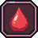
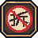
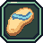

# 成就徽章 Review

[打开 HTML 审阅版](achievement-badges.html)

共 12 枚，按标题页摆放顺序排列。中英文说明沿用游戏原文，文末补充实际计数口径。

1.  **第一滴血 · FIRST BLOOD**
   - 完成首次战斗击杀
   - First combat kill
2.  **爆头专家 · PINPOINT**
   - 累计完成 12 次爆头击杀
   - 12 headshots across rounds
3.  **三连击 · TRIPLE TAP**
   - 在 1.25 秒内完成 3 次击杀
   - 3 kills within 1.25 seconds
4.  **一桶双响 · BARREL DEAL**
   - 用同一个油桶击杀 2 名敌人
   - 2 kills from a single oil barrel
5.  **货场值班 · YARD SHIFT**
   - 在一局货场中完成 12 次战斗击杀
   - 12 combat kills in one yard round
6.  **末班游乐 · LAST RIDE**
   - 在游乐园的一次狂暴模式中完成 5 次击杀
   - 5 kills in one park DESTROY ALL phase
7.  **涨潮时刻 · HIGH TIDE**
   - 在一局渡轮地图中从高处完成 3 次击杀
   - 3 kills from high ground on the ferry in one round
8.  **节目停播 · OFF AIR**
   - 摧毁深夜摄影棚的一块背景板
   - Destroy a Night Studio backdrop
9.  **拆迁小队 · WRECKING CREW**
   - 累计摧毁 8 件道具或建筑
   - Destroy 8 props or structures across rounds
10.  **屹立不倒 · STILL STANDING**
    - 撑过 60 秒且零死亡并完成 8 次战斗击杀
    - Finish 60 seconds with no deaths and 8 combat kills
11.  **水花四溅 · SPLASH ZONE**
    - 用滋水枪累计完成 10 次战斗击杀
    - 10 combat kills in water blaster mode
12.  **拖鞋正义 · SOLE JUSTICE**
    - 用拖鞋发射器累计完成 10 次战斗击杀
    - 10 combat kills in slipper launcher mode

## 实际计数口径

- **战斗击杀**包括回合内的爆炸击杀。倒计时归零后的全场爆炸只计入成绩。拆弹模式无这组徽章进度。
- **三连击**的 1.25 秒从这一组的第一杀开始计时。**一桶双响**只看单只油桶的爆炸，连锁引爆的其他油桶各自计数。
- **涨潮时刻**用击杀发生时的玩家高度判定，门槛为关卡坐标 Y ≥ 2.55 米。
- **节目停播**和**拆迁小队**都在狂暴模式期间计数。节目停播需要打掉演播厅中带背景板标记的物件。
- **屹立不倒**在结算时判定。**水花四溅**和**拖鞋正义**按启用的模式累计，油桶或厕所爆炸造成的战斗击杀也算。

[成就定义](../../scripts/achievements.gd) · [中文文案](../../data/ui_text.csv) · [游戏内计数](../../scripts/game.gd)
