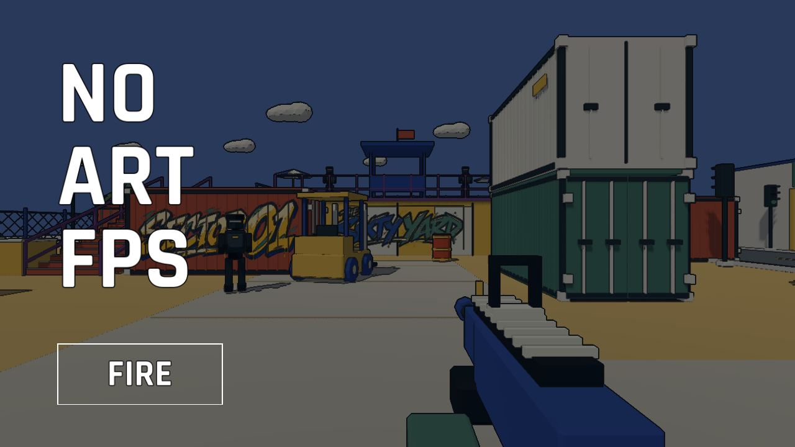
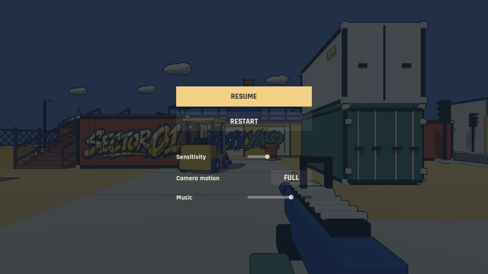
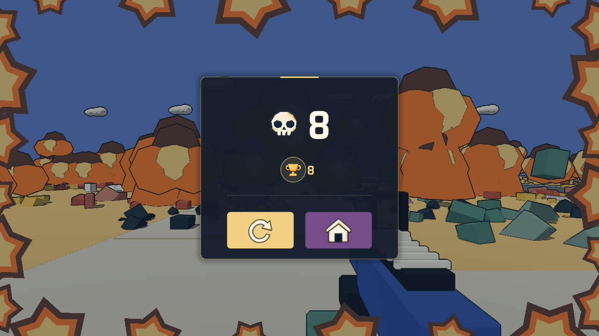

# 游戏文本 Review

核对日期：2026-11-06。范围为玩家能看到的运行时文字、鼠标悬停提示、应用信息，以及已烘焙进涂鸦的文字。以下是当前实现的原文清单，除本次要求移除的死亡提示外，未擅自修改文案。

## 1. 主菜单

| 原文 | 位置 / 行为 |
| --- | --- |
| `NO` | 标题第一行，左对齐，纯白字，无描边 |
| `ART` | 标题第二行，左对齐，纯白字，无描边 |
| `FPS` | 标题第三行，左对齐，纯白字，无描边 |
| `FIRE` | 白色文本、紫色按钮；开始加载转场，弹夹归位后直接开始游戏 |

标题和 FIRE 均使用项目自带 Rajdhani Bold 字体实时渲染。标题和加载页共用开局场景首帧截图，以及同为 55% 不透明度的黑色遮罩。加载页没有进度数字或提示文字，以弹夹装填表示准备过程。

## 2. 局内 HUD

| 当前文字 / 格式 | 示例 | 显示条件 |
| --- | --- | --- |
| `%02d:%02d` | `01:00`、`00:47`、`00:09` | 顶部回合时间，左侧同色秒表；最后十秒有变色与缩放 |
| `%02d` | `00`、`12`、`100` | 顶部击杀数，至少两位，超过两位不截断 |
| `KILLS` | `KILLS` | 顶部击杀数右侧的小字 |
| `GO` | `GO` | 弹夹归位后在中央显示，约 0.8 秒内淡出；同时立即允许操作并开始计时 |

死亡等待已经不显示文字：中央骷髅和圆环表示 5 秒等待；复活后顶部右侧的骷髅数量表示死亡次数。弹药使用子弹图形，换弹通过逐颗推入和装满后的下沉回位表现。没有生命数值、伤害数字、爆头播报、地点标签或按 E 开门提示。

## 3. 暂停菜单

| 原文 | 行为 / 含义 |
| --- | --- |
| `RESUME` | 继续当前回合 |
| `RESTART` | 放弃当前回合并重新开始，死亡次数清零 |
| `Sensitivity` | 鼠标视角灵敏度滑块 |
| `Camera motion` | 镜头运动设置 |
| `LOW` | 减少镜头运动，也减少弹夹脱壳的位移和旋转 |
| `FULL` | 完整镜头运动 |
| `Music` | 音乐音量滑块 |

滑块本身没有数值文本。`LOW` / `FULL` 是同一按钮在两种状态下的文字。

## 4. 结算

| 原文 / 格式 | 示例 | 显示条件 / 行为 |
| --- | --- | --- |
| 击杀数整数 | `0`、`13` | 中央大数字，不补零 |
| 最佳成绩整数 | `0`、`123` | 奖杯图标右侧，不补零 |

结算只显示数字和 imagegen 图标：骷髅表示击杀、奖杯表示最佳，刷新纪录时奖杯有金色圆环。两个按钮使用圆箭头和房屋，分别重试和返回标题。KILLS、NEW RECORD、BEST、RETRY 和 MENU 已从结算常驻界面移除。局内 KILLS 和暂停菜单的文字保留。

## 5. 悬停提示

这些也是运行时纯文本，但平时不常驻显示。

| 原文 | 对应按钮 |
| --- | --- |
| `Enter` | FIRE、暂停菜单 RESTART |
| `Esc` | RESUME |
| `重试 · Enter` | 结算圆箭头按钮 |
| `返回标题 · Esc` | 结算房屋按钮 |
| `M` | LOW / FULL |

## 6. 场景里的涂鸦文字

这三项现在都是 PNG 中的图形文字，不是 Label3D 或普通字体标牌。若修改拼写或内容，需要修改相应美术素材。

| 原文 | 位置 | 文件 |
| --- | --- | --- |
| `SECTOR 01` | 红色集装箱侧面 | [sector-01.png](../../assets/graffiti/sector-01.png) |
| `THE SIXTY YARD` | 二楼平台前墙 | [sixty-yard.png](../../assets/graffiti/sixty-yard.png) |
| `WAREHOUSE` | 仓库西侧墙，画面分成 WARE / HOUSE 两行 | [warehouse.png](../../assets/graffiti/warehouse.png) |

## 7. 应用和启动提示

| 原文 | 来源 / 显示位置 |
| --- | --- |
| `No-Art-FPS` | 项目名、窗口标题；本地开发运行时的 `(DEBUG)` 由 Godot 添加 |
| `Sixty seconds. Make every shot count.` | 项目描述，目前不在游戏内菜单显示 |
| `Godot 4.7.2 is required. Open project.godot in Godot to play.` | 双击启动器找不到 Godot 时，在终端显示 |

## 8. 已移除的历史文本

| 历史内容 | 当前替代方式 |
| --- | --- |
| 准备倒数 `3`、`2`、`1` | 非阻塞的 GO 淡出，不再等待三秒 |
| `PLAY` | FIRE 纯文本描边按钮 |
| `BACK IN A BEAT` | 五秒死亡等待：中央骷髅和圆环。用户提到的 “back in seat” 对应的是这一句 |
| `RELOADING` | 逐颗推入子弹，装满后轻沉并快速回位；旧进度线也已移除 |
| 剩余弹药数字（如 `16`） | 横排子弹图形 |
| 黄色底板上的 SECTOR 01 / THE SIXTY YARD / WAREHOUSE | 大面积墙面涂鸦 |

## 9. 文本来源与 Review 入口

- HUD、按钮和悬停提示集中在 [scripts/hud.gd](../../scripts/hud.gd)。HUD、标题和菜单文案直接写在 GDScript 中，没有独立翻译表或多语言资源。
- 菜单动作与纪录判定在 [scripts/game.gd](../../scripts/game.gd)；应用名和描述在 [project.godot](../../project.godot)。
- 缺少 Godot 的提示在 [Play No-Art-FPS.command](../../Play%20No-Art-FPS.command)。
- 涂鸦文字及生成提示词在 [assets/graffiti/README.md](../../assets/graffiti/README.md)。
- 测试日志、调试报错、节点名、材质名、模型部件名、许可证及设计文档不属于游戏文案，不计入上面的清单。

可直接按“原文 → 希望的新文案 / 改用图标 / 删除”给出修改意见。比较值得一起 review 的是 `RETRY` 与 `RESTART` 的命名是否统一、`KILLS` 是否保留，以及设置项采用英文还是中文。
