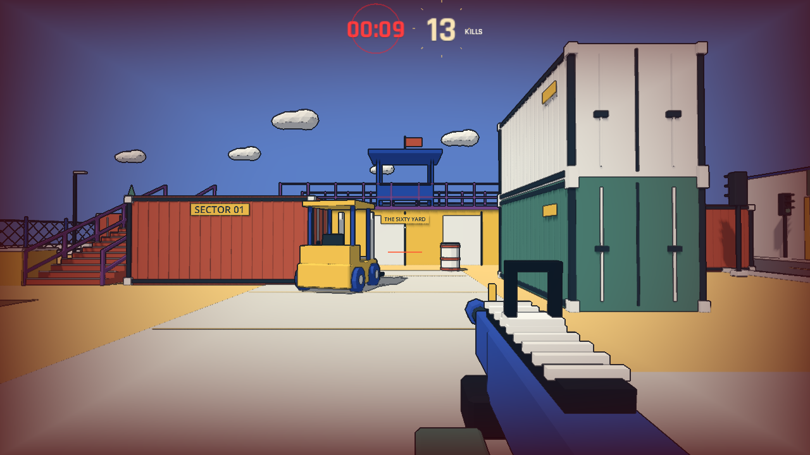
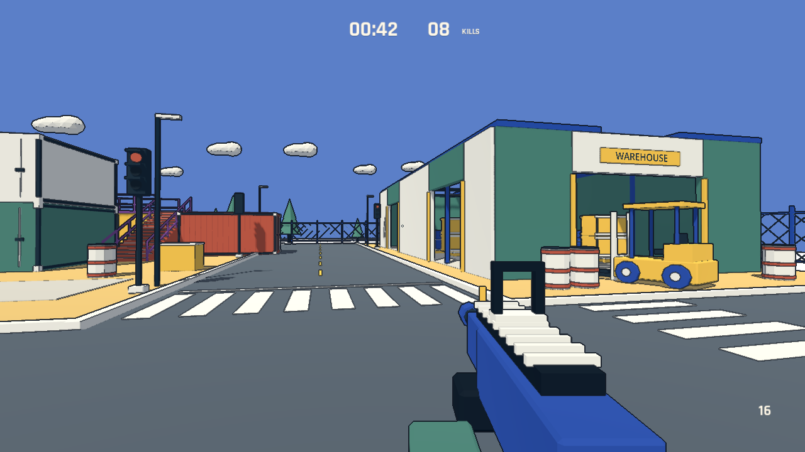
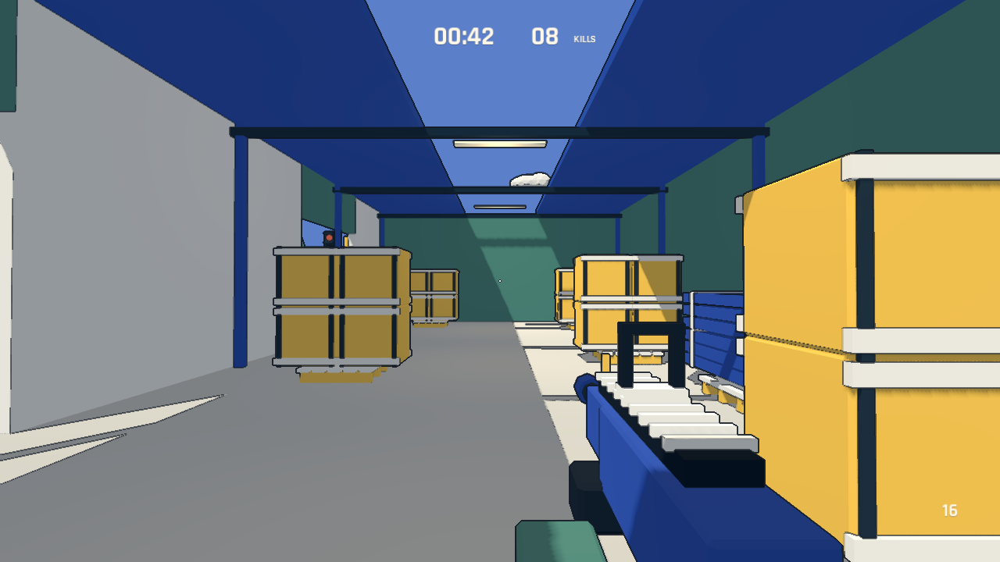
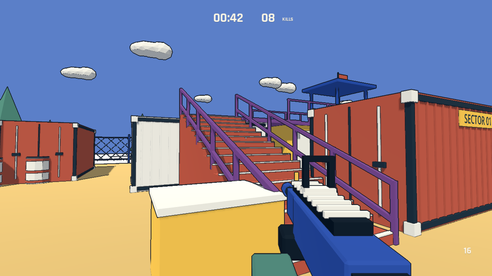

# No-Art-FPS：反馈、音乐与地图扩建

2026-11-05。Godot 4.7.2 / Blender 5.2.2 LTS。以下为当前实现；较早的设计与验证记录保留为历史。

## 画面与反馈

- 对场景、道具、敌人及第一人称枪械统一做深度/色差描边，HUD 保持清晰。线宽约 1.15 个渲染像素；远处细线仍可能出现锯齿，尚未做跨分辨率美术验收。
- 字体采用 Rajdhani Bold：紧凑、方正的数字适合倒计时与分数。未修改字体，附 SIL OFL 1.1 许可。
- 最后 10、9……1 秒各触发一次约 0.4 秒的红色缩放/扩散脉冲；到 0 时直接结算。不会每帧重复触发。
- 击杀数增加时，数字放大后回落，同时放射短线；快速连续击杀重新触发动画，计分立即更新。
- 不显示生命条、护甲格或生命数字。生命不足 50 时，屏幕边缘逐渐加深为暗红；中心瞄准区域保持可读。受击后至少 5 秒才开始以每秒 12 点恢复，满值 100。短暂无敌期间被弹体命中也重置恢复等待时间。
- 默认弹匣 20 发，打空自动换弹；无限备弹，可用 R 提前换弹。
- 成绩只保留历史最大击杀数，不累计爆头或命中率历史。严格超过旧纪录时结算显示 `NEW RECORD`，持平不显示。音量/灵敏度等设置仍单独作为设置项保存。

反馈图是固定机位、固定分数与低生命状态的引擎截图，用于检查动画峰值与暗角，不代表人工成绩。

## 街道与仓库

可玩边界从约 36×28 m 扩大为 64×48 m。保留原来的集装箱场地与高台，东侧连接小街道和仓库。增加了桶、树、灯杆和叉车；目前共有四台叉车、四组可切换灯色的红绿灯，街道路口有斑马线、停止线、分道线和路缘。

仓库占地约 12×25 m，有一个装卸正门和两个侧门。内部有双层货箱、托盘、钢材束、柱梁、屋架、灯带和长条天窗；碰撞与导航均按实际空心空间生成。新增模型保存在 `art_source/no_art_kit.blend`，可用 `tools/build_assets.py` 重建。

楼梯两侧增加斜向实体扶手与立柱，阻止正常横向行走跌落；这是护栏，不是禁止主动跳越的隐形墙。

这些都是 Godot 实际渲染截图，采用固定展示机位。地图仍是首版布局，未以人工试玩证明所有区域都具有同等战斗价值。

## 原创 MIDI BGM

`assets/music/sixty.mid` 是可编辑的标准 MIDI format 1：指挥轨、脉冲贝斯、琶音、铺底和鼓，共五轨。144 BPM、E 小调、4/4、36 小节，长度 60 秒。最后十秒增加琶音密度，末段升高音区。

`sixty.wav` 由同一组 MIDI 音符事件通过原创振荡器/噪声合成器渲染；游戏播放该立体声 PCM 文件，不需要外部 MIDI 解码器或 soundfont。没有使用第三方录音采样。开局开始播放，暂停时停住位置，恢复后继续，结算停止；暂停菜单可调音量。

MIDI 校验通过：五轨结构、每轨 note-on/note-off 配对、拍速和总时长均正确。WAV 为双声道 32 kHz、60 秒，生成时峰值约 0.488、RMS 约 0.068，未削波。合成器的音色与音量平衡仍可按实际听感继续调整。

## 验证与边界

- Godot 导入与脚本检查完成。
- 反馈检查覆盖：五秒等待/渐进恢复/再命中重置、20 发后自动换弹、最后十秒逐秒单次脉冲、破纪录与持平判断、BGM 开始/暂停/继续/结束。
- 地图检查覆盖：十个出生点到靶场的导航连通、仓库正门和侧门实际走入、街道连续通行、楼梯向侧面行走被扶手阻挡。
- 初次扩图检查发现花坛占用了出生点，已移开。启动时不再仅等待固定帧数，而是等导航地图同步后允许开局。
- 完整 60 秒自动瞄准回合完成结算、拒绝截止后加分并成功重开。该测试使用自动瞄准和脚本换位，不能作为人类难度与手感结论；最新数据见 `artifacts/playtest.json`。
- 短时十敌人压力样本：Apple M5，实际渲染 1138×640，关闭 VSync/帧率上限；P95 4.17 ms，P99 4.76 ms，最大 7.84 ms。样本只有 10 秒，不是 GPU 专项计时或 1080p 结论。
- 运行期截图、短时检查不等于十分钟稳定性验收，也未验证 Windows、Web 或控制器。

本次均提交到本地 Git；没有配置远程或发布。

## 技术来源

描边中的全屏四边形与深度重建采用 [Godot 官方后处理接口](https://docs.godotengine.org/en/stable/tutorials/shaders/advanced_postprocessing.html)，分别处理 Compatibility 与其他渲染器的 NDC 范围。字体来源为 [Google Fonts / Rajdhani](https://github.com/google/fonts/tree/main/ofl/rajdhani)，项目内保留完整许可。
