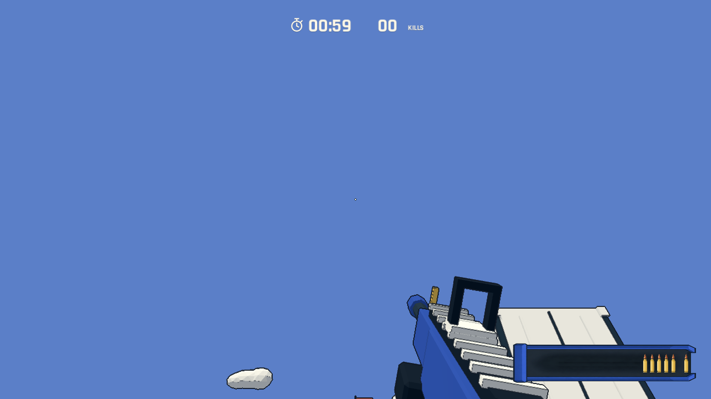
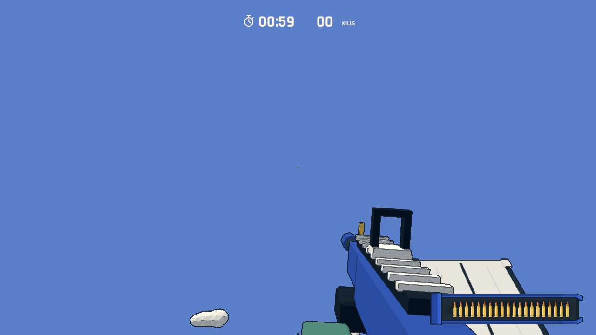

# 逐颗推弹与装填完成动作

删除弹夹下方的换弹进度线，改为从右端逐颗推入子弹，同时把已有子弹向左顶一格。部分换弹保留当前子弹，只补足缺额。

- 0.00～0.04 秒：短准备，让射击/抛壳衔接到装填。
- 0.04～0.68 秒：依次推入缺少的子弹，末尾全部就位。
- 0.68～0.82 秒：装满的弹夹下沉约 11 个逻辑像素（随整体 HUD 缩放）。
- 0.82～0.90 秒：快速回位，回位完成的同一时刻允许射击。

总换弹时间保持 0.9 秒；新增子弹在动画期间仅为显示，实际弹药仍在结束时补满。视觉进度直接使用游戏换弹计时，因此暂停、死亡、重新开始不会留下独立播放的装填动画。低镜头运动设置把下沉幅度减至 3 像素，保留完成反馈。

验证：Godot 导入和规则测试通过。`--qa --magazine` 在真实渲染中逐步计数空弹、缺 6 发、缺 1 发的补弹过程，检查全部装好后才下沉、回位时序、动画期间禁止射击、暂停、死亡取消、重开及 960×540 显示；验证 53 个物理帧内不结束，第 54 帧完成，保持 0.9 秒。原有交互和五秒复活检查继续覆盖射击、换弹、暂停与重开。未进行人工手感验收。

后续设计建议见 [射击反馈与紧张感](../design/shooting-feel-next.md)，本次仅实现换弹动画，未将建议中的战斗改动一并加入。
