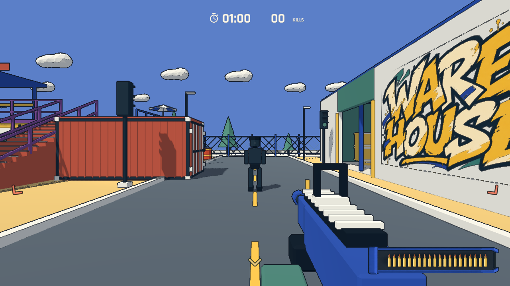

# 油桶动线与战斗可读性

## 油桶范围及布局

油桶半径由 5 米扩大到 7.5 米，敌人的满伤区同步从 3.2 米扩大到 4.8 米，6.3 米以内为两点伤害，外围为一点；玩家也承受扩大后的范围风险。预警时间、连锁规则、实体掩体遮挡保持一致。

使用当前 Yard 导航网格，组合开场/增援出生点与九个代表性玩家位置（出生广场、左右通道、街道、仓库、二楼），并增加左右各 5 米的简化侧向接近目标，共 298 条有效路线。样本等权，未模拟完整 AI 包抄周期；按路线到桶的距离和掩体遮挡估计桶接近动线的程度，搜索原位 2.5 米以内的候选点，排除道具重叠、出生点和无落脚处。15 个桶移到更接近接敌路线的位置，1 个保持原位。没有把桶直接堆在出生点或狭窄门口。

这是导航样本估计，不是人工试玩轨迹或击杀率提升的证明。三维路线与前后坐标见 `artifacts/barrel-route-analysis.json`。下图为俯视投影：蓝线是采样路线，灰圈是原位，橙点是调整后位置。

地图中的静态油桶位置和预烘焙导航同时更新；运行时不会重新计算摆放。`--blast-range` 覆盖扩大后的内外圈伤害、玩家风险和所有出生点导航连通；`--combat` 回归真实子弹点燃、预警、连锁、掩体和重开。

## 背后敌人提示

两种模式共用三个克制的方向提示：左后、正后、右后。距离 24 米以内、位于玩家后半侧且视线没有实体遮挡的存活敌人才参与，同方向合并；九米内或正在蓄力射击时转为偏红色。转身、敌人死亡、遮挡、复活等待、暂停菜单和终局时会清理/隐藏提示。每 0.1 秒更新一次，不显示隔墙敌人轮廓。

方向标记是手绘 `assets/ui/rear-threat.svg`，没有 Unicode 图标、表情字体或生成图片。控件保留中文可访问名称和悬停文字，默认 HUD 不增加常驻说明。测试包含转身、前方/远距离排除、墙体遮挡、死亡、暂停、复活和 960×540 布局。

## 更快的灰色敌弹轨迹

黑色敌人的子弹速度由 13 m/s 提高至 80 m/s，移除球形 Mesh，只保留不渲染的飞行状态与持续约 0.075 秒的细灰色轨迹。轨迹透明材质在场景描边后绘制，避免细线变成黑色小棒。沿每个物理步的完整运动线段做碰撞检测，遇墙截断；伤害和射击间隔不变，原有开枪前预警保留。暂停冻结弹道逻辑，重开清理飞行中的子弹。

`--awareness` 验证 16 米射击约 0.2 秒到达、没有可见弹丸模型、暂停冻结、较长物理步不穿墙和重开清理，并输出实际灰色轨迹截图。另做拆弹模式的导航、巡逻、交互、死亡/超时及切换模式回归。截图为受控引擎测试场景；未进行人工难度与长时间稳定性验收。

最终完整 60 秒实机自动瞄准回合完成 74 次击杀并成功重开；计分与拆弹规则检查通过。以上是自动流程验证，不能用作人工难度对照。
