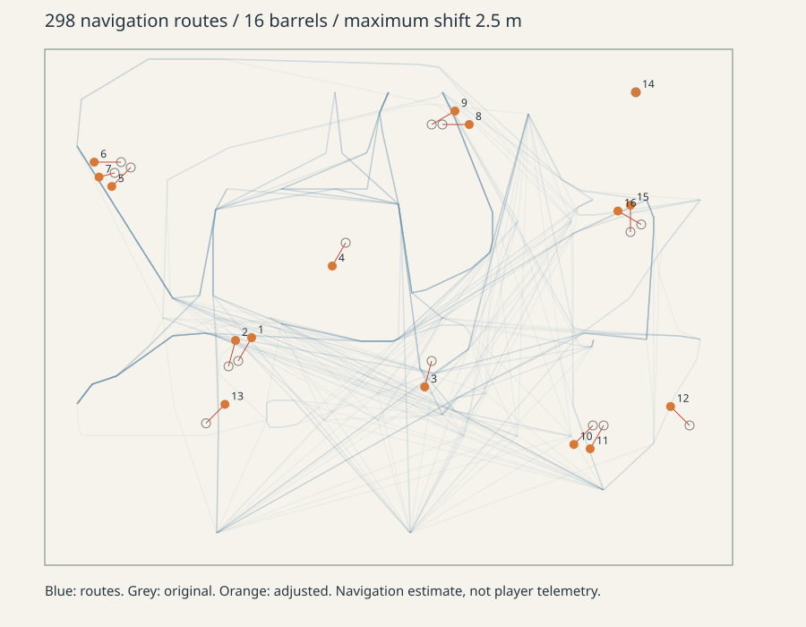

# 油桶动线与战斗可读性

## 油桶范围及布局

油桶半径由 5 米扩大到 7.5 米，敌人的满伤区同步从 3.2 米扩大到 4.8 米，6.3 米以内为两点伤害，外围为一点；玩家也承受扩大后的范围风险。预警时间、连锁规则、实体掩体遮挡保持一致。

使用当前 Yard 导航网格，组合开场/增援出生点与九个代表性玩家位置（出生广场、左右通道、街道、仓库、二楼），并采样黑色敌人常见包抄方向，共 298 条有效路线。按路线到桶的距离和掩体遮挡粗估经过概率，搜索原位 2.5 米以内的候选点，排除道具重叠、出生点和无落脚处。15 个桶移到更接近接敌路线的位置，1 个保持原位。没有把桶直接堆在出生点或狭窄门口。

这是导航样本估计，不是人工试玩轨迹或击杀率提升的证明。三维路线与前后坐标见 `artifacts/barrel-route-analysis.json`。下图为俯视投影：蓝线是采样路线，灰圈是原位，橙点是调整后位置。

地图中的静态油桶位置和预烘焙导航同时更新；运行时不会重新计算摆放。`--blast-range` 覆盖扩大后的内外圈伤害、玩家风险和所有出生点导航连通；`--combat` 回归真实子弹点燃、预警、连锁、掩体和重开。
