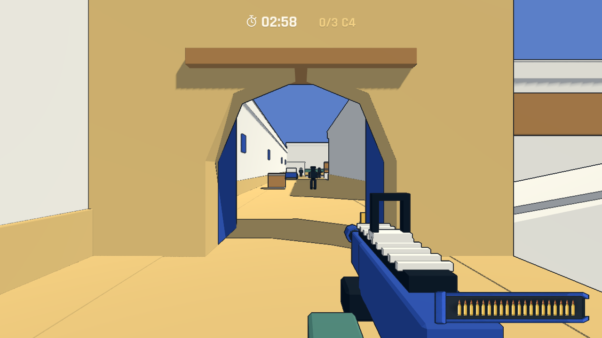
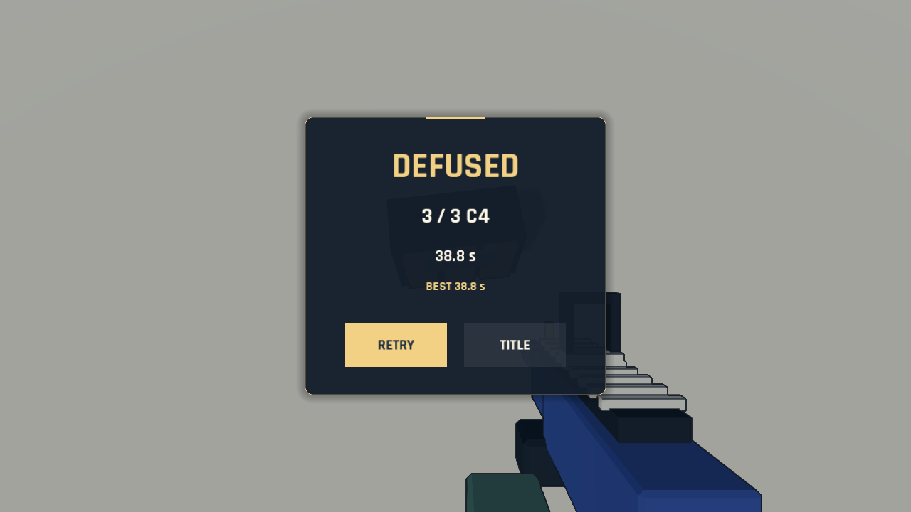

# 风味 Dust2 拆弹任务

已实现两个独立会话：标题右侧 SCORE ATTACK 选择原竞技场，DEFUSE C4 选择新任务。FIRE 开始当前选择。旧图保留 60 秒击杀、五秒复活、最后十五秒 DESTROY 和最后一秒引爆；新图是 180 秒内拆除三颗 C4并存活，死亡或超时失败，第三颗完成即成功。

按住 E 或触屏“拆除”按钮约 5 秒。需在 1.8 米内、有直接视线且静止；拆除期间射击/换弹被锁定，移动、受伤、松开或暂停取消未完成进度。完成目标不在本局重置。C4近距离有轻声提示，拆完隐藏标签并播放确认声。暂停/失焦取消输入，恢复需重新按住。任务没有补兵、复活、DESTROY、建筑坍塌或全场引爆。超时只显示未拆目标的局部爆炸并冻结结果，不产生额外伤害或目标完成事件。

三个作者点位在 A 平台、小道和 CT 院落。八名远程守卫沿预置路线巡逻，停留观察；视锥和遮挡决定发现，丢失视线后搜索最后位置再回巡逻。首版未加入听觉警戒或近战兵，场地可绕行。任务 HUD 为时间、已拆 C4、准星和情境弹药，结果展示成功/阵亡/超时。最快成功时间按任务版本与时限独立保存，旧最高击杀存档兼容；QA 不覆盖用户成绩。

地图是 `scenes/maps/dust_flavor.tscn`，模型通过本地 Blender 脚本从 MIT A 点结构生成，源文件、许可和改动见 [模型说明](../../assets/models/dust_flavor/README.md)。约 6,220 三角面，GLB 主体约 373 KB；保留独立可编辑零件，共享纯色色板，静态简化碰撞和预烘焙导航。没有使用原作者缺失的贴图、远景或细碎装饰。原 `yard.tscn` 与任务地图共用地图生命周期，规则分别配置，不通过地图名称分支改变射击行为。

## 已完成验证

- Godot 4.7.2 导入；原 60 秒规则与新拆弹规则测试。
- 保存旧场景的标记/景物调整后重新打开，变换仍存在；两个实例的导航和 MultiMesh 资源隔离。
- 旧图真实渲染的交互、双向楼梯、终局定格；建筑破坏和导航恢复；完整 60 秒自动回合完成 76 次击杀并成功重开，日志无引擎错误。
- 拆弹任务 headless 和真实渲染检查：三个目标与全部巡逻路径可达、守卫实际移动、武器锁定、受伤/暂停/隔墙取消、逆序拆除、死亡优先、120/150/180 秒截止、重复任务重置和两种模式切换。
- 实际角色沿导航路径行走并按住交互完成小道、CT、A 平台，约 38.9 秒模拟游戏时间、19 发/8 次击杀。该检查为 3 倍模拟、自动瞄准、玩家无敌；验证碰撞、射线、AI和目标流程，不是人工手感、巡逻难度或生存平衡证据。
- Web 输入单元检查覆盖多指、长按拆除、取消和失焦释放；陀螺仪回归通过。真实手机的操作和难度仍需人工验证。

