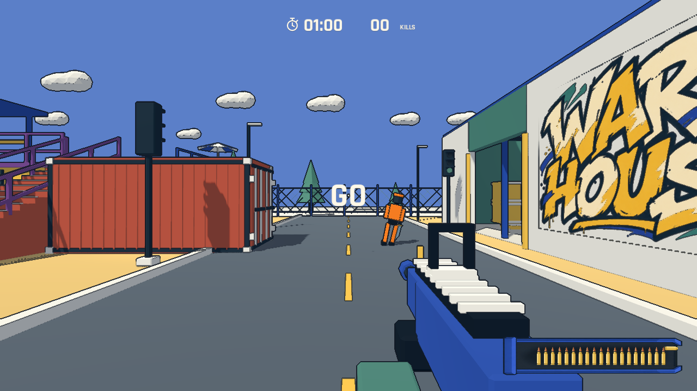
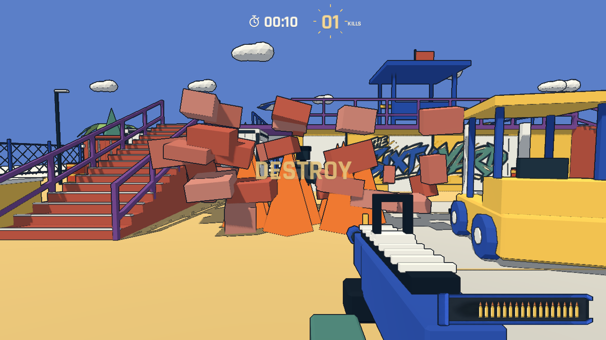
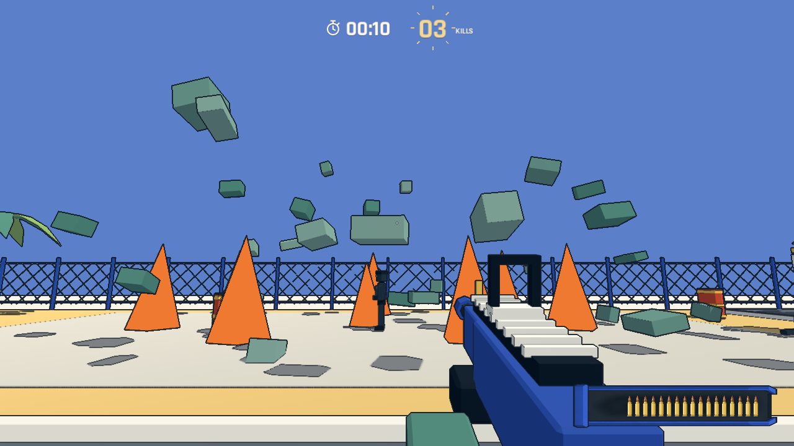

# 近战闪避、DESTROY 与多杀反馈

## 近战兵闪避

近战兵保留 5.8 m/s 追近、举刀预警和近身劈砍。玩家在 8 米外直接射击它时，瞄准到该目标的子弹改为 65 m/s 的短暂可见飞行，近战兵在开枪后侧移闪避；前方要有完整地面并通过胶囊体扫掠，不能穿墙、穿其他敌人或闪出平台。连续远距离射击期间也不会对它造成直接枪击伤害。8 米内正常接受头部一发、身体三发命中；爆炸及坍塌仍可杀死它。

闪避 0.16 秒、10 m/s，准备回避时中断当前举刀；暂停冻结敌人和玩家弹丸。重开清理尚未飞完的弹丸。`--qa --dodge` 验证实际射击触发侧移、远距离不中弹、近距离爆头、暂停和重开；`--qa --combat` 保留挥刀、躲避、遮挡和油桶检查。

## 最后十秒 DESTROY

有效回合时间到 50 秒时中央显示 `DESTROY` 并淡出，之后直到 60 秒截止，步枪弹道、枪口与命中附加低模火焰。命中敌人可附带三次间隔 0.25 秒的燃烧伤害；近战兵的远距离枪击仍会闪避。

可破坏结构包括地面集装箱及其堆叠、仓库墙体/屋顶/内装、二楼平台/泳池/楼梯及观察架。普通弹药不损坏它们。燃烧弹累计三次直接命中该结构会点燃，预警约 0.55 秒后拆成有重力、旋转和落地运动的彩色块状碎片，配合多面火焰和爆炸声。原建筑和碰撞一同移除；地面仍保留。二楼坍塌后玩家会落回地面。

坍塌体积内的敌人通过同一伤害/死亡接口死亡，计入击杀数，重复坍塌或重复伤害不能再次得分。碎片只用于表现、不形成新的不可走碰撞，短时缩小回收；火焰和碎片数量受限。暂停冻结引燃和碎片运动，结算后不再产生伤害或计分。

建筑碰撞移除后请求后台导航烘焙，区域建筑坍塌后不再向消失的楼层补兵，释放其人口名额给地面。重开恢复建筑、门、碰撞和保存的完整初始导航，避免把已经坍塌的路径带入下一局；加载流程等待导航更新完成。

## 验证

`--qa --destroy` 验证 50 秒边界、普通枪击不拆楼、实际燃烧枪击、点燃/暂停/碎片、集装箱内掩埋计分、燃烧伤害、仓库与二楼拆除、消失的碰撞/更新导航、结算截止和重开完全恢复。资源导入、规则、二楼行走和原有射击/复活检查用于回归。截图是受控引擎场景，非人工试玩或平衡证据。
