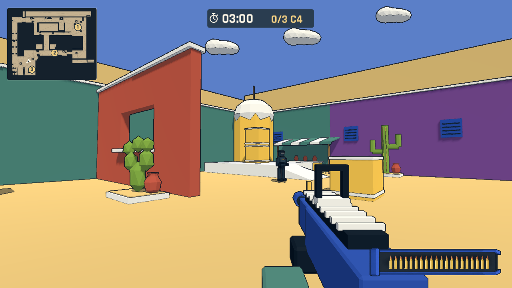
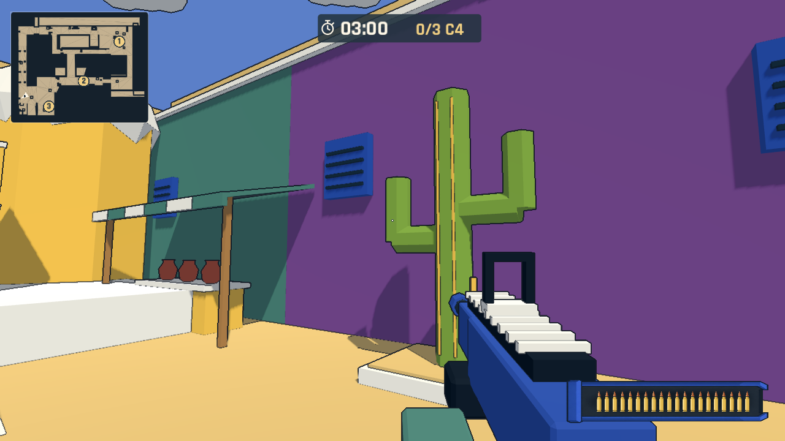
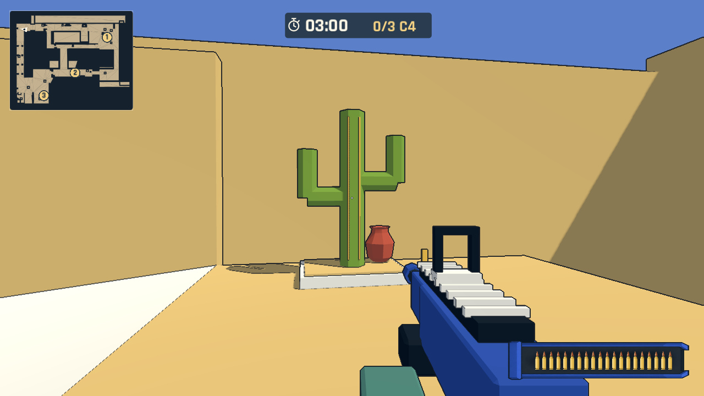

# Dust 明亮画风与仙人掌

Dust 的砂岩纹理与大面积褐色墙面偏离首张地图的明亮色块、低面数和细描边风格。按照已生成的 [imagegen 概念图](../art/dust-color-concept.md)，现在用砖红、青绿、紫色、暖黄和奶油色还原建筑与装饰，保留蓝色天空、首张地图的武器和描边。概念图只用作美术方向；运行时的仙人掌、花床、棚、百叶窗和陶罐均为可编辑 Blender 几何。

Dust 不再有椰子树。六处花床采用柱状分枝和扁掌两种仙人掌，B 点窗口旁、庭院侧墙和 long 连接处的位置与朝向经过实际渲染检查，避免藏在建筑内或让分枝正对镜头而失去轮廓。花床和柱状主干保留碰撞；小分枝、陶罐和棚布不增加碰撞。棚的柜台、支柱仍有碰撞，导航已重新烘焙。

B 点补齐红色窗口墙的奶油色墙帽、青绿与紫色背景墙、蓝色百叶窗、斜面青绿/奶油色条纹棚、暖黄柜台和有收口轮廓的陶罐。原有箱子保留位置与体积，改为暖黄箱体配奶油色绑带。云使用首张地图的原始资产，在庭院上方调整位置与朝向。

原来的日照方向把 B 点主要立面置于阴影中。地图根节点新增可编辑的 `sun_rotation_degrees`；Dust 为 `(-52, 145, 0)`，首张地图保留 `(-52, -35, 0)`。初次载入及模式切换均应用目标地图的方向。天空、环境光、太阳强度和描边参数继续共用。

最终色板直接写入 `art_source/dust_flavor.blend` 和导出的 GLB，而不是只在 Godot 中覆盖原模型的中性色。Godot 场景复用对应 `.tres` 材质；有纹理的 plaster 材质已不再应用。当前建筑导出为 355 个网格、11,624 个三角形、814,736 字节，GLB 内无贴图图像。模型、碰撞、导航、雷达均已同步。

## 实际渲染

以下为 Godot 4.7.2 的真实渲染，镜头和敌人由自动检查摆放。几何遵循既有关卡，保留现有入口、三处 C4 点位和八组巡逻；不宣称逐像素复刻概念图。







## 验证

- Blender 5.2.2 LTS 重建与同高度地板不重叠断言通过；Godot 4.7.2 无窗口导入及场景保存通过。
- 计分/计时规则和拆弹规则测试通过。
- 实际渲染 `--dust-revision` 通过：1178 条地面碰撞射线、雷达/目标映射、拆弹圆环、暂停取消、跌落冻结、重试；检查 Dust 中没有 palm/frond 网格，并保存新截图。
- `--floor-render` 对两个固定地面点各检查 36 个移动镜头帧，最大 RGB 色差为 0.007064 和 0.000000，均低于既有 0.015 阈值。
- `--mission-route --expanded-loop --live-patrols` 用角色实际碰撞行走完成 long/tunnel/B/mid/short 环线和三个目标；动态巡逻开启，18 发、8 次击杀，在模拟时间 66.2 秒完成。该检查使用三倍模拟速度、无敌状态和自动瞄准。
- `--mission-check` 通过所有目标/巡逻导航、巡逻移动、伤害/暂停/遮挡取消、胜负/超时、重试及两种模式切换；同时验证首图日照恢复及 Dust 日照重新应用。

以上为引擎自动化检查和实际渲染观察，不是人工试玩。详细日志与地板采样保留在 Git 忽略的 `artifacts/local/dust-style-*.log` 与 `artifacts/local/floor-render-after.json`。

可复现命令：

```sh
blender --background --python tools/build_dust_flavor_assets.py
godot --headless --path . --editor --import
godot --headless --path . --script tools/maps/save_dust.gd
godot --headless --path . --editor --import
godot --headless --path . --script tests/rules_test.gd
godot --headless --path . --script tests/defuse_rules_test.gd
godot --path . -- --mission --qa --dust-revision
godot --path . -- --mission --qa --floor-render
godot --path . -- --mission --qa --mission-route --expanded-loop --live-patrols
godot --path . -- --mission --qa --mission-check
```
