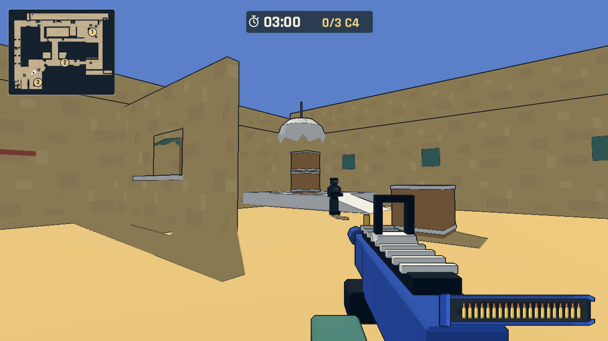
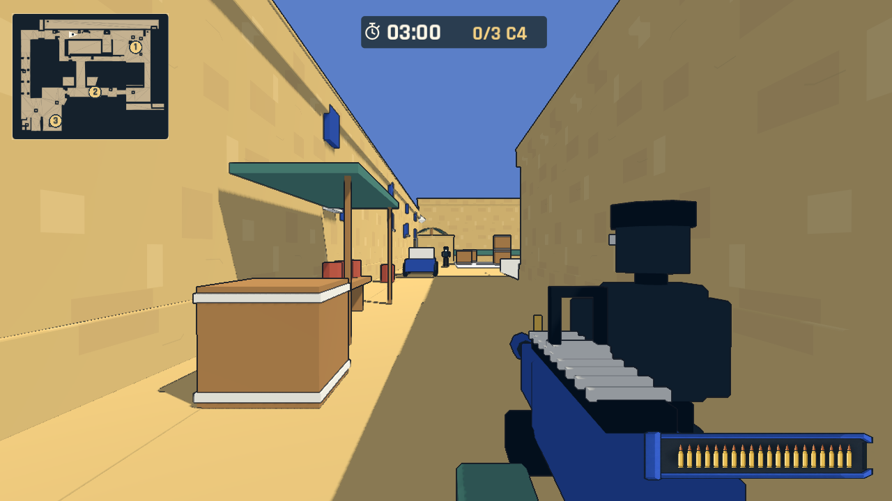
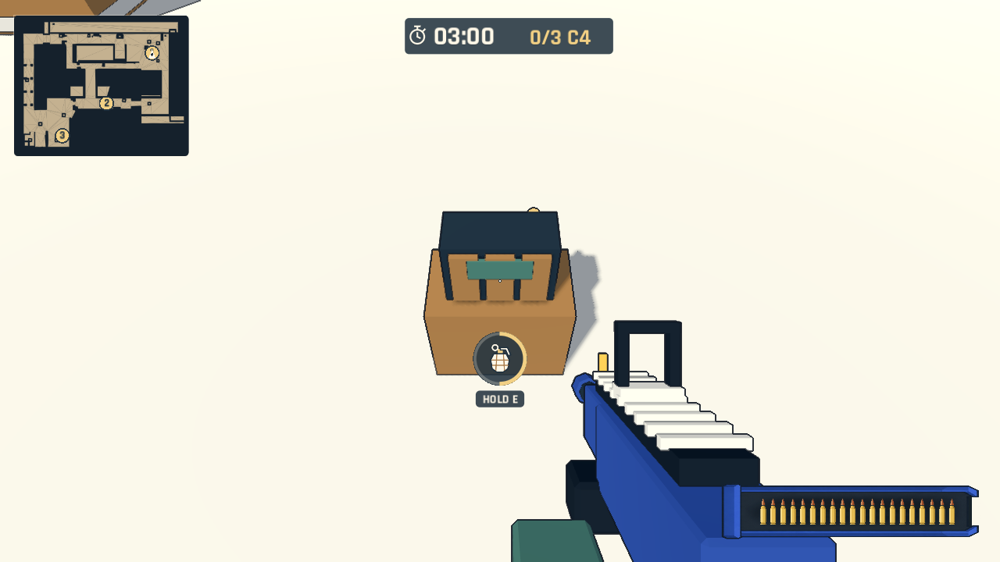
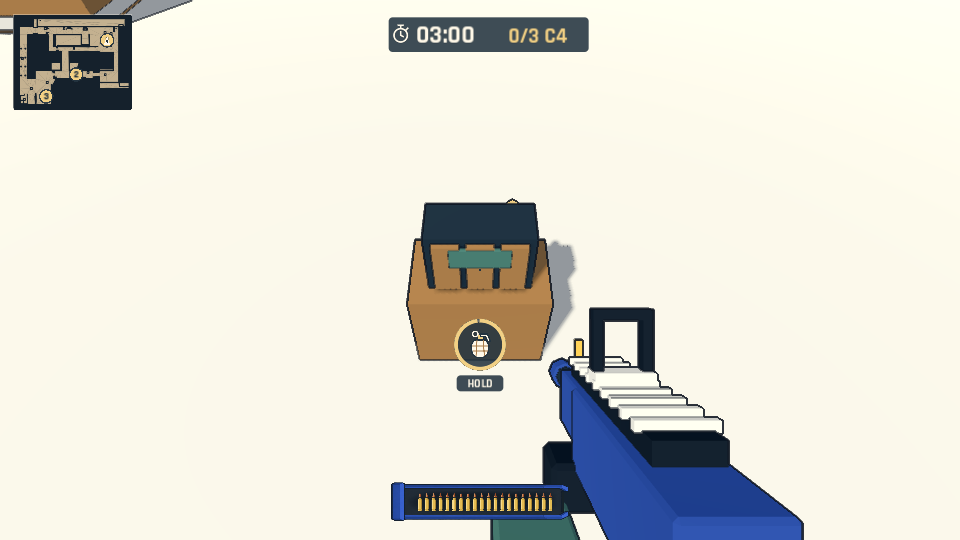

# Dust 任务地图：路线、景物、雷达与拆除圆环

本次按白模反馈扩展任务地图。保留此前长门、大道、小道、A 平台与低坑，新增中路双门、B 院落/后平台/窗口、西侧有顶隧道、中路返回小道的坡道，以及连接 CT 区的门洞。三个 C4 重新摆放在 A 点、中路、B 点，可按任意顺序访问；八名守卫重新分配到主要路线与新区域。

景物增加塔楼与低面数穹顶、棕榈、货箱、市集遮阳棚和陶罐、窗板、车辆与墙面标识。砂岩表面使用原创 SVG 色块贴图及共享三向投射材质，不依赖写实纹理或图片生成。全部建筑模型仍保留可编辑分件，`.blend`、GLB 与地图 `.tscn` 同步更新。现有主 GLB 约 635 KB、291 个分件、9,186 个三角面；新增中路与 B 点为原创风格扩展，不声称原版 Dust2 精确比例。

## 找到 C4 与拆除

左上角新增任务专用小地图，由当前导航网格生成 SVG，显示通道和 A/B/MID 区域。三颗未拆 C4 以金色圆点及 1–3 编号高亮，拆除后变为较小绿点；白色方向三角表示玩家的位置与朝向。目标投影直接使用当前场景坐标，避免另外手工维护一套小地图坐标。底层保险地面与高屋顶不画进雷达。

C4 上方的 Label3D 纯文本已移除，模型仅保留小型指示灯和近距离声音。靠近后 HUD 显示原创 SVG 手雷图标；金色圆环随五秒拆除由空环展开成完整圆形。松开、移动、受伤、遮挡和暂停会取消并清空进度，已拆目标保持完成。保留一个 HOLD E / HOLD 操作提示，圆环与顶部时间使用深色底保证在浅色地面上可读。旧竞技场 HUD 不添加雷达。

## 跌落与路线修复

扩展地图新增实体安全地基和四周边界。门洞打开时一并切掉原墙裙碰撞，避免地面已经连通但门口仍有不可走台阶。坡道使用真实斜面碰撞，楼梯不再叠加台阶方盒碰撞。隧道两端、中路、B 点及返回小道均通过实际输入行走。

玩家低于安全高度时立即禁用移动、清空速度、固定在安全高度并结算阵亡，不继续无限下坠。此兜底遵守任务死亡即失败，不传送回出生点。任务布局版本升级为 2，最快纪录按布局版本及时限独立保存，旧记录不覆盖新版记录。

## 验证

Godot 4.7.2 导入、原计分与拆弹规则、任务成功/死亡/超时/取消/重试及地图切换检查通过。`--mission --qa --dust-revision` 检查全图 1,178 条地面射线、目标雷达投影、无漂浮 Label3D、圆环半满/近满/取消/拆完、960×540 小窗口，以及强制跌落后的逐帧定格与重开。

`--mission --qa --mission-route --expanded-loop` 用角色碰撞与真实移动输入走完大道、隧道、B、中路、小道，再拆完三颗 C4。`--live-patrols` 任务检查约 46.2 秒模拟时间内完成三颗，7 发/7 次击杀；该测试为三倍模拟、自动瞄准、玩家无敌，验证流程而不是生存难度或人工平衡。旧场地真实渲染的坡道、射击/遮挡、换弹、复活和十次重开继续通过。测试日志无引擎错误，未进行人工试玩。

