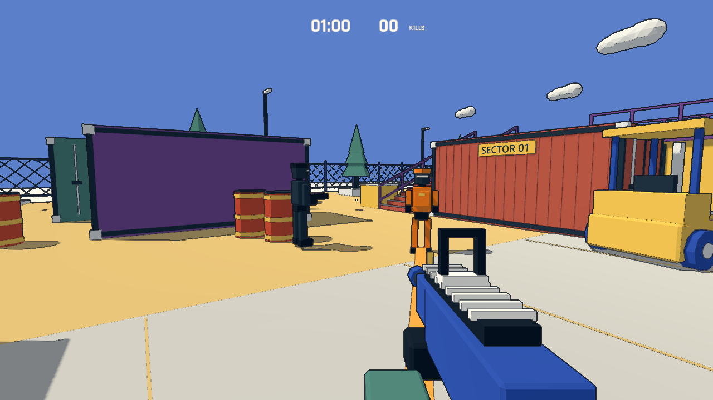
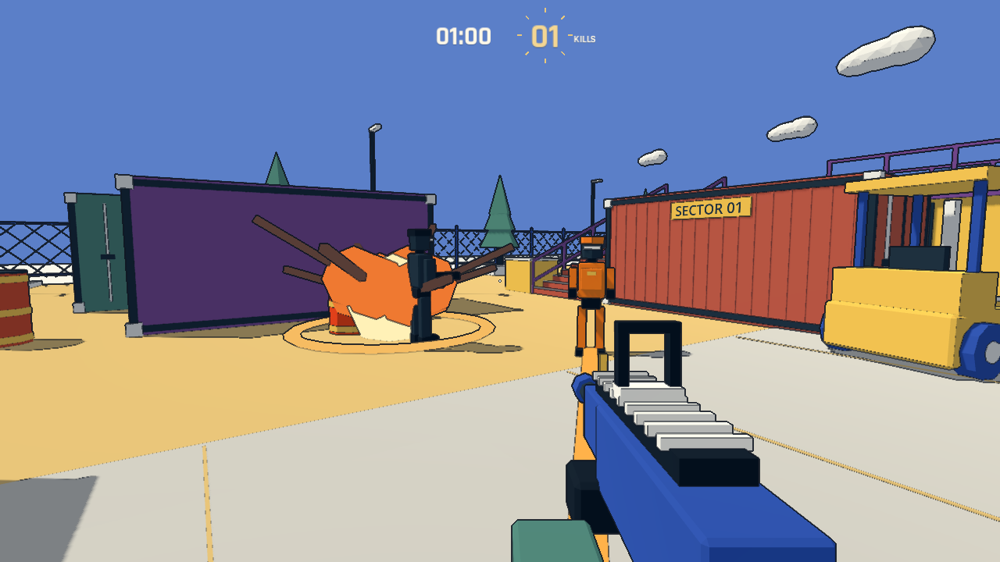

# 可引爆油桶与橙色突击兵

2026-11-06。保持 60 秒、只以击杀数计成绩；在既有地图与敌人数量上加入环境击杀和可躲避的近身威胁。

## 油桶

原有十四个油桶改为可射击的红色桶身、黄色束带；仓库货堆旁另加两个。沿用 Blender 原模型，在 Godot 中分配独立材质和交互脚本。

子弹命中后闪烁、膨胀并发出提示音，约 0.65 秒后爆炸。半径 5 米，敌人在内圈 3.2 米受到 3 点伤害，外围逐渐减至 2 / 1 点；玩家受到按距离衰减的 60→15 点伤害，沿用受击无敌窗口。实体掩体会阻挡伤害和连锁引爆。邻桶收到爆炸后经过 0.25 秒引爆，已爆炸的桶不会再次造成伤害。敌方普通子弹不会点燃油桶。

爆炸击杀沿用普通击杀计数，不计爆头。油桶一局只爆炸一次，重新开局恢复；暂停冻结引信，结算后停止爆炸与计分。爆炸移除物理阻挡，导航仍使用开局烘焙的保守绕行区域。

## 橙色突击兵

橙色躯干、头盔和四肢，无远程枪械。开场一名，后续增援从第 8 秒后有概率加入；同场前 40 秒最多两名，最后 20 秒最多三名。只占用地面敌人名额，仓库、二楼各两名巡逻兵仍然保留。

- 沿导航追近玩家，10 米内且有视线、处于相近高度时准备冲锋。
- 0.75 秒蓄力：身体压低、橙白闪烁、方向提示线和空间音效；预警开始时锁定方向。
- 以 12.5 m/s 沿锁定方向冲刺，最长 0.65 秒；玩家侧移可躲避。
- 命中玩家造成一次 42 点伤害；撞墙、接触玩家或冲刺结束后进入 0.9 秒硬直。随后还需至少 1.2 秒才可再次蓄力。
- 冲刺检查前方落脚点，避免直冲落台。蓄力期间可以正常击杀，死亡取消冲锋；生命仍为三发身体 / 一发爆头。

## 验证

`godot --path . -- --qa --combat` 覆盖实际子弹点燃、预警、暂停、连锁、范围、掩体、玩家受伤、去重计分、重开恢复，以及突击兵侧移躲避、单次接触伤害、撞墙、暂停和蓄力死亡。它还生成下面两张固定场景展示图；图中机位、敌人站位及瞬间由测试控制，不代表人工试玩成绩。

区域人口/导航、原有头身射击与墙体阻挡、换弹/复活、双楼梯行走、十次重开检查均通过；完整 60 秒实机自动回合完成 56 次击杀并成功重开。自动测试不等于人工手感或长时间稳定性验收。

新增引信、爆炸和冲锋音效均由 `tools/build_audio.py` 原创合成，无外部音频采样。
