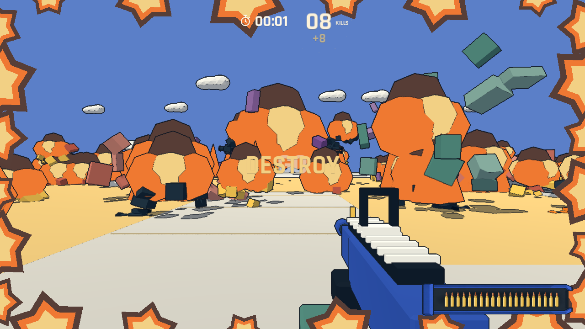

# 最后一秒全场引爆与结算定格

第 59 秒、剩余 1 秒时，所有存活敌人、可破坏建筑、油桶和场景道具同时爆开。树木、围栏、路灯及其他合批道具也消失并产生附近的火团和碎片；地面保留承托，天空不参与引爆。道具爆炸按五米网格合并，使用固定数量的低模碎片，避免每根围栏杆分别生成一套特效。全场终局只播放一次爆炸声。

剩余敌人在截止前通过统一死亡接口各计一分；终局没有额外分数倍率，也不会对玩家增加一次伤害。暂停会冻结最后一秒的时钟和碎片。四周同时展开橙金色漫画爆炸，中央留给瞄准和后续菜单。

60 秒截止时，停止所有场景节点回调和现有 Tween，冻结镜头、尸体、火团、碎片及灯光。移除局内 HUD 后保存同一冻结画面，结算使用这张静态背景。重试和返回标题恢复全部节点处理模式、道具、碰撞、建筑和开局导航。

`--qa --finale` 覆盖第 3540 tick 的引爆边界、全场敌人和结构/道具、单次计分、暂停、截止、结算背景逐像素保持不变，以及重开后的完整恢复。Godot 4.7.2 导入、规则检查、DESTROY 回归，以及无窗口和真实渲染的终局检查均通过。渲染截图为自动操作，不是人工试玩。

