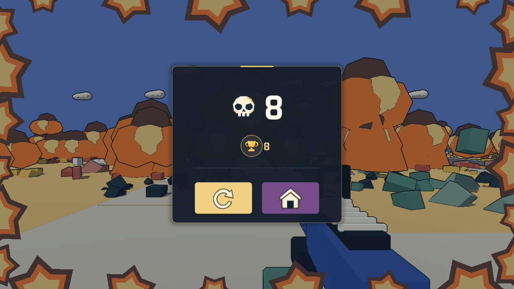
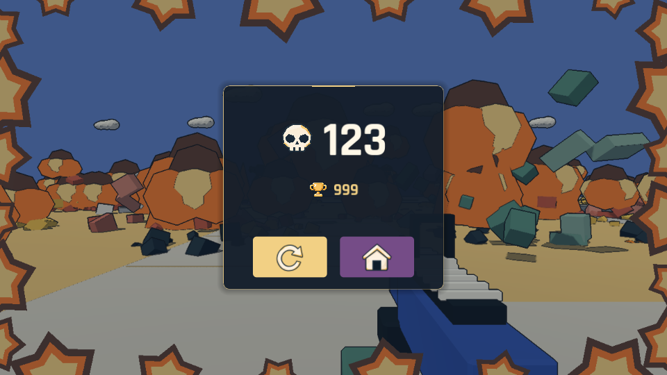

# 最后一秒全场引爆与结算定格

第 59 秒、剩余 1 秒时，所有存活敌人、可破坏建筑、油桶和场景道具同时爆开。树木、围栏、路灯及其他合批道具也消失并产生附近的火团和碎片；地面保留承托，天空不参与引爆。道具爆炸按五米网格合并，使用固定数量的低模碎片，避免每根围栏杆分别生成一套特效。全场终局只播放一次爆炸声。

剩余敌人在截止前通过统一死亡接口各计一分；终局没有额外分数倍率，也不会对玩家增加一次伤害。暂停会冻结最后一秒的时钟和碎片。四周同时展开橙金色漫画爆炸，中央留给瞄准和后续菜单。

60 秒截止时，停止所有场景节点回调和现有 Tween，冻结镜头、尸体、火团、碎片及灯光。移除局内 HUD 后保存同一冻结画面，结算使用这张静态背景。重试和返回标题恢复全部节点处理模式、道具、碰撞、建筑和开局导航。

`--qa --finale` 覆盖第 3540 tick 的引爆边界、全场敌人和结构/道具、单次计分、暂停、截止、结算背景逐像素保持不变，以及重开后的完整恢复。Godot 4.7.2 导入、规则检查、DESTROY 回归，以及无窗口和真实渲染的终局检查均通过。渲染截图为自动操作，不是人工试玩。

## 图标结算菜单

结算中央使用深蓝透明成绩卡片，爆炸定格画面保留在背景。本局击杀数前显示骷髅，最佳成绩前显示奖杯；新纪录以奖杯周围的金色圆环表示。卡片下方仅有两个按钮：金色圆箭头重试、紫色房屋返回标题。按钮使用正常、悬停、按下和键盘焦点状态；悬停提示保留动作名称及 Enter / Esc 快捷键。原有 KILLS、BEST、NEW RECORD、RETRY 和 MENU 的常驻描述已由图标替代。

四张透明 PNG 由内置 imagegen 工具生成，保存原图，生成提示词见 [图标来源](../../assets/ui/results/README.md)。

`--qa --results-ui` 通过：真实鼠标点击两个按钮、结算背景清理、返回标题、重试加载完成、纪录判定、三位成绩和 960×540 窗口。`--qa --finale` 在新 UI 下继续通过逐像素定格检查。以上为自动验证和实际引擎渲染，未进行人工试玩或平衡验收；三位数截图使用预设成绩核对布局。

完整 60 秒真实渲染自动回合也已通过，完成 83 次击杀（78 次爆头），最后一秒引爆后结算拒绝迟到计分，重开清空碎片和得分。日志无引擎错误。该回合使用自动瞄准及脚本换位，不能作为人工手感或平衡结论。

