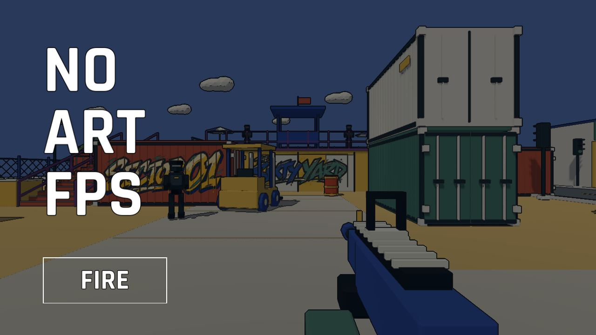
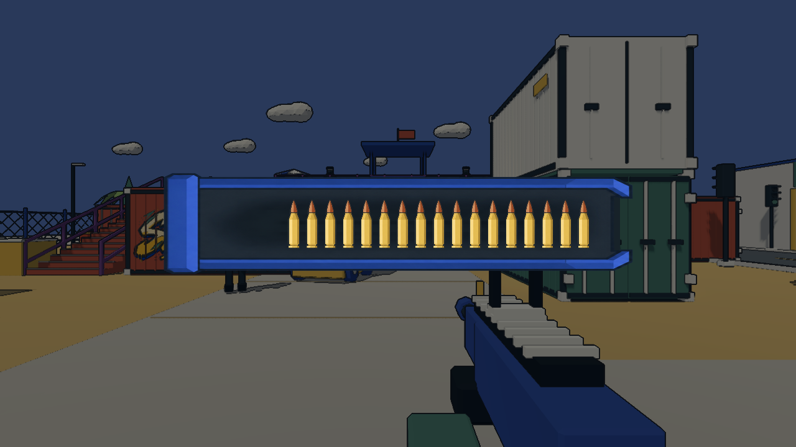
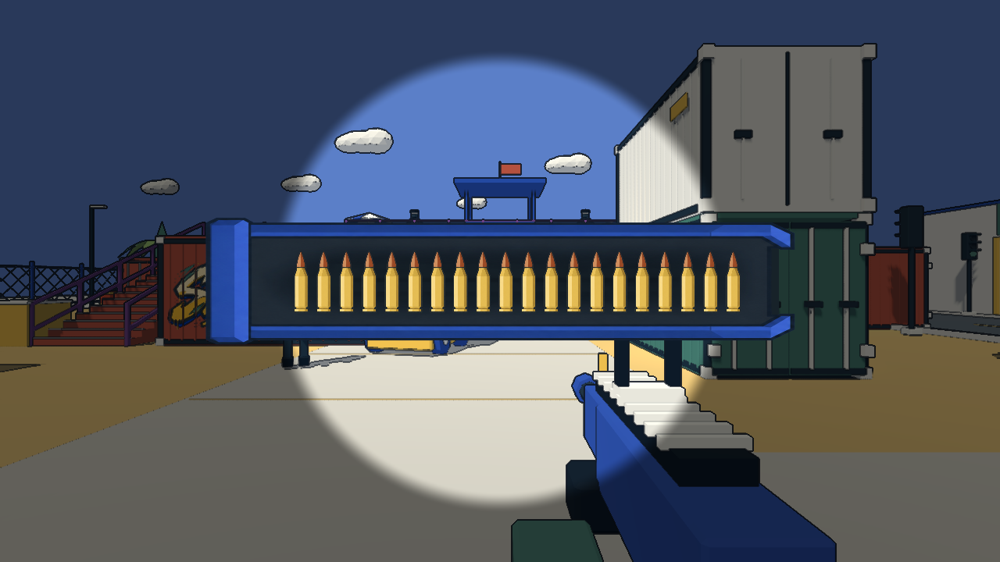
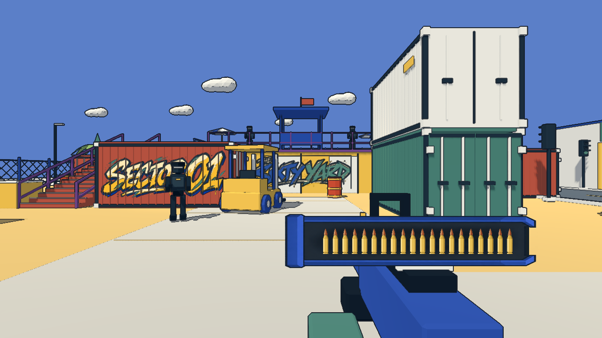
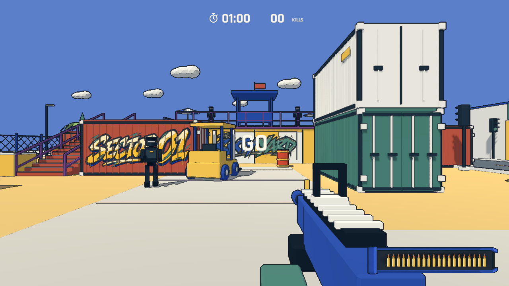

# FIRE 标题与弹夹加载转场

## 标题

标题最终采用项目自带的 Rajdhani Bold 纯文本，三行 `NO / ART / FPS` 左对齐，统一纯白字和纯黑描边。主按钮为同字体、同描边的白色 `FIRE`，带白色矩形边框，保留悬停/按下背景反馈、按下缩小和键盘焦点边框，Enter 可开始。已移除不再使用的 imagegen 标题和按钮 PNG，运行时无需这些图像。

程序启动时用开局机位、初始敌人和武器渲染首帧，截取不含 HUD 的场景画面并保存在内存。标题页将它作为全屏静态背景，叠加不透明度 55% 的纯黑遮罩。背景随每次程序启动从实际场景生成，返回标题时复用同一帧，不会显示上一局结束时的机位。

## 加载、揭幕与弹夹归位

点击 FIRE 后立即进入 LOADING：沿用标题的同一张场景首帧截图及相同透明度的黑色遮罩，中央大弹夹从空开始逐颗推入子弹。点击时仅替换前景内容，背景不变。场景准备在加载画面已经绘制后执行：清理旧回合、等待导航、后台请求敌人模型、逐帧创建八名开场敌人、提前渲染角色和首发特效。旧回合清理和角色逐帧出现不会透过加载背景被看到。

世界本身已用于标题背景，不会为了显示加载进度而重新生成地图。进度来自本局准备步骤和 ResourceLoader 实际加载状态；没有新进度时渐进补到 17/20，保留三发。只有所有准备完成才允许继续填到 20/20。画面进度平滑前进，不倒退；不会在仍未就绪时播放完成动作。

装满后，弹夹先轻沉，再快速回位，时长 0.22 秒。然后暗化截图的透明圆形区域从屏幕中央向四周扩大，约 0.65 秒后揭开同机位的实时场景；这一段弹夹仍停在中央。背景完全透明后，弹夹再用约 0.65 秒缩小并移往右下角。转场和局内弹夹共用同一绘制函数，终点精确使用局内弹夹矩形。按后续反馈取消三秒准备倒数：归位后立即允许移动、射击、敌人行动和 60 秒计时，中央显示米白 GO，短暂保持后平滑淡出，总计 0.8 秒。GO 不拦截输入，暂停冻结淡出，重开重新触发。

加载期间重复点击/Enter 不会重复准备；Esc 返回标题，并使旧的异步任务失效。窗口失焦会暂停转场动画，恢复焦点后继续，后台准备可以完成但不会在用户离开时自动进入战斗。导航或资源失败会退出加载、返回标题并记录明确错误。低镜头运动设置减轻下沉幅度。

暂停菜单 RESTART、结算 RETRY 和 Enter 新开局使用同一流程。测试仍保留同步的回合初始化入口作为隔离的规则/碰撞检查夹具；完整自动对局已改为从真实加载路径开始。

## 验证

`godot --path . -- --qa --loading` 使用视口鼠标事件点击 FIRE 的真实按钮区域，检查加载状态即时建立、重复点击防护、实际准备、单调装填、17 发等待上限、完整阶段顺序、先揭幕后归位、归位矩形匹配及敌人不重复生成；验证归位后的 GO 显示、立即移动/射击/计时、暂停冻结淡出及淡出结束；还覆盖重新开始、Esc 取消、导航等待、暂停加载动画和 960×540 窗口。

首帧背景检查通过：底层 3D 相机移动后，标题背景采样区域保持不变；标题切入加载、取消加载返回标题时，同一区域平均像素差异低于 0.01。检查同时确认 FIRE 的白色文本、黑色描边和矩形边框。原始场景首帧见 [opening-frame.png](../../artifacts/opening-frame.png)。

短时加载帧记录在 [loading-check.json](../../artifacts/loading-check.json)。这是当前 Apple M4 Pro / Godot 4.7.2 / Compatibility 下的自动渲染采样，含截图读取和 60 fps 限制；不能当作所有设备的不卡顿承诺或人工操作延迟测量。截图写盘安排在序列结束后，避免 PNG 编码污染转场帧间隔。

资源导入、规则、原有弹夹逐发/换弹像素检查、移动/头身射击/墙体遮挡/复活/十次重开检查，以及经加载转场进入的完整 60 秒自动对局用于最终回归。截图是实际引擎渲染；未进行人工试玩。

最终完整自动对局经加载转场进入游戏，使用共享首帧背景和黑色遮罩后完成 60 秒、84 次击杀、171 发射击并成功重开。自动瞄准与脚本机位不代表人工成绩或手感验收。
