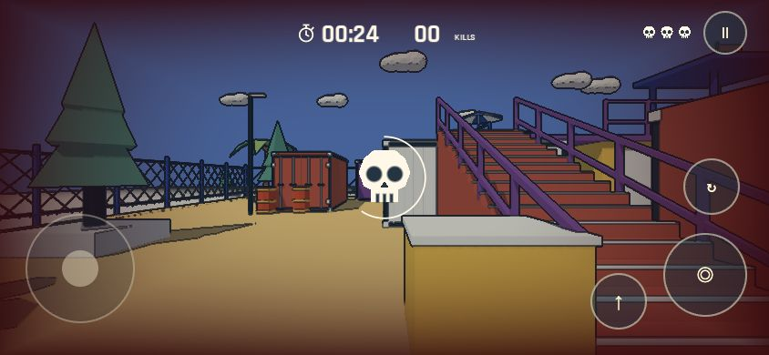
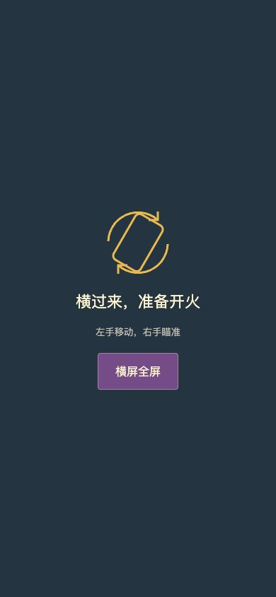

# 横屏触控适配（本地待体验）

2026-11-06。本轮仅更新源码和本地 Web 构建，保持用户要求的公网发布暂停；不更新 fps.yicong.me 或 cv.yicong.me。

## 操作与布局

- 手机竖屏显示横置提示；转回竖屏会暂停战斗。横屏后手动继续，不自动消耗倒计时。
- 左侧摇杆移动，右侧空白区滑动瞄准。按住开火键可持续射击，拖动开火键同时瞄准，支持双拇指移动射击。
- 独立跳跃、换弹、暂停按钮；触控按钮使用 48–120 CSS 像素尺寸。瞄准沿用暂停菜单里的灵敏度设置。
- 手机用 960×540 基础逻辑画布并扩展宽高比，避免 16:9 黑边；不改变桌面画布。弹匣移到下方中央，避免与右侧按钮重叠。手机标题与菜单单独适配。
- 横屏加载页压缩为两栏；适配安全区域和动态视口高度。
- 每个触点独立管理。松手、取消、失去捕获、旋转、失焦和切后台清理持续输入。后台暂停请求会保留到游戏读取，即使浏览器暂停期间没有物理帧也不会遗漏。

## 沉浸模式边界

点击 FIRE 时请求文档全屏，成功后尝试锁定横屏；也提供手动全屏入口。退出全屏暂停游戏。不能在没有用户手势时强制隐藏浏览器界面，也不能保证所有手机浏览器支持文档全屏。失败时保留普通横屏游戏并提示添加到主屏幕；加入 Apple 独立窗口元信息。没有引入 Service Worker 或离线缓存。

依据：[Fullscreen API](https://developer.mozilla.org/en-US/docs/Web/API/Fullscreen_API)、[requestFullscreen](https://developer.mozilla.org/en-US/docs/Web/API/Element/requestFullscreen)、[ScreenOrientation.lock](https://developer.mozilla.org/en-US/docs/Web/API/ScreenOrientation/lock)。

## Web 音频修正

本地 Chrome 运行中观察到 Godot Sample 播放复用节点的 `AudioScheduledSourceNode.stop` 异常，页面在约 49 秒处不再推进。将 Web 专用默认音频播放类型设为 Stream，后续浏览器运行可继续倒计时和操作，没有再观察到该异常。原生默认设置不变。

Stream 在性能较弱的手机上可能有音频延迟，需实机试听；不能把桌面 Web 检查当成移动硬件性能证明。[Godot 播放类型说明](https://docs.godotengine.org/en/4.6/classes/class_projectsettings.html#class-projectsettings-property-audio-general-default-playback-type-web)。

## 验证

- Godot Web 导出和运行资源清单检查通过：116 个打包资源；不包含测试、设计或参考素材。
- `node tests/mobile_input_test.mjs`：实际 HTML 触控桥接脚本的多指移动／瞄准／射击、拖动射击、触点所有权、单次动作、取消、竖屏、后台、失焦、全屏退出、跨帧暂停请求通过。
- `godot --headless --path . --script tests/rules_test.gd`：计时与计分边界通过。
- `godot --path . -- --qa --check`：真实渲染模式下两条坡道、暂停换弹、头身命中、遮挡、重生及十次重开通过。
- 最初误以 headless 执行需要鼠标捕获的 `--check`，无法产生移动，坡道断言失败；随后按该测试文档用真实渲染模式执行通过。未修改测试断言或场景路径。
- Chrome 本地响应式 iframe：844×390、667×375 横屏及 390×844 竖屏。检查了开始、触控显示、视角移动、暂停／继续及旋转提示。截图见下方。
- 这些是桌面浏览器模拟尺寸与输入，不是真机多指触摸测试。真实 iPhone／Android 的全屏权限、横屏锁定、音频、帧率和手感仍待用户体验。自动化环境不授予全屏，验证的是失败降级，不声称真机浏览器栏已经隐藏。

本地入口 `http://127.0.0.1:8785/`；桌面强制检查触控布局使用 `?touch=1`。这两个 localhost 地址只在当前 Mac 可用。手机实测需在同一局域网提供本地静态服务，或待用户允许后发布测试版本；本轮不新增公网发布。
