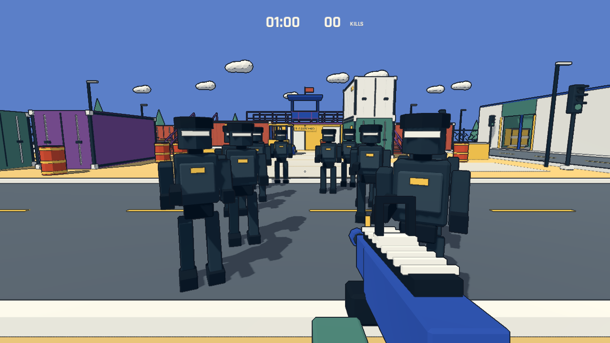

# 敌人移动、避让与图形弹夹

## 阶段一：移动与间距

复现：地面黑色敌人的导航路径起点在 Y=0.5，实体脚底约为 Y=-0.02，而路径到达阈值只有 0.45 米。它们无法到达首个路径点；12 秒自动检查中，第一名地面黑色敌人仅因落地位移约 0.07 米。二楼误差较小，因此原先仍能移动。

根据导航体素高度设置路径高度偏移，消除首点的垂直误差。仓库和二楼巡逻从对侧巡逻点开始，到达后立即转向下一点。行走动画使用实际位移速度。

NavigationAgent3D 开启局部避让，半径 0.6 米；敌人实体互相碰撞，作为最后的阻挡。突击兵预告后的冲锋方向保持锁定，碰到其他敌人也会停下。阵亡时移除碰撞和避让；暂停期间不应用避让回调。刷怪选点及预警结束时都检查与活着敌人的 1.4 米间距，位置被占用时延后补充。

迎面相遇时使用一致的侧移方向，避免对称避让导致互相等待。图形模式下的 12 敌人交叉检查通过，最小中心间距约 1.19 米；每名敌人横向推进超过 11 米。规则测试、实时 headless 区域巡逻/增援检查、油桶/冲锋检查均通过。加速 headless 测试曾在快速退出时报告音频资源未释放；最终实时检查正常退出，没有该警告。尚未进行人工手感验收。

新增 `godot --path . -- --qa --movement`：开场七名黑色敌人各自移动超过 2 米；12 敌人对向穿过同一广场，各自推进超过 8 米，逐物理帧检查实体间距；同时覆盖暂停和刷怪占位重新检查。场景由测试控制，截图为引擎实际渲染，不代表人工试玩。

