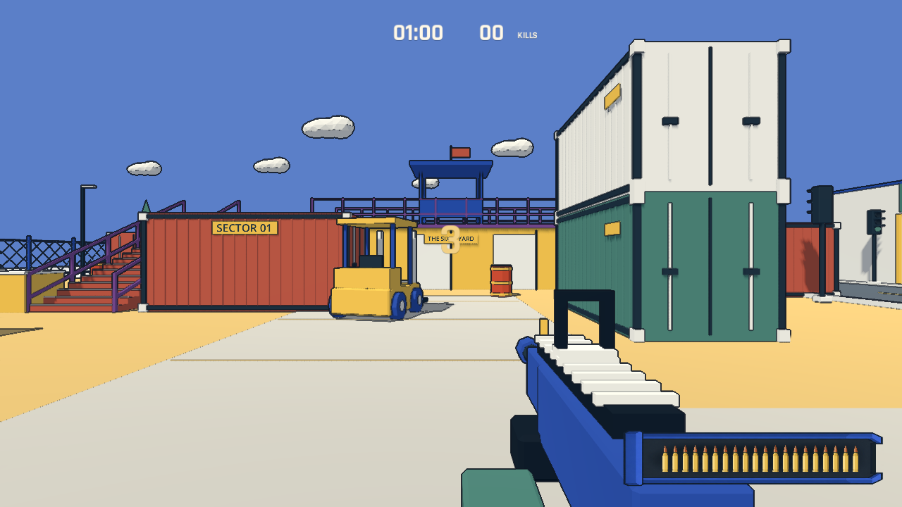
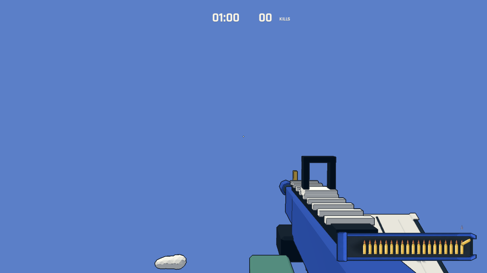

# 敌人移动、避让与图形弹夹

## 阶段一：移动与间距

复现：地面黑色敌人的导航路径起点在 Y=0.5，实体脚底约为 Y=-0.02，而路径到达阈值只有 0.45 米。它们无法到达首个路径点；12 秒自动检查中，第一名地面黑色敌人仅因落地位移约 0.07 米。二楼误差较小，因此原先仍能移动。

根据导航体素高度设置路径高度偏移，消除首点的垂直误差。仓库和二楼巡逻从对侧巡逻点开始，到达后立即转向下一点。行走动画使用实际位移速度。

NavigationAgent3D 开启局部避让，半径 0.6 米；敌人实体互相碰撞，作为最后的阻挡。突击兵预告后的冲锋方向保持锁定，碰到其他敌人也会停下。阵亡时移除碰撞和避让；暂停期间不应用避让回调。刷怪选点及预警结束时都检查与活着敌人的 1.4 米间距，位置被占用时延后补充。

迎面相遇时使用一致的侧移方向，避免对称避让导致互相等待。图形模式下的 12 敌人交叉检查通过，最小中心间距约 1.19 米；每名敌人横向推进超过 11 米。规则测试、实时 headless 区域巡逻/增援检查、油桶/冲锋检查均通过。加速 headless 测试曾在快速退出时报告音频资源未释放；最终实时检查正常退出，没有该警告。尚未进行人工手感验收。

新增 `godot --path . -- --qa --movement`：开场七名黑色敌人各自移动超过 2 米；12 敌人对向穿过同一广场，各自推进超过 8 米，逐物理帧检查实体间距；同时覆盖暂停和刷怪占位重新检查。场景由测试控制，截图为引擎实际渲染，不代表人工试玩。

## 阶段二：横排弹夹与逐发脱壳

右下角常驻一排 20 颗子弹，准备阶段即显示满弹；替代剩余弹药数字和 RELOADING 字样。最右端是出弹端。有效射击才触发动画：最前面的弹头短促向上飞出，弹壳分离、旋转、落下并渐隐，剩余子弹在约 0.085 秒内向右补位。每枚弹壳存活 0.48 秒，支持连射时多个弹壳同时播放。

换弹保留当下剩余子弹，完成后一次补满；下方细线显示进度。暂停冻结补位和脱壳动画；重开和复活清空旧弹壳。低镜头运动设置减少弹壳位移和旋转。生命反馈仍然只使用暗红边缘渐晕。

素材使用内置 imagegen 生成，保留原始透明 PNG，运行时以区域引用、旋转和重复绘制组合。原图、完整提示词和使用说明位于 [assets/ui](../../assets/ui/README.md)。弹夹内部有深色底，保证半透明区域不会透出枪身或地面而干扰弹药辨认。

`godot --path . -- --qa --magazine` 从画面像素统计子弹轮廓，逐发验证 20→0；验证有效射击产生弹壳、无效射击不产生弹壳、动画回收、自动/手动换弹、暂停、重开及 960×540 窗口。测试截图使用受控状态，不是人工试玩。

旧交互检查在抓取鼠标时曾受桌面鼠标位移影响而偏离坡道；仅在自动测试中禁用玩家鼠标回调，仍用原有移动输入与实际碰撞检查坡道。最终两侧坡道、头身射击、墙体阻挡、换弹、复活、十次重开均通过。

完整 60 秒图形模式自动对局完成 96 次击杀、150 发射击，并成功结算与重开。使用自动瞄准和脚本机位，不能作为人类成绩或平衡结论；数据见 [playtest.json](../../artifacts/playtest.json)。验证机器为 Apple M4 Pro / Godot 4.7.2 / Compatibility。资源导入和规则测试通过，未做人工试玩。
