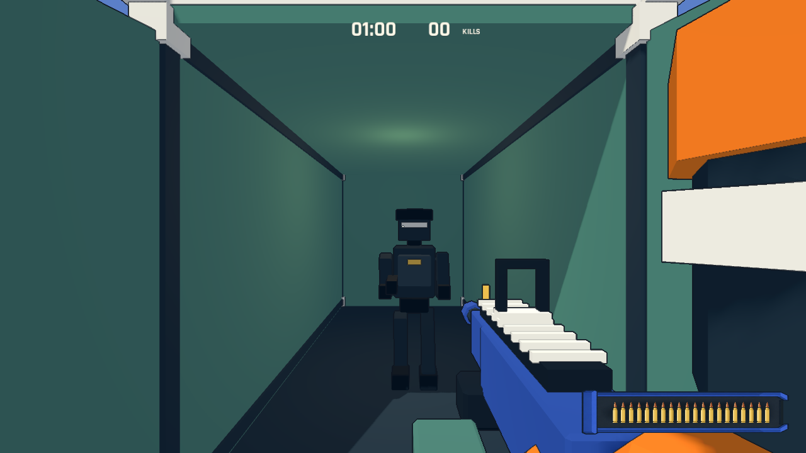
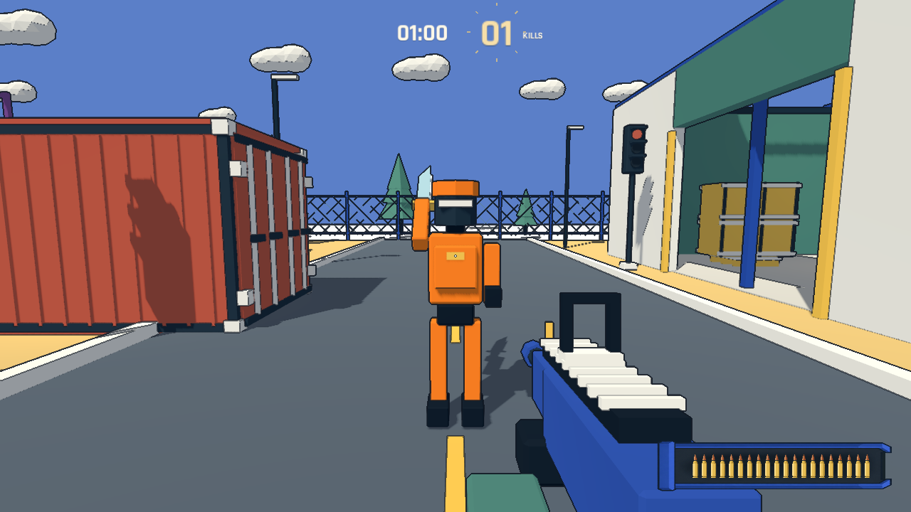

# 自动集装箱、持刀近战与泳池露台

## 弹夹

保持比例和右下边距，宽高乘以 `sqrt(0.8)`，面积精确减少 20%。子弹、脱壳轨迹、换弹进度线一起缩放。逐发画面计数及 960×540 检查通过。

## 自动集装箱

地面八个集装箱改成真正可进入的空心结构。走近门前约 3.2 米时，两扇门向外打开，不需要按键，不显示交互文字。侧面、背后、楼上及被掩体隔开的玩家不会触发。动画持续 0.7 秒；开门时不推挤角色，打开后门板仍能挡人和挡子弹。重开关闭所有门，暂停冻结动画。

绿色和紫色集装箱各放一名黑色敌人，占原有地面名额；门打开之前留在内部，开门完成后加入移动和战斗。保持开场 8 人及区域人口规则。高处叠放、无法正常走近的装饰集装箱保持原模型。

## 橙色持刀敌人

替换远距离直线冲锋。以 5.8 m/s 寻路追近，1.85 米内举刀预警 0.4 秒，随后播放 0.24 秒劈砍，硬直 0.65 秒。方向在预警时锁定，命中检测要求 2.1 米内、同高度、前方扇区且没有墙体遮挡。每刀只造成一次 34 点伤害；没有接触伤害或远程弹丸。可以侧移、后退、用掩体阻挡，或在举刀时击杀。

模型来自可重建的 Blender 5.2.2 原创源文件 `art_source/playbox_props.blend`，生成脚本为 `tools/build_playbox_assets.py`。右臂以肩部为轴，手与刀一同参与举刀和劈砍动画。

## 验证

`--qa --containers` 实机验证门前自动触发、侧面不触发、内部敌人走出、玩家实际穿门、暂停、重开、所有地面门及内部导航连通性。`--qa --combat` 验证快速追近、劈砍、单次伤害、侧移躲避、遮挡、暂停和击杀中断，同时保留油桶测试。资源导入和规则测试通过；人口和避让 headless 检查通过。实机截图为受控场景，不代表人工试玩。
