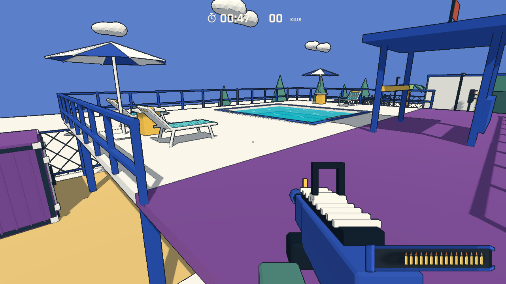
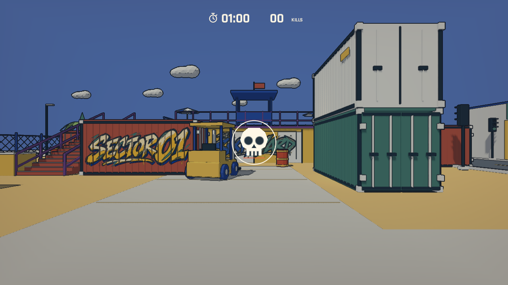
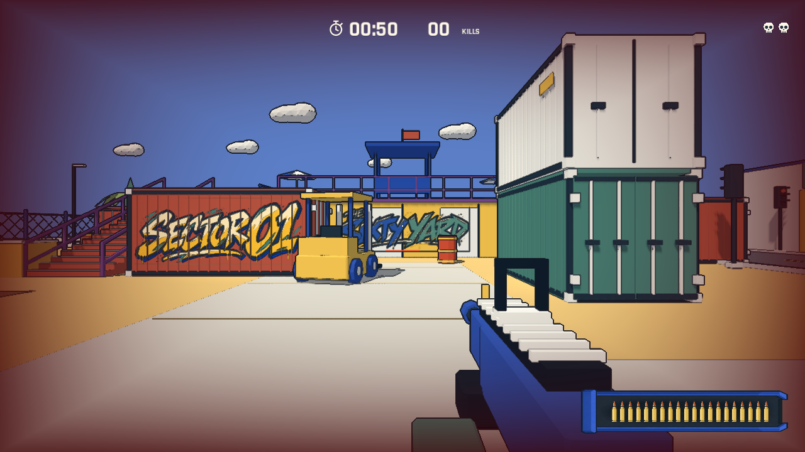

# 平台接缝与五秒死亡重置

## 平台

用户截图中的缺口位于旧紫色落脚平台的外侧。白色露台已扩宽到 18 米，紫色主平台仍只有 13.5 米，左右楼梯连接板又没有延伸到白色露台前缘，导致两翼的空隙可掉落。

紫色主平台扩到 18 米，与白色露台在 Z=-13.2 同高接合；左侧楼梯连接板缩成外侧支段，删除重叠的旧右支段。白色前缘也裁到同一接缝，避免共面重叠。地板网格与静态碰撞使用同一尺寸。

新增左右两翼、两个方向的实际移动检查，逐物理帧确认角色脚底不低于平台。原有楼梯、露台、浅水池进出均通过。

## 死亡与复活

原文字为 `BACK IN A BEAT`，表示死亡后的短暂重置，现已移除。致命伤害后等待 5 秒，中央显示米白骷髅及逐渐缩短的等待圆环，暂时隐藏枪、准星和弹夹；回合时间继续运行，不新增文字提示或生命值。

死亡事件只计一次。复活完成后顶部右侧增加一枚骷髅，每枚代表一次死亡；再次死亡等待时，顶部保留之前的骷髅，中央显示本次死亡。结算显示本局所有死亡，包括截止前未复活的一次。死亡次数只保留在当前回合，重新开始（包括暂停菜单中的 RESTART）清零。

暂停同时冻结回合与死亡等待；恢复暂停不会错误解锁死亡玩家的移动。复活恢复满生命、满弹与短暂无敌。若回合先到 60 秒，直接结算，不在结算界面复活。

## 验证

`--qa --respawn` 验证 299 个物理帧内不能复活，第 300 帧恰好复活；覆盖伤害去重、等待期间不能移动/射击、暂停/恢复、第二次累计、临近截止死亡、重开及等待中重开。图标在实际渲染画面中检查。规则测试确认开局清零；原有射击、坡道、复活和十次重开检查通过。自动检查不等于人工试玩。

完整 60 秒图形模式自动对局完成 77 次击杀、191 发射击，按时结算并成功重开。自动瞄准成绩不用于平衡评价，记录见 [playtest.json](../../artifacts/playtest.json)。
