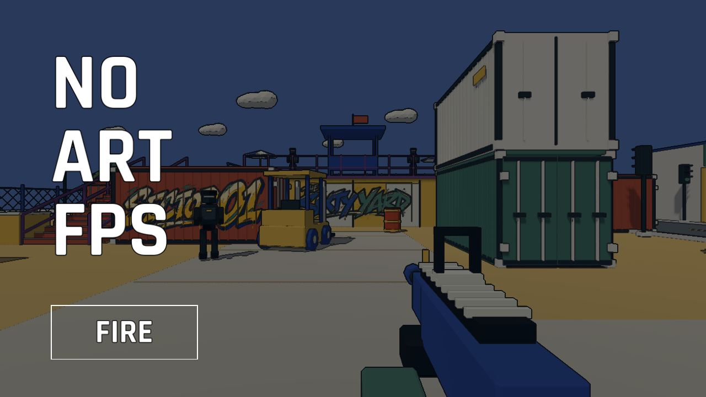

# 标题样式与楼梯出口修复

2026-11-06。

标题三行白字取消黑色描边；FIRE 使用 Rajdhani Bold 白字、紫色背景，取消文字描边和常态边框，保留悬停/按下反馈与键盘焦点提示。实机加载检查覆盖真实按钮点击、完整转场、输入、暂停和窗口缩放。

右侧完整上楼路线在修复前复现了卡住：玩家停在 `(7.6, 2.814, -8.501)`，碰撞点位于紫色平台前沿 `(7.6, 3.1, -8.8)`。旧坡道顶面为 3.0 米，平台顶面为 3.1 米，且平台前沿比坡道终点提前 0.2 米进入通道，导致角色撞到近乎竖直的侧面。紫色平台与白色露台本身高度相同，独立跨缝测试可通过。

两侧楼梯顶面现在均为 3.1 米。左侧坡道终点对齐平台前沿 z=-8.4，右侧对齐 z=-8.8，同时更新可见台阶和扶手；角色跳跃、碰撞半径和移动速度不变。

验证：

- `--routes` 从地面分别连续走上左右楼梯、经过平台再进入白色露台，并沿原路返回；全程无跳跃。
- 同一检查低速双向穿过两侧紫白接缝，避免高速惯性掩盖台阶问题。
- `--terrace` 检查露台及泳池导航、双向接缝、下水和无跳跃出水、树干碰撞。
- `--destroy` 检查平台破坏后碰撞移除、导航更新和重开恢复。

测试来自 Godot 实际物理移动；未做跨平台或长时间试玩验收。
