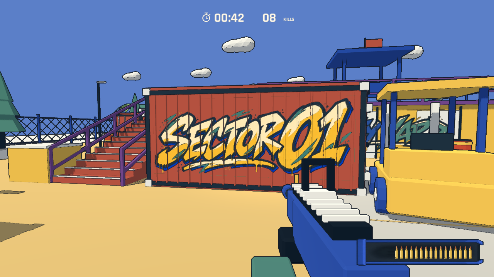
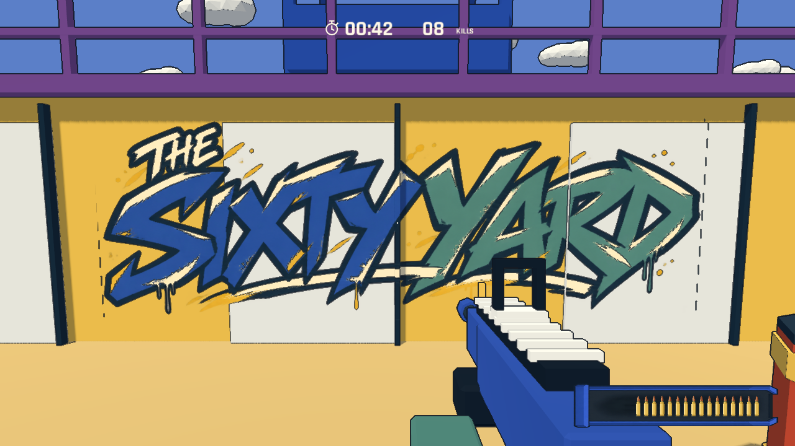
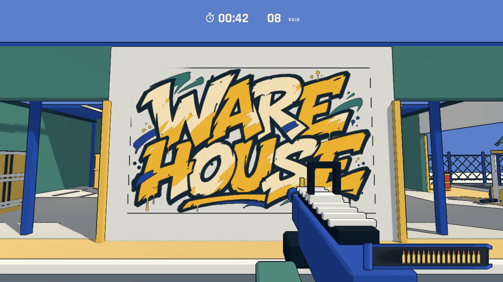

# 墙面涂鸦与闪烁修复

原先 SECTOR 01、THE SIXTY YARD、WAREHOUSE 三处黄色底板和 Label3D 纯文本标牌已移除，改成大面积喷漆字。SECTOR 01 占据红色集装箱侧面约 5.55×2.18 米；THE SIXTY YARD 跨越平台前墙约 7.1×2.35 米；WAREHOUSE 从仓库入口上方的小牌移到西侧实墙，约 6.7×4.05 米。

三幅图由内置 imagegen 生成，原始透明 PNG 和完整提示词位于 [assets/graffiti](../../assets/graffiti/README.md)。保留原场景的米白、金黄、青绿、钴蓝和深色轮廓，以不规则字形、划痕、喷点及滴漆形成涂鸦风格。

初版透明 next-pass 叠层出现用户报告的闪烁；检查还发现贴图没有生成 mipmap。最终在墙面本身的不透明材质中直接混合喷漆颜色，保留相同几何和深度值，去除额外透明绘制及法线偏移。启用 mipmap 和各向异性过滤，减少远处及斜角的细节跳动。喷漆沿实际墙板和集装箱筋条投射，受场景光照和遮挡影响。

`godot --path . -- --qa --graffiti` 检查场景没有 Label3D、涂鸦材质没有额外绘制层、纹理具备 mipmap，并对三幅涂鸦的 12 个近远/斜角视点正向和反向渲染。冻结自动门等场景变化后，最终同一视点中心区域平均像素差异最大值为 0。该检查验证重复视点稳定性，不代替所有设备和任意运动条件的人工检查。

Godot 导入、规则、仓库/街道/楼梯通行和射击/复活/十次重开检查通过。截图为真实引擎渲染，测试控制视点与分数；未进行人工试玩。

12 敌人短时渲染基准通过：Apple M4 Pro、Compatibility、实际 1138×640 渲染目标，10 秒样本的 P95 帧间隔 9.19 ms、P99 11.25 ms、最大 13.67 ms。关闭 VSync 和帧率上限；这些是进程帧间隔而非 GPU 计时，不代表长时间或其他设备性能。详见 [benchmark.json](../../artifacts/benchmark.json)。
