# 九图普通模式可破坏物首批

新增 27 类原创小物件，每图 9 组，共 81 组、258 个独立命中部件。普通模式即可破坏；较硬的格板、泡沫砖、屏幕和罩板需要两次命中，狂暴命中一次即可。原有大型结构仍沿用其破坏规则。

| 地图 | 首批物件 |
| --- | --- |
| 沙城 | 彩釉陶罐、水果筐、木格板 |
| 游乐园 | 气球、叠罐、爆米花机 |
| 渡轮 | 救生衣箱、甲板椅、瓶筐 |
| 摄影棚 | 泡沫布景砖、场记板与道具瓶、分片纸幕 |
| 办公室 | 屏幕与键盘、原创小手办、外卖盒与纸杯文件 |
| 城堡球场 | 训练靶、扫帚器具架、铠甲与盾牌 |
| 雪线天文台 | 冰柱样品架、结冰仪器罩、雪人 |
| 棕榈屋 | 育苗盆、喷灌接头、土袋 |
| 银座站 | 售货机面板与饮料、报刊架、雨伞架 |

## 行为与实现

- 各部件独立损坏，底座、空架保留；陶罐等保留破口残块。较硬物件首次命中有碎屑与轻微偏转。
- 叠罐底层被打倒后上层连续倒下；水果用球形碎物，纸片、玻璃、陶片采用不同尺寸；喷灌接头产生短促的水滴喷散。本批没有持续喷水、真实布料、绳索或刚体模拟。
- 七种合成材质声音。小物破坏不触发伤害爆炸，不新增杂物计分；手雷按遮挡关系破坏附近物件。
- 命中盒使用道具射击层，不增加玩家／敌人通行障碍，也不重烘焙导航。保留底座和碎口属于装饰，不作为可依赖的战术掩体。
- 飞散效果复用 MultiMesh，每批 4–8 个碎片，全局最多 10 批；减少动态效果设置会降低数量。碎片在 0.65–1.25 秒内清理。
- 提供 Blender 母版、GLB 和位置数据；模型共 1,700,284 字节、17,206 三角形（27 类去重资产总计，并非单帧可见数）。位置离线核查后编入目录，运行时没有地面搜索。

## 验证

- Godot 4.7.2 导入、规则检查、九图地图选择检查通过。
- tests/interactive_props_check.gd 原生渲染检查覆盖全部九图：普通射线命中、两段破坏、狂暴破坏、普通模式手雷波及、实体墙遮挡、重开恢复、暂停恢复连锁、取消延迟连锁、碎片批次上限、导航资源未改变。另以 headless 覆盖九图的结尾清场和恢复，见 finale-check.log。
- 81 组位置有支撑面；258 个目标未与原有静态碰撞体相交。检查数据见 checks.json。
- 每图保留一组固定机位的破坏前后画面，共 18 张。它们是脚本控制的渲染与命中测试，不代表完整人工游玩。
- draw_calls_intact 只记录当前画面绘制次数，没有做旧版同机位基准，不用于声称帧率改善。
- 逐个检查 GLB：所有表面具有顶点颜色；资产统计见 assets.json。

| 地图 | 完整状态 | 破坏后 |
| --- | --- | --- |
| 沙城 | 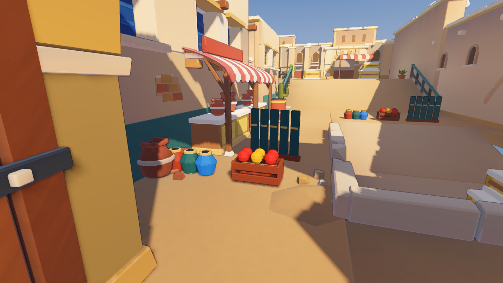 | 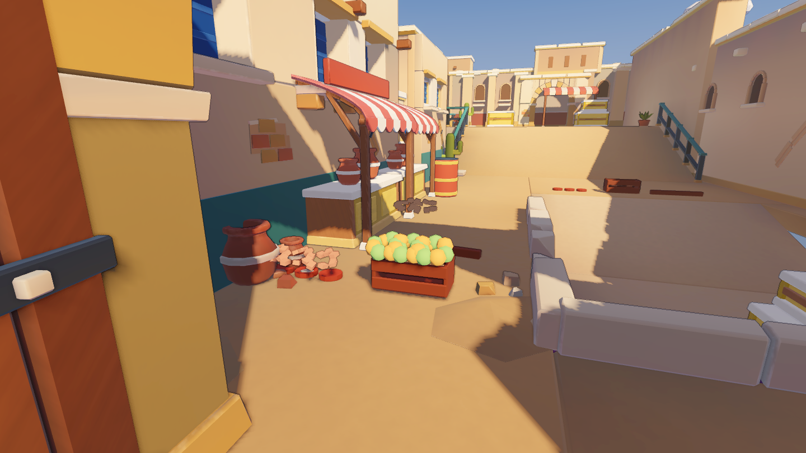 |
| 游乐园 | 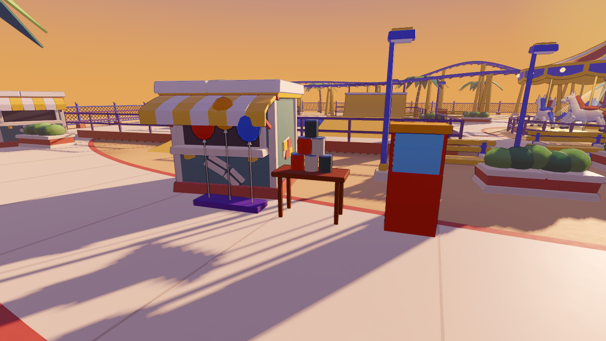 | 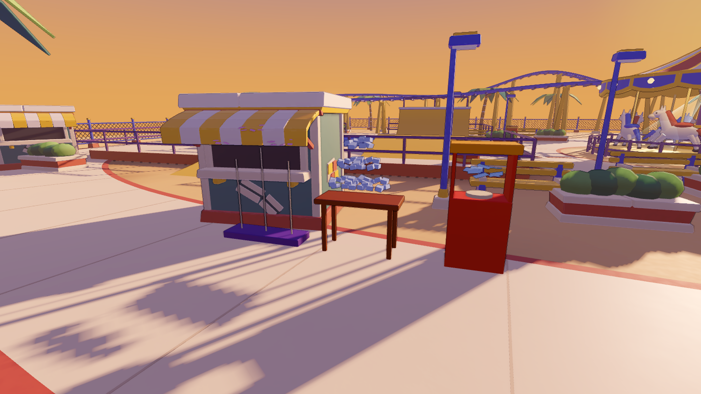 |
| 渡轮 | 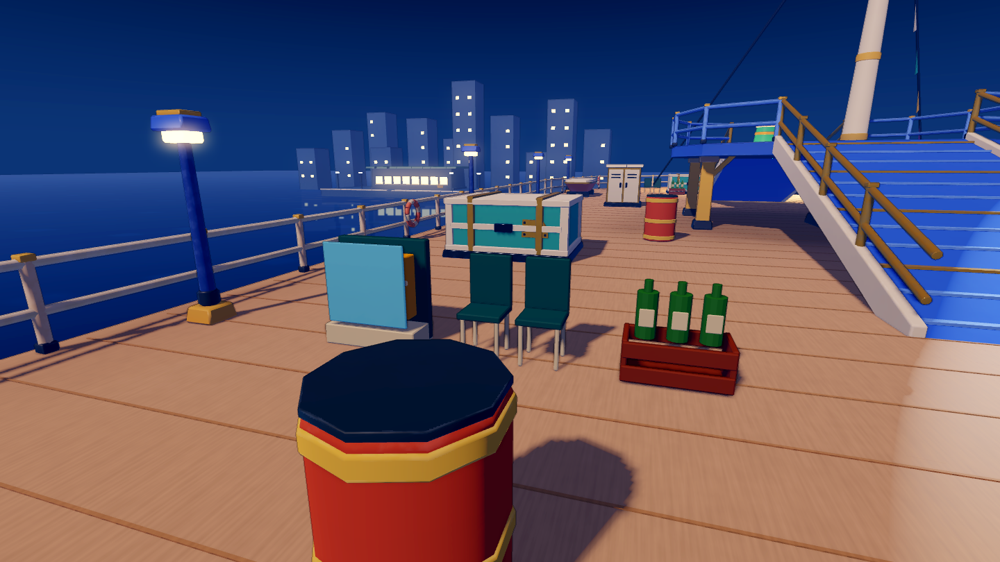 | 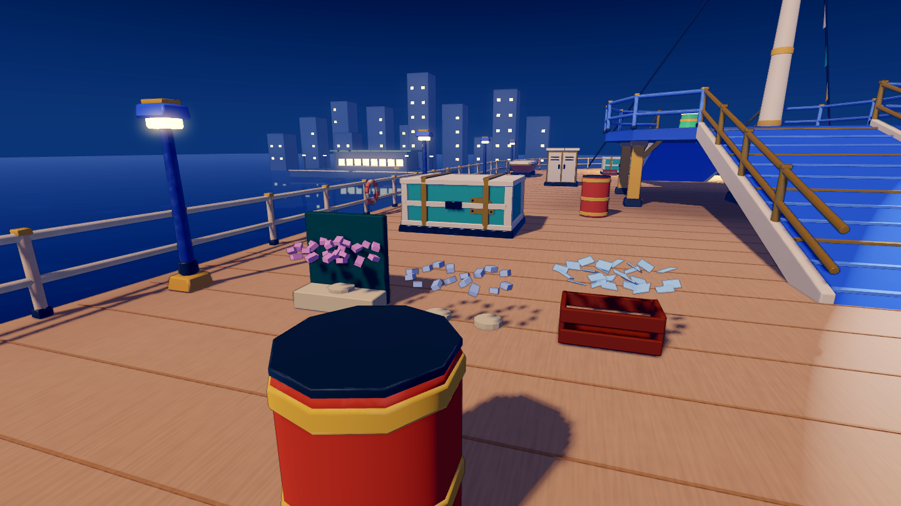 |
| 摄影棚 | 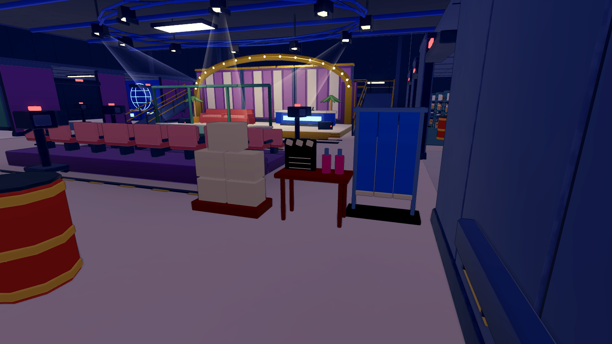 | 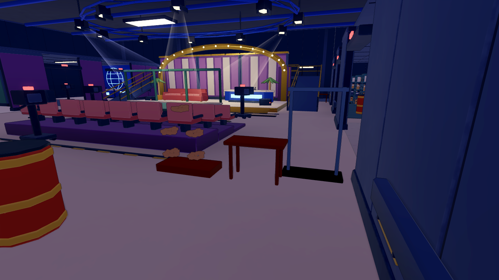 |
| 办公室 | 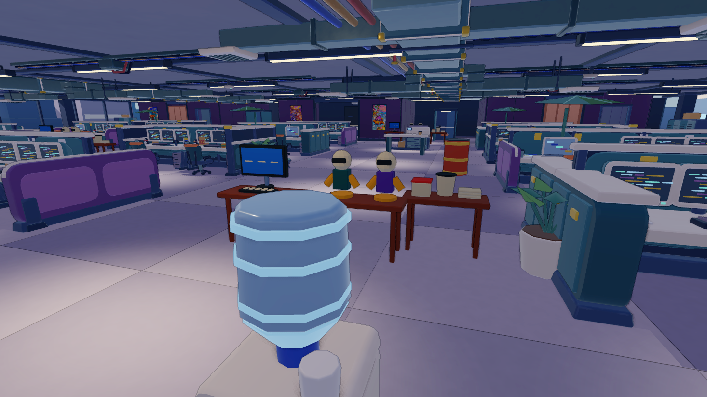 | 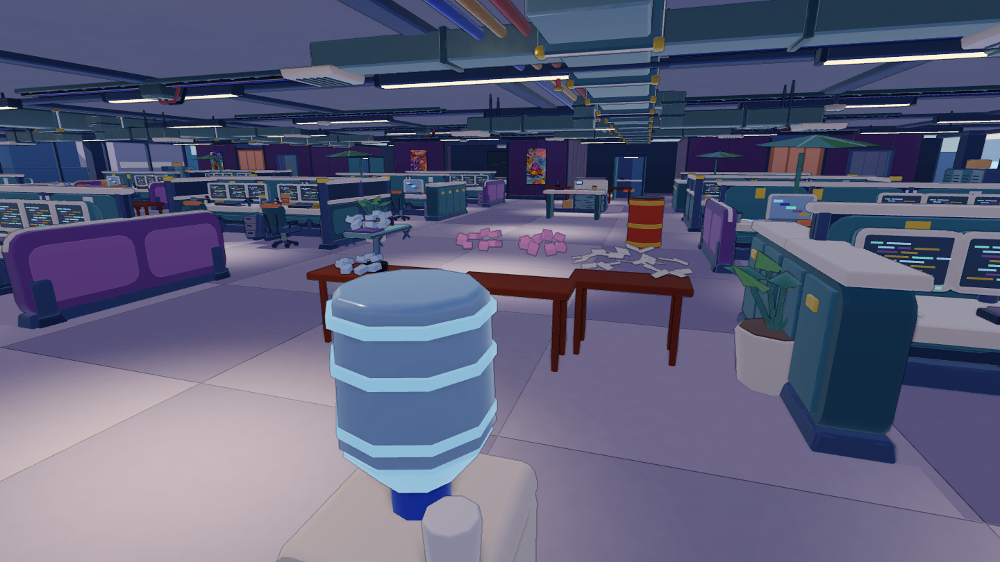 |
| 城堡 | 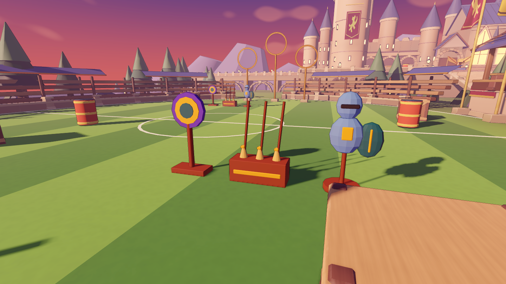 | 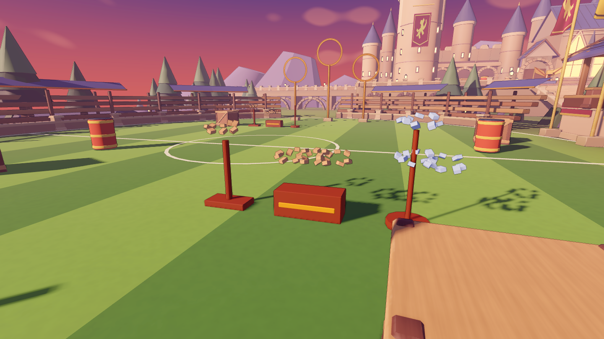 |
| 雪线 | 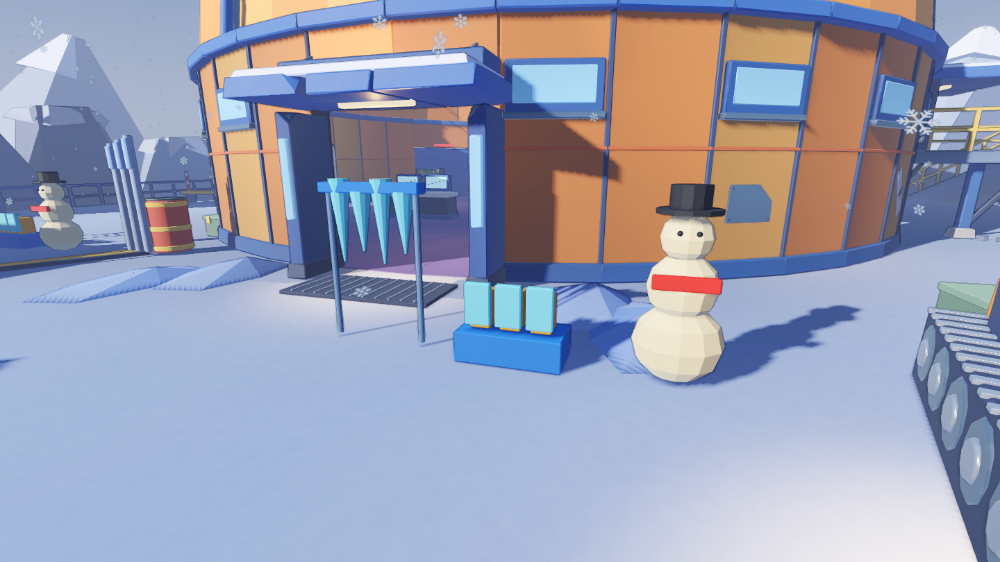 | 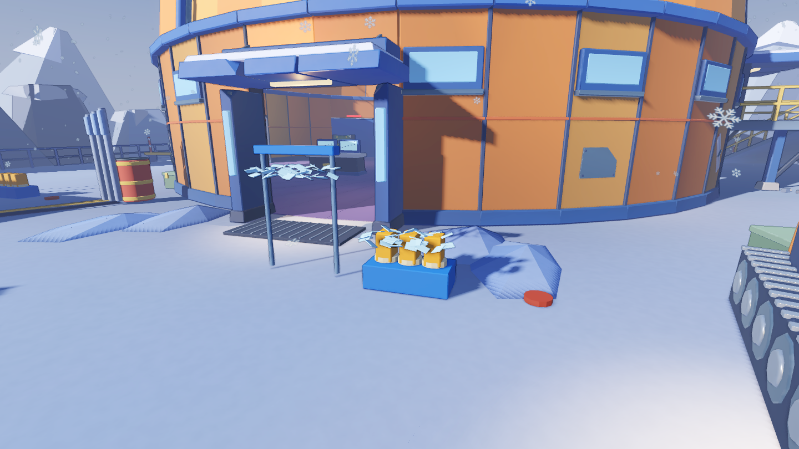 |
| 棕榈屋 |  | 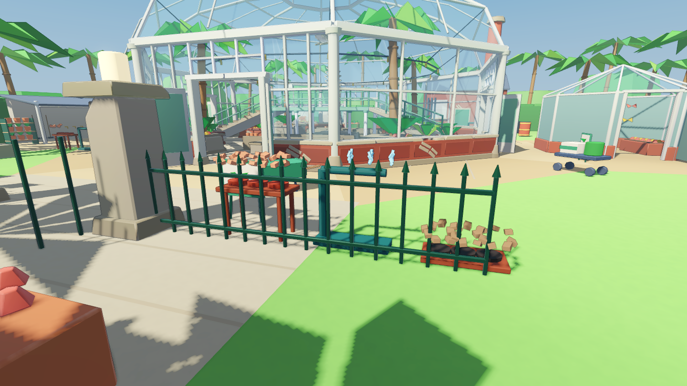 |
| 银座站 | 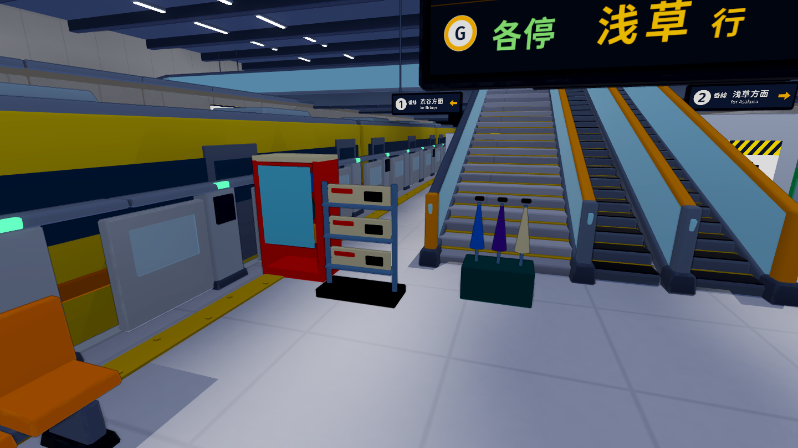 | 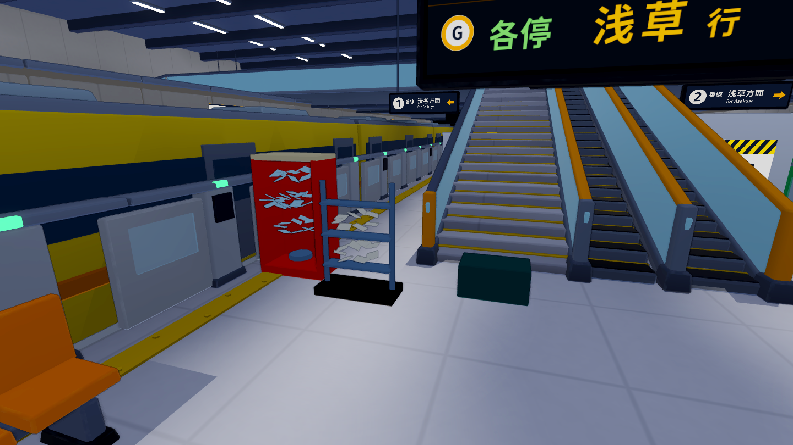 |

线上验证在发布后记录。
