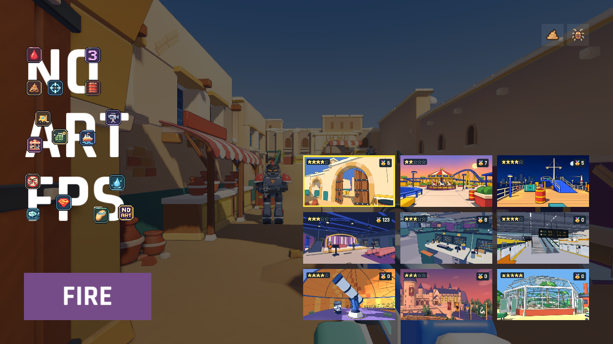

# 九张地图与沙城默认入口

移除堆货场、香港鱼市和机场行李层的地图场景、会话资源、选择卡片与缩略图。沙城（内部 ID sandgate，原中文名沙门）成为首次启动和失效旧选择的默认地图，九张卡片按 3×3 展示。仍记住其他有效地图的选择。

更新 Web 启动画面与缓存地图白名单。沙城继续使用 score_sandgate_v1 成绩，避免继承原堆货场的 score 记录。保留历史研究、制作源文件与共享道具；退役地图的专属模型和音乐从各平台导出排除，Web 校验禁止退役地图场景、会话和专属模型进入 PCK。

## 验证

- Godot 导入、规则检查、场景保存与导航实例隔离通过。
- 地图选择 headless 与原生渲染检查通过：九张卡片、成绩隔离、键盘与触控选择、无效导航回退、启动对局。
- 回退检查主动注入不可达出生点，预期产生一条导航失败警告。
- Web 导出与资源检查通过：23 文件，978 打包资源。
- 原生画面：

线上发布与浏览器启动记录完成后补充。
