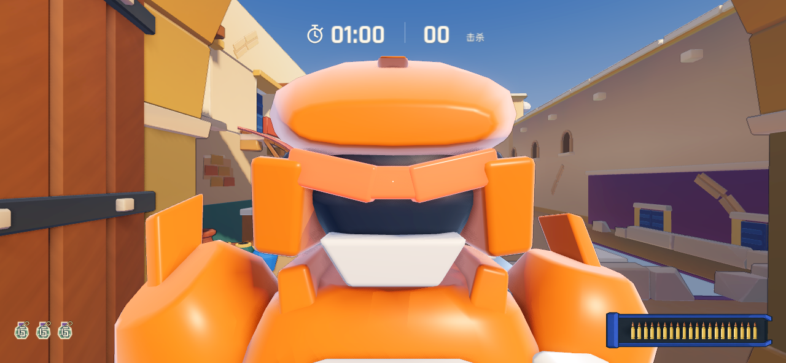
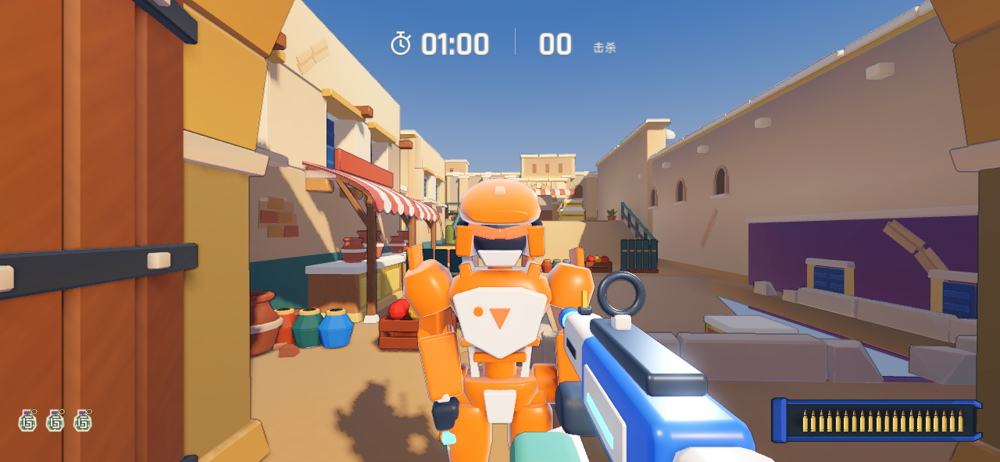

# 近战兵镜头距离，2026-11-15

近战兵原先持续寻路到玩家中心。出刀冷却、位于玩家身后而不能出刀时，仍会向前靠近；玩家与敌人之间没有实体碰撞，模型会挤进第一人称镜头。

本次在近战兵实际移动前增加距离约束，且放在导航避让回调之后，避免 RVO 又把它推回玩家身体内：

- 在约 1.7 米中心距离停步，接近该距离时平滑减速；小台阶按立体距离换算水平停距，保留原有出刀范围。
- 玩家靠得过近时平滑退让，最高退速 5.8 米/秒，继续使用原来的地形碰撞。
- 冷却、身后追击和挥刀各阶段都保持距离约束；不同楼层或隔着掩体的敌人不额外后退，避免妨碍绕障寻路。
- 伤害 34、出刀前摇 0.4 秒、命中距离 2.1 米、正面限制、掩体阻挡、侧移躲刀均保留。
- 未改变玩家镜头、FOV 或敌人模型大小；玩家移动也不会被新增碰撞体挡住。没有新增绘制、特效、纹理或逐敌人扫描，只有近距离移动时的常数次向量计算和一次视线检测。

## 固定镜头对照

使用同一沙城出生点、镜头、紧凑版 Web 敌人模型、1280×592 视口，近战兵从前方 4 米处追击冷却中的玩家，经过 150 个物理 tick 后截图。

- `before.png/json`：298712c 的旧 Enemy 脚本，距离约 0.52 米。
- `after.png/json`：新脚本，距离约 1.70 米。

这是实际 Godot 渲染的受控回放，采用手机横屏比例；不是实体手机拍摄。测试专门让攻击处于冷却，复现持续追到镜头的情况，没有用模型缩放模拟改善。





## 验证

`tests/melee_clearance_check.gd` 在独立平面导航区域使用真实 Enemy、NavigationAgent 和物理回调，验证：

- 冷却追击停距与导航避让后的向内速度限制。
- 身后追击不挤入镜头、不触发背后近战；转身后仍能受一次 34 点伤害。
- 0.4 米重叠处平滑退开，单步位移约 0.10 米，没有传送。
- 暂停冻结、侧移躲刀、掩体阻挡、三名近战兵围近。

专项测试、规则测试及紧凑模型爆头回归通过，见 `checks-melee.txt`、`checks-headshot.txt`。

现有全量 `tests/combat_check.gd` 在默认沙城会先失败于 `Nearby barrel chains`，尚未执行到近战部分。使用旧 Enemy 脚本复测也失败于同一断言，属于已有测试前提问题，保留 `baseline-combat-known-failure.txt`；不把它报告为全量测试通过。

重建画面对照：

```sh
mkdir -p artifacts/local
git show 298712c:scripts/enemy.gd > artifacts/local/enemy_before_clearance.gd
python3 tools/qa_run.py --script tools/analysis/capture_melee_clearance.gd -- --baseline
python3 tools/qa_run.py --script tools/analysis/capture_melee_clearance.gd
python3 tools/qa_run.py --headless --script tests/melee_clearance_check.gd
```

正式站点发布和浏览器验证证据见 `release.md`。实体手机实际手感仍需人工确认，狭小空间中敌人可退让的距离受地形碰撞限制。
