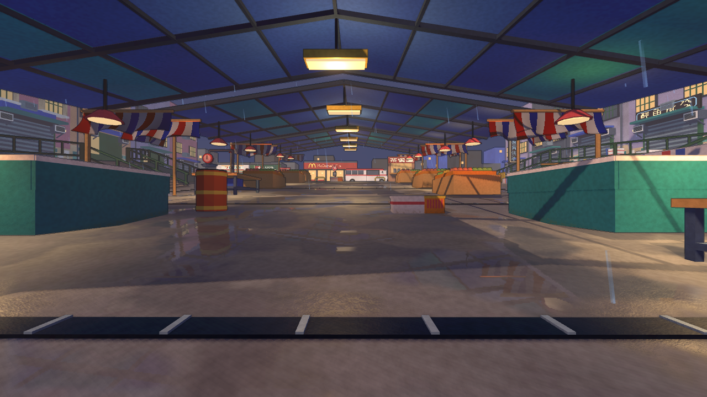

# 雨市光照与材质升级

雨市保留原布局、模型、碰撞、导航、出生点和 60 秒计分玩法，以暖灯、冷色棚布、湿地面和更克制的描边接近概念图。本次未添加道具、修改通道或调整武器规则。

[打开四机位拖动对照](comparison.html)

## 实机结果

以下是同机位 Godot 原生实际渲染，1280 x 720，截图时隐藏 HUD、武器和敌人以比较环境。它们不是概念图。Web 战斗截图另外保留 HUD 与敌人。

| 改造前 | 改造后 |
|---|---|
|  |  |

[原概念图](../../research/fable-rendering-2026-11-11/rain-market-potential.png)

原概念图的光色与潮湿质感已经迁移到实机；精细倒角、堆积杂物、复杂几何与完整间接光仍有差距，本次保留原有低多边形轮廓。

## 具体实现

- 一张确定性生成的 512 x 512 无缝噪声图供涂装、金属、地面、棚布与积水共用；不同尺度控制颜色、粗糙度和低强度法线扰动。材质覆盖仅作用于雨市实例，未修改导入 GLB 的共享资源。
- 调整环境色与现有灯具，补充三个无阴影暖色局部光源；固定灯具附近使用解析漫反射补光和接地暗化。这是廉价近似，不是实时 GI，也不把环境 SSAO/glow 配置视为 Compatibility 画质验收依据。
- 主斜坡用镜像相机绘制真实棚布、摊位和招牌，再以不规则水洼遮罩、Fresnel 和微弱波纹混合。桌面反射宽度 640、最高 30 Hz；触屏宽度 384、最高 20 Hz。
- 反射排除地面、武器、敌人、雨与屏幕效果；侧巷、非共面地面和画面边缘使用解析近似。它不是光追，不能承诺所有地形和动态对象都有准确镜像。
- 原生额外使用一个静态环境探针；反射图集从默认容量收缩至 128 像素、2 个槽位。Web 探针立方体捕获产生过深度 blit 错误，因此 Web 禁用该探针，保留独立平面反射；最终 Web 回合无此错误。
- 仅雨市降低全屏描边强度，切换到其他地图会恢复原参数。原有雨、狂暴灯、可破坏物与 HUD 保留。

## 性能对比

改造前源代码：02a5bc5（分析提交，游戏代码与 88f6940 相同）。基线归档提交：bfe413a。

| 指标 | 改造前 | 改造后 | 解读 |
|---|---:|---:|---|
| 原生平均帧时间 | 6.266 ms | 7.979 ms | +1.713 ms |
| 原生 P95 | 7.053 ms | 9.260 ms | +31.3%，低于 16.67 ms 的 60 FPS 预算 |
| 原生 P99 | 7.627 ms | 9.850 ms | +2.223 ms |
| 原生最大帧间隔 | 14.942 ms | 27.350 ms | 有少量超预算帧，不能声称全程锁帧 |
| 原生平均绘制调用 | 847 | 895 | 反射增加绘制工作 |
| 引擎报告显存 | 138.43 MiB | 151.07 MiB | +12.63 MiB，不是系统级峰值 |
| Web 平均 RAF 间隔 | 17.054 ms | 16.901 ms | 受显示节奏限制，不能据此断言 GPU 更快 |
| Web P95 / P99 | 16.70 / 16.80 ms | 16.80 / 16.80 ms | 典型帧间隔接近 60 Hz |
| Web 最大 RAF 间隔 | 416.7 ms | 183.3 ms | 两版均有长帧 |
| 本地 Web 全目录未压缩字节 | 68,400,011 | 68,580,427 | 增加 180,416 字节，约 0.26% |

原生条件：Apple M5、Godot 4.7.2 Compatibility、实际计时视口 1138 x 640、关闭 VSync 与 FPS 上限；3 秒预热、60 秒相同轨迹相机扫描，8 个冻结敌人，雨与狂暴灯正常运行。它是可重复渲染负载，包含系统调度，不是 GPU timer，也不是完整战斗 CPU 基准。正常阶段 P95 从 7.029 ms 到 9.199 ms；狂暴阶段从 7.088 ms 到 9.414 ms。

Web 条件：同机硬件 Chrome，1280 x 720，60 秒真实回合，固定出生视角持续射击与换弹，两版均进入 RESULTS。RAF 统计不是 GPU 耗时。两版使用新浏览器缓存，但 localhost 加载时间不代表公网下载速度。Web 截图均在 RUNNING 后约 250 ms 捕获，敌人动画与出生状态存在差异。

触屏为同机 Chrome 模拟 844 x 390，15 秒运行，P95/P99 均约 16.8 ms、无脚本和 WebGL 错误；不代表实体手机性能或陀螺仪验证。

原始数据：[原生前](before/performance.json)、[原生后](after/performance.json)、[Web 前](before/web-web.json)、[Web 后](after/web.json)、[触屏模拟](after/touch.json)。

[Web 改造前](before/web-gameplay.png) / [Web 改造后](after/web-gameplay.png) / [触屏布局](after/touch-gameplay.png)

## 验证

以下自动化检查通过，未进行人工试玩验收或十分钟稳定性测试。

- Godot headless editor import。
- `tests/rules_test.gd` 与 `tests/defuse_rules_test.gd`。
- `tests/rain_market_minibus_check.gd`。
- `tests/concept_arenas_check.gd -- rain_market`：本次只验收雨市；全地图长流程提前终止，不计为通过。
- 新增 `tests/rain_market_lookdev_check.gd` 的 headless 与实际渲染运行：共享材质未被污染、碰撞与导航保留、8 个敌人与 60 秒规则、狂暴与重开、触屏反射降档、侧巷回退、切图还原描边与释放镜像。
- 四机位实机截图、原生 60 秒扫描、Web 60 秒回合及 15 秒触屏模拟。
- 四组对照图片加载与拖动分界交互通过浏览器检查。

复测入口：`tools/maps/check_rain_visuals.gd`、`tools/browser/check_rain_market.cjs`。截图和性能原始数据一并保留，不能用概念图代替实机证据。

## 发布

- 发布源提交：`9b663deebc6a4006f6ee878f11e3c650a08c1e07`，构建快照时 `HEAD == origin/main` 且工作区干净。
- [GitHub Pages](https://yicongcao.github.io/No-Art-FPS/)：[构建与部署成功](https://github.com/YicongCao/No-Art-FPS/actions/runs/42985521289)，23 个线上导出文件按清单逐个校验字节数与 SHA-256。
- [自定义域名](https://fps.yicong.me/)：`20261111-v2`，健康检查确认新版。4 个 CDN 原始/Brotli 文件、22 个站点文件校验通过，CORS、Content-Type、压缩、Range 与跳转检查通过。
- 前一版本 `20261111-v1` 及其 CDN 对象均保留。需要回退时通过既有 `publish_fps.py activate 20261111-v1` 工作流切回，无需覆盖发布目录。
- 两个线上入口均使用新浏览器缓存实际进入雨市，持续运行和射击 15 秒，未出现脚本或 WebGL 错误。线上结果用于发布冒烟验证，不与本地 60 秒基准混作性能对比。
- 本次为自动化验证与截图检查，未替代人工手感试玩和实体手机验收。

证据：[Pages 浏览器](release/pages-browser.json)、[Pages 文件校验](release/pages-http.json)、[自定义域名浏览器](release/custom-browser.json)、[自定义域名 HTTP 校验](release/custom-http.json)、[线上实机](release/custom-gameplay.png)。

此后的文档归档提交不改变游戏构建；两站游戏源版本均为上述 `9b663de`。
